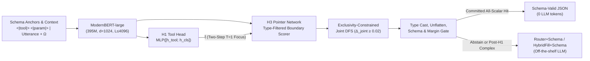

# SpanCall: Not Every Tool Call Needs Generation

[](research_paper/main.tex)
[](MODEL_CARD.md)
[](pyproject.toml)

Official repository for **"Not Every Tool Call Needs Generation: Function Calling as Span Extraction."**

Most function-calling systems decode JSON sequentially even when every argument already appears in the user request, recent dialogue, or schema (**Stratum F**). **SpanCall** is a non-autoregressive extractive alternative built on `answerdotai/ModernBERT-large` (395M) that emits schema-valid JSON in parallel without generation tokens—and pairs cleanly with any off-the-shelf LLM via zero-training routing policies (`Router+Schema` and `HybridFill+Schema`) when a call crosses the extractive boundary (`array`/`object` schemas or abstentions).

---

## Key Highlights

- **Non-autoregressive span extraction (`ModernBERT-large`, 395M):** Jointly encodes `<|tool|>` / `<|param|>` schema anchors (including flattened dotted leaves for nested `object` schemas up to depth 3), the sanitized utterance, and a canonical literal pool $\Omega$ (`<|ctx_meta|>`, `<|ctx_time|>`, `<|ctx_enum|>`, `<|ctx_recent|>`).
- **Two-head encoder + exclusivity-constrained two-step DFS:** Pairs a tool selection head ($H_1$) with a type-filtered, boundary-factorized span pointer ($H_3$, $d_h=256$, $W_{\max}=16$, $C \le 1024$), value probability aggregation across repeated mentions, non-overlapping DFS decoding ($\Delta_{\text{joint}} \ge 0.02$), and two-step $T=1$ re-encoding so accuracy stays flat as candidate tool count grows.
- **Zero-training extractive–generative collaboration:**
  - **`Router+Schema`**: Inspects only the $H_1$-selected tool $\hat{t}$ (zero ground-truth labels) and routes declared `array`/`object` tools and abstentions to the LLM while keeping SpanCall's all-scalar lead.
  - **`HybridFill+Schema`**: Keeps 100% of tool selection on $H_1$ and preserves grounded scalars, invoking the LLM once in plain JSON mode (`tools=[]`, `response_format=json_object`) to fill only unresolved or complex parameters.



---

## Main Results (v3.3 Frozen Benchmarks)

All headline comparisons use the frozen **Tier 1 Matched Fair Eval** (`data/eval_v3_3/`, $n=1{,}735$ single-call turns per corpus, $n_F=1{,}277$ Stratum F [1,108 Normal + 169 Complex], $n_A=458$ Stratum A [286 clean + 172 adversarial]), evaluated with 10,000-resample paired bootstrap 95% CIs. SpanCall runs locally on a Google Colab A100 (batch 8, two-step decoding); baseline LLMs run zero-shot (`temperature=0.0`, `tool_choice=auto`) via Novita AI's OpenAI SDK.

### 1. Tier 1 Fair Eval: Standalone & Zero-Training LLM Collaboration

| System | Hermes `exact_F` | xLAM `exact_F` | **Macro `exact_F`** | Macro Complex `exact_F` | `false_hit_A` ↓ | Mean Latency (ms) | Mean API Tokens / Turn |
| :--- | :---: | :---: | :---: | :---: | :---: | :---: | :---: |
| **SpanCall (standalone)** | `.743` | `.766` | **`.755`** | `.331` | **`.664`** | **77.0** | **0** |
| *`google/gemma-4-26b-a4b-it`* | | | | | | | |
| LLM-only | `.390` | `.778` | `.584` | **`.754`** | `.895` | 7025.6 | 443 |
| Router (abstention) | `.801` | `.815` | `.808` | `.379` | `.975` | **1364.0** | **88** |
| **Router+Schema** | **`.826`** | **`.889`** | **`.857`** | **`.754`** | `.956` | 2565.6 | 179 |
| HybridFill | `.805` | `.796` | `.800` | `.364` | `.927` | 2958.7 | 225 |
| HybridFill+Schema | `.822` | `.866` | `.844` | `.698` | **`.853`** | 4721.4 | 345 |
| *`openai/gpt-oss-120b`* | | | | | | | |
| LLM-only | `.420` | `.777` | `.598` | **`.746`** | `.879` | 2986.7 | 500 |
| Router (abstention) | `.800` | `.814` | `.807` | `.376` | `.965` | **657.2** | 102 |
| **Router+Schema** | `.821` | **`.889`** | **`.855`** | **`.746`** | `.936` | 1151.1 | 200 |
| HybridFill | `.805` | `.797` | `.801` | `.367` | `.931` | 809.0 | **100** |
| HybridFill+Schema | **`.823`** | `.871` | `.847` | `.710` | **`.862`** | 1446.5 | 177 |

- Standalone **SpanCall** beats `gemma-4-26b` by **+35.3 pp** and `gpt-oss-120b` by **+32.3 pp** on Hermes while statistically tying both on xLAM, at **38.8×–91.3×** lower wall-clock latency and **0** generation tokens, with **0** duplicate-span collapse and **4×–19×** fewer entity swaps.
- **Router+Schema** lifts macro exact match to **0.855–0.857** (**0.889** on xLAM, +11.1–11.2 pp over either LLM) while cutting API tokens by **~60%**.
- **HybridFill+Schema** trims multi-tool xLAM prompt tokens by **38%–61%**, cuts Stratum A false calls below both standalone LLMs (**0.853–0.862**), and on concise-reasoning `gpt-oss-120b` reduces total tokens a further **11.4%** below `Router+Schema` (**64.5%** total reduction vs. LLM-only).

### 2. Extractive Boundary: Normal (All-Scalar) vs. Complex (`array`/`object`)

| Corpus | Schema Type | $n_F$ | **SpanCall** | `gemma-4-26b` | `gpt-oss-120b` |
| :--- | :--- | ---: | :---: | :---: | :---: |
| Hermes | Normal (all-scalar) | 1,108 | **`.798`** | `.360` | `.397` |
| Hermes | Complex (`array`/`object`) | 169 | `.385` | **`.586`** | `.568` |
| xLAM | Normal (all-scalar) | 1,108 | **`.840`** | `.755` | `.755` |
| xLAM | Complex (`array`/`object`) | 169 | `.278` | **`.923`** | **`.923`** |

### 3. Tier 2 Full Splits: Zero-Shot OOD & Adversarial Generalization (34,969 Rows)

| Split (Tier 2 Full) | $n$ | $n_F$ | `exact_F` | `hit_F` | `param_F1` | `false_hit_A` | Mean Latency (ms) |
| :--- | ---: | ---: | :---: | :---: | :---: | :---: | :---: |
| Hermes ID eval | 1,829 | 1,367 | `.708` | `.873` | `.776` | `.636` | 127.6 |
| xLAM ID eval | 6,811 | 4,571 | `.757` | `.871` | `.793` | `.661` | 46.9 |
| Hermes OOD-Schema | 1,599 | 1,204 | `.711` | `.835` | `.774` | `.648` | 89.6 |
| xLAM OOD-Schema | 7,227 | 5,010 | **`.799`** | **`.887`** | `.753` | `.714` | 43.2 |
| Hermes OOD-Para | 1,342 | 1,341 | `.735` | `.834` | `.779` | `1.00` | 87.4 |
| xLAM OOD-Para | 6,876 | 6,868 | **`.793`** | `.880` | `.780` | `.875` | 38.7 |
| Hermes Adversarial | 4,285 | 0 | — | — | — | `.816` | 164.6 |
| xLAM Adversarial | 5,000 | 0 | — | — | — | `.788` | 48.3 |

---

## Installation

```bash
python -m venv .venv
source .venv/bin/activate
pip install -e ".[model,data,agent,dev]" huggingface_hub openai
```

Run the test suite to verify the environment:

```bash
pytest -q
```

---

## Quickstart: SpanCall + LLM in a few lines

```python
from spancall import SpanCallLLM

caller = SpanCallLLM.from_pretrained(
    "convoicon/spancall-lean-v3-3",          # Hub repo or local checkpoint dir
    policy="router_schema",                   # see policy table below
    base_url="https://api.openai.com/v1",     # any OpenAI-compatible endpoint
    api_key="sk-...",                         # or set BASE_URL / API_KEY env vars
    model="gpt-4o-mini",
)

tools = [{                                    # OpenAI function dicts or ToolDefinition
    "type": "function",
    "function": {
        "name": "search_flights",
        "description": "Search available flights",
        "parameters": {"type": "object", "properties": {
            "origin": {"type": "string", "description": "Departure city"},
            "destination": {"type": "string", "description": "Arrival city"},
            "date": {"type": "string", "format": "date", "description": "Travel date"},
            "nonstop": {"type": "boolean", "description": "Direct flights only"},
        }, "required": ["origin", "destination", "date"]},
    },
}]

out = caller("Flights from Hanoi to Da Nang tomorrow, direct only", tools, now="2026-10-23")
print(out.hit, out.tool_name, out.arguments)   # arguments is a dict
print(out.source, out.llm_called, out.latency_ms, out.prompt_tokens + out.completion_tokens)
# source: "spancall" (0 LLM tokens) | "llm" | "spancall+llm_fill"
```

Switch policy per call with `caller(..., policy="hybrid_fill_schema")`. All policies are zero-training and share their routing/merge code with the paper's evaluation (`spancall/eval/hybrid_fill.py`):

| `policy=` | Behavior |
| :--- | :--- |
| `llm_only` | LLM answers every turn (baseline; no SpanCall model loaded). |
| `spancall_only` | SpanCall only; abstentions return `hit=False`. |
| `router` | SpanCall first; full LLM call only when it abstains. |
| `router_schema` *(default)* | Like `router`, but tools declaring an `array`/`object` parameter go to the LLM (decided after $H_1$ picks the tool; no labels). |
| `hybrid_fill` | On abstention keep $H_1$'s tool and grounded scalars; LLM fills only the rest via plain JSON (no `tools=`). |
| `hybrid_fill_schema` | Same, also for complex-schema tools. |

Bring your own pieces if you prefer: `load_resolver(path_or_repo)` returns a ready `LeanResolver` (weights loaded with `weights_only=True`), and `SpanCallLLM(resolver, llm_client, model, policy)` accepts any OpenAI-SDK-shaped client. Nested `object` parameters supplied as OpenAI dicts are treated as complex (not decomposed), so under `*_schema` policies they are delegated to the LLM.

---

## Reproducing the v3.3 Paper Experiments

1. **Build the frozen Tier 1 & Tier 2 evaluation suite (`data/eval_v3_3/`):**
   ```bash
   python scripts/build_fair_eval_v3_3.py --data-dir data/processed_v3_3 --out-dir data/eval_v3_3
   ```
2. **Train & evaluate SpanCall v3.3 (Colab A100 notebook):**
   - Notebook: [`notebooks/spancall_lean_v3_3_train_eval.ipynb`](notebooks/spancall_lean_v3_3_train_eval.ipynb) (generated by [`scripts/build_lean_v3_3_train_eval_notebook.py`](scripts/build_lean_v3_3_train_eval_notebook.py)).
   - Trains `answerdotai/ModernBERT-large` on the 1:1 balanced Hermes V1 + xLAM-60k pool (138,824 records → 117,760 tensorized instances) for 3 epochs (`bf16`, effective batch 128, seed 42), evaluates all frozen Tier 1 + Tier 2 splits, and writes `results/v3_3/`.
3. **Run hosted-LLM baselines (`LLM-only`) and the abstention `Router` merge:**
   ```bash
   cp .env.example .env   # set BASE_URL, API_KEY, BASE_LLM_MODEL
   python scripts/eval_llm_local.py --config configs/llm_eval_v3_3.yaml
   ```
4. **Run plain-JSON partial-fill collaboration (`HybridFill`, `HybridFill+Schema`):**
   ```bash
   python scripts/eval_hybrid_fill.py --config configs/llm_eval_v3_3.yaml --eval-dir data/eval_v3_3 --results-dir results/v3_3
   ```

> [!NOTE]
> Whole-call **`Router+Schema`** rows are produced by `eval_hybrid_fill.py` (via `merge_router_schema`), but `export_v3_3_results.py` / `final_report.md` do not yet include them; the paper tables for those rows are not in the audited export.

5. **Audit & export paper tables (`results/v3_3/export/`):**
   ```bash
   python scripts/export_v3_3_results.py \
     --eval-dir data/eval_v3_3 \
     --results-dir results/v3_3 \
     --out-dir results/v3_3/export \
     --bootstrap-n 10000
   ```
6. **Build the paper PDF:**
   ```bash
   cd research_paper && make
   ```

---

## Repository Layout & Documentation Index

| Path | Description |
| :--- | :--- |
| [`MODEL_CARD.md`](MODEL_CARD.md) | Hugging Face model card for `convoicon/spancall-lean-v3-3` (architecture, loading, metrics, limitations) |
| [`research_paper/`](research_paper/README.md) | ACL-format LaTeX source (`main.tex`, `sections/`, `figures/`, `Makefile`) |
| [`PROJECT_STATE.md`](PROJECT_STATE.md) | Current v3.3 project snapshot, invariants, component status, and roadmap |
| [`docs/architecture.md`](docs/architecture.md) | Codebase layout, module contracts, data flow, and CLI reference |
| [`docs/heads.md`](docs/heads.md) | Specification of active $H_1$ tool heads and $H_3$ boundary-factorized pointer head |
| [`docs/experiments.md`](docs/experiments.md) | Experiment ledger covering v2, v3, and completed v3.3 paper benchmarks |
| [`docs/proposal.md`](docs/proposal.md), [`docs/mechanism.md`](docs/mechanism.md), [`docs/pipeline_io.md`](docs/pipeline_io.md) | Original pre-implementation design & template specifications (historical reference) |
| [`span_template/`](span_template/) | Unified marker grammar (`template_multi.jinja`), parser, R7 sanitizer, cryptographic template stamp |
| [`spancall/combine.py`](spancall/combine.py), [`spancall/hub.py`](spancall/hub.py) | Public one-call API (`SpanCallLLM`, 6 policies) and safe Hub/local loader (`load_resolver`) |
| [`spancall/lean/`](spancall/lean/) | Active model (`LeanSpanCallModel`), loss, tensorizer, trainer, exclusivity DFS decoder, two-step resolver |
| [`spancall/eval/`](spancall/eval/) | `ToolCallEvaluator`, `llm_parity.py`, `hybrid_fill.py`, paired bootstrap CIs, agentic evaluators |
| [`spancall/agent/`](spancall/agent/) | Version-agnostic `ToolCallRouter`, `ReActAgentLoop`, `fill.py`, LLM backends, mock environments |
| [`results/v3_3/export/`](results/v3_3/export/final_report.md) | Frozen v3.3 audit report, benchmark tables, and LaTeX exports |

---

## Citation

```bibtex
@misc{spancall2026,
  title  = {Not Every Tool Call Needs Generation: Function Calling as Span Extraction},
  author = {Anonymous Submission},
  year   = {2026},
  note   = {Preprint}
}
```
