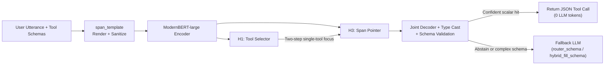

# Developer Onboarding Walkthrough

Welcome to **SpanCall** (`spancall`). This guide walks you through how the system works, where the code lives, how a single request flows end-to-end, and the main invariants to keep in mind when making changes.

---

## 1. Mental Model (30 Seconds)

Standard function-calling LLMs generate JSON token by token, even when every argument is already sitting in the user's message, recent conversation, or tool schema.

**SpanCall** treats those groundable tool calls as **span extraction** instead of generation:
1. It packs the candidate tool schemas, the user utterance, and a small context pool (booleans, resolved dates, schema enums, recent tool outputs) into one encoder sequence (`ModernBERT-large`, 395M).
2. A **tool head (`H1`)** picks the tool, and a **pointer head (`H3`)** points to the exact start/end span for each parameter in parallel.
3. A **joint decoder** prevents duplicate/overlapping assignments, casts strings to strict JSON types, and validates against the tool's schema.
4. If SpanCall abstains—or if the selected tool requires complex `array`/`object` arguments—a zero-training **collaboration policy** (`router_schema` or `hybrid_fill_schema`) hands off cleanly to an off-the-shelf LLM.



---

## 2. Local Setup & Verification

Requires Python 3.10+.

```bash
python -m venv .venv
source .venv/bin/activate
pip install -e ".[model,data,agent,dev]" huggingface_hub openai
```

Run the test suite to verify your setup:

```bash
pytest -q
```

For quick feedback while editing a specific area, run targeted tests:

```bash
pytest -q tests/test_combine_api.py tests/test_lean_flow.py
```

---

## 3. Quickstart in Python

### SpanCall + LLM (Recommended Entry Point)

The public one-call API is `SpanCallLLM` in `spancall/combine.py`:

```python
from spancall import SpanCallLLM

caller = SpanCallLLM.from_pretrained(
    "convoicon/spancall-lean-v3-3",      # Hugging Face repo or local checkpoint dir
    policy="router_schema",               # default policy
    base_url="https://api.openai.com/v1", # any OpenAI-compatible endpoint
    api_key="sk-...",                     # or set BASE_URL / API_KEY env vars
    model="gpt-4o-mini",
)

tools = [{
    "type": "function",
    "function": {
        "name": "search_flights",
        "description": "Search available flights",
        "parameters": {
            "type": "object",
            "properties": {
                "origin": {"type": "string"},
                "destination": {"type": "string"},
                "date": {"type": "string", "format": "date"},
                "nonstop": {"type": "boolean"},
            },
            "required": ["origin", "destination", "date"],
        },
    },
}]

out = caller("Flights from Hanoi to Da Nang tomorrow, direct only", tools, now="2026-10-23")
print(out.hit, out.tool_name, out.arguments)
print(out.source, out.llm_called, out.latency_ms)
```

Available policies (pass to `from_pretrained(..., policy=...)` or override per call):

| Policy | Behavior |
| :--- | :--- |
| `llm_only` | Always calls the LLM (baseline; skips loading SpanCall). |
| `spancall_only` | Runs SpanCall only; returns `hit=False` on abstention. |
| `router` | Runs SpanCall first; calls the LLM with all tools only if SpanCall abstains. |
| `router_schema` *(default)* | Like `router`, but also delegates to the LLM if the selected tool declares `array`/`object` parameters. |
| `hybrid_fill` | On abstention, keeps SpanCall's selected tool and grounded scalar args, then asks the LLM for the missing args via plain JSON (`tools=[]`). |
| `hybrid_fill_schema` | Same as `hybrid_fill`, also triggered for complex `array`/`object` tools. |

### SpanCall Standalone (No LLM)

```python
from spancall import load_resolver

resolver = load_resolver("convoicon/spancall-lean-v3-3")
res = resolver.try_resolve_candidates(
    candidate_schemas=[...],  # list of ToolDefinition objects
    utterance="Flights from Hanoi to Da Nang tomorrow, direct only",
    now="2026-10-23",
)
print(res.hit, res.tool_name, res.arguments)
```

---

## 4. Codebase Map

| Path | Responsibility | Key Files to Start With |
| :--- | :--- | :--- |
| `span_template/` | Single source of truth for prompt/sequence formatting, marker parsing, input sanitization, and template hashing | `template.py`, `parser.py`, `sanitize.py`, `stamp.py` |
| `spancall/combine.py` | Public `SpanCallLLM` wrapper and 6 routing/fill policies | `combine.py` |
| `spancall/hub.py` | Safe checkpoint loader (`load_resolver`, `weights_only=True`, attention/dtype selection) | `hub.py` |
| `spancall/data/` | Unified data schema, dataset loaders (Hermes, xLAM, etc.), reverse span alignment, object flattening, augmentation, splitting | `schema.py`, `align.py`, `flatten.py`, `sources/` |
| `spancall/model/` | Shared encoder wrapper, tool heads (`H1`), and type-filtered candidate span mask builder | `encoder.py`, `heads.py`, `masks.py` |
| `spancall/lean/` | Active v3.3 model (`LeanSpanCallModel`), pointer head (`H3`), loss, tensorizer, trainer, joint decoder, two-step resolver | `model.py`, `resolver.py`, `decode.py`, `tensorize.py`, `trainer.py` |
| `spancall/infer/` | Version-agnostic resolver/decoder ABCs, strict type casting, JSON schema validation, clock helpers | `base.py`, `cast.py`, `clock.py` |
| `spancall/train/` | Shared training config dataclasses and `BaseTrainer` / LR schedule boilerplate | `config.py`, `base.py` |
| `spancall/agent/` | Multi-turn agent router (`ToolCallRouter`), ReAct loop, LLM backend adapters, mock tool environments | `router.py`, `loop.py`, `backends/` |
| `spancall/eval/` | Tool-call & agentic evaluators, LLM parity runners, hybrid-fill merge logic, cost/latency metrics | `hybrid_fill.py`, `llm_parity.py`, `toolcall/evaluator.py` |
| `scripts/` | Thin CLI entry points (argument parsing + calling library code) | `train_lean.py`, `eval_toolcall.py`, `eval_llm_local.py`, `eval_hybrid_fill.py`, `probe.py` |
| `configs/` | YAML configs for training and LLM evaluation | `default.yaml`, `llm_eval_v3_3.yaml` |
| `tests/` | Unit and integration tests covering every layer | `test_combine_api.py`, `test_lean_flow.py`, `test_v3_3_pipeline.py` |

---

## 5. Tracing One Request End-to-End

When you call `caller(utterance, tools, now="2026-10-23")`, here is the exact path through the codebase:

1. **Coerce Tools (`spancall/combine.py`)**
   - `coerce_tools()` normalizes OpenAI function dicts (or `ToolDefinition` instances) into internal `ToolDefinition` / `ParameterSchema` objects (`spancall/data/schema.py`).
2. **Render & Sanitize (`span_template/template.py`)**
   - `build_input_multi()` sanitizes the user utterance (preventing spoofed special markers via `sanitize.py`), builds the literal context pool (`<|ctx_meta|>`, `<|ctx_time|>`, `<|ctx_enum|>`, `<|ctx_recent|>`), and renders the Jinja template (`template_multi.jinja`).
   - `parser.py` extracts the character offsets of every `<|tool|>`, `<|param|>`, and context anchor.
3. **Encode & Two-Step Resolve (`spancall/lean/resolver.py`)**
   - **Step 1:** `SpanCallTransformerEncoder` (`spancall/model/encoder.py`) encodes all candidate tools + utterance. The tool head (`ToolHead` in `spancall/model/heads.py`) selects the top tool.
   - **Step 2 (`two_step` mode):** `LeanResolver` re-encodes a compact single-tool sequence for the winning tool so the full candidate span budget (up to 1024 spans) is dedicated to that tool's parameters.
4. **Candidate Masking & Pointer Scoring (`spancall/model/masks.py`, `spancall/lean/model.py`)**
   - `CandidateMaskBuilder` enumerates valid spans (up to width 16) and pre-filters them by parameter type (e.g., enums only match enum slots, dates match calendar slots).
   - `LeanPointerHead` scores every `(param, candidate_span)` pair in parallel.
5. **Joint Decoding & Gating (`spancall/lean/decode.py`, `spancall/infer/cast.py`)**
   - `LeanJointDecoder` aggregates probability mass across repeated mentions of the same value, runs exclusivity-constrained search so two parameters do not collapse onto the same span, and checks the joint confidence margin (`min_joint_margin`).
   - `StrictTypeCaster` and `SchemaValidator` cast the extracted text to the declared JSON types and validate required fields and schema constraints.
6. **Policy Decision & Fallback (`spancall/combine.py`, `spancall/eval/hybrid_fill.py`)**
   - If SpanCall commits a valid scalar call, it returns immediately (`source="spancall"`, 0 LLM tokens).
   - Otherwise—or if the selected tool has `array`/`object` parameters under `*_schema`—`SpanCallLLM` delegates to the configured OpenAI-compatible LLM (`source="llm"` or `"spancall+llm_fill"`).

---

## 6. Common Developer Workflows

### Inspect a Checkpoint on Custom Prompts
Use `scripts/probe.py` to interactively test or inspect predictions from a local checkpoint.

### Run Local LLM & HybridFill Evaluations
Copy `.env.example` to `.env`, set `BASE_URL`, `API_KEY`, and `BASE_LLM_MODEL`, then run:

```bash
python scripts/eval_llm_local.py --config configs/llm_eval_v3_3.yaml
python scripts/eval_hybrid_fill.py --config configs/llm_eval_v3_3.yaml --eval-dir data/eval_v3_3 --results-dir results/v3_3
```

### Add a New Model Version or Resolver
The agent router (`spancall/agent/`) and evaluators (`spancall/eval/`) depend only on the abstract base classes in `spancall/infer/base.py` (`BaseResolver`, `BaseResolveResult`, `BaseJointDecoder`). Subclass `BaseResolver` to plug a new model in without touching router or eval code.

### Add a New Dataset Source
Subclass `BaseDatasetLoader` (`spancall/data/base.py`) under `spancall/data/sources/` to emit `UnifiedSample` records (`spancall/data/schema.py`). From there, `ReverseAligner`, `DataAugmenter`, and `tensorize_sample_lean` work out of the box.

---

## 7. Key Invariants & Gotchas

- **One render path for train and serve:** Both offline alignment (`spancall/data/align.py`) and online inference (`spancall/lean/resolver.py`) call `span_template.template.build_input_multi`. If you change the template or marker grammar, `span_template/stamp.py` will intentionally flag stale data splits until they are re-aligned.
- **Atomic special markers:** Marker tokens (`<|tool|>`, `<|param|>`, `<|ctx_*|>`) are registered via `encoder.add_marker_tokens(...)` so the tokenizer never splits them into subwords.
- **Keep prediction heads in `fp32`:** `load_resolver()` in `spancall/hub.py` may cast the encoder backbone to `bf16`/`fp16` (for FlashAttention-2 / speed), but intentionally keeps `tool_head` and `pointer_head` in `fp32` so the tight `min_joint_margin = 0.02` abstention gate stays calibrated.
- **Safe weight loading:** Checkpoints are exported as a plain `state_dict` (`model.pt`) plus `resolve_config.json` and loaded with `weights_only=True`.
- **Keep `scripts/` thin:** Put reusable logic in `spancall/` with unit tests in `tests/`, and keep `scripts/` to CLI argument parsing and wiring.
- **Lightweight top-level import:** `spancall/__init__.py` uses lazy `__getattr__` exports so `import spancall` does not import `torch` until needed.

---

## 8. Suggested Reading Order

If you want to understand the whole codebase quickly, read these 5 files in order:

1. [`spancall/data/schema.py`](spancall/data/schema.py) — core data types (`UnifiedSample`, `ToolDefinition`, `ParameterSchema`, `SpanTarget`)
2. [`span_template/template.py`](span_template/template.py) — how tools, utterance, and context are serialized
3. [`spancall/lean/model.py`](spancall/lean/model.py) — `LeanSpanCallModel` and `LeanPointerHead`
4. [`spancall/lean/resolver.py`](spancall/lean/resolver.py) — end-to-end two-step inference and gating
5. [`spancall/combine.py`](spancall/combine.py) — public `SpanCallLLM` API and LLM fallback policies

For deeper design details, see [`docs/architecture.md`](docs/architecture.md), [`docs/heads.md`](docs/heads.md), and [`PROJECT_STATE.md`](PROJECT_STATE.md).
