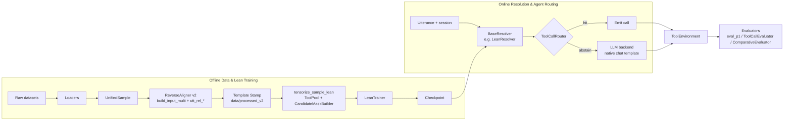

# Codebase Architecture & Research Plan

Describes the repository structure, module contracts, data flow, evaluation methodology, and experiment protocol for SpanCall (**Lean v3.3**, aligned with [research_paper/main.tex](../research_paper/main.tex)). It complements the companion docs:

| Doc | Scope |
| --- | --- |
| [README.md](../README.md) | Paper overview, headline v3.3 results, quickstart & reproduction |
| [MODEL_CARD.md](../MODEL_CARD.md) | Pretrained `convoicon/spancall-lean-v3-3` model card |
| [PROJECT_STATE.md](../PROJECT_STATE.md) | Current v3.3 snapshot, invariants, component status, roadmap |
| [heads.md](heads.md) | Active prediction heads ($H_1$ Tool + $H_3$ Lean Pointer) |
| [experiments.md](experiments.md) | Experiment ledger (v2, v3, and completed v3.3 paper results) |
| [param_extraction_eval_coverage.md](param_extraction_eval_coverage.md) | Retrieval-first contract & honest Part-1/Part-3 metrics |
| [proposal.md](proposal.md), [mechanism.md](mechanism.md), [pipeline_io.md](pipeline_io.md) | Original pre-implementation design & template specs (historical reference) |
| **this doc** | Codebase layout, shareable boilerplate contracts, Lean v3.3 workflows |

> [!NOTE]
> **Architecture Principle — Lean Core + Pluggable Boilerplate:**
> `span_template/`, `spancall/data/`, `spancall/model/{encoder,masks,heads}.py`, `spancall/infer/{base,cast,clock,export}.py`, `spancall/train/{base,config}.py`, `spancall/eval/`, and `spancall/agent/` provide **version-agnostic ABCs and shared utilities**. Concrete model/training/decoding/resolution versions (`spancall/lean/`) implement these contracts (`BaseResolver`, `BaseTrainer`, `BaseJointDecoder`, `BaseHead`) so new versions drop into the agent router and evaluation harnesses with zero friction.

---

## 1. Research Framing (Current Paper)

**Claim:** A non-autoregressive bidirectional pointer architecture (`ModernBERT-large`, 395M) with an anchor-conditioned tool head ($H_1$), a type-filtered boundary-factorized pointer head ($H_3$), and exclusivity-constrained two-step DFS resolves groundable tool calls (**Stratum F**, especially **Normal** all-scalar calls) in parallel without generation tokens. For **Complex** (`array`/`object`) schemas or ungroundable/abstained turns (**Stratum A**), two zero-training collaboration policies (**Router+Schema** and **HybridFill+Schema**) hand off cleanly to any off-the-shelf LLM.

**Systems compared on Tier 1 Fair Eval (`data/eval_v3_3/`):**

| System | Role |
| --- | --- |
| **SpanCall (standalone)** | `ModernBERT-large` (395M), two-step decoding, 0 LLM tokens |
| **LLM-only** | Zero-shot `google/gemma-4-26b-a4b-it` and `openai/gpt-oss-120b` (`tool_choice=auto`) |
| **Router / Router+Schema** | Abstention-only or post-$H_1$ complex-schema whole-call LLM routing |
| **HybridFill / HybridFill+Schema** | $H_1$ tool selection + grounded scalars + plain-JSON LLM partial completion (`tools=[]`) |

---

## 2. Repository Layout

```text
multi_span_tool_calling/
├── README.md                      # Paper overview, headline results, reproduction guide
├── MODEL_CARD.md                  # Hugging Face model card for convoicon/spancall-lean-v3-3
├── PROJECT_STATE.md               # Current v3.3 snapshot & component status
├── pyproject.toml
├── configs/
│   ├── default.yaml               # Base Lean training/model/agent config
│   └── llm_eval_v3_3.yaml         # Local multi-model LLM evaluation registry
├── data/
│   ├── processed_v3_3/            # Re-aligned v3.3 Hermes & xLAM splits + template_stamp.json
│   └── eval_v3_3/                 # Frozen Tier 1 Fair Eval & Tier 2 Full Splits + manifest.json (SHA256)
├── docs/                          # Architecture, heads, experiments ledger, historical design specs
├── research_paper/                # ACL LaTeX paper (main.tex, sections/, figures/, Makefile)
├── results_lean_v3_3/             # Audited v3.3 predictions, metrics, and LaTeX/MD exports
├── span_template/                 # Shared grammar: render, parse, sanitize (R7), template stamp
│   ├── template.py                #   build_input_multi / resolve_utterance_span / gate_tool_call
│   ├── parser.py                  #   marker grammar → extraction legend
│   ├── sanitize.py                #   P0/P1 normalization + R7 marker rejection
│   ├── stamp.py                   #   Cryptographic template-hash stamp verification
│   ├── template_multi.jinja       #   Unified multi-tool marker template
│   └── test_template.py           #   Golden render/parse + R7 fixtures
├── spancall/
│   ├── combine.py                 # Public one-call API: SpanCallLLM (6 policies), CombinePolicy, coerce_tools
│   ├── hub.py                     # Safe Hub/local checkpoint loader (load_resolver, weights_only=True)
│   ├── data/                      # §4 Shared ingestion (Hermes, xLAM), alignment, object flattening, splits
│   ├── model/                     # §5.1 Shared encoder, candidate masks, BaseHead, ToolHead, BinaryToolHead
│   ├── train/                     # §5.2 Shared TrainingConfig + BaseTrainer / BaseCalibrator / CosineWarmupSchedule
│   ├── infer/                     # §6.1 Shared BaseResolver / BaseResolveResult / BaseJointDecoder, StrictTypeCaster, clock
│   ├── lean/                      # §5.3 & §6.2 Lean model, loss, tensorizer, trainer, exclusivity DFS decoder, two-step resolver
│   ├── agent/                     # §7 Pluggable ToolCallRouter, ReActAgentLoop, fill.py, backends, mock tools
│   └── eval/                      # §8 ToolCallEvaluator, llm_parity.py, hybrid_fill.py, ComparativeEvaluator, CostModel
├── scripts/                       # Thin CLIs (build_fair_eval_v3_3, eval_llm_local, eval_hybrid_fill, export_v3_3_results, etc.)
├── notebooks/
│   └── spancall_lean_v3_3_train_eval.ipynb
└── tests/                         # Unit & integration tests across template, data, lean, infer, agent, eval, v3.3 pipeline
```

Design rules:
1. **One code path for train and serve** for render -> parse -> tokenize (`span_template` `build_input_multi` is the single source of truth, guarded by `span_template/stamp.py`).
2. **Scripts hold no logic**: they parse args and call library code.
3. **Interfaces first**: each stage exposes a lightweight ABC (`BaseResolver`, `BaseTrainer`, `BaseJointDecoder`, `BaseHead`, `BaseEncoder`, `BaseDatasetLoader`, `BaseLLMBackend`) so new model versions plug into `ToolCallRouter` and evaluators without glue rewrites.
4. **Config-driven**: every experiment is reproducible from a YAML + seed + template stamp.

---

## 3. End-to-End Data Flow



---

## 4. Data Processing (`spancall/data/`)

### 4.1 Unified record ([schema.py](../spancall/data/schema.py))

| Type | Purpose |
| --- | --- |
| `UnifiedSample` | Canonical record: utterance, tools, GT calls, recent context, clock, stratum, target spans, split |
| `ToolDefinition` | Tool spec: `name`, `description`, `parameters`, `risk_tier` (per tool) |
| `ParameterSchema` | Per-param spec: `param_type`, `enum`, `default`, `required`, `entity_class` (exclusivity group) |
| `GroundTruthCall` | Reference call (tool + arguments) |
| `SpanTarget` | Per-param target: utterance span (`char_start`/`char_end` + render-invariant `utt_rel_start`/`utt_rel_end`), recent ctx, time/enum/bool ctx, or unresolved |
| `Stratum` | `F` (fully groundable) / `A` (abstention negative) |
| `Split` | `train, dev, calib, test_id, test_ood_schema, test_ood_para, test_adversarial` |

### 4.2 Components (All Kept & Shareable)

| Module | Contract |
| --- | --- |
| [base.py](../spancall/data/base.py) | `BaseDatasetLoader.load()`, `BaseAligner.align()`, `BaseAugmenter.augment()` |
| [sources/](../spancall/data/sources) | **Hermes** (`HermesLoader`, all 5 configs of `NousResearch/hermes-function-calling-v1`) + shareable loader boilerplate shells (`xLAM`, `Glaive`, `ToolBench`, `BFCL`, `tau-bench`) |
| [align.py](../spancall/data/align.py) | `ReverseAligner`: renders with `build_input_multi`, aligns GT args to utterance (`utt_rel_*`) + CTX entries, idempotent `target_spans` emission |
| [augment.py](../spancall/data/augment.py) | `DataAugmenter`: shuffles, clock randomization, entity swaps, distractors, adversarial markers |
| [mix.py](../spancall/data/mix.py) | `DatasetMixer`: 55/20/10/15 stratified mix, `partition_by_schema`, 7-way `finalize_splits` |
| [partition.py](../spancall/data/partition.py) | `partition_schema_disjoint` (zero-shot OOD-schema split), `write_splits_jsonl` |

---

## 5. Model and Training (`spancall/model/`, `spancall/train/`, `spancall/lean/`)

### 5.1 Shared Model Primitives (`spancall/model/`)

| Module | Contract | Spec |
| --- | --- | --- |
| [encoder.py](../spancall/model/encoder.py) | `BaseEncoder`, `SpanCallTransformerEncoder`; registers marker special tokens | mechanism §3.2, §4 |
| [heads.py](../spancall/model/heads.py) | `BaseHead` (ABC), `ToolHead` (H1 softmax over `<|tool|>`/`<|none|>`), `BinaryToolHead` (H1 independent per-anchor sigmoid BCE) | heads.md §3 |
| [masks.py](../spancall/model/masks.py) | `CandidateMaskBuilder`: P4 type pre-filter, R8 entry snapping, R9 enum masks, stratified candidate packing | mechanism §3.4, pipeline_io P4 |

### 5.2 Shared Training Config & Boilerplate (`spancall/train/`)

| Module | Contract |
| --- | --- |
| [config.py](../spancall/train/config.py) | `TrainingConfig`, `ModelConfig`, `OptimizationConfig`, `DataConfig`, `AgentConfig` |
| `base.py` | `BaseTrainer` (`train`, `evaluate`, `save_checkpoint`, `load_checkpoint`), `BaseCalibrator`, `CosineWarmupSchedule` |

### 5.3 Lean Model & Training Stack (`spancall/lean/`)

| Module | Contract |
| --- | --- |
| [model.py](../spancall/lean/model.py) | `LeanPointerHead` (0-indexed candidate span scorer over `(B, K, C)`, no abstain logit collapse), `LeanSpanCallModel` (`encoder` + `tool_head` / `binary_tool_head` + `pointer_head`) |
| [loss.py](../spancall/lean/loss.py) | `LeanLossContainer`: multi-positive pointer cross-entropy (`PAD_INDEX = -1` ignored) + multi-call/single-call softmax or binary BCE tool loss |
| [tensorize.py](../spancall/lean/tensorize.py) | `tensorize_sample_lean`, `ToolPool` (`jitter_pack_tools`), `LeanBatchCollate` |
| [trainer.py](../spancall/lean/trainer.py) | `LeanTrainer(BaseTrainer)`: length-bucketed micro-batching, slot-weighted `_MicroLossAccumulator`, differential LR + layerwise decay, optional LoRA, early stopping |

---

## 6. Inference & Pluggable Resolver Contract (`spancall/infer/`, `spancall/lean/`)

### 6.1 Shared Inference Boilerplate (`spancall/infer/`)

| Module | Contract | Spec |
| --- | --- | --- |
| `base.py` | `BaseResolver` (ABC: `try_resolve`, `try_resolve_candidates`, `from_checkpoint`), `BaseResolveResult`, `BaseJointDecoder`, `NoOpResolver`, `ScriptedResolver`, `FakeTokenizer` | Pluggable contract for `spancall/agent/` and future versions |
| [cast.py](../spancall/infer/cast.py) | `BaseTypeCaster`, `StrictTypeCaster` (Q4/Q5 strict typed cast from char offsets), `SchemaValidator` (Q6) | pipeline_io Q4–Q6 |
| [clock.py](../spancall/infer/clock.py) | `local_today`, `tz_offset_minutes` | pipeline_io P2 |
| [export.py](../spancall/infer/export.py) | `BaseExporter` (ONNX / quantization interface) | mechanism §10 |

### 6.2 Lean Inference & Evaluation (`spancall/lean/`)

| Module | Contract |
| --- | --- |
| [decode.py](../spancall/lean/decode.py) | `LeanJointDecoder(BaseJointDecoder)`: equal-value probability aggregation (R4), top-K collapse, exclusivity-constrained DFS assignment + `joint_margin` |
| [resolver.py](../spancall/lean/resolver.py) | `LeanResolver(BaseResolver)` + `LeanResolveResult(BaseResolveResult)`: single-pass multi-tool encoding reuse, softmax/sigmoid H1 gating (`call_min_prob`, `call_min_prob_ratio`, `tool_call_threshold`), `min_joint_margin` W2 gate, strict casting & schema validation |
| [eval_p1.py](../spancall/lean/eval_p1.py) | `eval_param_extraction_lean`: Part-1 retrieval-first metrics (`extraction_recall`, `extraction_precision`, `candidate_parity`, `exact_payload_match_F`, `tool_acc`) |
| [diagnostics.py](../spancall/lean/diagnostics.py) | `run_diagnostics`, `analyze_predictions`, `audit_gt_offsets` |

---

## 7. Agentic Use (`spancall/agent/`) — Version-Agnostic Boilerplate

`spancall/agent/` depends **only** on `BaseResolver` and `BaseResolveResult` (`spancall/infer/base.py`), never on a specific version's model internals. Any new resolver version fits in by subclassing `BaseResolver`.

| Module | Contract |
| --- | --- |
| [router.py](../spancall/agent/router.py) | `ToolCallRouter(resolver: BaseResolver, llm_backend: BaseLLMBackend, mode, variant)` |
| [loop.py](../spancall/agent/loop.py) | `BaseAgentLoop`, `ReActAgentLoop.run_task(...) -> ExecutionTrace` |
| [context.py](../spancall/agent/context.py) | `select_recent_context` (token-budgeted recent history selection shared with `tensorize.py` and `resolver.py`) |
| [trace.py](../spancall/agent/trace.py) | `StepTrace`, `ExecutionTrace`, `RoutingDecision` |
| [backends/](../spancall/agent/backends) | `BaseLLMBackend`; `UniversalAPIBackend` (LiteLLM/OpenAI), `LocalVLLMBackend` (local, native chat template) |
| [tools/](../spancall/agent/tools) | `BaseToolEnvironment`: `execute`, `reset`, `evaluate_task_success`; `MockBookingEnvironment` |

---

## 8. Evaluation (`spancall/eval/`)

1. **Part 1 — Lean retrieval & tool metrics ([`spancall/lean/eval_p1.py`](../spancall/lean/eval_p1.py) + [`diagnostics.py`](../spancall/lean/diagnostics.py)):**
   - Separates model quality on offered candidates from serve-time candidate parity (`candidate_parity`, `extraction_recall`, `extraction_precision`, `exact_payload_match_F`).
2. **Part 3 — Offline end-to-end tool-call eval ([`spancall/eval/toolcall/`](../spancall/eval/toolcall/evaluator.py)):**
   - `BaseToolCallEvaluator` / `ToolCallEvaluator`: stratified metrics (`F`, `A`, `all`), 7-bucket error taxonomy, risk-coverage curve, ECE, and `B1aBaseline`.
3. **Comparative agent eval ([`spancall/eval/agentic/`](../spancall/eval/agentic/evaluator.py), [`compare.py`](../spancall/eval/compare.py), [`cost.py`](../spancall/eval/cost.py)):**
   - `MultiSeedAgentEvaluator`, `ComparativeEvaluator` (paired bootstrap CIs, non-inferiority test), and `CostModel`.

---

## 9. CLI Entrypoints (`scripts/`)

| Script | Purpose | Backing modules |
| --- | --- | --- |
| `scripts/prepare_data.py` | Ingest, align, augment, schema-disjoint split | `spancall/data/*` |
| `scripts/realign_v2.py` | Re-align splits with `build_input_multi` + `utt_rel_*` + object flattening + template stamp | `spancall/data/align.py`, `spancall/data/flatten.py`, `span_template/stamp.py` |
| `scripts/build_fair_eval_v3_3.py` | Build frozen Tier 1 matched Fair Eval & Tier 2 full splits with SHA256 `manifest.json` | `spancall/data/*`, `spancall/eval/llm_parity.py` |
| `scripts/build_lean_v3_3_train_eval_notebook.py` | Generate `notebooks/spancall_lean_v3_3_train_eval.ipynb` (Colab A100 v3.3 training & eval) | `notebooks/` |
| `scripts/train_lean.py` | Train `LeanSpanCallModel` with `LeanTrainer` | `spancall/lean/*`, `spancall/model/*` |
| `scripts/eval_llm_local.py` | Evaluate hosted/local LLMs + `Router` / `Router+Schema` on frozen Tier 1 splits | `spancall/eval/llm_parity.py`, `configs/llm_eval_v3_3.yaml` |
| `scripts/eval_hybrid_fill.py` | Evaluate plain-JSON `HybridFill` and `HybridFill+Schema` policies on frozen Tier 1 splits | `spancall/eval/hybrid_fill.py`, `spancall/agent/fill.py` |
| `scripts/export_v3_3_results.py` | Audit manifest/coverage parity, run 10k paired bootstrap CIs, export MD/JSON/LaTeX tables | `spancall/eval/llm_parity.py` |
| `scripts/eval_toolcall.py` | Offline Part-3 tool-call evaluation & B1a baseline | `spancall/eval/toolcall/*` |
| `scripts/eval_agent.py` | Comparative agent evaluation via `BaseResolver` / `LeanResolver` | `spancall/eval/agentic/*`, `spancall/agent/*` |
