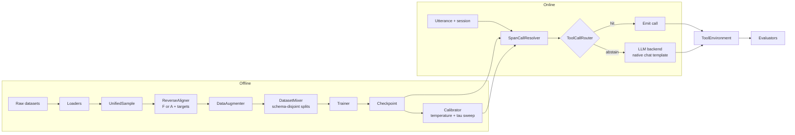

# Codebase Architecture & Research Plan

Describes the repository structure, module contracts, data flow, evaluation methodology and experiment protocol for SpanCall. It complements the design docs:

| Doc | Scope |
| --- | --- |
| [proposal.md](proposal.md) | What we claim and why |
| [mechanism.md](mechanism.md) | How one-pass resolution works, cost model, experiments E1-E8 |
| [heads.md](heads.md) | Prediction heads H1-H4 |
| [pipeline_io.md](pipeline_io.md) | Pre/post-process spec |
| [experiments.md](experiments.md) | Experiment ledger E1-E15 |
| **this doc** | Codebase layout, module contracts, workflows |

> [!NOTE]
> Status: **boilerplate only**. `span_template/` is implemented and tested. Everything in `spancall/` is interfaces (ABCs, dataclasses, config) whose logic methods raise `NotImplementedError`. Nothing is hardcoded to a dataset or domain.

---

## 1. Research Framing

**Claim:** a ~150M bidirectional encoder with a pointer head resolves fully-specified tool calls (stratum **F**, ~80%) in one pass, gated for >=95% precision. Stratum **A** (absent/unresolvable params) abstains to the normal LLM.

**Systems compared everywhere:**

| ID | System | Role |
| --- | --- | --- |
| **B0** | Normal agent: LLM generates every tool call | Reference quality and cost |
| **B1** | Cheap baselines: 0.5B constrained generator, regex/rules | Fair small-model baseline (E6) |
| **S** | Agent + SpanCall router (fast path, LLM fallback) | The proposal |

**Layered questions:** does the model work (offline tool-call eval) -> is the gate safe (calibration) -> does the agent still succeed, cheaper (agentic eval).

---

## 2. Repository Layout

```
multi_span_tool_calling/
├── pyproject.toml
├── configs/default.yaml           # data / model / optimization / training / calibration / agent / gate
├── docs/                          # design docs + this file + experiments.md
├── span_template/                 # IMPLEMENTED: render, parse, sanitize (R7)
│   ├── template.py                #   build_input / build_input_multi / gate_tool_call
│   ├── parser.py                  #   marker grammar → extraction legend
│   ├── sanitize.py                #   P0/P1 normalization + R7 marker rejection
│   ├── template.jinja / template_multi.jinja
│   └── test_template.py           #   golden render/parse + R7 fixtures (implemented tests)
├── spancall/
│   ├── data/                      # §4
│   ├── model/                     # §5
│   ├── train/                     # §5
│   ├── infer/                     # §6
│   ├── agent/                     # §7
│   └── eval/                      # §8
├── scripts/                       # thin CLIs (no logic)
└── tests/
    ├── test_boilerplate.py        # imports/exports contract canary
    └── (pending: alignment, caster, gate, chat-template round trip, shuffle-invariance)
```

`docs/chat_template_gemma4.jinja` is the optional, *unused by default* Gemma 4 chat template for the local backend's fallback path (§7) — the fallback always uses the LLM's unchanged native template.

Design rules:
1. **One code path for train and serve** for render -> parse -> tokenize (`span_template` is the single source).
2. **Scripts hold no logic**: they parse args and call library code.
3. **Interfaces first**: each stage is an ABC so alternatives (backbones, gates, backends) are swappable for ablations.
4. **Config-driven**: every experiment is reproducible from a YAML + seed.

---

## 3. End-to-End Data Flow



---

## 4. Data Processing (`spancall/data/`)

### 4.1 Unified record ([schema.py](../spancall/data/schema.py))

| Type | Purpose |
| --- | --- |
| `UnifiedSample` | Canonical record: utterance, tools, GT calls, recent context, clock, stratum, target spans, split |
| `ToolDefinition` | Tool spec: `name`, `description`, `parameters`, `risk_tier` (per tool) |
| `ParameterSchema` | Per-param spec: `param_type`, `enum`, `default`, `required`, `entity_class` (exclusivity group) |
| `GroundTruthCall` | Reference call (tool + arguments) |
| `SpanTarget` | Per-param target: utterance span, recent ctx, time/enum/bool ctx, or unresolved |
| `Stratum` | `F` (fully groundable) / `A` (abstention negative) |
| `Split` | `train, dev, calib, test_id, test_ood_schema, test_ood_para, test_adversarial` |

### 4.2 Components

| Module | Contract |
| --- | --- |
| [base.py](../spancall/data/base.py) | `BaseDatasetLoader.load()`, `BaseAligner.align()`, `BaseAugmenter.augment()` |
| [sources/](../spancall/data/sources) | Loaders: xLAM, Glaive, ToolBench (train); BFCL, tau-bench (eval); **Hermes** (`HermesLoader`, all 5 configs of `NousResearch/hermes-function-calling-v1`) |
| [align.py](../spancall/data/align.py) | `ReverseAligner`: GT args -> spans / CTX entries; ungrounded => stratum A (mechanism §8.1) |
| [augment.py](../spancall/data/augment.py) | `DataAugmenter`: shuffles, clock randomization, entity swaps, distractors, adversarial markers (§8.4) |
| [mix.py](../spancall/data/mix.py) | `DatasetMixer`: mix 55/20/10/15 (natural F / paraphrase F / swap+distractor F / A), `partition_by_schema` (§8.3) |
| [partition.py](../spancall/data/partition.py) | `partition_schema_disjoint` (schema-group → train/dev/eval, zero-shot OOD-schema eval), `write_splits_jsonl` (JSONL + report) |

### 4.3 Pipeline

1. Ingest sources into `UnifiedSample` (`HermesLoader` covers all 5 hermes configs; `JSONL`/hub via optional `datasets`).
2. Assign a synthetic clock (never the GT date); render via `span_template`.
3. Reverse-align; log the **F/A share per source** (this measures the real "80%" assumption).
4. Augment; mix.
5. **Split by schema**, not only utterance (`partition_schema_disjoint` → `hermes_{train,dev,eval}.jsonl` + `partition_report.json`): held-out schemas for zero-shot eval, paraphrase-disjoint calibration set.
6. QA: leakage check (schema and near-duplicate utterances across splits), dataset card.

Evaluation-only data: BFCL (call-level), tau-bench-style tasks (agentic), stratum-A probes (false hits), adversarial suite.

---

## 5. Model and Training

### 5.1 Model (`spancall/model/`)

| Module | Contract | Spec |
| --- | --- | --- |
| [encoder.py](../spancall/model/encoder.py) | `BaseEncoder`, `SpanCallTransformerEncoder`; registers marker special tokens | mechanism §3.2, §4 |
| [heads.py](../spancall/model/heads.py) | `ToolHead` (H1), `CallCountHead` (H2), `PointerHead` (H3), `AbstainHead` (H4), `CallAcceptHead` | heads.md, mechanism §5. Heads H5-H8 (Source, List-Size, Swap/Exclusivity, Correctness) are **spec-only** in heads.md — not yet implemented, available to H1-H4/CallAcceptHead |
| [masks.py](../spancall/model/masks.py) | `CandidateMaskBuilder`: type pre-filter, R8 snapping, R9 enum masks | mechanism §3.4 |
| [loss.py](../spancall/model/loss.py) | `SpanCallLossContainer`: multi-positive softmax CE over `A_k + {abstain}` + accept BCE | mechanism §8.2 |

Pointer scoring: `M(k,i,j) = s_{k,i} + e_{k,j} + r(j-i)`, restricted to valid candidates.

### 5.2 Training (`spancall/train/`)

| Module | Contract |
| --- | --- |
| [config.py](../spancall/train/config.py) | `ModelConfig`, `OptimizationConfig`, `TrainingConfig`, `CalibrationConfig` |
| [trainer.py](../spancall/train/trainer.py) | `BaseTrainer`: `train`, `evaluate`, `save_checkpoint`, `load_checkpoint` |
| [calibrate.py](../spancall/train/calibrate.py) | `BaseCalibrator`: temperature scaling, threshold sweep, Clopper-Pearson lower bound |

### 5.3 Staged methodology

| Stage | What | Gate |
| --- | --- | --- |
| T0 | Overfit ~1k examples | loss ~0, offsets decode exactly |
| T1 | Pointer head only on F slice | **E1: exact payload >= 90%** |
| T2 | + abstain/accept head + A negatives | precision-at-coverage curve |
| T3 | + tool head + count head (multi-tool packing) | wrong-tool <= 1% |
| T4 | + swap/distractor slices | E3 swap ablation |
| T5 | Calibration | E2 (>= 95% precision) |

---

## 6. Inference / "Use" (`spancall/infer/`)

| Module | Contract | Spec |
| --- | --- | --- |
| [resolver.py](../spancall/infer/resolver.py) | `SpanCallResolver.try_resolve(schema, utterance, recent_context, now) -> ResolveResult`; `try_resolve_candidates` for multi-schema | mechanism §2, §9 |
| [decode.py](../spancall/infer/decode.py) | `BaseJointDecoder`: exclusivity-constrained assignment + `Delta_joint` | mechanism §6 |
| [cast.py](../spancall/infer/cast.py) | `BaseTypeCaster` (strict typed cast from char offsets), `SchemaValidator` | mechanism §7.1-7.2 |
| [gate.py](../spancall/infer/gate.py) | `BaseGate`, `ConjunctionGate` | mechanism §7.3 |
| [export.py](../spancall/infer/export.py) | `BaseExporter`: ONNX / int8 | mechanism §10 |

Hit rule (baseline):
`hit <=> min_k p_k >= tau_p AND Delta_joint >= tau_Delta AND accept >= tau_a AND validate()`

`ResolveResult` carries `hit, tool_name, payload, per-param confidence/margin/char_span, joint_margin, accept_score, abstain_reason, latency_ms, features`.

Default gating thresholds (same values as [`ConjunctionGate.__init__`](../spancall/infer/gate.py:37)); must be overridden from calibration (§8.1, `configs/default.yaml` section `gate`):
`tau_p = 0.90`, `tau_delta = 2.0`, `tau_a = 0.85`.

> [!IMPORTANT]
> After quantization/export, thresholds must be recalibrated (scores shift).

---

## 7. Agentic Use (`spancall/agent/`)

| Module | Contract |
| --- | --- |
| [router.py](../spancall/agent/router.py) | `ToolCallRouter.route_turn(...)`; `RouterMode`, `IntegrationVariant` |
| [loop.py](../spancall/agent/loop.py) | `BaseAgentLoop.run_task(...) -> ExecutionTrace` |
| [trace.py](../spancall/agent/trace.py) | `StepTrace`, `ExecutionTrace`, `RoutingDecision` (telemetry shared by eval and shadow calibration) |
| [backends/](../spancall/agent/backends) | `BaseLLMBackend`; `UniversalAPIBackend` (hosted), `LocalVLLMBackend` (local, native chat template) |
| [tools/](../spancall/agent/tools) | `BaseToolEnvironment`: `execute`, `reset`, `evaluate_task_success`; `ToolExecutionResult` |

**Modes (`RouterMode`)**

| Mode | Behavior |
| --- | --- |
| `llm_only` | B0, normal agent |
| `spancall_only` | Diagnostic fast path only |
| `router` | System S: SpanCall first, LLM fallback |
| `shadow` | LLM answers; SpanCall runs and is logged for comparison/calibration |

**Integration variants (`IntegrationVariant`)**

| Variant | Behavior |
| --- | --- |
| `s_skip` | Hit replaces the LLM call (default) |
| `s_inject` | Hit call and tool result inserted into history as if the LLM made it (keeps history format consistent) |
| `s_hint` | On abstain, pass partial spans to the LLM (optional, beyond the all-or-nothing scope) |

The fallback path always uses the LLM's **unchanged** native chat template.

---

## 8. Evaluation (`spancall/eval/`)

### 8.1 Offline tool-call eval (`eval/toolcall/`)

`BaseToolCallEvaluator.evaluate(...) -> ToolCallMetrics`, plus `compute_risk_coverage_curve`.

Reported on **stratum F**, **A**, and **all**:
- Tool accuracy, per-param accuracy, exact payload match.
- **Hit rate**, **precision-at-hit**, **false-hit rate on A**, abstain-reason breakdown.
- Error taxonomy: wrong tool / wrong value / entity swap / duplicate span / date misparse / extra or missing call.
- Risk-coverage curves, calibration (ECE), slices: ID vs OOD-schema vs OOD-paraphrase vs adversarial.
- Baselines B0/B1 on the **same records**, plus "LLM on only the SpanCall-hit subset".

### 8.2 Agent eval (`eval/agentic/`)

`BaseAgentEvaluator.evaluate_agent(loop, tasks, num_seeds) -> (AgentMetrics, traces)`.

| Axis | Metrics |
| --- | --- |
| Task quality | task success (end-state check), per-step call accuracy, turns/task, recovery after bad call |
| Efficiency | LLM calls saved, tokens, latency p50/p95, FLOPs, cost |
| Safety | wrong-hit rate, side-effecting errors |
| Routing | fast-path share, hit rate by tool/turn |

### 8.3 Agent + tool span vs normal agent ([compare.py](../spancall/eval/compare.py))

`ComparativeEvaluator.compare(normal_traces, spancall_traces) -> ComparativeStudyResult`

Protocol: same LLM, tools and tasks; only the router differs. >= 3 seeds, **paired** per-task comparison, bootstrap CIs, **non-inferiority test** on task success (default margin 2 pts) while reporting cost reduction.

### 8.4 Cost model ([cost.py](../spancall/eval/cost.py))

`E[cost] = c_s + (1-h)·c_L + h(1-p)(c_w + c_L)`; `CostModel.theoretical_expected_cost` and `compute_break_even_hit_rate`. Measured savings are validated against this formula.

---

## 9. Experiments

Full ledger with hypotheses and gates: [experiments.md](experiments.md).

| Group | IDs | Focus |
| --- | --- | --- |
| Model ceiling and gate | E1-E5 | Pointer accuracy, precision gating, swap negatives, `Delta_joint`, OOD generalization |
| Cost and safety | E6-E8 | Latency/FLOPs, stratum-A false hits, multi-schema selection |
| Agent | E9-E11 | Non-inferiority, history consistency, context length |
| Engineering | E12-E15 | Backbone, quantization, shadow-mode transfer, head ablations |

**Kill criteria (floors — deliberately below the success gates of §5.3/experiments.md, so a "passed gate" result and a "killed" result can never overlap):**

| Experiment | Success gate (proceed) | Kill floor (stop) |
| --- | --- | --- |
| E1 (pointer ceiling on F) | exact payload >= 90% | E1 < 80% |
| E2 (precision gating) | >= 95% precision-at-hit at coverage >= 60% of F | cannot reach >= 95% precision at **any** coverage >= 40% of F |

Behavior: a result between the gate and the floor is a **stalled experiment** — investigate before continuing. At or below the kill floor, stop and write up the negative result.

---

## 10. CLI and Config

| Script | Purpose | Backing modules |
| --- | --- | --- |
| `scripts/prepare_data.py` | ingest, align, augment, split | `data/*` |
| `scripts/train.py` | train model | `train/trainer.py`, `model/*` |
| `scripts/calibrate.py` | temperature + threshold sweep | `train/calibrate.py` |
| `scripts/eval_toolcall.py` | offline call-level eval | `eval/toolcall` |
| `scripts/eval_agent.py` | agent vs normal agent | `eval/agentic`, `eval/compare.py`, `agent/*` |

`configs/default.yaml` sections: `experiment`, `data`, `model`, `optimization`, `training`, `calibration`, `gate`, `agent`. Section → config-dataclass mapping (single source of truth is [`config.py`](../spancall/train/config.py) plus a YAML loader there):

| YAML section | Config dataclass | Notes |
| --- | --- | --- |
| `experiment` | `TrainingConfig` (name/seed/output_dir) | `seed` → `TrainingConfig.seed` |
| `data` | `DatasetMixer` / `DataAugmenter` / schema split | digested by `data/*` |
| `model` | `ModelConfig` | `backbone_name`, `head_dim`, `max_seq_len`, `max_span_width`, `dropout` |
| `optimization` | `OptimizationConfig` | includes `batch_size`, `num_epochs`, `mixed_precision` owned here (they are training-loop params), plus `learning_rate_encoder`, `learning_rate_head`, `weight_decay`, `warmup_ratio` |
| `training` | `TrainingConfig` | `gradient_accumulation_steps`, `checkpoint_every_n_steps`, `output_dir`, `seed` |
| `calibration` | `CalibrationConfig` | `target_precision`, `confidence_level`, `temperature_scaling` |
| `gate` | `ConjunctionGate` | `tau_p`, `tau_delta`, `tau_a` |
| `agent` | `ToolCallRouter` / `BaseAgentLoop` | `mode`, `integration`, `llm_model`, `max_turns` |

Install/run: `pip install -e .[dev]`; tests: `PYTHONPATH=. python -m unittest discover -s tests`.

---

## 11. Implementation Roadmap

| Phase | Deliverable | Est. |
| --- | --- | --- |
| P0 | Boilerplate, configs, record schema (**done**) → **Phase-0 promotion:** E0 traffic probe ([`scripts/probe.py`](../scripts/probe.py), D7) + template fixes D1–D3 + config defaults D4–D5 | - |
| P1 | Loaders + aligner + F/A stats | 1 wk |
| P2 | Train T0-T2; E1; B0/B1 offline harness | 1-1.5 wk |
| P3 | Decode/cast/validate/gate + calibration; E2-E5 | 1 wk |
| P4 | Agent loop, router, shadow mode, mock tool envs | 1 wk |
| P5 | Agentic eval E7, E9-E11; cost E6 | 1 wk |
| P6 | Ablations, quantization, write-up | 1 wk |

## 12. Research Hygiene

- Frozen test sets; calibration set never trains; schemas disjoint across splits.
- Every number traces to `results/<run_id>/` (config + seed + checkpoint hash).
- >= 3 seeds for reported results.
- Tests implemented: golden render/parse (``span_template/test_template.py``), imports/exports canary (``tests/test_boilerplate.py``).
- Tests pending (boilerplate status): alignment, caster, gate invariants, chat-template round trip, shuffle-invariance — tracked in §2 layout tree.

## 13. Open Decisions

1. Base LLM(s) for the agent comparison (e.g. Gemma 4 plus a hosted model).
2. Agentic benchmark: tau-bench, BFCL multi-turn, ToolSandbox, or custom mock environments.
3. Compute budget (GPUs; vLLM serving).
4. Whether to explore `s_hint`, or stay strictly all-or-nothing.
