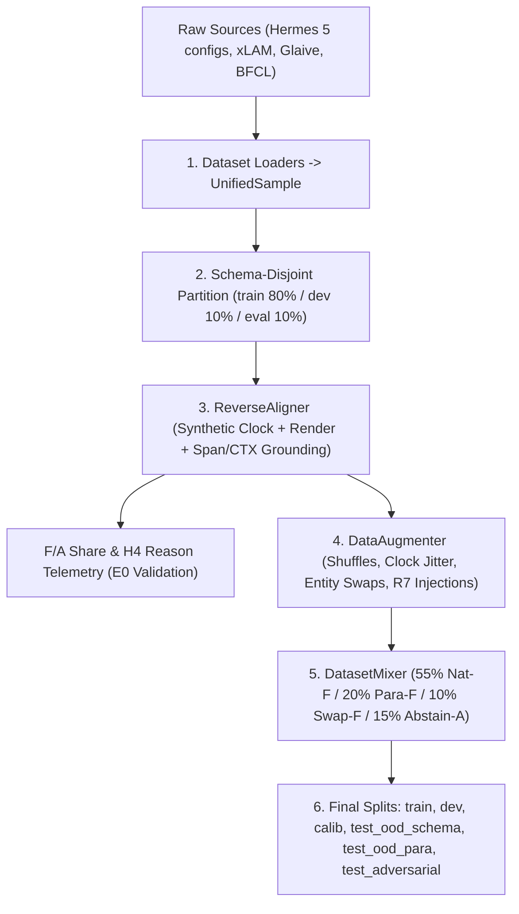
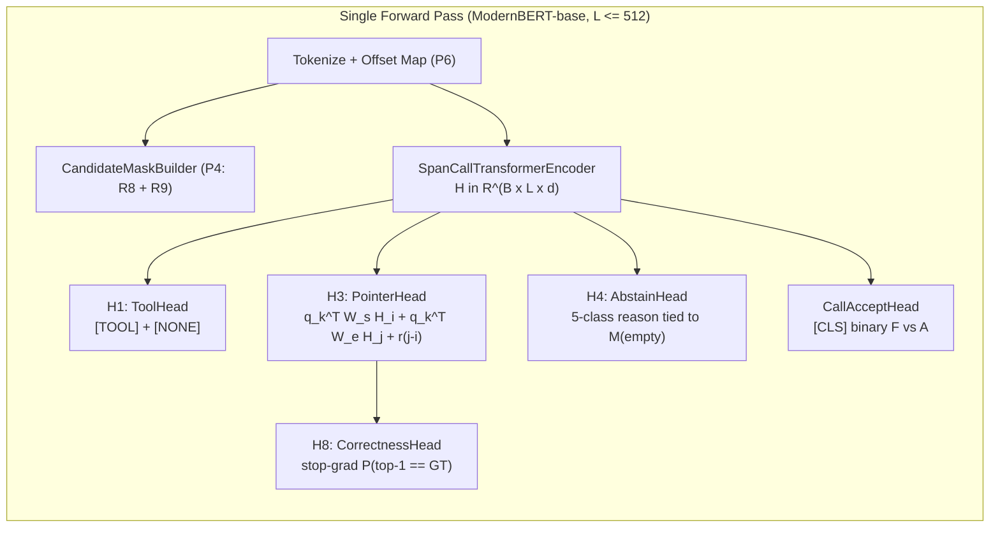

# SpanCall Full Implementation Blueprint: Data Creation, Training, & Evaluation

*Audit Date: 2026-11-02 · Snapshot: 117 tests passing · Scope: End-to-End Implementation Spec & Gap Review*

---

## 1. Executive Audit: What Is Done vs. What Is Left to Do

This audit reviews the entire repository against the specifications in [`proposal.md`](file:///Users/tinhluong/work_dir/research_prjs/multi_span_tool_calling/docs/proposal.md), [`mechanism.md`](file:///Users/tinhluong/work_dir/research_prjs/multi_span_tool_calling/docs/mechanism.md), [`heads.md`](file:///Users/tinhluong/work_dir/research_prjs/multi_span_tool_calling/docs/heads.md), [`pipeline_io.md`](file:///Users/tinhluong/work_dir/research_prjs/multi_span_tool_calling/docs/pipeline_io.md), [`architecture.md`](file:///Users/tinhluong/work_dir/research_prjs/multi_span_tool_calling/docs/architecture.md), and [`spancall_remediation_plan.md`](file:///Users/tinhluong/work_dir/research_prjs/multi_span_tool_calling/plans/spancall_remediation_plan.md).

### 1.1 Codebase Status Matrix

Legend: ✅ **Implemented & Tested** · 🚧 **Partially Implemented** · ⛔ **Stub (`NotImplementedError`)**

| Pillar | Module / File | Status | What Is Done | What Is Left to Do |
| :--- | :--- | :---: | :--- | :--- |
| **0. Template & Pre-Process** | [`span_template/template.py`](file:///Users/tinhluong/work_dir/research_prjs/multi_span_tool_calling/span_template/template.py) [`span_template/parser.py`](file:///Users/tinhluong/work_dir/research_prjs/multi_span_tool_calling/span_template/parser.py) [`span_template/sanitize.py`](file:///Users/tinhluong/work_dir/research_prjs/multi_span_tool_calling/span_template/sanitize.py) | ✅ | Single/multi-tool Jinja rendering (`build_input`, `build_input_multi`), legend parsing (`Entry` offsets), R7 sanitization (`norm2orig`, NFKC marker check), R4 idioms (`tomorrow`, `day_after_tomorrow`, `tonight`), R5 quoted multi-word enums, `tokenize_offset_mapping`, `gate_tool_call` (Q6 defaults). | Register `MARKER_TOKENS` as atomic special tokens in HF tokenizer (P6); add byte-exact `RENDERING_CONTRACT` diff test. |
| **1. Data Creation** | [`spancall/data/schema.py`](file:///Users/tinhluong/work_dir/research_prjs/multi_span_tool_calling/spancall/data/schema.py) | ✅ | Canonical dataclasses: `UnifiedSample`, `ToolDefinition`, `ParameterSchema`, `GroundTruthCall`, `SpanTarget`, `Stratum` (`F`/`A`), `Split`. | — |
| | [`spancall/data/sources/hermes.py`](file:///Users/tinhluong/work_dir/research_prjs/multi_span_tool_calling/spancall/data/sources/hermes.py) | ✅ | Full `HermesLoader` across all 5 HF configs (10,693 ingested rows, 12,889 GT calls, brace-matching parser, single-quote fallback, multi-turn `recent_context` extraction). | — |
| | [`spancall/data/partition.py`](file:///Users/tinhluong/work_dir/research_prjs/multi_span_tool_calling/spancall/data/partition.py) [`scripts/prepare_data.py`](file:///Users/tinhluong/work_dir/research_prjs/multi_span_tool_calling/scripts/prepare_data.py) | ✅ | `partition_schema_disjoint` (largest-first greedy assignment: 8,555 train / 1,069 dev / 1,069 eval across 4,120 zero-overlap schemas) + `write_splits_jsonl`. | Wire alignment, augmentation, and mixing into `scripts/prepare_data.py`; produce `calib`, `test_ood_para`, and `test_adversarial` splits. |
| | [`scripts/probe.py`](file:///Users/tinhluong/work_dir/research_prjs/multi_span_tool_calling/scripts/probe.py) | ✅ | E0 traffic probe: F-share, H4 abstain-reason mix, scope-cut deltas (`--arm`), retriever R@T, kill-floor gate (`F_floor = h_min / 0.6`). | Run E0 probe on the ingested Hermes dataset & 2–3 representative target workloads. |
| | [`spancall/data/align.py`](file:///Users/tinhluong/work_dir/research_prjs/multi_span_tool_calling/spancall/data/align.py) | ⛔ | `ReverseAligner` class skeleton. | **Full implementation:** synthetic clock assignment, template render, multi-positive span matching across `utterance`, `recent_ctx`, `time_ctx`, `enum_ctx`, `boolean_ctx`, and F/A + H4 reason classification. |
| | [`spancall/data/augment.py`](file:///Users/tinhluong/work_dir/research_prjs/multi_span_tool_calling/spancall/data/augment.py) | ⛔ | `DataAugmenter` class skeleton. | **Full implementation:** param/enum/recent-context order shuffling, synthetic clock randomization, entity-swap hard negatives, distractor injection, R7 marker-injection adversarial rows. |
| | [`spancall/data/mix.py`](file:///Users/tinhluong/work_dir/research_prjs/multi_span_tool_calling/spancall/data/mix.py) | ⛔ | `DatasetMixer` class skeleton (`55/20/10/15` ratios, `pack_tools`). | **Full implementation:** stratified sampling across natural F (55%), paraphrase F (20%), swap/distractor F (10%), and abstention A (15%); bridge `partition_by_schema` to `partition.py`. |
| | [`spancall/data/sources/{xlam,glaive,toolbench,bfcl,tau_bench}.py`](file:///Users/tinhluong/work_dir/research_prjs/multi_span_tool_calling/spancall/data/sources/xlam.py) | ⛔ | `BaseDatasetLoader` shells. | Implement loaders reusing hardened JSON extraction from `hermes.py` and `partition_schema_disjoint`. |
| **2. Model & Training** | [`spancall/train/config.py`](file:///Users/tinhluong/work_dir/research_prjs/multi_span_tool_calling/spancall/train/config.py) [`configs/default.yaml`](file:///Users/tinhluong/work_dir/research_prjs/multi_span_tool_calling/configs/default.yaml) | ✅ | `TrainingConfig.from_yaml`, `ModelConfig`, `HeadsConfig` (D4 v1 flags), `OptimizationConfig`, `CalibrationConfig`, `GateConfig`, `DataConfig` (`pack_tools: 1`). | — |
| | [`spancall/model/masks.py`](file:///Users/tinhluong/work_dir/research_prjs/multi_span_tool_calling/spancall/model/masks.py) | ⛔ | `CandidateMaskBuilder` skeleton. | **Full implementation:** P4 candidate set construction `A_k`, R8 entry-snapping on CTX tokens, R9 per-param enum masks, regex pre-filtering for int/float/date, width `<= W_max` utterance window mask. |
| | [`spancall/model/encoder.py`](file:///Users/tinhluong/work_dir/research_prjs/multi_span_tool_calling/spancall/model/encoder.py) | ⛔ | `SpanCallTransformerEncoder` skeleton. | **Full implementation:** `AutoModel`/`AutoTokenizer` wrapper (`answerdotai/ModernBERT-base`), `add_marker_tokens(MARKER_TOKENS)` + embedding resize, `forward` returning `H in R^{B x L x d}`. |
| | [`spancall/model/heads.py`](file:///Users/tinhluong/work_dir/research_prjs/multi_span_tool_calling/spancall/model/heads.py) | ⛔ | `ToolHead` (H1), `CallCountHead` (H2), `PointerHead` (H3), `AbstainHead` (H4), `CallAcceptHead` skeletons. | **Full implementation:** v1 enabled heads (`ToolHead`, `PointerHead` with relative positional bias + `M(empty)`, `AbstainHead` 5-class + consistency tie, `CorrectnessHead` H8 with stop-grad, `CallAcceptHead`), plus gated H2/H5/H6/H7 modules. |
| | [`spancall/model/loss.py`](file:///Users/tinhluong/work_dir/research_prjs/multi_span_tool_calling/spancall/model/loss.py) | ⛔ | `SpanCallLossContainer` skeleton. | **Full implementation:** multi-positive softmax CE (`logsumexp` over equal-valued positives `P_k`), H4 CE, H1 CE, `CallAcceptHead` BCE, H3–H4 consistency loss, and Stage-C H8 BCE. |
| | [`spancall/train/trainer.py`](file:///Users/tinhluong/work_dir/research_prjs/multi_span_tool_calling/spancall/train/trainer.py) [`scripts/train.py`](file:///Users/tinhluong/work_dir/research_prjs/multi_span_tool_calling/scripts/train.py) | ⛔ | `BaseTrainer` ABC and CLI stub. | **Full implementation:** PyTorch `Dataset` + dynamic bucket collator, differential LR + layer-wise decay (`0.90`), bf16 AMP, Staged Curriculum (T0 overfit -> Stage A joint -> Stage B hard-neg mining -> Stage C frozen-encoder H8), checkpointing, CLI wiring. |
| | [`spancall/train/calibrate.py`](file:///Users/tinhluong/work_dir/research_prjs/multi_span_tool_calling/spancall/train/calibrate.py) [`scripts/calibrate.py`](file:///Users/tinhluong/work_dir/research_prjs/multi_span_tool_calling/scripts/calibrate.py) | ⛔ | `BaseCalibrator` ABC and CLI stub. | **Full implementation:** L-BFGS temperature scaling per head, Clopper–Pearson exact binomial lower bound (`scipy.stats.beta.ppf`), grid sweep over `(tau_p, tau_a, tau_delta)` on `calib` split, isotonic calibration for H8, CLI wiring. |
| **3. Inference & Routing** | [`spancall/infer/clock.py`](file:///Users/tinhluong/work_dir/research_prjs/multi_span_tool_calling/spancall/infer/clock.py) [`spancall/infer/gate.py`](file:///Users/tinhluong/work_dir/research_prjs/multi_span_tool_calling/spancall/infer/gate.py) | ✅ | `local_today(zone)` with DST handling; `SingleTauGate` (v1 default) and `ConjunctionGate` (ablation) + `build_gate` factory; covered by `test_clock.py` and `test_gate.py`. | Add per-risk-tier threshold lookup (`read_only`, `idempotent`, `side_effecting`) loaded from calibration artifact. |
| | [`spancall/infer/decode.py`](file:///Users/tinhluong/work_dir/research_prjs/multi_span_tool_calling/spancall/infer/decode.py) | ⛔ | `BaseJointDecoder` ABC. | **Full implementation:** top-`K` (`K=3`) candidate extraction with equal-value probability summing (R4), exhaustive combinatorial assignment (`<= 3^K`) enforcing entity-class exclusivity & span non-overlap, `Delta_joint` computation. |
| | [`spancall/infer/cast.py`](file:///Users/tinhluong/work_dir/research_prjs/multi_span_tool_calling/spancall/infer/cast.py) | ⛔ | `BaseTypeCaster`, `SchemaValidator` skeletons. | **Full implementation:** Q4 span->original substring via `norm2orig` & word-boundary check, Q5 strict typed caster (str/enum/bool/int/float/date/array), Q6 JSON Schema Draft 2020-12 validator + deterministic default materialization. |
| | [`spancall/infer/resolver.py`](file:///Users/tinhluong/work_dir/research_prjs/multi_span_tool_calling/spancall/infer/resolver.py) [`spancall/infer/export.py`](file:///Users/tinhluong/work_dir/research_prjs/multi_span_tool_calling/spancall/infer/export.py) | ⛔ | `SpanCallResolver`, `ResolveResult`, `BaseExporter` skeletons. | **Full implementation:** end-to-end `try_resolve` (P0–P7 -> Encoder+Heads -> Q0–Q8 -> `ResolveResult` with latency telemetry), `try_resolve_candidates`, ONNX/INT8 exporter. |
| **4. Evaluation & Agent Loop** | [`spancall/eval/cost.py`](file:///Users/tinhluong/work_dir/research_prjs/multi_span_tool_calling/spancall/eval/cost.py) [`spancall/eval/toolcall/metrics.py`](file:///Users/tinhluong/work_dir/research_prjs/multi_span_tool_calling/spancall/eval/toolcall/metrics.py) | ✅ | `CostModel` (`theoretical_expected_cost`, `compute_break_even_hit_rate`), `CostMetrics`, `ToolCallMetrics` dataclasses. | — |
| | [`spancall/eval/toolcall/evaluator.py`](file:///Users/tinhluong/work_dir/research_prjs/multi_span_tool_calling/spancall/eval/toolcall/evaluator.py) [`scripts/eval_toolcall.py`](file:///Users/tinhluong/work_dir/research_prjs/multi_span_tool_calling/scripts/eval_toolcall.py) | ⛔ | `BaseToolCallEvaluator` ABC and CLI stub. | **Full implementation:** canonical JSON payload comparison, stratified metrics (`F`, `A`, `all`), 7-bucket error taxonomy, risk–coverage curve generator, ECE, B0/B1 baseline runners, CLI wiring. |
| | [`spancall/agent/*`](file:///Users/tinhluong/work_dir/research_prjs/multi_span_tool_calling/spancall/agent/router.py) [`spancall/eval/agentic/*`](file:///Users/tinhluong/work_dir/research_prjs/multi_span_tool_calling/spancall/eval/agentic/evaluator.py) [`spancall/eval/compare.py`](file:///Users/tinhluong/work_dir/research_prjs/multi_span_tool_calling/spancall/eval/compare.py) | ⛔ | `ToolCallRouter`, `BaseAgentLoop`, `BaseLLMBackend`, `ComparativeEvaluator` skeletons. | **Full implementation:** `route_turn` (`llm_only`, `spancall_only`, `router`, `shadow` modes; `s_skip`, `s_inject` history formatting matching `chat_template_gemma4.jinja`), LiteLLM/vLLM adapters, mock/tau-bench tool environments, paired bootstrap CI & non-inferiority test (`margin = -0.02`). |

---

## 2. Part I — Full Implementation Specification: Data Creation Pipeline

The data pipeline transforms raw function-calling conversations into aligned, augmented, schema-disjoint training and evaluation splits.

### 2.1 Step 1: Reverse Substring & Context Alignment ([`spancall/data/align.py`](file:///Users/tinhluong/work_dir/research_prjs/multi_span_tool_calling/spancall/data/align.py))

`ReverseAligner.align(sample: UnifiedSample) -> UnifiedSample` must ground every argument of `sample.ground_truth_calls` against the rendered template legend (`SpanTemplateOutput.entries`) without leaking the ground-truth date.

#### Algorithm Specification
1. **Synthetic Clock Assignment (Anti-Leakage Rule, [`proposal.md`](file:///Users/tinhluong/work_dir/research_prjs/multi_span_tool_calling/docs/proposal.md) §5.1):**
   - If `sample.current_time_iso` is set (recorded timestamp in dataset), parse it as `base_date: date`.
   - Otherwise, sample a deterministic synthetic date seeded by `hash(sample.sample_id)` (e.g., in `2025-01-01..2027-12-31`).
   - **Never** anchor `base_date` to a date extracted from `ground_truth_calls` unless the utterance contains a relative date idiom (`today`, `tomorrow`, `day after tomorrow`, `tonight`, `this_<dow>`, `next_<dow>`, `in k days`). When a relative idiom is detected in the utterance and `sample.current_time_iso` is missing, solve `base_date = gt_date - idiom_offset` so that the relative idiom aligns to `[CTX_TIME]`, and store `sample.current_time_iso = base_date.isoformat()`.
2. **Template Rendering:**
   - Convert the target `ToolDefinition` (matching `gt_call.tool_name`) to `span_template.Tool` and `sample.recent_context` to ` Sequence[RecentRow]`.
   - Call `out = build_input(tool=..., utterance=sample.utterance, recent_context=..., now=base_date)`.
   - If `SanitizeError` or `ValueError` is raised, mark `sample.stratum = Stratum.A`, set `sample.metadata["abstain_reason"] = exc.reason`, and return.
3. **Per-Parameter Grounding (Multi-Positive):**
   For each `param` in `tool_def.parameters`:
   - **Case A — Argument omitted or `None` in `gt_call.arguments`:**
     - If `not param.required`: align to the `[NULL]` entry in `[CTX_META]` (`SpanTarget(param_name=param.name, target_type="null_ctx", char_start=e.char_start, char_end=e.char_end, canonical_value=None)`).
     - If `param.required`: ungroundable -> record `SpanTarget(param_name=param.name, target_type="unresolved")`, set parameter reason to `ABSENT`.
   - **Case B — Boolean (`param.param_type == "boolean"` or `isinstance(val, bool)`):**
     - Match `"true"` or `"false"` in `[CTX_META]` (`e.kind == "bool"` and `e.value == str(val).lower()`). Emit `SpanTarget(..., target_type="boolean_ctx", canonical_value=bool(val))`.
   - **Case C — Enum (`param.enum` is non-empty):**
     - Find all entries in `[CTX_ENUM]` (`e.kind == "enum"`) where `str(e.value).lower() == str(val).strip().lower()`.
     - If matched, emit `SpanTarget(..., target_type="enum_ctx", char_start=e.char_start, char_end=e.char_end, canonical_value=e.value)`.
   - **Case D — Date (`_ISO_DATE_RE.match(str(val))`):**
     - Find **all** colliding entries in `[CTX_TIME]` (`e.kind == "date"`) where `e.value == str(val)` (e.g., both `+1d` and `tomorrow` share the same ISO date — R4 requires **all** equal-valued entries as positives).
     - Also search the utterance entry (`e.segment == "utterance"`) for verbatim literal date matches (`YYYY-MM-DD`, etc.).
     - If neither matches, mark parameter `unresolved` with H4 reason `OFF_WINDOW`.
   - **Case E — Scalar String / Integer / Number (`utterance` and `recent_ctx` search):**
     - Format canonical search string `s_val = str(val).strip()`.
     - **Utterance verbatim search:** Find all non-overlapping case-insensitive (or exact, configurable via `fuzzy_matching`) substring occurrences of `s_val` inside the utterance entry `u_entry` (`e.segment == "utterance"`), enforcing word boundaries (`\b` or non-alphanumeric neighbors) so `"5"` does not match inside `"15"`. For each occurrence `(rel_start, rel_end)`, emit `SpanTarget(param_name=param.name, target_type="utterance_span", char_start=u_entry.char_start + rel_start, char_end=u_entry.char_start + rel_end, canonical_value=val)`.
     - **Recent-context search:** Find all selectable recent-context entries (`e.segment == "recent" and e.selectable`) where `e.value == s_val` or `s_val` is a word-bounded substring. Emit `SpanTarget(..., target_type="recent_ctx", ctx_key=e.key, char_start=..., char_end=..., canonical_value=val)`.
   - **Case F — Array (`param.param_type == "array"` and `isinstance(val, list)`):**
     - Align every element `v_i in val` using Cases B–E. The parameter aligns iff **every** element `v_i` has at least one aligned `SpanTarget`. Store `sample.metadata["list_sizes"][param.name] = len(val)`.
4. **Stratum & H4 Reason Assignment:**
   - If **every** parameter has `>= 1` non-`unresolved` `SpanTarget`, set `sample.stratum = Stratum.F` and `sample.metadata["h4_reasons"][p.name] = "OK"`.
   - Otherwise, set `sample.stratum = Stratum.A` and assign each unaligned parameter's H4 class (`ABSENT`, `OFF_WINDOW`, `AMBIGUOUS`, or `NEEDS_REASONING` per [`heads.md`](file:///Users/tinhluong/work_dir/research_prjs/multi_span_tool_calling/docs/heads.md) §H4).
   - Special handling for `json_mode_*` rows (`tool_name == "json_output"`): if the synthetic `json_output` tool definition has empty `parameters`, infer `ParameterSchema` entries from the JSON keys/types of `gt_call.arguments` before alignment so extractable JSON fields become valid Stratum F/A supervision, or keep schema-less rows as Stratum A negatives according to a config flag `align_json_mode_keys: bool = True`.

---

### 2.2 Step 2: Data Augmentation ([`spancall/data/augment.py`](file:///Users/tinhluong/work_dir/research_prjs/multi_span_tool_calling/spancall/data/augment.py))

`DataAugmenter.augment(sample: UnifiedSample) -> List[UnifiedSample]` generates controlled variants from aligned `UnifiedSample` records (Ref: [`mechanism.md`](file:///Users/tinhluong/work_dir/research_prjs/multi_span_tool_calling/docs/mechanism.md) §8.3–8.4):

1. **Structural Order Shuffling (`enable_shuffling=True`, Position Invariance):**
   - Permute `tool.parameters` order, `param.enum` list order, and `sample.recent_context` row order with a seeded RNG.
   - Re-run `ReverseAligner.align()` on the shuffled copy so `char_start`/`char_end` offsets reflect the new rendered layout. Tag `metadata["aug_type"] = "shuffle_f"`.
2. **Paraphrase / Surface Perturbation (`paraphrase_f` slice):**
   - Apply surface-form perturbations to the utterance outside target spans (or case/whitespace/punctuation variations on casing-insensitive spans) and re-align.
   - Support loading pre-generated LLM paraphrases (from a companion JSONL keyed by `sample_id`) where the utterance phrasing changes while keeping entity spans intact; verify via `ReverseAligner` that the paraphrased sample still lands in `Stratum.F`. Tag `metadata["aug_type"] = "paraphrase_f"`.
3. **Entity-Swap Hard Negatives & Role Swaps (`enable_swaps=True`, `swap_distractor_f` slice):**
   - For tools with `>= 2` string/numeric parameters of the same type or `entity_class` (e.g., `origin` and `destination`, `sender` and `recipient`):
     - **Utterance/GT role swap (Stratum F):** Swap the two entity mentions in the utterance *and* swap their values in `ground_truth_calls` -> re-align. Forces the encoder to rely on syntax ("to X from Y") rather than word order.
     - **H7 Negative Pair Synthesis:** Record the swapped span assignment `(param_1 -> span_2, param_2 -> span_1)` in `sample.metadata["swap_negatives"]` for Stage-B H7 training.
4. **Distractor Injection (`enable_distractors=True`):**
   - **Context distractors (Stratum F):** Inject 1–3 plausible but irrelevant `RecentRow` items into `sample.recent_context` (drawn from other samples in the same split). Re-align -> remains `Stratum.F`.
   - **Ambiguous anaphora negatives (Stratum A, H4 `AMBIGUOUS`):** When a parameter grounds to `recent_ctx` (e.g., `flight_id="VN123"`), inject a second `RecentRow` with a colliding key prefix and a different value (`picked_alt="VN456"`), flip `sample.stratum = Stratum.A`, and label that parameter `AMBIGUOUS` for H4.
5. **Adversarial Marker Injection (`enable_adversarial_markers=True`, R7 Suite):**
   - Inject reserved markers (`[SEP]`, `[PARAM]`, `[CTX_ENUM]`, fullwidth `［ＳＥＰ］`, zero-width characters, or newline-prefixed markers) into `utterance` or `recent_context` values.
   - Set `sample.stratum = Stratum.A`, `sample.metadata["aug_type"] = "adversarial_r7"`, `sample.metadata["expected_abstain"] = "marker_injection"`.

---

### 2.3 Step 3: Dataset Mixing & Split Finalization ([`spancall/data/mix.py`](file:///Users/tinhluong/work_dir/research_prjs/multi_span_tool_calling/spancall/data/mix.py))

`DatasetMixer` assembles the final training mix and evaluation suites:

1. **Training Mix (`mix(samples)`):**
   Sample with replacement (or down-sample majority strata) to achieve the target training distribution on `Split.TRAIN`:
   - **55%** `natural_f`: un-augmented `Stratum.F` samples (with random parameter/enum order shuffling applied on the fly).
   - **20%** `paraphrase_f`: surface/LLM-paraphrased `Stratum.F` samples.
   - **10%** `swap_distractor_f`: entity-swap and distractor-injected `Stratum.F` samples.
   - **15%** `abstention_a`: natural `Stratum.A` samples (ungrounded required params, off-window dates, Glaive non-call QA rows) + synthesized `AMBIGUOUS` rows.
2. **Evaluation & Calibration Splits (`partition_by_schema`):**
   Extend the `80/10/10` schema-disjoint split in [`partition.py`](file:///Users/tinhluong/work_dir/research_prjs/multi_span_tool_calling/spancall/data/partition.py) to produce all 7 canonical `Split` files under `data/processed/`:
   - `train.jsonl` (`Split.TRAIN`): 80% of schema groups, mixed `55/20/10/15`.
   - `dev.jsonl` (`Split.DEV`): 5% of schema groups (or half of the 10% dev share), natural F + A distribution, for early stopping and E1 ceiling evaluation.
   - `calib.jsonl` (`Split.CALIB`): 5% of schema groups + paraphrase-disjoint holdout, **never used in training or Stage-A/B model selection**, used exclusively for Stage-C H8 training and temperature/`tau` calibration.
   - `test_ood_schema.jsonl` (`Split.TEST_OOD_SCHEMA`): 10% held-out schema groups (zero-shot schema evaluation, E2 & E5).
   - `test_id.jsonl` (`Split.TEST_ID`): held-out utterances from `train` schemas (10% utterance holdout within train schemas) to measure in-distribution vs. OOD-schema drop (E5).
   - `test_ood_para.jsonl` (`Split.TEST_OOD_PARA`): paraphrased variants of `test_ood_schema` / `test_id` utterances (E5).
   - `test_adversarial.jsonl` (`Split.TEST_ADVERSARIAL`): R7 marker/newline/quote-escape adversarial fixtures (must achieve 100% abstention).

---

## 3. Part II — Full Implementation Specification: Model, Training, & Calibration

### 3.1 Tokenization & Candidate Masks ([`spancall/model/masks.py`](file:///Users/tinhluong/work_dir/research_prjs/multi_span_tool_calling/spancall/model/masks.py))

`CandidateMaskBuilder` implements pre-filtering (Stage 1 §3.4 / P4 in [`pipeline_io.md`](file:///Users/tinhluong/work_dir/research_prjs/multi_span_tool_calling/docs/pipeline_io.md)) so the pointer head only scores type-valid spans:

1. **Special Token Registration:**
   - Register `MARKER_TOKENS` from [`span_template/sanitize.py`](file:///Users/tinhluong/work_dir/research_prjs/multi_span_tool_calling/span_template/sanitize.py) (`[CLS]`, `[SEP]`, `[EOS]`, `[TOOL]`, `[PARAM]`, `[NONE]`, `[CTX_META]`, `[CTX_TIME]`, `[CTX_ENUM]`, `[CTX_RECENT]`, `[NULL]`, `[UNRESOLVED]`) as `additional_special_tokens` on the HuggingFace `AutoTokenizer`.
   - Call `tokenize_offset_mapping(output, tokenizer, max_len=512)` to obtain `input_ids`, `offsets`, and `per_token_entry`.
2. **Entry Token Range Mapping (R8 Snapping):**
   - For every `entry` in `output.entries`, compute:
     - `tok_start(entry)` = first token `i` with `cs >= entry.char_start` and `ce <= entry.char_end`.
     - `tok_end(entry)` = last token `j` with `cs >= entry.char_start` and `ce <= entry.char_end`.
   - For atomic CTX entries (`segment in {"meta", "time", "enum"}`), **only** the exact full-entry pair `(tok_start(entry), tok_end(entry))` is valid (R8). Sub-entry token ranges are masked out (`False`).
3. **Per-Parameter Candidate Set `A_k` Construction (R9):**
   `build_param_masks` returns a list of valid `Candidate(tok_start, tok_end, char_start, char_end, region, canon_value)` objects plus a boolean mask over `[L, L]` (or packed candidate index tensor `[N_cand, 2]`):
   - **`boolean` param:** only the `true` and `false` entries in `[CTX_META]`.
   - **`string` with `enum` (R9):** only `[CTX_ENUM]` entries whose `entry.value` is in `param_schema.enum` (plus `[NULL]` if `not param_schema.required`).
   - **`date` / `datetime` param:** all `[CTX_TIME]` entries $\cup$ regex-matched ISO/literal date spans in the utterance (`_DATE_SPAN_RE`).
   - **`integer` / `number` param:** regex-matched numeric spans in the utterance (`r"[-+]?\d[\d,]*(?:\.\d+)?[kKmMbB]?"`) mapped to token boundaries $\cup$ numeric `recent_ctx` interiors.
   - **Free `string` param:** all token pairs `(i, j)` wholly inside the `utterance` entry with `0 <= j - i < max_span_width` (`W_max = 16`) whose character boundaries align with word boundaries $\cup$ all selectable `recent_ctx` value interiors.
   - **Optional parameter:** if `not param_schema.required`, append the `[NULL]` entry in `[CTX_META]` to `A_k`.
   - **Abstain slot `∅`:** represented as a dedicated index `0` in the candidate logit vector (scored by `M(k, ∅)`), always unmasked.

---

### 3.2 Encoder & Prediction Heads ([`spancall/model/encoder.py`](file:///Users/tinhluong/work_dir/research_prjs/multi_span_tool_calling/spancall/model/encoder.py), [`spancall/model/heads.py`](file:///Users/tinhluong/work_dir/research_prjs/multi_span_tool_calling/spancall/model/heads.py))

All model modules inherit from `torch.nn.Module` (whilst preserving the existing ABC contracts).

#### 1. `SpanCallTransformerEncoder` ([`encoder.py`](file:///Users/tinhluong/work_dir/research_prjs/multi_span_tool_calling/spancall/model/encoder.py))
- Wraps `AutoModel.from_pretrained(model_name_or_path)` (default `answerdotai/ModernBERT-base`, `d = 768`).
- `add_marker_tokens(tokens)`: adds `MARKER_TOKENS` to tokenizer, calls `self.backbone.resize_token_embeddings(len(tokenizer))`, and initializes new marker embeddings with the mean + std of existing embeddings.
- `forward(input_ids, attention_mask, token_type_ids=None) -> torch.Tensor`: returns `last_hidden_state` $H \in \mathbb{R}^{B \times L \times d}$ with dropout `hidden_dropout_prob`.

#### 2. `PointerHead` — H3 ([`heads.py`](file:///Users/tinhluong/work_dir/research_prjs/multi_span_tool_calling/spancall/model/heads.py))
- Parameter query projection at `[PARAM]` token index $\pi_k$:
  $$q_k = W_q\,\text{LayerNorm}(H_{\pi_k}) \in \mathbb{R}^{d_h} \quad (d_h = 256)$$
- Start and end boundary projections over sequence $H \in \mathbb{R}^{B \times L \times d}$:
  $$K_s = H W_s^\top \in \mathbb{R}^{B \times L \times d_h}, \qquad K_e = H W_e^\top \in \mathbb{R}^{B \times L \times d_h}$$
  $$s_{k,i} = \frac{q_k^\top K_{s,i}}{\sqrt{d_h}}, \qquad e_{k,j} = \frac{q_k^\top K_{e,j}}{\sqrt{d_h}}$$
- Width relative bias: `self.width_bias = nn.Embedding(max_span_width + 1, 1)` where bin `min(j - i, max_span_width)` adds $r(j - i)$ to span `(i, j)`.
- For each candidate $c = (i, j) \in A_k$:
  $$M(k, c) = s_{k,i} + e_{k,j} + r(j - i)$$
- Abstain logit $M(k, \varnothing)$:
  $$M(k, \varnothing) = w_\varnothing^\top [\,H_{\text{CLS}};\, H_{\pi_k}\,] + b_\varnothing$$

#### 3. `AbstainHead` — H4 ([`heads.py`](file:///Users/tinhluong/work_dir/research_prjs/multi_span_tool_calling/spancall/model/heads.py))
- 2-layer MLP over $[\,H_{\text{CLS}};\, H_{\pi_k};\, \bar{H}_{\text{utt}}\,] \in \mathbb{R}^{3d}$ outputting 5 logits: `(OK, ABSENT, AMBIGUOUS, NEEDS_REASONING, OFF_WINDOW)`.
- **H3–H4 tie ([`heads.md`](file:///Users/tinhluong/work_dir/research_prjs/multi_span_tool_calling/docs/heads.md) §H4):** Auxiliary consistency loss penalizes $(M(k, \varnothing) - \text{logit}(\neg\text{OK}))^2$ so H3's abstain logit and H4's `1 - P(OK)` stay aligned.

#### 4. `CallAcceptHead` & `ToolHead` — H1 ([`heads.py`](file:///Users/tinhluong/work_dir/research_prjs/multi_span_tool_calling/spancall/model/heads.py))
- `CallAcceptHead`: `nn.Sequential(nn.Linear(d, d_h), nn.GELU(), nn.Linear(d_h, 1))` on $H_{\text{CLS}}$, predicting whether the call is in `Stratum.F`.
- `ToolHead` (H1): 2-layer MLP over $[\,H_{\tau_t};\, H_{\text{CLS}}\,]$ for each `[TOOL]` anchor $\tau_t$ and `[NONE]` anchor; no-op when `pack_tools == 1`.

#### 5. `CorrectnessHead` — H8 ([`heads.py`](file:///Users/tinhluong/work_dir/research_prjs/multi_span_tool_calling/spancall/model/heads.py), newly added class per D4)
- Input per parameter: $[\,\bar{h}_{a^*};\, q_k;\, v_{\text{stats}}\,] \in \mathbb{R}^{2d_h + 8}$, where $\bar{h}_{a^*} = W_{\text{span}}\,\text{LayerNorm}(\text{mean}_{t \in a^*} H_t.\text{detach}())$ is the stop-gradient pooled representation of H3's top-1 span $a^*$, $q_k$ is `q_k.detach()`, and $v_{\text{stats}}$ holds `(p_top1, p_top2, margin, entropy, p_abstain, p_ok, span_width_norm, is_ctx)`.
- Outputs a single logit for $P(\text{top-1 matches GT})$.

---

### 3.3 Loss Functions ([`spancall/model/loss.py`](file:///Users/tinhluong/work_dir/research_prjs/multi_span_tool_calling/spancall/model/loss.py))

`SpanCallLossContainer` computes the multi-task objective (Ref: [`mechanism.md`](file:///Users/tinhluong/work_dir/research_prjs/multi_span_tool_calling/docs/mechanism.md) §8.2, [`heads.md`](file:///Users/tinhluong/work_dir/research_prjs/multi_span_tool_calling/docs/heads.md) §4):

1. **Multi-Positive Pointer Loss ($\mathcal{L}_{\text{ptr}}$):**
   For parameter $k$ with valid candidate logits $z_k = [M(k, \varnothing), M(k, c_1), \dots, M(k, c_{|A_k|})]$ and positive index set $P_k \subseteq \{0, 1, \dots, |A_k|\}$ (where $P_k = \{0\}$ if parameter $k$ is unaligned/abstain, else all aligned candidate indices in $A_k$):
   $$\mathcal{L}_k = -\Big(\text{logsumexp}_{c \in P_k} z_{k,c} - \text{logsumexp}_{c \in \{0\} \cup A_k} z_{k,c}\Big)$$
   Up-weight abstention rows (`P_k == {0}`) by `abstain_weight = 1.5` to make the pointer head eager to abstain when uncertain.
2. **Call-Accept Loss ($\mathcal{L}_{\text{accept}}$):**
   Binary cross-entropy with logits: $\text{BCEWithLogitsLoss}(z_{\text{accept}}, \mathbb{I}[\text{stratum} == \text{F}])$.
3. **Abstain-Reason Loss ($\mathcal{L}_{\text{reason}}$):**
   Cross-entropy over the 5 H4 classes with class weights `[0.25, 1.0, 1.0, 1.0, 1.0]` (`OK` down-weighted) + $0.1 \cdot \text{MSE}(\text{logit}(\neg\text{OK}), M(k, \varnothing))$.
4. **Correctness Loss ($\mathcal{L}_{\text{corr}}$, Stage C / stop-grad):**
   On-the-fly binary target $y_{\text{corr}, k} = \mathbb{I}[\arg\max_{c} z_{k,c} \in P_k]$, trained with `BCEWithLogitsLoss` with gradients stopped into the encoder and H3.
5. **Total Loss:**
   $$\mathcal{L} = \lambda_{\text{ptr}} \mathcal{L}_{\text{ptr}} + \lambda_{\text{accept}} \mathcal{L}_{\text{accept}} + \lambda_{\text{reason}} \mathcal{L}_{\text{reason}} + \lambda_{\text{tool}} \mathcal{L}_{\text{tool}} + \lambda_{\text{corr}} \mathcal{L}_{\text{corr}}$$

---

### 3.4 Staged Training Loop ([`spancall/train/trainer.py`](file:///Users/tinhluong/work_dir/research_prjs/multi_span_tool_calling/spancall/train/trainer.py), [`scripts/train.py`](file:///Users/tinhluong/work_dir/research_prjs/multi_span_tool_calling/scripts/train.py))

Implement `SpanCallTrainer(BaseTrainer)` following the staged methodology in [`architecture.md`](file:///Users/tinhluong/work_dir/research_prjs/multi_span_tool_calling/docs/architecture.md) §5.3 and [`heads.md`](file:///Users/tinhluong/work_dir/research_prjs/multi_span_tool_calling/docs/heads.md) §4:

1. **Optimizer & Schedule:**
   - `AdamW` with parameter groups:
     - Encoder layers with layer-wise LR decay: $\text{lr}_l = \text{lr}_{\text{enc}} \cdot 0.90^{L_{\text{layers}} - l}$ (`lr_enc = 3e-5`).
     - Newly initialized marker token embeddings + all prediction heads: `lr_head = 1e-4`.
     - Weight decay `0.01` (excluded on biases and `LayerNorm`).
   - Linear warmup (`warmup_ratio = 0.06`) followed by cosine decay to `0`.
   - Mixed precision: `torch.amp.autocast("cuda" if cuda else "cpu", dtype=torch.bfloat16)` and `clip_grad_norm_(..., max_grad_norm=1.0)`.
2. **Staged Curriculum (`--stage` flag or automatic progression):**
   - **Stage T0 (Sanity Check):** Train on 1,000 `Stratum.F` samples for 20 epochs; verify training loss $\to 0$ and exact payload decode $\ge 99\%$ (validates offset math and Q4/Q5 caster parity).
   - **Stage T1 (E1 Pointer Ceiling Gate):** Train `PointerHead` (H3) on `Stratum.F` `train` split; evaluate exact payload match on `Stratum.F` `dev` split. **Gate:** proceed if `exact_payload_match >= 0.90` (kill floor `< 0.80`).
   - **Stage T2 / Stage A–B (Full Multi-Task):** Train Encoder + H1 + H3 + H4 + `CallAcceptHead` on the full `55/20/10/15` mix (with optional Stage-B hard-negative mining if H7 is enabled).
   - **Stage C (Frozen-Encoder H8 Calibration Training):** Freeze encoder and H1–H4; train `CorrectnessHead` (H8) on a held-out slice of `calib` so H8 learns out-of-sample error patterns rather than memorized training accuracy.
3. **Checkpointing & Provenance:**
   - Save `model.pt`, `tokenizer/`, `config.yaml`, git commit hash, and `metrics_dev.json` to `results/<experiment_name>_seed<seed>/checkpoints/`.

---

### 3.5 Confidence Calibration & Threshold Sweep ([`spancall/train/calibrate.py`](file:///Users/tinhluong/work_dir/research_prjs/multi_span_tool_calling/spancall/train/calibrate.py), [`scripts/calibrate.py`](file:///Users/tinhluong/work_dir/research_prjs/multi_span_tool_calling/scripts/calibrate.py))

Implement `SpanCallCalibrator(BaseCalibrator)` (Ref: [`mechanism.md`](file:///Users/tinhluong/work_dir/research_prjs/multi_span_tool_calling/docs/mechanism.md) §7.4):

1. **Temperature Scaling (`fit_temperature`):**
   - Optimize scalar temperature $T > 0$ (parameterized as $T = \exp(\log T)$) via `torch.optim.LBFGS` on `calib.jsonl` to minimize negative log-likelihood of H3 candidate logits and `CallAcceptHead` logits.
2. **Clopper–Pearson Exact Lower Bound (`clopper_pearson_lower_bound`):**
   - Given $k$ exact-payload hits out of $n$ emitted calls at confidence level $1 - \alpha = 0.95$:
     $$\text{LBD}(k, n; \alpha) = \begin{cases} 0.0 & \text{if } k = 0 \\ \text{Beta}^{-1}(\alpha;\, k,\, n - k + 1) & \text{if } k > 0 \end{cases}$$
   - Computed via `scipy.stats.beta.ppf(1 - confidence, k, n - k + 1)` (with a pure-Python regularized incomplete beta fallback via `math` if `scipy` is absent).
3. **Threshold Sweep (`sweep_thresholds`):**
   - Evaluate candidate grids: $\tau_p \in [0.50, 0.99]$ (step `0.01`), $\tau_a \in [0.50, 0.99]$ (step `0.02`), and (for `conjunction` mode) $\tau_\Delta \in [0.0, 5.0]$ (step `0.25`).
   - Select $(\tau_p^*, \tau_a^*, \tau_\Delta^*)$ maximizing **Hit Rate on Stratum F** subject to:
     $$\text{ClopperPearsonLBD}(k_{\text{correct}}, n_{\text{hits}}; 0.95) \ge \text{target\_precision}$$
   - Compute per-risk-tier thresholds:
     - `read_only`: `target_precision = 0.95`
     - `idempotent`: `target_precision = 0.97`
     - `side_effecting`: `target_precision = 0.99`
   - Persist `calibration_report.json` (temperatures, thresholds per tier, full risk–coverage curve, ECE).

---

## 4. Part III — Full Implementation Specification: Inference & Evaluation

### 4.1 Post-Processing & One-Pass Resolver ([`spancall/infer/`](file:///Users/tinhluong/work_dir/research_prjs/multi_span_tool_calling/spancall/infer/resolver.py))

1. **Equal-Value Aggregation & Joint Assignment ([`spancall/infer/decode.py`](file:///Users/tinhluong/work_dir/research_prjs/multi_span_tool_calling/spancall/infer/decode.py)):**
   - Implement `ExclusivityJointDecoder(BaseJointDecoder)`:
     - Group candidate probabilities by `canon_value` (R4): $p_k(v) = \sum_{c \in A_k:\, \text{canon}(c)=v} p_k(c)$, associating $v$ with its highest-scoring span representative.
     - Extract top-$K$ ($K = 3$) distinct values per parameter.
     - Enumerate all Cartesian combinations $a = (c_1, \dots, c_M) \in \prod_{k=1}^M \text{Top}_3(k)$ ($3^M \le 729$ for $M \le 6$).
     - Filter out any combination where two parameters share an overlapping utterance character span `(char_start, char_end)` when their `entity_class` matches (or when both are free utterance strings, unless allowed).
     - Rank valid assignments by total log-probability $\mathcal{S}(a) = \sum_{k=1}^M \log p_k(c_k)$.
     - Return `(best_assignment a*, delta_joint = S(a*) - S(a_second))`.
2. **Span-to-Text & Strict Typed Caster ([`spancall/infer/cast.py`](file:///Users/tinhluong/work_dir/research_prjs/multi_span_tool_calling/spancall/infer/cast.py)):**
   - Implement `StrictTypeCaster(BaseTypeCaster)` (Q4 + Q5 in [`pipeline_io.md`](file:///Users/tinhluong/work_dir/research_prjs/multi_span_tool_calling/docs/pipeline_io.md)):
     - **Q4 Provenance Mapping:** Never detokenize token IDs. For an utterance span `(char_start, char_end)` in the rendered text, compute relative offset in `output.utterance`, map through `output.norm.norm2orig` to slice `output.norm.orig[orig_start:orig_end]`, verify word boundaries (abstain `bad_boundary` if mid-word > 1 char), and trim boundary punctuation `, . ; : ! ? " '`. For `recent_ctx`, take the already-unescaped `entry.value`. For `enum` / `date` / `bool`, take `entry.value`.
     - **Q5 Strict Cast:**
       - `boolean`: `"true" -> True`, `"false" -> False`, else `(False, None)`.
       - `enum`: case-insensitive exact match against `param_schema.enum` returning the canonical schema string; never fuzzy-match.
       - `integer`: regex `^[-+]?\d+(?:,\d{3})*[kKmMbB]?$` (reject spelled words like `"five"`, approximations `"~500"`, or locale-ambiguous `"1.000"`).
       - `number`: strict float parse with optional `k/m/b` multiplier.
       - `date`: ISO `YYYY-MM-DD` from `[CTX_TIME]` or strict literal formats (`YYYY-MM-DD`, `DD Mon YYYY`, `Mon DD, YYYY`); reject ambiguous `03/04/26` or partial `"the 15th"`.
       - `array`: cast each non-overlapping span element; fail whole parameter if any element fails.
   - Implement `SchemaValidator.validate(payload, tool_schema)` (Q6):
     - Apply schema `default` for omitted optional parameters (`param.default is not None`).
     - Verify all `required` parameters are present, types match `param_type`, values satisfy `enum`, and validate against `jsonschema` (if additional constraints exist).
3. **End-to-End `SpanCallResolver` ([`spancall/infer/resolver.py`](file:///Users/tinhluong/work_dir/research_prjs/multi_span_tool_calling/spancall/infer/resolver.py)):**
   - `try_resolve(schema, utterance, recent_context, now)`:
     - Runs `build_input` -> `tokenize_offset_mapping` -> `CandidateMaskBuilder` -> `Encoder + Heads` -> temperature scaling -> `ExclusivityJointDecoder` -> `StrictTypeCaster` -> `SchemaValidator` -> `Gate.evaluate(...)`.
     - Populates `ResolveResult` with `hit`, `payload`, per-param `ParameterResolution`, `joint_margin`, `accept_score`, `abstain_reason`, and wall-clock `latency_ms` (`pre_ms`, `enc_ms`, `post_ms`).

---

### 4.2 Offline Tool-Call Evaluation ([`spancall/eval/toolcall/evaluator.py`](file:///Users/tinhluong/work_dir/research_prjs/multi_span_tool_calling/spancall/eval/toolcall/evaluator.py), [`scripts/eval_toolcall.py`](file:///Users/tinhluong/work_dir/research_prjs/multi_span_tool_calling/scripts/eval_toolcall.py))

Implement `ToolCallEvaluator(BaseToolCallEvaluator)`:

1. **Canonical Payload Equality (`payload_equal`):**
   - Normalize key ordering, numeric representation (`5 == 5.0` for `number` params), and strip omitted optional parameters equal to schema defaults.
2. **Stratified Metrics (`ToolCallMetrics`):**
   - Compute separately on `Stratum.F`, `Stratum.A`, and `all`:
     - `exact_payload_match` (ungated ceiling for E1, and gated precision for E2).
     - `hit_rate` = fraction of samples where `res.hit == True`.
     - `precision_at_hit` = fraction of hits where `payload_equal(res.payload, gt.arguments)` and `res.tool_name == gt.tool_name`.
     - `false_hit_rate_on_a` = fraction of `Stratum.A` samples where `res.hit == True` (E7 target: $\le 1\text{–}2\%$).
3. **7-Bucket Error Taxonomy:**
   For every false hit (`res.hit == True` and payload mismatch), classify into:
   - `error_wrong_tool`: `res.tool_name != gt.tool_name`.
   - `error_entity_swap`: two parameters' predicted values match each other's ground-truth values (`pred[p1] == gt[p2]` or `pred[p2] == gt[p1]`).
   - `error_duplicate_span`: two parameters extracted the identical utterance span when GT values differ.
   - `error_date_misparse`: mismatch occurs on a date/datetime parameter.
   - `error_wrong_value`: predicted value occurs in Ω (utterance/context) but does not match GT.
   - `error_extra_call` / `error_missing_call`: count mismatches on multi-call/no-call rows.
4. **Baselines (B0 / B1 Fairness Comparison, [`proposal.md`](file:///Users/tinhluong/work_dir/research_prjs/multi_span_tool_calling/docs/proposal.md) §6.2):**
   - **B1a — Regex + Virtual Context Baseline:** Deterministic rule/regex extractor over the identical `SpanTemplateOutput` legend (exact enum match, single date entry match, single regex numeric match).
   - **B1b — 0.5B Constrained Generator:** Small causal LM (e.g. `Qwen/Qwen2.5-0.5B-Instruct`) with JSON schema constraint.
   - **B0 — 7B+ Normal Agent LLM:** Native chat template (`chat_template_gemma4.jinja` or API backend) evaluated on the full test set AND on the exact subset of calls where SpanCall hit.

---

### 4.3 Agent Loop, Router, & Comparative Evaluation ([`spancall/agent/`](file:///Users/tinhluong/work_dir/research_prjs/multi_span_tool_calling/spancall/agent/router.py), [`spancall/eval/agentic/`](file:///Users/tinhluong/work_dir/research_prjs/multi_span_tool_calling/spancall/eval/agentic/evaluator.py), [`spancall/eval/compare.py`](file:///Users/tinhluong/work_dir/research_prjs/multi_span_tool_calling/spancall/eval/compare.py))

1. **`ToolCallRouter.route_turn` ([`spancall/agent/router.py`](file:///Users/tinhluong/work_dir/research_prjs/multi_span_tool_calling/spancall/agent/router.py)):**
   - Supports all 4 `RouterMode` values:
     - `LLM_ONLY` (B0): calls `llm_backend.generate_tool_call(...)`.
     - `SPANCALL_ONLY`: runs `resolver.try_resolve_candidates(...)` only.
     - `ROUTER` (System S): runs `resolver` first; if `res.hit == True`, emits tool call immediately (`s_skip`) or appends a synthetic assistant `tool_calls` message formatted byte-identically to the LLM's native history (`s_inject`, Q9.1); if `res.hit == False`, falls through to `llm_backend` with the **unmodified** prompt.
     - `SHADOW`: runs both `resolver` and `llm_backend`, executes the LLM's call, and logs `payload_equal(spancall, llm)` + features in `StepTrace` for live calibration (E14).
2. **`ReActAgentLoop(BaseAgentLoop)` ([`spancall/agent/loop.py`](file:///Users/tinhluong/work_dir/research_prjs/multi_span_tool_calling/spancall/agent/loop.py)):**
   - Iterates up to `max_turns`: builds `recent_context` from prior tool outputs and session state -> calls `router.route_turn` -> executes tool call against `BaseToolEnvironment` -> appends tool output to history -> stops when assistant emits final answer or task completes.
   - Returns `ExecutionTrace` with per-step `StepTrace` telemetry (routing decision, latency, tokens, TFLOPs).
3. **`ComparativeEvaluator.compare` ([`spancall/eval/compare.py`](file:///Users/tinhluong/work_dir/research_prjs/multi_span_tool_calling/spancall/eval/compare.py)):**
   - Takes paired `normal_agent_traces` (B0) and `spancall_agent_traces` (S) across `>= 3` seeds on identical tasks:
     - Computes paired task-success difference $\Delta_i = \text{success}_{S,i} - \text{success}_{B0,i}$.
     - Runs `10,000` paired bootstrap resamples to compute `bootstrap_ci_95` and one-sided non-inferiority $p$-value against margin $-\delta = -0.02$ (`non_inferiority_passed = (ci_lower >= -0.02)`).
     - Computes empirical speedup ratio, token savings %, and compares empirical cost savings against `CostModel.theoretical_expected_cost(h, p)`.

---

## 5. Step-by-Step Execution & Verification Roadmap

Follow this exact sequence so that every experiment gate (E0 $\to$ E1 $\to$ E2 $\to$ E9) can validate or halt the pipeline early.

### Phase 1: Complete Data Creation & Run E0 Gate (Days 1–3)
1. **Implement [`spancall/data/align.py`](file:///Users/tinhluong/work_dir/research_prjs/multi_span_tool_calling/spancall/data/align.py) (`ReverseAligner`):**
   - Implement synthetic clock anchoring, `build_input` legend matching, multi-positive `SpanTarget` emission, and F/A + H4 reason classification.
   - Add unit tests in `tests/data/test_align.py` covering verbatim utterance spans, `recent_ctx` spans, colliding `[CTX_TIME]` entries (`+1d` & `tomorrow`), `[CTX_ENUM]`, optional `[NULL]`, and `Stratum.A` classification.
2. **Run Alignment + E0 Probe on Ingested Hermes Corpus:**
   - Run `ReverseAligner` across the 10,693 ingested Hermes records (`hermes_{train,dev,eval}.jsonl`) and log true F-share per config (`func_calling_singleturn`, `func_calling`, `glaive_func_calling`, `json_mode_*`).
   - Verify E0 Gate: `F_share >= 0.50` on function-calling configs.
3. **Implement [`spancall/data/augment.py`](file:///Users/tinhluong/work_dir/research_prjs/multi_span_tool_calling/spancall/data/augment.py) & [`spancall/data/mix.py`](file:///Users/tinhluong/work_dir/research_prjs/multi_span_tool_calling/spancall/data/mix.py):**
   - Implement order shuffling, entity-swap synthesis, distractor injection, R7 adversarial synthesis, and the `55/20/10/15` `DatasetMixer`.
   - Update [`scripts/prepare_data.py`](file:///Users/tinhluong/work_dir/research_prjs/multi_span_tool_calling/scripts/prepare_data.py) to run `load -> partition -> align -> augment -> mix` and output all splits (`train`, `dev`, `calib`, `test_id`, `test_ood_schema`, `test_ood_para`, `test_adversarial`).
   - Add `tests/data/test_augment_mix.py` (including shuffle-invariance and leakage assertions).

### Phase 2: Implement Model, Loss, & Trainer + Run T0/E1 Gate (Days 4–7)
1. **Implement [`spancall/model/masks.py`](file:///Users/tinhluong/work_dir/research_prjs/multi_span_tool_calling/spancall/model/masks.py) (`CandidateMaskBuilder`):**
   - Implement P4 type pre-filtering, R8 entry snapping, and R9 enum masks.
   - Add `tests/model/test_masks.py`.
2. **Implement [`spancall/model/encoder.py`](file:///Users/tinhluong/work_dir/research_prjs/multi_span_tool_calling/spancall/model/encoder.py), [`spancall/model/heads.py`](file:///Users/tinhluong/work_dir/research_prjs/multi_span_tool_calling/spancall/model/heads.py), & [`spancall/model/loss.py`](file:///Users/tinhluong/work_dir/research_prjs/multi_span_tool_calling/spancall/model/loss.py):**
   - Implement `SpanCallTransformerEncoder`, v1 heads (`ToolHead`, `PointerHead`, `AbstainHead`, `CorrectnessHead`, `CallAcceptHead`), and `SpanCallLossContainer` (multi-positive softmax CE).
   - Add `tests/model/test_heads_loss.py` (shape checks, gradient flow, stop-grad check on H8, R4 equal-value loss invariance).
3. **Implement [`spancall/train/trainer.py`](file:///Users/tinhluong/work_dir/research_prjs/multi_span_tool_calling/spancall/train/trainer.py) & [`scripts/train.py`](file:///Users/tinhluong/work_dir/research_prjs/multi_span_tool_calling/scripts/train.py):**
   - Run **T0 Overfit Test** on 1,000 `Stratum.F` examples -> verify loss $\to 0$ and exact decode $\ge 99\%$.
   - Run **T1 / E1 Pointer Ceiling** on `hermes_train.jsonl` (F slice) and evaluate on `hermes_dev.jsonl` (F slice).
   - **Verify E1 Gate:** Dev Exact Payload $\ge 90\%$ (Kill floor: $< 80\%$).

### Phase 3: Implement Inference, Calibration, & Offline Eval + Run E2–E7 (Days 8–10)
1. **Implement [`spancall/infer/decode.py`](file:///Users/tinhluong/work_dir/research_prjs/multi_span_tool_calling/spancall/infer/decode.py), [`spancall/infer/cast.py`](file:///Users/tinhluong/work_dir/research_prjs/multi_span_tool_calling/spancall/infer/cast.py), & [`spancall/infer/resolver.py`](file:///Users/tinhluong/work_dir/research_prjs/multi_span_tool_calling/spancall/infer/resolver.py):**
   - Implement `ExclusivityJointDecoder`, `StrictTypeCaster` (Q4/Q5), `SchemaValidator` (Q6), and `SpanCallResolver`.
   - Add `tests/infer/test_cast_decode.py` covering every row of Q4/Q5/Q6 and swap-margin edge cases.
2. **Implement [`spancall/train/calibrate.py`](file:///Users/tinhluong/work_dir/research_prjs/multi_span_tool_calling/spancall/train/calibrate.py) & [`scripts/calibrate.py`](file:///Users/tinhluong/work_dir/research_prjs/multi_span_tool_calling/scripts/calibrate.py):**
   - Fit temperatures and sweep $(\tau_p, \tau_a, \tau_\Delta)$ on `calib.jsonl` with Clopper–Pearson 95% lower bound.
   - Add `tests/train/test_calibrate.py`.
3. **Implement [`spancall/eval/toolcall/evaluator.py`](file:///Users/tinhluong/work_dir/research_prjs/multi_span_tool_calling/spancall/eval/toolcall/evaluator.py) & [`scripts/eval_toolcall.py`](file:///Users/tinhluong/work_dir/research_prjs/multi_span_tool_calling/scripts/eval_toolcall.py):**
   - Run **E2 (Precision Gating):** verify Precision-at-Hit $\ge 95\%$ at Coverage $\ge 60\%$ of F on `test_ood_schema.jsonl` (Kill floor: $< 40\%$ coverage).
   - Run **E3–E7:** swap ablation (E3), `Delta_joint` conjunction vs. single-$\tau$ ablation (E4), ID vs. OOD-schema/paraphrase comparison (E5), latency/FLOPs benchmark vs. B0/B1 (E6), and Stratum A false-hit check $\le 2\%$ (E7).

### Phase 4: Implement Agent Loop & Comparative Evaluation + Run E9–E11 (Days 11–13)
1. **Implement [`spancall/agent/`](file:///Users/tinhluong/work_dir/research_prjs/multi_span_tool_calling/spancall/agent/router.py) (`router.py`, `loop.py`, `backends/`, `tools/`):**
   - Implement `ToolCallRouter`, `ReActAgentLoop`, `UniversalAPIBackend` / `LocalVLLMBackend`, and deterministic mock/benchmark tool environments.
   - Add byte-exact history round-trip test against [`docs/chat_template_gemma4.jinja`](file:///Users/tinhluong/work_dir/research_prjs/multi_span_tool_calling/docs/chat_template_gemma4.jinja) (Q9.1).
2. **Implement [`spancall/eval/agentic/evaluator.py`](file:///Users/tinhluong/work_dir/research_prjs/multi_span_tool_calling/spancall/eval/agentic/evaluator.py), [`spancall/eval/compare.py`](file:///Users/tinhluong/work_dir/research_prjs/multi_span_tool_calling/spancall/eval/compare.py), & [`scripts/eval_agent.py`](file:///Users/tinhluong/work_dir/research_prjs/multi_span_tool_calling/scripts/eval_agent.py):**
   - Run 3-seed paired evaluation of **B0 (Normal Agent)** vs. **S (Agent + SpanCall Router)** across `s_skip` and `s_inject` (E9, E10, E11).
   - Verify non-inferiority ($\Delta \text{success} \ge -2\%$, $p < 0.05$) and empirical latency/cost reduction matching the theoretical cost formula.

