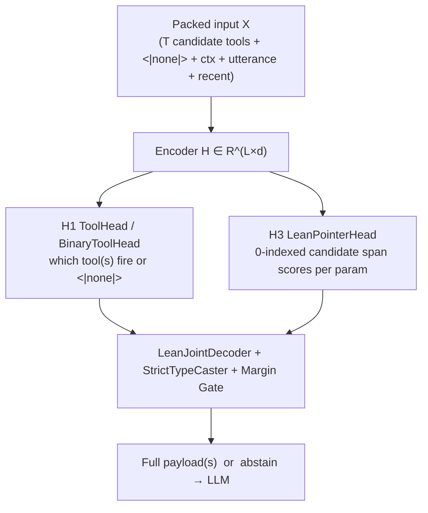

# SpanCall Prediction Heads: Getting Everything Out of One Forward Pass

Companion to [mechanism.md](mechanism.md) (§5 pointer head, §7 gate, §9 schema selection), [architecture.md](architecture.md), and [proposal.md](proposal.md).

**Design principle:** the encoder pass `H = Enc(X) ∈ R^{L×d}` is the expensive part (~99% of compute). Every prediction head is a few linear layers on `H` (<1% of cost).

> [!IMPORTANT]
> **Active Lean Architecture (`spancall/lean/` + `spancall/model/heads.py`):**
> The production Lean model ([`LeanSpanCallModel`](../spancall/lean/model.py)) uses **two active heads** on top of the shared encoder:
> 1. **H1 — Tool Selection Head:** [`ToolHead`](../spancall/model/heads.py) (softmax over packed `<|tool|>` + `<|none|>` anchors) or [`BinaryToolHead`](../spancall/model/heads.py) (independent per-anchor sigmoid BCE, `use_binary_tool_head=True`).
> 2. **H3 — Lean Pointer Head:** [`LeanPointerHead`](../spancall/lean/model.py) (0-indexed boundary-factorized span scorer over `C` valid candidates per parameter, with **no** learned abstain column `∅` so pointer training never collapses onto an abstain shortcut).
>
> Whole-call abstention is handled cleanly at serve time by H1's `<|none|>` / threshold gate, deterministic type casting & schema validation, and the W2 `min_joint_margin` posterior margin gate in [`LeanResolver`](../spancall/lean/resolver.py).
>
> All heads subclass [`BaseHead`](../spancall/model/heads.py) so additional or experimental heads (Sections 4–5 below) can be plugged in without altering the encoder or agent router.

---

## 1. What One Lean Pass Predicts



| # | Head | Implementation | Predicts | Used at inference by |
| --- | --- | --- | --- | --- |
| **H1** | **Tool (`ToolHead` / `BinaryToolHead`)** | [`spancall/model/heads.py`](../spancall/model/heads.py) | Which packed tool(s) fire, or `<|none|>` | Tool selection, multi-call emission, tool-confidence gate |
| **H3** | **Lean Pointer (`LeanPointerHead`)** | [`spancall/lean/model.py`](../spancall/lean/model.py) | Distribution over `C` valid candidate spans per parameter | `LeanJointDecoder` equal-value aggregation + `joint_margin` |

---

## 2. Input Layout: Multi-Tool Packed Sequence (`template_multi.jinja`)

Both training ([`tensorize_sample_lean`](../spancall/lean/tensorize.py)) and serving ([`LeanResolver`](../spancall/lean/resolver.py)) render through the **single unified grammar** `build_input_multi` ([`span_template/template_multi.jinja`](../span_template/template_multi.jinja)):

```text
<|cls|>
<|tool|> t1 (desc)  <|param|> a (desc)  <|param|> b (desc)
<|tool|> t2 (desc)  <|param|> c (desc)  <|param|> d (desc)
<|none|>
<|sep|>
<|ctx_meta|> <|null|> | true | false | <|unresolved|>
<|ctx_time|> ...   <|ctx_enum|> ...
<|sep|>
utterance
<|sep|>
<|ctx_recent|> ...
<|eos|>
```

- Every `<|tool|>`, `<|none|>`, and `<|param|>` token is an atomic special token registered on the tokenizer (`SPECIAL_MARKER_TOKENS`), serving as a **query anchor** where heads read `H`.
- During training, `ToolPool` (`jitter_pack_tools=True`) packs the ground-truth tool(s) alongside distractor tools so H1 always sees `T >= 2` anchors.
- At serve time, `LeanResolver.try_resolve_candidates` encodes the multi-tool prompt **once** (`encoded_bundle`) and reuses `(output, H, per_token)` for both H1 tool scoring and H3 parameter extraction.

---

## 3. Active Head Specifications

Notation: `B` = batch size, `T` = packed tool anchors (including `<|none|>`), `K` = parameter anchors, `C` = candidate spans per parameter (`max_cands = 512`), `L` = sequence length, `d` = encoder hidden size (read dynamically from the backbone config), `d_h` = head projection width (`head_dim = 256`).

### 3.1 H1 — `ToolHead` (Softmax) and `BinaryToolHead` (Independent Sigmoid)

Both heads share the exact same input signature and architecture (`2d -> d -> 1` GELU MLP over `[H_{\tau_t}; H_{\text{CLS}}]`), producing `(B, T)` logits:

$$u_{t} = w_{\text{tool}}^\top\,\text{GELU}(W[\,H_{\tau_t};H_{\text{CLS}}\,])$$

- **`ToolHead` (default):**
  - Trained with masked cross-entropy (single-call) or multi-positive set-marginal cross-entropy (multi-call) in [`LeanLossContainer`](../spancall/lean/loss.py).
  - At inference, scores are normalized via `softmax_t(u)`; gated by `call_min_prob` and `call_min_prob_ratio`.
- **`BinaryToolHead` (`use_binary_tool_head=True`):**
  - Trained with `binary_cross_entropy_with_logits` independently per anchor (`1` for called tool anchors, `0` for distractors and `<|none|>` on positive rows; `1` on `<|none|>` for abstain rows).
  - Eliminates softmax competition between distractors and produces an absolute `P(called) = \sigma(u_t)` gated against `tool_call_threshold`.

### 3.2 H3 — `LeanPointerHead` (Boundary-Factorized Candidate Span Scorer)

For each parameter anchor `k` at token index `\pi_k` and each valid candidate span `c = (i_c, j_c)` in `0..C-1`:

$$q_{k} = W_q\,\text{LN}(H_{\pi_k}) \in \mathbb{R}^{d_h}$$

$$s_{k,c} = q_{k}^\top (W_s\,\text{LN}(H_{i_c})), \qquad e_{k,c} = q_{k}^\top (W_e\,\text{LN}(H_{j_c}))$$

$$M(k, c) = \frac{s_{k,c} + e_{k,c}}{\sqrt{d_h}} + r(\min(j_c - i_c, W_{\max}))$$

- **No abstain column:** Unlike the retired v1 `PointerHead`, `LeanPointerHead` outputs `(B, K, C)` over real candidates only (with `-1e4` on padded candidate slots `c` where `cand_mask[b,k,c] == False`).
- **Multi-positive loss (`compute_lean_pointer_loss`):**
  $$\mathcal{L}_{\text{ptr}}(b, k) = -\log \sum_{p \in \mathcal{P}_{b,k}} P(c = p \mid b, k)$$
  Parameters with no positive candidate (`pos_indices == -1` everywhere) are masked out of the denominator (`ignore_index = PAD_INDEX = -1`).

---

## 4. Combined Lean Training Objective (`LeanLossContainer`)

$$\mathcal{L} = \lambda_{\text{ptr}}\,\mathcal{L}_{\text{ptr}} + \lambda_{\text{tool}}\,\mathcal{L}_{\text{tool}}$$

Default weights: `\lambda_{\text{ptr}} = 1.0`, `\lambda_{\text{tool}} = 1.0`.
In [`LeanTrainer`](../spancall/lean/trainer.py), `_MicroLossAccumulator` accumulates slot-weighted numerators and denominators (`sum(loss_sum) / sum(n_supervised)`) so logged `train_loss` and `eval_loss` are invariant to micro-batch bucketing.

---

## 5. Historical / Spec-Only Extended Heads (Retired from v1, Reserved for Future Versions)

The following heads from the original v1 exploration were removed from active code because empirical runs showed that coupling an in-head abstain logit (`M(\emptyset)`) with auxiliary abstain heads caused H3 to collapse onto abstention. Their concepts remain documented here as specification references if future versions subclass `BaseHead`:

- **H2 (Call-Count Head):** superseded by multi-anchor selection in H1 (`max_calls`, `call_min_prob_ratio`, or sigmoid thresholding in `BinaryToolHead`).
- **H4 (Abstain-Reason Head):** 5-class diagnostic taxonomy (`OK`, `ABSENT`, `AMBIGUOUS`, `NEEDS_REASONING`, `OFF_WINDOW`). Keep the taxonomy enum in `spancall/data/align.py` for dataset alignment diagnostics, without training a separate head.
- **H5–H8 (Source, List-Size, Swap/Exclusivity, Correctness):** spec-only extensions; swap exclusivity is handled deterministically in `LeanJointDecoder` (`Delta_joint`), and whole-call confidence gating is handled by `min_joint_margin` + H1 probability thresholds.
