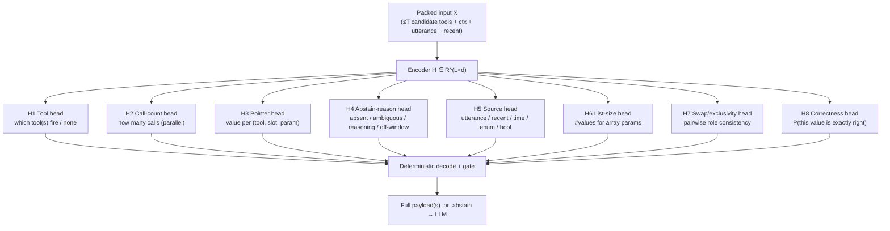

# SpanCall Prediction Heads: Getting Everything Out of One Forward Pass

Companion to [mechanism.md](mechanism.md) (§5 pointer head, §7 gate, §9 schema selection) and [proposal.md](proposal.md). Scope stays the **fully specified (F) 80%**: heads exist to emit a complete call, or to say *why* we can't.

**Design principle:** the encoder pass `H = Enc(X) ∈ R^{L×d}` is the expensive part (~99% of compute). Every extra head is a few linear layers on `H` (<1% of cost). So we move as much of the pipeline as possible *into* heads — tool choice, values, call count, confidence, swap detection, abstain reason — instead of into separate passes, retries or heuristics.

---

## 1. What One Pass Predicts



| # | Head | Predicts | Replaces / adds | Used at inference by |
| --- | --- | --- | --- | --- |
| H1 | **Tool** | which packed tool(s) should be called, or none | N separate passes for schema selection | tool selection, ambiguity between tools |
| H2 | **Call count** | number of parallel calls (0..J) | "one call per utterance" assumption | slot allocation |
| H3 | **Pointer** | the value for each `(tool, slot, param)` | core extraction | payload |
| H4 | **Abstain reason** | *why* a param is not resolvable | opaque `[UNRESOLVED]` | gate + telemetry |
| H5 | **Source** | which region the value lives in | hierarchical pointer, auxiliary signal | candidate prior, debugging |
| H6 | **List size** | number of values for `array` params | greedy threshold NMS | multi-span decode |
| H7 | **Swap / exclusivity** | are two params' chosen values consistent roles | hand-written exclusivity rule | joint decode |
| H8 | **Correctness** | calibrated P(top-1 value is exactly correct) | uncalibrated softmax | gate |

---

## 2. Input Layout: Pack All Candidate Tools Into One Sequence

> **D5 status:** the packed layout below is **spec-only by default**. The shipped path is the single-tool form ([`template.jinja`](../span_template/template.jinja)) with `data.pack_tools: 1` (configs/default.yaml); the packed layout below ([`template_multi.jinja`](../span_template/template_multi.jinja)) is constructed only when `data.pack_tools > 1`, gated by the measured tool-ambiguity slice of stratum F exceeding ~10% of F (E0/E7 telemetry, remediation_plan.md D5). Until then the single-tool form is what training and serving use.

To predict tool choice *and* values in one pass, put the top-`T` candidate tools (from a cheap retriever, T ≤ 4) in the same sequence. The schema block gets repeated once per tool; context and utterance appear once.

```text
[CLS]
[TOOL] t1 (desc)  [PARAM] a (desc)  [PARAM] b (desc)
[TOOL] t2 (desc)  [PARAM] c (desc)  [PARAM] d (desc)
[NONE]                                   ← "no tool applies" anchor
[SEP]
[CTX_META] [NULL] | true | false | [UNRESOLVED]
[CTX_TIME] ...   [CTX_ENUM] ...
[SEP]
utterance
[SEP]
[CTX_RECENT] ...
[EOS]
```

- `[NONE]` is a new anchor so "no tool" is a first-class class of H1, not a threshold.
- Every `[TOOL]`/`[PARAM]` token is a **query anchor**; heads read `H` at those positions. Param anchors are tagged `(tool t, param k)`.
- **Attention masking (optional, v2):** params of tool `t1` attend to `t1`'s schema, shared context and the utterance, *not* to other tools' params. Prevents cross-tool leakage and keeps cost near `L_shared + T·L_schema`. Start with full attention (simplest), ablate the mask.
- Enum pool `[CTX_ENUM]` is the union across **all packed tools**; the per-param validity masks (mechanism R9) still restrict candidates to that param's own enum.

Budget: `L ≤ 32768` (backbone-driven; e.g. T=4 tools × ~60 tokens of schema + context/utterance/recent budget). Over-budget ⇒ reduce T / evict oldest context rows, then abstain.

---

## 3. Head Specifications

Notation: `T` ≤ 4 tools, `K` ≤ 8 params per tool, `J` ≤ 3 call slots, `L` ≤ 32768. `d` = encoder hidden width, **read from the pretrained backbone's config at construction** (1024 for Qwen3-0.6B). The entire head stack derives its shapes from `d`, so swapping backbones requires passing the new hidden size and nothing else. `d_h` = head width, a hyperparameter defaulting to `d_h = max(64, d // 3)` (= 256 at `d`=768, 341 at `d`=1024); every per-head projection below is `d → d_h`, so it retargets automatically with the backbone.

### H1 — Tool Head

- **Input:** `H` at each `[TOOL]` anchor `τ_t` and at `[NONE]`, plus `H_CLS`.
- **Output:** logits over `{t_1..t_T, NONE}` per slot `j` (multi-label across slots; see H2).

$$u_{t} = w_{\text{tool}}^\top\,\text{GELU}(W[\,H_{\tau_t};H_{\text{CLS}}\,]),\qquad P(\text{tool}=t)=\text{softmax}_t(u)$$

- **Label:** the GT tool name of the example (slot order, §H2). `NONE` for non-call utterances.
- **Loss:** cross-entropy (softmax over `T+1` classes).
- **Inference:** top-1 prob `P_tool` and the margin to second tool both enter the gate. **Two tools within margin ⇒ abstain** (ambiguous routing).
- This head is what replaces "run the encoder `N` times" (mechanism §9, option 3).

### H2 — Call-Count Head

- **Input:** `H_CLS`.
- **Output:** `P(n_calls = 0..J)` (softmax, J=3; 0 ≡ no call).
- **Label:** number of GT calls (parallel calls like "weather in Hanoi and Paris", "add milk and eggs").
- **Loss:** cross-entropy.
- **Use:** allocates `n` call slots. `n > J` or `P_count` low ⇒ abstain. In v1, set `J=1` and use H2 only as an *abstain* feature (`n ≥ 2` ⇒ abstain), turning "this is actually two calls" from a silent error into a detected one.
- **Slot ordering (no matching needed):** GT calls are ordered by the char position of the earliest grounded span. Slots are therefore a deterministic function of the text, so no Hungarian loss is required.

### H3 — Pointer Head (value extraction)

Same boundary-factorized head as mechanism §5, extended with a **slot** and **tool** dimension. The query for param `k` of tool `t` in slot `j`:

$$q_{t,k,j} = W_q\,\text{LN}(H_{\pi_{t,k}}) + E^{\text{slot}}_j$$

$$s_{i}^{(t,k,j)} = q_{t,k,j}^\top W_s H_i,\quad e_{j'}^{(t,k,j)} = q_{t,k,j}^\top W_e H_{j'},\quad M(c)=s_i+e_{j'}+r(j'-i)$$

- **Candidates `A_{t,k}`:** pre-filtered by type and per-param validity (mechanism §3.4/R9), snapped for CTX entries (R8). Always includes `∅`.
- **Abstain logit `M(∅)`:** from `[H_CLS; H_π]`; it is *decomposed* by H4.
- **Distribution:** one softmax over `A ∪ {∅}` per `(t,k,j)`; equal-valued candidates are summed (R4).
- **Label:** multi-positive set `P` from reverse alignment (all occurrences / equal-valued entries); only for the **GT tool** `t*` and its slots. Params of non-GT tools are **not trained** (masked out of the loss) — they are only ever read if H1 selects that tool.
- **Loss:** multi-positive softmax CE (mechanism §8.2).
- **Cost:** `3·d·d_h` params (≈ 0.6 M at `d`=768, `d_h`=256); `2·K·T·J·L·d_h` MACs (~tens of MFLOPs) — scales with `d`, no manual head edits per backbone.

### H4 — Abstain-Reason Head

Splits the single `[UNRESOLVED]` abstention into *causes*. Only the *union* matters for firing the gate, but the split gives (a) a better-trained abstention signal, (b) telemetry on the 20% **without engineering effort for it**.

- **Input:** `[H_CLS; H_π; pool(H_utt)]` per `(t,k,j)`.
- **Classes (5):** `OK` (a candidate is correct), `ABSENT` (no value stated), `AMBIGUOUS` (≥2 plausible distinct candidates, e.g. two flights in recent context and "that flight"), `NEEDS_REASONING` (value must be computed/inferred: "in a week after payday", "the cheaper one"), `OFF_WINDOW` (date/entity exists but is outside the context pool, e.g. "Q1 2027").
- **Labels:**
  - `OK` — param aligns.
  - `ABSENT` — GT null/missing.
  - `OFF_WINDOW` — GT is a date not in the window, or an entity in a segment we don't expose.
  - `AMBIGUOUS` — **synthetic**: insert a near-duplicate distractor row in recent context with the same key class, and keep an anaphoric utterance ("that one") ⇒ label ambiguous.
  - `NEEDS_REASONING` — alignment failed, GT derivable from the utterance but not extractable (residual class).
- **Loss:** CE; weight `OK` low (it is the majority).
- **Inference:** `P(OK)` is a gate feature; the argmax reason is logged when we abstain. `M(∅)` in H3 is *tied* to `log(1 − P(OK))` via an auxiliary consistency loss so H3 and H4 never disagree.

> [!NOTE]
> **H5–H8 are specification-only** — designed in this doc, but **not yet implemented** in [`spancall/model/heads.py`](../spancall/model/heads.py). The codebase currently implements H1–H4 plus `CallAcceptHead` (see architecture §5.1). H5–H8 enter the roadmap behind E12/E15 ablations.

### H5 — Source Head (auxiliary + prior)

- **Input:** `H_π` per `(t,k,j)`.
- **Output:** softmax over `{utterance, recent, time, enum, bool}` — *where* the value lives.
- **Label:** segment of the aligned positive (free from the legend: `entry.segment`).
- **Loss:** CE, small weight (0.3).
- **Why it helps:** hierarchical decomposition `P(c) = P(source)·P(c | source)`. It (a) regularizes the encoder to separate "stated" vs "canonicalized" vs "remembered" values, (b) provides a **prior** that can down-weight cross-region candidates at inference, and (c) is a debug signal ("model thinks it's a date but pointed to utterance"). Disagreement between H5's source and H3's chosen region is a gate feature.

### H6 — List-Size Head

- **Input:** `H_π` for params whose schema type is `array`.
- **Output:** softmax over `{0,1,2,…,N_max}` (N_max=8; 9 = "more").
- **Label:** number of aligned elements.
- **Loss:** CE.
- **Inference:** replace threshold-based NMS with **top-`n` non-overlapping spans** from H3's sigmoid-style scores, where `n = argmax H6`. Count mismatch with spans above threshold ⇒ abstain. Fixes the classic list failure modes (merged items "milk and eggs", split items).

### H7 — Swap / Exclusivity Head (pairwise)

Learns what the hand-written exclusivity rule in mechanism §6 approximates. Operates on the **chosen** top-1 candidates per param.

- **Input (pair `(k,l)` of the same tool, with chosen spans `a_k, a_l`):**

$$\bar h_a = W_{\text{span}}\,\text{LN}(\bar H_a)\in\mathbb{R}^{d_h}, \qquad z_{kl} = [\,q_k;\;q_l;\;\bar h_{a_k};\;\bar h_{a_l};\;\bar h_{a_k}\!\odot\!\bar h_{a_l}\,]\in\mathbb{R}^{5d_h}$$

where `H̄_a` is mean-pooled encoder state over span `a` (a second tiny gather — no extra encoder pass) and `W_span: d → d_h` is one shared projection (also reused by H8). Projecting spans to `d_h` keeps the MLP width `5·d_h` independent of the backbone width, so the pair head needs no edits when `d` changes.
- **Output:** `P(roles consistent)` ∈ (0,1) — sigmoid.
- **Label:** positive = GT assignment; negatives = **swapped** assignment (origin↔destination, sender↔recipient), same-span assignment, and distractor-substituted assignment — all synthesized from the same example.
- **Loss:** BCE.
- **Inference:** `min_{k,l} P_consistent` is a gate feature, directly measuring the *wrong-value* risk. Complements (does not replace) the joint-margin check; H7 is learned, the joint margin is structural.
- **Cost:** `K(K−1)/2 ≤ 28` pairs × a 2-layer MLP on `5·d_h`: negligible. It does run *after* the argmax (one tiny second step on already-computed `H`), not a second encoder pass.

### H8 — Correctness Head (learned confidence)

Softmax probabilities are over-confident on OOD paraphrases. A head trained directly on *"was the model right?"* is a better gate input.

- **Input per `(t,k,j)`:** `[\bar h_{a*}; q_{t,k,j}; v_\text{stats}] ∈ R^{2d_h + n}` where `\bar h_{a*}` is the H7 span projection of the chosen span, `q` is the H3 query (`d_h`), and `v_stats` is a fixed `n=8`-dim logit-statistics vector (top-1, top-2, margin, entropy of `A ∪ {∅}`, `P_source`, `P_OK`, + 2 reserved). Both `d_h`-width pieces re-derive from `d` (§3).
- **Output:** `P(top-1 exactly matches GT)`.
- **Label:** `1` if the argmax of H3 equals a positive, `0` otherwise — computed **on the fly during training from the model's own prediction** (stop-gradient into the encoder and H3, so it only learns to read confidence).
- **Loss:** BCE.
- **Call-level:** `P_call = ∏_k P_correct,k` (or `min`), then isotonic-calibrated on a held-out set. This feeds the gate (§5) instead of raw softmax.

---

## 4. Training: One Loss, Many Heads

$$\mathcal{L} = \mathcal{L}_{\text{ptr}} + \lambda_1\mathcal{L}_{\text{tool}} + \lambda_2\mathcal{L}_{\text{count}} + \lambda_3\mathcal{L}_{\text{reason}} + \lambda_4\mathcal{L}_{\text{src}} + \lambda_5\mathcal{L}_{\text{list}} + \lambda_6\mathcal{L}_{\text{swap}} + \lambda_7\mathcal{L}_{\text{corr}}$$

| Weight | Start | Note |
| --- | --- | --- |
| `λ_1` tool | 1.0 | routing is gate-critical |
| `λ_2` count | 0.3 | small signal |
| `λ_3` reason | 0.5 | `OK` class down-weighted |
| `λ_4` source | 0.3 | auxiliary |
| `λ_5` list | 0.5 | only on rows with arrays |
| `λ_6` swap | 1.0 | main wrong-value defence |
| `λ_7` corr | 1.0 | **stop-grad** — never moves the encoder |

**Schedule (avoids multi-task gradient fights):**

1. **Stage A (≈60% steps):** `L_ptr + L_tool + L_reason + L_src + L_count + L_list`. Encoder + heads trained jointly; pointer is the anchor task.
2. **Stage B (≈25%):** add `L_swap` with swap negatives synthesized *from the model's own mistakes* (hard-negative mining: take top-2 wrong candidates from Stage-A predictions).
3. **Stage C (≈15%, encoder frozen):** train **only** H8 on held-out-style data (paraphrase-disjoint split) so correctness is learned on predictions the encoder has *not* memorized. This is what makes H8 honest.

If gradient conflicts appear (check cosine similarity between per-head grads), use uncertainty weighting or PCGrad as an ablation, not as default.

**Label coverage per row type:**

| Row type | H1 | H2 | H3 | H4 | H5 | H6 | H7 | H8 |
| --- | --- | --- | --- | --- | --- | --- | --- | --- |
| F (full) | tool | n | all params | `OK` everywhere | segment | arrays | GT + swap negs | on-the-fly |
| A (abstention negative) | tool/NONE | n | `∅` on unaligned, aligned on others | reason | segment where aligned | — | — | on-the-fly |
| Non-call utterance | `NONE` | 0 | — | — | — | — | — | — |
| Multi-call | tools per slot | n ≥ 2 | per slot | per slot | per slot | per slot | per slot | per slot |

Sources: xLAM / Glaive (multi-call and parallel exist in both); non-call rows from Glaive chitchat and synthetic negatives; ambiguous rows are synthetic (H4).

---

## 5. Decode and Gate Using All Heads

```python
def decode(out):                      # out = all head outputs from ONE forward pass
    n  = argmax(out.count)            # H2
    if n == 0 or n > J:               return ABSTAIN("no_call_or_too_many")
    calls = []
    for j in range(n):
        t, p_tool, tool_margin = top2(out.tool[j])        # H1
        if t == NONE or tool_margin < M_TOOL:             return ABSTAIN("tool_ambiguous")
        payload, feats = {}, []
        for k in params(t):
            reason, p_ok = out.reason[t,k,j]              # H4
            if p_ok < T_OK:                               return ABSTAIN(reason)      # logged cause
            cand, p_ptr, margin = best_valid(out.ptr[t,k,j], mask=R9)   # H3
            if schema_type(k)=="array":
                cand = topn_nonoverlap(out.ptr[t,k,j], n=argmax(out.list[t,k,j]))   # H6
            payload[k] = cast(cand)                       # deterministic caster
            feats.append((p_ptr, margin, out.corr[t,k,j], src_agree(out.src, cand)))
        swap = min_pair(out.swap, payload)                # H7
        if swap < T_SWAP or not validate(t, payload):     return ABSTAIN("inconsistent")
        calls.append((t, payload, feats, p_tool))
    P_call = calibrate(prod_corr(calls))                  # H8, isotonic
    return calls if P_call >= TAU_TIER[risk_tier(calls)] else ABSTAIN("low_confidence")
```

- **Fires only if every head agrees.** Each head is an independent veto; the conjunction is the **precision engine**. The calibrated `P_call` is the final threshold.
- **Every abstain carries a reason** (`tool_ambiguous`, `ABSENT`, `AMBIGUOUS`, `NEEDS_REASONING`, `OFF_WINDOW`, `inconsistent`, `low_confidence`). Aggregated in shadow mode, this tells you which slice of the 20% is worth attacking next — without us optimizing it now.
- Risk tiers set `TAU_TIER` (mechanism §7.4).

---

## 6. Cost Accounting

| Item | Params | Extra FLOPs / call | Share of encoder |
| --- | --- | --- | --- |
| Encoder (Qwen3-0.6B / ModernBERT-base) | ~0.6 B | variable | 100% |
| H1 tool | ~0.3 M | <1 MFLOP | ~0 |
| H2 count | ~0.01 M | ~0 | ~0 |
| H3 pointer (3 projections) | ~0.6 M | ~tens of MFLOPs | <0.05% |
| H4 reason | ~0.4 M | ~10 MFLOPs | ~0 |
| H5 source, H6 list | ~0.2 M | ~0 | ~0 |
| H7 swap | ~0.5 M | ~10 MFLOPs (28 pairs) | ~0 |
| H8 correctness | ~0.3 M | ~5 MFLOPs | ~0 |
| **Heads total** | **~2.4 M (~1.6%)** | **<0.1%** | |
| Packing T=4 tools vs T=1 | — | +~0.9× encoder tokens (≈1.9× single-tool, per the §2 budget) | the real cost |

> All head parameter counts assume the defaults `d`=768 / `d_h`=256 (ModernBERT-base / DeBERTa-v3-base). Params are ~linear in `d·d_h` and re-derive from the backbone at construction (§3), so this table needs no manual edits when testing another pretrained model — only the encoder row changes.
>
> For a clean upgrade path across backbones, keep `d_h` as a fraction of `d` (`d // 3`) rather than an absolute; tune it per backbone only if the heads' share of the gradient argues otherwise.

**Takeaway:** heads are free. The one meaningful cost lever is *packing tools*, which trades ~1.5× encoder cost for removing `N` separate passes and giving a tool-vs-tool signal in the same pass. Verify with measurements (Phase 4).

---

## 7. What Cannot Be Done in One Pass (Honest Limits)

1. **H7 and H8 consume the chosen spans** (argmax of H3), so they run as a tiny second step on the *same* `H`. No second encoder pass, but not literally a single feed-forward graph. A fully parallel variant would score all top-`K` candidates pairwise (`K²` per pair) — viable if latency matters; start sequential.
2. **Retrieval of candidate tools** (choose top-`T`) is outside the pass. A cheap embedding retriever over tool descriptions; its recall caps the whole system's recall, so measure it separately (R@T).
3. **Multi-step plans** ("find flights then book the cheapest") require reasoning and results from the first call — not extractable. H2/H1 detect `n ≥ 2` with dependency cues only as an abstention signal.
4. **Values requiring computation** (arithmetic, comparison) — H4's `NEEDS_REASONING` flags them; the LLM does them.

---

## 8. Ablations (Order of Priority)

| # | Ablation | Question | Expected |
| --- | --- | --- | --- |
| H-A1 | H3 only vs + H1 packing | does single-pass tool selection beat N-pass? | similar precision, ~N× less compute |
| H-A2 | − H4 (single `∅`) | do reasons improve abstention? | better precision at fixed coverage |
| H-A3 | − H7 | do learned swap checks beat joint margin alone? | wrong-value rate ↑ without |
| H-A4 | H8 vs raw softmax gate | calibration benefit | higher coverage at 95% precision |
| H-A5 | − H5 | does the source head help representation? | small, maybe 0–1 pt |
| H-A6 | J=1 vs J=3 | do multi-call slots pay off? | only if parallel calls > ~10% of traffic |
| H-A7 | full vs masked attention across tools | does cross-tool leakage hurt? | masking helps with T ≥ 3 |
| H-A8 | stage C (frozen-encoder H8) vs joint | honesty of correctness head | joint overfits, stage C better calibrated |

**Priority for v1 (D4):** H3 + H1 + H4 + H8 (value, tool, why-not, calibrated confidence) are constructed by default (`model.heads` in configs/default.yaml; `CallAcceptHead` also stays). H2/H5/H6/H7 are **spec-only** — constructed only when their `model.heads.<id>` flag is flipped on. Add H7 when wrong-value errors dominate the error log; add H2/H6 when multi-call / list slices exceed ~10% of F; H5 is optional.

---

## 9. Module Sketch

```python
class SpanCallHeads(nn.Module):
    def __init__(self, encoder_hidden_size, dh=None, T=4, J=3, Nmax=8,
                 n_stats=8):
        d  = encoder_hidden_size            # from the backbone config, not hardcoded
        dh = dh or max(64, d // 3)          # head width scales with d (256 @ d=768)
        self.q     = nn.Linear(d, dh)                 # param query
        self.Ws    = nn.Linear(d, dh); self.We = nn.Linear(d, dh)
        self.Wspan = nn.Linear(d, dh)                 # span repr for H7 + H8
        self.slot  = nn.Embedding(J, dh)
        self.rope  = RelPosBias(dh)
        self.abst  = nn.Linear(2*d, 1)                # M(∅)
        self.tool  = MLP(2*d, 1)                      # per [TOOL]/[NONE] anchor
        self.cnt   = nn.Linear(d, J+1)
        self.rsn   = MLP(3*d, 5)
        self.src   = nn.Linear(d, 5)
        self.lst   = nn.Linear(d, Nmax+2)
        self.swp   = MLP(5*dh, 1)                     # [q_k;q_l;h_k;h_l;h_k⊙h_l]
        self.cor   = MLP(2*dh + n_stats, 1)           # [h_{a*}; q; logit stats]
        self.d, self.d_h = d, dh

    def forward(self, H, anchors, cand_mask):        # H: [B, L, d]
        ...  # all heads read H; none call the encoder again

# construct per backbone — swap any pretrained encoder without touching head shapes:
heads = SpanCallHeads(model.config.hidden_size)      # DeBERTa-v3 / ModernBERT / ...
```

---

## 10. Open Questions

1. Is `J=3` worth it, or should multi-call detection (H2) stay an abstention feature only?
2. Is full-attention packing of `T=4` tools robust, or does it need the block mask from day one?
3. Do H4's synthetic `AMBIGUOUS` rows transfer to real ambiguity, or just teach a template?
4. Is stage-C correctness training data (paraphrase-disjoint) large enough for isotonic calibration per risk tier?
5. Can H5 be dropped once H3 is trained with hierarchical softmax?
