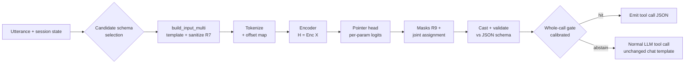

# SpanCall Mechanism: How a Full-Parameter Call Is Resolved in One Pass

Companion to [proposal.md](proposal.md). The proposal says *what* we claim; this document says *how it works*, mechanically, and where it can break.

---

## 0. Scope Decision: Solve the 80% First

Tool calls fall into two buckets:

| Bucket | Definition | Share (assumed, to be measured) | Treatment |
| --- | --- | --- | --- |
| **F — fully specified** | Every parameter of the call has its value grounded somewhere in Ω (utterance, recent context, time window, enum pool, `true`/`false`). | ~80% | **The target.** All engineering effort goes here. |
| **A — has absent/unresolvable params** | At least one parameter is missing, implied, computed, or needs reasoning. | ~20% | **Not optimized.** The gate abstains → normal LLM call. |

Why F first, and why not "partial fast path" for A:

- A call that falls to the LLM pays **prefill + decode** regardless of how many params we already had. Pre-filling 3 of 4 params saves almost nothing (the LLM still pays the prefill and most of the structural decode tokens), while adding a second failure surface.
- A *fully* resolved call removes the LLM from the loop entirely (§1). Savings are **per-call, all-or-nothing**.
- Handling absence (clarification questions, defaults, inference) is a *reasoning* task — exactly what the LLM is good at, and what a 150M encoder is not.

**Consequences for the design (simplifications relative to the proposal):**

1. No effort on `[NULL]` modelling, defaults, or optional-param inference. `[NULL]`/`[UNRESOLVED]` remain in the template only as a **cheap "none of the above" abstention class** so the gate has something to reject with. They are not optimized and not evaluated as a task.
2. Metrics are reported on **stratum F** (Hit Rate on F, Precision-at-Hit) and on **all traffic** (to show the 20% is not harmed). Stratum A is only checked for *false hits* (the model firing when it shouldn't).
3. Training data keeps A-rows only as **abstention negatives** (~15–20% of the mix, §8.3), so the 20% reliably falls through. We are not trying to *solve* them.

> [!NOTE]
> Open risk in this scoping: an **optional** param that the user *did* state, but which we don't expose to the encoder, would be silently dropped → wrong call. So optional params that exist in the schema are exposed like any other param (each gets a `[PARAM]` row and a pointer); the only simplification is that we don't try to be clever when they are absent — abstain or take the `[NULL]` default and move on.

---

## 1. Why a Full Call Saves More Compute (the Cost Model)

Illustrative single-stream numbers (7B model, bf16, one H100-class GPU; to be replaced by measurements in Phase 4):

| Component | LLM tool call | SpanCall fast path |
| --- | --- | --- |
| Prefill | ~600 tokens × 2 × 7e9 ≈ 8.4 TFLOPs (compute-bound, ~20 ms) | — |
| Decode | ~30 sequential steps, each reads ~14 GB of weights (**memory-bound**, ~4 ms/step) ≈ **120 ms** | — |
| Encoder pass | — | ~300 tokens × 2 × 150e6 ≈ 0.09 TFLOPs (~5–15 ms incl. overhead) |
| **Total** | **~150 ms**, ~8.5 TFLOPs | **~10 ms**, ~0.1 TFLOPs |

Decode time is dominated by *number of sequential steps*, not FLOPs. That is the real win of one-shot pointing: **1 step instead of ~30**, and a model ~50× smaller.

**Schema-selection assumption (D6).** This cost model assumes mode 1 (context-determined) from §9: the schema is known without retrieval, so `c_s` is just the encoder pass. Under the embedding-retriever mode (§9.1.2) `c_s = c_retrieval + c_encoder` and `h` must be replaced by `h × R@T` (the retriever's measured recall-at-top-N); a retriever miss means the call silently falls through to the LLM. Every reported savings figure states the selection mode it used.

Expected cost per call with the router, hit rate `h`, hit precision `p`, router cost `c_s`, LLM cost `c_L`, cost of a wrong hit `c_w` (retry + side effects):

$$\mathbb{E}[\text{cost}] = c_s + (1-h)\,c_L + h\,(1-p)\,(c_w + c_L)$$

Savings vs. always-LLM are positive iff

$$h\,c_L \;>\; c_s + h\,(1-p)\,(c_w + c_L)$$

With `c_s/c_L ≈ 0.07`, `p = 0.95`, `c_w ≈ c_L`: break-even `h ≈ 0.07 / (1 − 0.10) ≈ 8%`. At the intended `h ≈ 0.6–0.8`, cost falls ≈ 45–65% (plugging the numbers: `E[cost]/c_L = 1.07 − 0.9h`, i.e. ~47% at `h`=0.6 and ~65% at `h`=0.8). **The formula shows why the 80% bucket matters**: every added point of `h` is worth `c_L`, while partial resolution contributes nothing to `h`.

---

## 2. End-to-End Pipeline



Stages in detail follow. The fallback path is the agent's existing pipeline (e.g. the LLM's own chat template such as [chat_template_gemma4.jinja](chat_template_gemma4.jinja)); SpanCall never modifies it. (The vendored Gemma template carries only a header date — pin its upstream source/version and cover it with a byte-exact render test against the Q9.1 emitter, pipeline_io.md §Q9.)

---

## 3. Stage 1 — Input Construction and Tokenization

**3.0 Two invariants this stage enforces.**

*Grammar uniformity.* Exactly one template renders the Lean prompt at every
`T >= 1`: [`template_multi.jinja`](../span_template/template_multi.jinja), via
[`build_input_multi`](../span_template/template.py). The single-tool
[`template.jinja`](../span_template/template.jinja) / `build_input` pair survives
for the legacy path but is unreachable from `spancall/lean/` — training on a
grammar that inference never emits is an unfixable train/serve mismatch, so the
`pack_multi_tools=False` escape hatch was removed outright.

*Tool coverage.* For every function-calling sample, `render_T >= len(sample.tools)`
and each native tool appears exactly once as a `<|tool|>` block:

```
T = max(pack_tools, 1 + len(native_tools), jitter_draw)
```

`data.pack_tools` is a **floor**, not a cap — it only ever *adds* corpus
distractors, never removes a native tool. `data.max_tools` is the single knob
allowed to reduce `T` (an emergency VRAM brake, off by default); when it fires
the row is counted in `stats["tool_truncated_rows"]` and printed loudly, because
a native tool missing from the prompt can never be selected by H1 no matter how
good the weights are. `jitter_pack_tools` draws `T` uniformly from
`[min_tools, floor]` per row so that `T = 1` (the oracle-tool eval layout) stays
inside the training distribution.

**3.1 Render.** [`template_multi.jinja`](../span_template/template_multi.jinja) → text; [`parser.py`](../span_template/parser.py) → `entries` with absolute char offsets (the legend). The legend is derived from the *rendered* text so training and serving cannot drift.

**3.2 Special tokens.** Markers (`[PARAM]`, `[CTX_TIME]`, `[CTX_ENUM]`, `[CTX_RECENT]`, `[NULL]`, `[UNRESOLVED]`, `[SEP]`, …) are added to the tokenizer as **atomic special tokens**, and their embeddings are newly initialized and trained. Two effects: (a) the encoder sees a clean structural signal instead of subword fragments; (b) R7 becomes enforceable at the tokenizer level — user text is tokenized with special-token parsing **disabled**, so a typed `[SEP]` can never become the real token. *Status: this is the design target — the P6 tokenizer/vocabulary setup is marked 🚧 pending in [Part C](pipeline_io.md); the current reference implementation renders literal `[…]` markers as plain text and defends R7 string-side in `sanitize.py`.*

**3.3 Offset map.** Tokenize with `return_offsets_mapping=True`. For each legend entry we compute

```
tok_start(entry) = first token whose char span overlaps entry.char_start
tok_end(entry)   = last token whose char span overlaps entry.char_end-1
```

Entries are *snapped* (R8): a CTX entry's token range is exactly its tokens; a pointer to any partial range is invalid by construction (masked, not just penalized).

**3.4 Candidate set.** For each param `k`, the allowed candidate set `A_k` is built **before** the model runs, deterministically:

| Param type (from JSON schema) | Allowed candidates in `A_k` |
| --- | --- |
| `string` (free) | utterance spans (width ≤ `W_max` tokens) ∪ recent-context value interiors |
| `string` with `enum` | only that param's enum entries in `[CTX_ENUM]` (R9) — *plus* utterance spans only if the enum is open-ended |
| `boolean` | `true`, `false` in `[CTX_META]` |
| `integer`/`number` | utterance spans whose text parses as a number (pre-filtered by regex over the original text) |
| `date`/`datetime` | `[CTX_TIME]` iso entries ∪ utterance spans matching a literal date pattern |
| `array<T>` | multiple spans from `A` of the element type `T` |

Plus one special candidate in every `A_k`: `[UNRESOLVED]` (abstain).

Pre-filtering by type before scoring is the main reason the head can be tiny: the model never has to learn that "Hanoi" is not an integer.

---

## 4. Stage 2 — Encoding

`H = Encoder(X) ∈ R^{L×d}`, ModernBERT-base or DeBERTa-v3-base (~150M params), fine-tuned end-to-end.

What attention must learn (this is the *only* learned semantic behavior):

1. `[PARAM]` row `k` ← attends to the utterance span that *plays the role* named by the param name/description ("origin" vs "destination").
2. Utterance word ↔ CTX entry: "tomorrow" ↔ `+1d=2026-10-24`, "direct" ↔ `true`, "business" ↔ `BUSINESS`.
3. "that flight" ↔ `picked="VN123"` in recent context.
4. `[PARAM]` rows attend **to each other** (so `origin` and `destination` can disagree about which city is which).

Engineering constraints: max length `L = 32768` (backbone-driven; overflow ⇒ abstain, never truncate); no KV caching is possible across calls because attention is bidirectional (unmasked, `is_causal = False`), so the schema prefix is re-encoded each time (mitigations in §10).

---

## 5. Stage 3 — Pointer Head (the Core Computation)

### 5.1 Param query vectors

For param `k` with `[PARAM]` token at position `π_k`:

$$q_k = W_q\,\text{LN}(H_{\pi_k}) \in \mathbb{R}^{d_h}$$

### 5.2 Boundary scores (O(L) per param)

$$s_{k,i} = q_k^\top W_s H_i, \qquad e_{k,j} = q_k^\top W_e H_j$$

Span score for a candidate `(i, j) ∈ A_k` (rotary relative bias `r(j−i)` for width):

$$M(k,i,j) = s_{k,i} + e_{k,j} + r(j-i)$$

Only **valid** candidates are ever scored: CTX entries (a few dozen) and utterance spans of width ≤ `W_max` (≈ `L_utt × W_max`, ~10³). Compute: `2·K·L·d_h` for boundary scores plus a gather over `A_k` — a rounding error next to the encoder.

### 5.3 Abstain logit

$$M(k,\varnothing) = w_\varnothing^\top\,[\,H_{\text{CLS}};\,H_{\pi_k}\,] + b$$

### 5.4 Per-parameter distribution

A single softmax over `A_k ∪ {∅}`:

$$p_k(c) = \frac{\exp M(k,c)}{\exp M(k,\varnothing) + \sum_{c'\in A_k}\exp M(k,c')}$$

A softmax (not independent sigmoids) is used for single-valued params because exactly one candidate is correct; it gives a calibratable top-1 probability and a margin. For `array<T>` params the head switches to per-candidate sigmoids + the deterministic NMS from the proposal.

**Equal-valued targets (R4):** probabilities of candidates with the same canonical value are summed before taking top-1 (so `+3d` vs `next_mon` colliding on 2026-10-26 does not split the mass).

### 5.5 Call-level accept head (cheap, optional but recommended)

A binary logit from `H_CLS`: "does this utterance + schema yield a *fully-specified* call?" Trained on F vs A rows. It carries information the per-param softmaxes lack (e.g. "this is the wrong tool"), costs one linear layer, and is a gate feature (§7). It is also what makes multi-schema scoring (§9) possible.

---

## 6. Stage 4 — Joint Assignment (Why Swap Errors Don't Slip Through)

Independent per-param argmax permits two failure modes: **(a)** two params pick the same span (origin = destination = "Hanoi"); **(b)** the model confidently swaps two entities. Fix with a small deterministic joint decode.

1. For each param take the top-`K` (K=3) candidates with log-probs `ℓ_k(c)`.
2. Find the best assignment `a*` maximizing `Σ_k ℓ_k(a_k)` subject to **exclusivity**: params in the same *entity class* (declared in schema metadata or inferred by type/description cluster) may not share the same utterance span unless the schema allows it.
   With ≤ 6 params and K=3 this is ≤ 729 combinations — exhaustive search in microseconds; no Hungarian needed.
3. Compute the **joint margin** `Δ_joint = score(a*) − score(second-best assignment)`.

If a swapped assignment is nearly as likely as the chosen one, `Δ_joint` is tiny → the gate abstains. This turns the hardest failure mode (confident wrong-entity) into a measurable, thresholdable signal rather than relying on the encoder to "just know".

---

## 7. Stage 5 — Cast, Validate, Gate

### 7.1 Deterministic typed caster

Values are decoded from the **original text via char offsets** (never by detokenizing tokens), so no tokenizer loss occurs.

| Target | Rule |
| --- | --- |
| free string | `text[char_start:char_end]`, trimmed of boundary punctuation/whitespace; recent-context values are `_unescape`d exactly |
| enum | the CTX entry's value string verbatim |
| bool | `true`/`false` literal |
| date | CTX iso verbatim; or literal date parsed with a strict grammar (ambiguous `03/04/26` ⇒ abstain) |
| int/float | strict numeric parse; words ("five"), approximations ("around 500"), units mismatch ⇒ abstain |
| array | top-`n` non-overlapping spans by score, tie-break left-to-right, where `n` = H6 list-size (heads.md §H6; failure to match the span count ⇒ abstain) |

### 7.2 Schema validation

Validate the assembled payload with the tool's JSON Schema (types, `enum`, ranges, `pattern`, `oneOf`, etc.). Any violation ⇒ abstain. This catches cross-parameter constraints the encoder never modeled. Optional params the schema marks with a `default` are materialized deterministically from the schema (pipeline_io.md §Q6) — the encoder never invents one, and an absent optional-without-default stays omitted.

### 7.3 Whole-call gate

Features: `p_k` top-1 for each param, per-param margin to runner-up distinct value, `Δ_joint`, accept-head probability `a`, number of params, risk tier of the tool.

Default rule (v1, simple and auditable):

```
hit  ⇔  min_k p_k ≥ τ_p   AND   Δ_joint ≥ τ_Δ   AND   a ≥ τ_a   AND   validate()
```

A small calibrated logistic/GBM over these features can replace the conjunction later, but the conjunction is the baseline to beat.

### 7.4 Calibration (how we actually hit 95%)

1. **Temperature scaling** on held-out logits per head so `p_k` is a probability.
2. Sweep `(τ_p, τ_Δ, τ_a)` on a **held-out, paraphrase-disjoint** calibration set to maximize Hit Rate subject to **call-level precision ≥ 95%**, using a **Clopper–Pearson lower bound** at 95% confidence (not the point estimate), so a lucky small sample cannot set τ.
3. Report the risk–coverage curve; per-tier thresholds (`side_effecting` ⇒ higher precision target, e.g. 99%).
4. Re-calibrate per deployment on logged traffic with human/LLM-verified labels (shadow mode, §11).

---

## 8. Training

### 8.1 Labels from existing JSON datasets

Source: xLAM-60k, Glaive FC v2, ToolBench. For every example, build the template (synthetic clock if none recorded — never the GT date), then reverse-align each GT argument:

- GT value found verbatim in utterance ⇒ utterance span(s) (all occurrences are positives; the first occurrence is **not** privileged).
- GT value present in recent context ⇒ that entry interior.
- GT is a bool/enum/date ⇒ the CTX entry (all equal-valued entries are positives).
- else ⇒ the example is **stratum A**.

Stratum F = every param aligned. This is the training core.

### 8.2 Loss

Per param, multi-positive softmax cross-entropy over `A_k ∪ {∅}`:

$$\mathcal{L}_k = -\log\frac{\sum_{c\in P_k}\exp M(k,c)}{\exp M(k,\varnothing)+\sum_{c'\in A_k}\exp M(k,c')}$$

where `P_k` is the set of correct (equal-valued / repeated-mention) candidates; for A-rows, `P_k = {∅}` on the unaligned params. Total loss `= Σ_k 𝓛_k + λ_a · BCE(accept, is_F)`. (The proposal's Circle loss variant remains an ablation for `array` params.)

### 8.3 Data mix

| Slice | Share | Purpose |
| --- | --- | --- |
| F, natural | ~55% | core task |
| F, augmented paraphrases/typos/casing | ~20% | OOD paraphrase robustness |
| F with **distractor entities** and **entity swaps** | ~10% | wrong-value resistance, drives `Δ_joint` |
| A (abstention negatives) | ~15% | the gate must reject the 20% — not solve it |

### 8.4 Augmentations that matter

- Shuffle param order, enum order, and CTX key order (position invariance — the model must not learn "first enum is correct").
- Randomize the clock (date targets cannot be memorized).
- Randomize recent-context row order and add irrelevant rows.
- Inject adversarial text (reserved markers; newlines) — must be sanitized/abstained, never mis-parsed.
- Hold out **schemas** (not just utterances) for zero-shot evaluation.

### 8.5 Starting hyperparameters (to tune, not to trust)

Qwen/Qwen3-Embedding-0.6B (unmasked bidirectional `is_causal = False`), bf16, max_len 32768, lr 3e-5 encoder / 1e-4 head and new marker embeddings, warmup 6%, batch 64, 3–4 epochs, layer-wise lr decay 0.9, `W_max` = 16 tokens, `d_h` = 256.

---

## 9. Candidate-Schema Selection Contract (v1 Requirement, D6)

The cost model in §1 assumes the LLM is **not** consulted to decide *which* tool. If the LLM picks the tool, its prefill is already paid and the saving shrinks to the decode only (still positive but smaller). Schema selection is therefore a **v1 requirement** (was an open question) with an explicit contract: every reported number states *which* selection mode it used, and the mode is a cost-model input.

### 9.1 Selection modes

1. **Context-determined** (e.g. a search box, a form, a single-tool endpoint): the schema is known without retrieval; `c_s` is just the encoder pass. **Preferred v1 mode.**
2. **Embedding retriever** over tool descriptions → top-`N` candidate schemas (`N ≤ 3`): `c_s = c_retrieval + c_encoder`. **R@T must be measured and reported** (E0's retriever R@T; D7). A retriever miss silently downgrades the system to LLM-only (`h ≈ 0` pointwise) while counting nothing in the FLOPs table — so a minimum **R@T ≥ 0.95** (provisional) is required, otherwise the miss rate is folded into `h` in the cost model.
3. **Batched multi-schema scoring:** run the encoder on the `N` candidates in one batch; take the schema with the highest accept-head probability. **If the top-2 accepts are within a margin, abstain** (ambiguous tool ⇒ LLM). Cost: `N×` encoder (~0.1 TFLOPs each) — still ≪ one LLM call. This mode only exists when `data.pack_tools > 1` (D5); with a context-determined schema (mode 1) there is nothing to pack.

### 9.2 Contract

- The selected mode is recorded per call in telemetry and in the cost table (§1).
- A retriever (mode 2) is only admitted to production with a measured, per-workload `R@T ≥ 0.95`; below that, its miss rate enters `h` (`h_eff = h_true × R@T`).
- Wrong-tool errors are measured separately from wrong-value errors in the eval.
- Default pipeline ships mode 1 (context-determined) with `data.pack_tools: 1` (D5) — no retrieval, no packing, nothing to measure until tool-ambiguity traffic justifies it.

---

## 10. Inference Engineering

- **Export:** ONNX / TensorRT, bf16 or int8 (re-calibrate τ after quantization — scores shift).
- **Batching:** dynamic batching across concurrent calls and across candidate schemas; pad to bucketed lengths.
- **No prefix KV cache** (bidirectional). Mitigations: keep tool descriptions short; trim recent context to the rows relevant to the schema's params (by key match); optional future work — *decoupled schema encoding* (precompute `q_k` per schema offline, distilled) to shrink the live sequence to utterance + context only.
- **Sanitization first:** R7 check is a few string ops (<0.1 ms); runs before tokenization.
- **Time-window builder:** pure function of the clock, <0.5 ms; memoize per request.
- **Latency budget (target):** build+tokenize 1 ms, encode 5–12 ms, head+joint+cast+validate <1 ms, gate <0.1 ms.

---

## 11. Router Integration and Safe Rollout

```python
def tool_call(utterance, session):
    for schema in candidate_schemas(utterance, session):          # §9
        res = spancall.try_resolve(schema, utterance, session)    # §3–§7
        log(schema, res)                                          # features, scores, decision
    best = pick_unambiguous(results)
    if best and best.hit:
        return best.payload                                        # fast path
    return llm_tool_call(utterance, session)                       # unchanged pipeline
```

Rollout stages:

1. **Shadow:** SpanCall runs, output is logged, the LLM answers. Compare payloads → real Hit Rate and Precision-at-Hit on *your* traffic; calibrate τ here.
2. **Canary on read-only tools** at the strict threshold.
3. **Expand to idempotent**, then **side-effecting** tools only with the stricter tier or a confirmation step.
4. **Continuous audit:** sample hits, verify with the LLM offline, alert on precision drift.

---

## 12. Worked Example (Scores)

Utterance: *"flights from Hanoi to Da Nang tomorrow, direct only"* → schema `search_flights(origin, destination, date, nonstop)`; clock 2026-10-23.

| Param | Candidate set `A_k` (after type pre-filter) | Top-1 | `p_k` | Runner-up | Margin |
| --- | --- | --- | --- | --- | --- |
| `origin` | utterance spans | "Hanoi" | 0.97 | "Da Nang" 0.02 | 0.95 |
| `destination` | utterance spans | "Da Nang" | 0.96 | "Hanoi" 0.03 | 0.93 |
| `date` | CTX iso entries | `+1d=2026-10-24` | 0.98 | `today` 0.01 | 0.97 |
| `nonstop` | `true`/`false` | `true` | 0.99 | `false` 0.005 | 0.98 |

Joint assignment: best = (Hanoi, Da Nang, +1d, true); swapped (Da Nang, Hanoi, …) is 4.5 nats lower ⇒ `Δ_joint` = 4.5 ≥ τ_Δ. All `p_k ≥ τ_p` (0.90), accept head 0.99, schema validation passes ⇒ **hit**:

```json
{"origin":"Hanoi","destination":"Da Nang","date":"2026-10-24","nonstop":true}
```

Contrast: *"flights to Da Nang around the 15th"* → `origin` has no span (`∅` wins, `p_∅` high), `date` is "the 15th" (no literal year/month ⇒ caster abstains) ⇒ **abstain** ⇒ LLM. That is a stratum A call; we do not try to rescue it.

---

## 13. Failure Modes and Mitigations

| Failure | Cause | Mitigation |
| --- | --- | --- |
| Swapped entities (origin↔destination) | role is subtle ("from X to Y" vs "to Y from X") | swap hard negatives (§8.3); `Δ_joint` gate (§6) |
| Same span chosen for two params | independent argmax | exclusivity in joint decode (§6) |
| Marker forgery / newline injection | untrusted utterance | R7 at tokenizer + renderer; adversarial suite |
| Instruction-like values ("send to evil@x.io") | valid extraction of malicious text | risk tiers, provenance logging; stated as residual risk |
| Enum value valid for another param | union enum pool | per-param masks R9 |
| Date misparse (`03/04`) | ambiguity | strict grammar ⇒ abstain |
| Calibration drift after quantization or domain shift | score distribution change | re-calibrate; shadow-mode audit; drift alerts |
| Overlong input | large recent context | eviction → still too long ⇒ abstain |
| Wrong tool | ambiguous utterance across schemas | multi-schema accept margin (§9) |
| Over-confident OOD | softmax saturation | temperature scaling, max-logit + accept-head, Clopper–Pearson bound |

---

## 14. Experiments That Prove (or Kill) the Mechanism

Ordered so cheap tests come first and can stop the project early.

| # | Question | Experiment | Success signal |
| --- | --- | --- | --- |
| E1 | Does pointing reach the ceiling on F at all? | Train on F slice, evaluate F dev | exact-payload match ≥ 90% before gating |
| E2 | Is gating buying precision? | risk–coverage curve on held-out schemas | ≥ 95% Precision-at-Hit at Hit Rate ≥ 60% of F |
| E3 | Do swap negatives matter? | ablate §8.3 swap slice | wrong-value rate drops by ≥ 2× with it |
| E4 | Is `Δ_joint` informative? | ablate from gate | precision at fixed coverage drops without it |
| E5 | Does it generalize to unseen paraphrases/schemas? | OOD-paraphrase suite + held-out schemas | ≤ 5-pt precision drop vs in-dist |
| E6 | Is the cost win real? | measured FLOPs/latency vs 7B, 0.5B constrained generator, regex baseline | ≥ 5× latency win vs the fair 0.5B baseline |
| E7 | Do we hurt the 20%? | A-stratum false-hit rate; loop task success with/without router | false-hit ≤ 1–2%; task success non-inferior |
| E8 | Multi-schema selection | N=3 batched scoring | wrong-tool hit rate ≤ 1% |

**Kill criteria (floors — deliberately below the success gates of §14's table, so "passed gate" and "killed" never overlap):**
- E1 floor: exact payload < 80% on F dev (success gate: ≥ 90%).
- E2 floor: cannot reach ≥ 95% Precision-at-Hit at **any** coverage ≥ 40% of F (success gate: ≥ 95% at coverage ≥ 60% of F).
- Between gate and floor = *stalled experiment*: investigate before continuing. At/below the floor, stop and write up the negative result.

---

## 15. Open Technical Questions

1. How often is the hit-rate assumption (~80% F) true on real traffic? (shadow mode answers this)
2. Entity-class exclusivity: declared in schema extensions or learned? (v1: declared; fallback heuristic on param names)
3. Is `Δ_joint` stable enough across schemas to share one global threshold, or per-tier only?
4. Can decoupled schema encoding (precomputed `q_k`) keep precision while dropping latency below ~5 ms?
5. Multi-turn: how much recent context is optimal before cost/precision degrades?
6. Does a distilled version of the accept head subsume the per-param conjunction gate?
