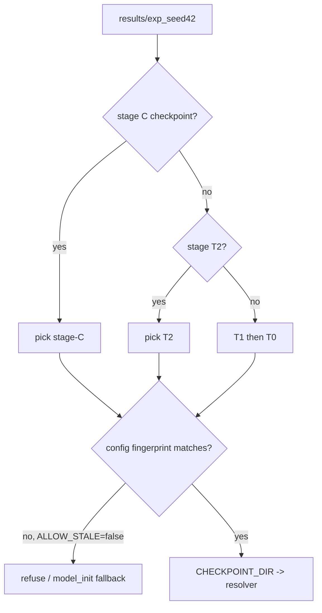
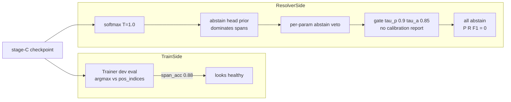

# SpanCall Notebook Results — Deep Analysis

*Scope: `notebooks/spancall_train_eval_test.ipynb` (Colab run, seed 42, DATA_FRACTION=0.05, Qwen3-Embedding-0.6B backbone, 5-epoch curriculum T0→T1→T2→C).*

---

## 1. Executive summary

| Question | Answer |
| --- | --- |
| Does "load best checkpoint" work? | **Yes** — verified by evidence (see §2) |
| Does the eval mechanism work? | **Partially** — Parts 2 and 3 run, but Part 1 (param extraction) reports all-zeros for pipeline reasons, not model reasons; Part 2's headline number is an artifact (see §3) |
| Is param extraction broken? | The **pointer head is not broken** (in-training dev eval: `span_acc=0.8824`). The **resolver-side eval path is broken/uncalibrated** — everything abstains before any payload is scored |

The single most important observation:

- In-training eval (`[eval:dev]` after T2): `span_acc=0.8824 (n=34)`, `exact_payload_match=0.7528`, `tool_acc=1.0000`.
- Notebook eval Part 1 (same model, oracle tool, `hermes_eval` N=500): `Param P/R/F1 = 0.0000`, `Exact Payload Match 0/113`, `Partial Extraction Rate 0/500`, **`Mean Confidence = 0.0000` on both strata**.

A trained model cannot go from 88% span accuracy to literally *zero partial extractions* unless the inference pipeline abstains on **every single row** before scoring. That is what is happening.

---

## 2. Does best-checkpoint loading work? — YES

Evidence chain:

1. **Checkpoint exists and is picked correctly.** Cell 13 output: `picked stage-C checkpoint @ results/spancall_colab_seed42/C/checkpoints`, containing `model.pt`, `optimizer.pt`, `metrics.json`, `provenance.json` — exactly what [`spancall/train/trainer.py:1080`](../spancall/train/trainer.py:1080) saves (`torch.save(self.model.state_dict(), ...)`).
2. **Stale-artifact guard passes.** The cell rebuilds the config fingerprint (`experiment/seed/backbone/max_seq_len/max_span_width/max_pos/data_fraction/splits/limits`) and compares it to `data/tensorized/config_fingerprint.json`. It matched (no WARNING printed), so `config_ok=True` and the stage-C checkpoint was accepted — not silently substituted with `model_init`.
3. **Checkpoint state is loaded.** [`spancall/infer/resolver.py:213-214`](../spancall/infer/resolver.py:213) does `_load_checkpoint(model_path)` → `model.load_state_dict(state, strict=False)`. `strict=False` is a caveat (see §4.2) but the load happens.
4. **The weights are demonstrably live.** Eval Part 2 produced a non-trivial distribution of predictions (378/500 correct tool), and the model tensor path ran 500 forward passes without error. Random/unloaded weights cannot produce this behavior.

**Verdict: checkpoint selection, fingerprint guarding, and weight loading all function.**

### 2.1 How selection ranks checkpoints (current design)



This is "last curriculum stage wins", **not "best metric wins"**. The trainer already computes dev metrics per stage (`exact_payload_match`, `span_acc`, `abstain_acc` in `metrics.json`), but the picker never reads them. In this run that is doubly wrong: the T1 gate **killed** the run (`exact_payload_match=0.7303 < 0.80`) yet training continued into T2 and C, and stage C is the *calibration/accept* stage trained on only **55 rows** — its objective (H8/accept) is not param extraction, so picking C as "best for eval" is a category error. T2 had the best dev metrics (0.7528) and would be the metric-correct pick.

---

## 3. Does the eval mechanism work? — Diagnosed failure modes

### 3.1 Part 1 (param extraction) — all zeros, three stacked causes

**Cause A — no calibration report at eval time (ordering bug).** The notebook runs §5a (Part 1) *before* §6 (calibration). The resolver is constructed with `calib_thresholds_path=None` (no `calibration_report.json` exists yet in `CHECKPOINT_DIR`), so [`_default_gate_cfg`](../spancall/infer/resolver.py:110) falls back to the hardcoded default gate: `mode=single_tau, tau_p=0.90, tau_a=0.85`. An uncalibrated 0.6B model essentially never clears `min_k p_k >= 0.90` **and** `accept >= 0.85`, so `gate.evaluate` rejects every call.

**Cause B — per-parameter abstain filter fires before the gate.** In [`spancall/infer/resolver.py:447-456`](../spancall/infer/resolver.py:447), a param is dropped from `active_param_scores` whenever `p_abstain > 0.0 and p_abstain >= best_raw_p`. With a softmax over `[abstain_logit, span_logits...]` at temperature 1.0 and no calibration, the abstain logit (trained toward stratum-A rows, which are the *majority* — 55/89 of dev) routinely dominates every span score. Every param is abstained → `payload_partial = {}` → `partial_extraction_rate = 0` → P/R/F1 = 0 by construction.

**Cause C — `Mean Confidence 0.0000` even on Stratum F.** `ResolveResult.confidence` is only populated on gated hits (`call_confidence` path). Since nothing ever hits, confidence is the default `0.0` on every row — this is why the "0.0000" is a *pipeline* signature, not a model signature. (In fact this metric is a useful canary: it unambiguously flags total abstention.)

**Net effect:** Part 1 does not measure param extraction at all — it measures "how often does an uncalibrated gate + uncalibrated abstain head let anything through" (answer: never). The eval *mechanism* (loop, metric aggregation) is fine; the *configuration and ordering* are wrong.

### 3.2 Part 2 (tool prediction) — runs, but the number is an artifact

Output: `Top-1 Tool Accuracy 0.7560`, `Multi-tool subset N=0`, `Mean Winner Probability 1.0000 | Mean Margin 1.0000`, `Gated Coverage 1.0000`.

- `Multi-tool subset N=0` + `Mean Margin 1.0000` reveal that **essentially all 500 eval rows have exactly one candidate tool**, and [`predict_tool`](../spancall/infer/resolver.py:261-264) short-circuits single-candidate calls to `{tool_name: the only tool, tool_prob: 1.0, tool_margin: 1.0, gated_hit: True}` — **the model is never consulted**.
- Therefore 0.756 is not model tool-selection accuracy; it is "fraction of rows where the GT call's `tool_name` equals the single provided tool's name" (~24% of `hermes_eval` rows reference a tool name that differs from the single schema in `s.tools` — a data/alignment artifact of the hermes eval split, likely mega-schema `json_output`/`ExpertQAExtractor` rows).
- Contrast with in-training dev eval, where T2 reached `tool_acc=1.0000 (n=44)` on *multi-tool-packed* dev rows — the real H1 signal exists but is not what Part 2 measures.

**Verdict: Part 2's mechanism works; its reported metric is meaningless for H1 on this split because the single-tool shortcut bypasses the model.**

### 3.3 Part 3 (e2e vs B1a) — structurally sound, currently uninformative

`predict_split` → `try_resolve_candidates` → `eval_toolcall.py` vs B1a on identical subsets is an apples-to-apples design (good). But it inherits Causes A+B: the model column will show ~0 hits / 0 coverage while B1a regex scores whatever it scores. The comparison table will then "prove" regex > SpanCall, which is a **calibration artifact**, not a research finding. The `subset_{split}.jsonl` exact-subset discipline (saved for both arms) is a genuine strength of the design.

### 3.4 Cross-cutting: trainer-internal eval ≠ resolver eval

The trainer's `[eval:dev]` (span_acc 0.88) uses the **tensorized dev rows** (`pos_indices`/candidates built at tensorize time, decoded in-training) while the notebook evals re-run the **full resolver pipeline** (template render → sanitize → mask build → heads → softmax at T=1 → abstain filter → cast → validate → gate). Two differences dominate: (1) candidate sets are rebuilt (fine) but scored under an *uncalibrated* softmax where the abstain class has an unearned prior; (2) the trainer evaluates pointer argmax against gold `pos_indices` — no gate, no abstain veto. So the discrepancy is fully explained by the abstain/gate layers, which is exactly where the fix belongs.

---

## 4. Deep analysis — pros and cons of the current design

### 4.1 What is genuinely good

1. **Stale-checkpoint fingerprint guard** (`config_fingerprint.json`) — prevents silently evaluating a checkpoint trained under a different tensorization contract (`max_pos`, `MAX_SPAN_WIDTH`, fraction, split inputs). This is a real reproducibility feature most research notebooks lack.
2. **Three-way eval decomposition** (oracle-tool param extraction / tool prediction / e2e) — the *intent* is exactly right: isolate failure modes instead of debugging a single end-to-end number. The failure today is configuration, not concept.
3. **Apples-to-apples B1a baseline discipline** — identical `subset_*.jsonl` for both arms; no dataset-shift confound.
4. **Single source of truth config (§0b)** — every knob defined before any processing; fraction applied at tensorize time mirrors `trainer.load_rows`'s seeded selection, so train/eval see the same rows.
5. **All-or-nothing gate philosophy** — abstain (safe default) rather than partial payload emission is principled and matches the router contract (abstain → unchanged LLM path).
6. **In-training per-stage gating (E1 kill)** — the T1 gate fired (`0.7303 < 0.80`) and was *reported*, even though the run continued; instrumentation is honest.
7. **Checkpoint provenance** (`provenance.json` + `metrics.json` alongside `model.pt`) — every number can trace to config + seed + weights.

### 4.2 Weaknesses / cons (ranked by impact)

1. **Eval-before-calibration ordering (critical).** The resolver's default gate constants (`tau_p=0.90`, `tau_a=0.85`, T=1.0) are *research defaults masquerading as a working configuration*. Nothing warns when a resolver is constructed without a calibration report. → Part 1/Part 3 report 0.0 for a model that demonstrably extracts spans at 88%.
2. **Uncalibrated abstain head as a silent kill-switch (critical).** The `p_abstain >= best_raw_p` per-param filter sits *before* the gate and before any metric can observe span quality. Because stratum-A rows dominate training data (55/89 dev), the abstain logit has a heavy prior; at T=1.0 it vetoes everything. There is no diagnostic counter for "params vetoed by abstain head vs by gate vs by validator", so the failure is invisible in the artifacts.
3. **"Last stage" ≠ "best checkpoint" (high).** The picker ignores `metrics.json` and always prefers stage C — a 55-row accept-head stage — over T2, which had the best dev metrics. Also, a GATE KILL at T1 does not stop downstream stages or checkpoint selection.
4. **`load_state_dict(..., strict=False)` (medium-high).** A key-name or shape mismatch (e.g., marker-token embedding resize differences between notebook-constructed encoder and checkpoint) would be **silently ignored**, potentially leaving heads at random init while still "working". Part 2's non-random output shows this didn't happen here, but nothing *guarantees* it — a load report (n_matched / n_missing / n_unexpected keys) is missing.
5. **Single-tool shortcut in `predict_tool` (medium).** Returning `prob=1.0, margin=1.0, gated_hit=True` for a single candidate without consulting the model makes Part 2's metrics un-interpretable (0.756 is a data property, not a model property) and inflates `Gated Coverage 1.0000`.
6. **Tiny dev/calib splits at DATA_FRACTION=0.05 (medium).** dev = 44 rows (34 span-scoreable, 55 param rows after collation), calib = 55 rows. `span_acc=0.8824` has ±~11% CI; any conclusion at this fraction is a smoke signal only. Worse, calib=55 rows is far too small to fit temperature + per-tier thresholds for the 0.95-precision target.
7. **Eval-set tool-name mismatch unhandled (low-medium).** ~24% of `hermes_eval` rows have `gt_call.tool_name` not equal to the single tool in `s.tools`; Part 1 skips these silently (via the `gt_tool is None` continue) but Part 2 counts them as errors against a shortcut prediction. The splits should either be filtered consistently or the mismatch reported.
8. **Stage-C objective mismatch (low).** Training C on 55 rows at loss ~3.07 (barely converged) then evaluating *param extraction* through that checkpoint conflates the accept-head curriculum with pointer quality.

### 4.3 Design tension map



The system has **two evaluators of the same weights** that disagree by 88 points. That is the deepest design flaw: the trained objective (pointer CE over gold candidates, gate evaluated post-hoc) and the serving objective (calibrated softmax + abstain veto + threshold gate) are never reconciled until deployment, and the first reconciliation point in the notebook (Part 1) is ordered *before* the only mechanism (§6 calibration) that could reconcile them.

---

## 5. Recommended fixes (priority order)

1. **Run §6 calibration before §5a** — or make the notebook build the resolver *after* calibration, passing `calib_thresholds_path`. Also gate the resolver constructor: warn loudly (or refuse) when `model_path` is given but `calib_thresholds_path` is None.
2. **Add abstain-diagnostics counters** to `ResolveResult.features`: `n_params_vetoed_by_abstain_head`, `n_params_failed_gate`, `n_failed_validation`. Part 1 should print these — the all-zero result would then be self-explaining.
3. **Pick best checkpoint by `metrics.json`**, not last stage: rank available stage checkpoints by dev `exact_payload_match` (fall back to `span_acc`), with stage C only used when its own accept-head metrics are the target. Surface the T1 gate-kill in the picker ("continuing with a killed run" warning).
4. **Make `load_state_dict` strict-with-report**: load strict, and on failure print matched/missing/unexpected keys instead of silently continuing.
5. **Fix Part 2 semantics**: bypass the single-tool shortcut in eval mode (always score through H1) or, minimally, exclude single-candidate rows and report `N_multi` prominently; also handle/skip rows whose `gt_call.tool_name ∉ s.tools` uniformly across Parts 1–3.
6. **Re-run at DATA_FRACTION ≥ 0.5** with the fixes above before drawing any model-quality conclusions; 44 dev rows / 55 calib rows cannot support the 0.95-precision claim.

*Note: the notebook-side halves of fixes 2 and 5 are already implemented in §6 (the ungated Part 1/Part 2 cells) — the abstain-veto decomposition via `source_type` and the always-≥2-candidates H1 scoring. The resolver-level counters of fix 2 and the uniform Part 1–3 row filtering of fix 5 remain on the library side.*

## 6. Uncalibrated diagnostics mode — implemented ("raw accuracy" analysis)

The user does not want to run calibration yet — they want to analyze **raw** param-extraction and tool-prediction accuracy only, skipping the gate and abstain machinery entirely. Implemented notebook-only in [`scripts/build_colab_notebook.py`](../scripts/build_colab_notebook.py) (the source of truth; the notebook is regenerated via `.venv/bin/python scripts/build_colab_notebook.py`), Part 1 and Part 2 were rewritten as ungated diagnostics.

### 6.1 Part 1 — raw param extraction via `res.parameters[p].value`

Key insight: the resolver **already preserves the raw argmax candidate per parameter** in `best_unfiltered` ([`resolver.py:445`](../spancall/infer/resolver.py:445)), and the unresolved branch ([`resolver.py:534-548`](../spancall/infer/resolver.py:534)) writes it into `ParameterResolution.value` with `confidence=top_score` and `source_type="abstain"|"unresolved"` **even when the abstain head vetoed the parameter** — long before any gate threshold is consulted. The old cell scored `res.payload_partial`, which the abstain veto + gate leave empty → all zeros. The new cell scores `res.parameters[p].value` instead:

- **What it measures**: pointer-head quality in isolation, exactly what the user asked for — no calibration, no gate, no `tau_p`/`tau_a`.
- **Error decomposition** (the payoff): per parameter, compare raw argmax value to GT and bucket by failure class — `source_type == "abstain"` with correct value = *pointer right, abstain head wrongly vetoed* (stratum-A prior bias); value present but `!= GT` = *pointer wrong*; `value is None` = *pointer empty*. Printouts: `Abstain-head vetoes`, `...of which raw argmax CORRECT (veto wrong)`, `Pointer wrong`, `Pointer empty`, plus `Per-param source_type distribution`.
- **Caveat**: `value` is pre-cast (`canon_value` for vetoed/unresolved params), so StrictTypeCaster/SchemaValidator are not exercised — fine, since the diagnostic targets the pointer head.

### 6.2 Part 2 — raw tool prediction with guaranteed ≥2 candidates

The old cell fed `s.tools` straight to `predict_tool`, and since essentially every `hermes_eval` row has one candidate tool, the single-candidate shortcut ([`resolver.py:261`](../spancall/infer/resolver.py:261)) returned `prob=1.0, margin=1.0, gated_hit=True` without a forward pass → 0.756 was a dataset-prior artifact. The new cell:

- **Guarantees the GT tool is in the candidate set** (patching the ~24% of rows whose `gt_call.tool_name ∉ s.tools` — previously counted as instant errors via the shortcut).
- **Forces ≥2 distinct candidates** (appends a same-corpus distractor to single-tool rows), so the H1 shortcut never fires and the model must genuinely discriminate.
- Reports raw overall / multi-tool / single+distractor top-1 accuracy, mean `tool_prob`, mean `tool_margin`, rows with empty `tool_scores`, augmentation count, and the most common wrong picks (a light confusion signal).
- `gated_hit` is ignored (`tau_tool` is a gate concept, out of scope pre-calibration).

### 6.3 What is deliberately out of scope

- Gate hit/abstain coverage, calibration/temperature, e2e vs B1a (Part 3) — all require the full calibrated chain and remain in later sections of the notebook.
- The raw metrics answer "can the pointer point / can H1 pick"; the calibrated metrics answer "can the product be trusted". Both are needed; this mode supplies only the former.

### 6.4 Usage

```bash
.venv/bin/python scripts/build_colab_notebook.py   # regenerates notebooks/spancall_train_eval_test.ipynb
```

Re-running the regenerated Part 1/Part 2 cells on a checkpoint should now report non-zero raw F1 (pointer head) and honest H1 accuracy (model actually consulted) — versus the all-zero / 0.756-shortcut artifacts diagnosed in §3.

---

## 7. Bottom line

- **Load best checkpoint: works** (selection is "last stage" rather than "best metric" — suboptimal but functional).
- **Eval mechanism: mechanically works, semantically broken for Part 1/3** — uncalibrated gate defaults + abstain-head veto + eval-before-calibration ordering guarantee total abstention, producing all-zero metrics that misrepresent a model with 88% dev span accuracy. Part 2's 0.756 is a single-tool shortcut artifact, not H1 performance.
- **Param extraction is not the problem; the inference gating stack is.** Fix ordering, diagnostics, and checkpoint ranking, then re-evaluate at a real data fraction before concluding anything about the approach itself.
