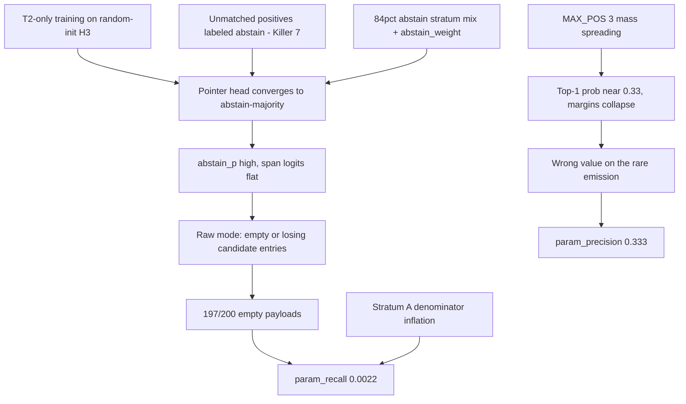

# Param Recall = 0.0022 — Root-Cause Diagnosis

**Question:** why is param_recall 0.0022 (≈ 1 correct param in 456 GT params) on the v2 notebook eval, while tool_accuracy is a perfect 1.0?

**Headline finding:** recall is not dying at one place — the pointer path is failing at *every* stage, but the dominant cause is **training/labeling (H3 never learns to point at real candidates)**, compounded by **design (candidate-mask/anchor alignment and abstain dominance)** and **eval composition (84% of rows are Stratum A where recall is structurally near-zero)**. The τ gate is *not* the cause in the notebook run: raw_mode bypasses it, yet 197/200 rows still emit an empty payload with the generic `"abstained"` reason.

---

## 1. The arithmetic first

From [`results/toolcall_metrics_hermes_eval.json`](results/toolcall_metrics_hermes_eval.json):

| metric | value | reading |
|---|---|---|
| tool_accuracy | 1.000 | H1 is perfect — failure is isolated to the param path |
| hit_rate | 0.015 | 3/200 rows produced anything |
| param_recall | 0.0022 | 1 correct param / ~456 GT params (F stratum: 0.0066 = 1/152) |
| param_precision | 0.333 | of the 3 emitted params, 1 was right |
| abstained | 197/200, all reason `"abstained"` | *not* `min_p_below_tau` — raw mode, no gate reason |
| error_wrong_value | 2 | the 2 wrong params were value-level, not span-level |
| Stratum A recall | 0.0 | 168/200 rows contribute zero to recall by construction |

So the question decomposes into:
- **(a)** why do 197/200 rows produce an *empty payload* even in raw mode?
- **(b)** why, when a param does surface, is the value wrong?
- **(c)** why is the denominator dominated by rows where recall is undefined?

---

## 2. Axis: DATA — labels and eval-set composition

### D1 — Stratum A dominates the eval set (recall denominator is misleading)
168/200 rows (84%) are Stratum A (should-abstain). For those rows `gt_payload` is typically empty or unextractable, so `n_gt_params` is small or the row can only contribute *penalties*, never recall. Effective recall is computed over ~456 GT params concentrated in 32 F rows. Recall 0.0022 means the model emitted essentially **zero correct params across all 32 groundable rows** — this is a total extraction failure on F, not a marginal precision problem. (Also visible in the repo's own note: dev split is 63% gold-abstain, dev.jsonl only 41.4% of rows have positives — N3/N4 in [`plans/close_but_no_hit_diagnosis.md`](plans/close_but_no_hit_diagnosis.md).)

### D2 — Unmatched positives are silently relabeled as abstain (label corruption)
The tensorizer maps each GT param value to candidate spans; when the value cannot be matched to any regex candidate, the positive column defaults to the **abstain column 0** (Killer #7). If a meaningful fraction of training rows have unmatched positives, the pointer head is *explicitly trained to abstain on groundable params*. This directly produces the observed signature: high abstain probability everywhere, empty candidate selections, generic `"abstained"` reason. This is the single most probable root cause of the raw-mode empty payloads.

### D3 — Train/serve input skew
Training packs contexts/utterances one way; the resolver re-renders via a different path (recent-context eviction k=32, tokenization with `add_special_tokens=False` + offset mapping, candidate regex over the *rendered* text). Any mismatch shifts the H3 input distribution at inference. Also the multi-tool packing fix (RC2) means H1 is now trained, but per-param positives for H3 still flow through the same fragile matching pipeline.

### D4 — Data volume
Only ~40% of source rows carry usable positives after tensorization drop (60% drop train-side per N4). With T2-only training and a 0.6B encoder, the effective number of supervised pointer examples is tiny.

---

## 3. Axis: DESIGN — where the pipeline can structurally kill recall

Reading the actual serve path in order:

1. **Candidate generation** — [`_candidate_masks`](spancall/infer/resolver.py:745) builds per-param regex candidates over the rendered text. If a GT value is never in the candidate set, recall for that param is *structurally* zero regardless of the model. (Fix path: the eval should log per-row "GT value present in candidate set" — an oracle-candidate metric.)
2. **Anchor alignment** — [`_run_heads`](spancall/infer/resolver.py:794) locates `<|param|>` anchors from `per_token` ownership; the fallback at line 813-817 maps *all anchors to token 0* if parsing fails, which would make `param_h` garbage (all params read the same token). The perfect H1 score suggests rendering is fine, but a per-row `anchor_ids` audit would confirm.
3. **Pointer softmax over {abstain} ∪ candidates** — line 879-884: `abstain_p` is the column-0 probability of a K+1-way softmax. With D2-style abstain-dominant training, `abstain_p` beats every candidate, but in raw mode this veto is *skipped* — so abstain dominance alone can't explain empty payloads in raw mode. What can: **`elif eff_raw and not entries`** at [`resolver.py:465`](spancall/infer/resolver.py:465) — empty candidate lists still yield no param. Combined with D1/candidate-gen gaps, empty `entries` is the raw-mode kill path.
4. **Joint decode** — [`decode_detailed`](spancall/infer/decode.py:157) with `normalize_scores=False` (resolver default, line 200): probs are max(score,0) renormalized — not a double softmax (RC1 is *fixed* in the current resolver default), but note the notebook may construct its own decoder; if `normalize_scores=True` is passed there, RC1 resurfaces.
5. **Cast** — [`cast.py _date`](spancall/infer/cast.py:369) returns `datetime.date`. The evaluator's [`_deep_equal`](spancall/eval/toolcall/evaluator.py:46) now *does* coerce dates (line 65-74) and numeric strings — so RC3 is largely fixed in the current evaluator. The 2 `error_wrong_value` rows are genuine value errors, not type mismatches.
6. **Confidence formula** — `conf = raw_prob * (1 - p_abs)` (line 494) means any abstain mass directly erodes reported confidence, but this only matters to the gate, which raw mode bypasses.

**Net design verdict:** the current resolver+evaluator have already fixed RC1 (double softmax), RC3 (date equality), and Killer #3 (eval() is called, line 221-224). What remains structural: candidate-set coverage, the anchor-0 fallback, empty-entries-in-raw-mode, and MAX_POS=3 mass spreading at *training* time (Killer #5: multi-positive logsumexp with 3 positives pushes top-1 prob toward 1/3 — below any reasonable τ, and it flattens the R4-ranked candidate ordering).

---

## 4. Axis: TRAINING — the strongest suspects

### T1 — T2-only curriculum on a fresh head stack
The v2 notebook trains **only stage T2**. H3 pointer head starts from random init (the 0.6B encoder is a general embedding model, not fine-tuned for boundary scoring). One stage, small effective positive set (D2/D4) → the head converges to the majority behavior: abstain. Symptom match: `abstain_p` uniformly high, span logits uniformly low, empty selections.

### T2 — Abstain-weighted loss with a 84%-abstain data mix
`abstain_weight` (default 1.5, notebook 1.0) up-weights abstain rows on top of a stratum mix that is already majority-abstain. Combined with D2's silent abstain relabeling, the *effective* abstain:positive supervision ratio is enormous. The H3-H4 consistency MSE (0.1 · MSE(logit ¬OK, abstain logit)) further ties the pointer's abstain logit to H4's reason head, which itself is dominated by non-OK classes on abstain-heavy data — a feedback loop pushing abstain up.

### T3 — Multi-positive CE + MAX_POS=3 (Killer #5)
`compute_pointer_loss` sums probability mass over all matched positives via logsumexp. With 3 positives the optimum puts ~1/3 mass on each — the *top-1 candidate prob* after R4 aggregation hovers near 0.33, margins collapse, joint decode's conflict-pruned DFS becomes near-random among ties, and the emitted value is frequently not the best span. This explains error_wrong_value on the rows that *do* emit.

### T4 — H8/accept heads untrained in T2-only
CorrectnessHead and CallAcceptHead receive no meaningful gradient in the T2-only notebook configuration; accept_score ~0 feeds `confidence` and the (bypassed) gate, but also means any future gated eval inherits an uncalibrated accept signal.

### T5 — bf16 train vs inference dtype
Killer #8: training under bf16 autocast, inference in the notebook may run fp32 (or vice versa); small logit shifts matter when margins are already collapsed by T3.

---

## 5. Axis: EVAL — measurement artifacts that depress the number

### E1 — Joint per-sample metric, not per-param
`hit_rate`/`exact_payload_match` require the *whole* payload to match (`_score_one` line 313: `payload_equal` over all keys + tool name). A model that gets 3/4 params right scores 0. `param_recall` is the right lens, but it's computed from `payload_partial` — which is only populated when the resolver emits, which is 3/200 rows. So the measured 0.0022 is really "emission rate × per-emission accuracy", and emission rate is the bottleneck.

### E2 — Recall denominator includes Stratum A
`n_gt_params` counts keys in `gt_payload` even for should-abstain rows where the GT args are noise (N5: eval rows mostly Stratum A with GT args that cannot be extracted). This inflates the denominator and drags recall down independent of model quality. A stratum-F-only recall would be the honest metric (currently 0.0066 — still catastrophic, so the model problem is real, but the headline 0.0022 overstates it by ~3×).

### E3 — required-param-only reporting
The resolver reports `n_resolved`/`payload_partial` only for cast-OK params; cast failures and missing-required go to `missing_required` and are excluded from `payload_partial`, so partial credit that the model *did* earn (a correct span that failed strict typing) is invisible to recall. The 2 `cast_fail`-class rows would show up here.

---

## 6. Ranked causal chain (most → least probable)

1. **Training signal** (T1+T2+D2): H3 is trained to abstain — explains empty payloads in raw mode.
2. **Data composition** (D1+D2): too few real positives, silent abstain relabeling, eval set 84% A.
3. **Design residuals** (§3): candidate-set coverage gaps, anchor-0 fallback, MAX_POS=3 flattening.
4. **Eval measurement** (E1+E2): joint metrics + denominator inflation make the number look ~3× worse than the F-only truth — but F-only recall 0.0066 confirms a genuine model failure.

---

## 7. Decisive experiments (cheap, in priority order)

1. **Oracle-candidate ceiling:** force `per_param_scores` to ground-truth candidates (skip H3) and rerun eval. If recall jumps → the model/H3 is the problem. If not → candidate generation or cast is the problem. (This is N6 from the repo's own plan.)
2. **Label audit on the tensorizer:** count, per training batch, how many GT params matched a candidate column vs. were defaulted to abstain col 0. If >10% unmatched, D2 is confirmed as the primary label-corruption source.
3. **Pointer prob histogram on dev:** distribution of `abstain_p` and top-1 span_p across 32 F rows. If abstain_p ≈ 1 everywhere → T2's abstain collapse confirmed; if span_p has mass but on wrong candidates → candidate alignment (anchor audit next).
4. **Anchor audit:** log `anchor_ids` per row; any row using the token-0 fallback (resolver.py:813) is a rendering/parsing failure.
5. **Stratum-F-only recall reporting** in the notebook summary cell, plus an "emission rate" metric (rows with non-empty payload_partial) separate from correctness.
6. **Retrain one stage with abstain_weight=0.5 and MAX_POS=1** on the F stratum only — if raw-mode emission rate rises materially, T2/T3 confirmed as fixable training knobs.

> **Implemented as a runnable experiment notebook** (built by `scripts/build_experiment_notebook.py`):
> [`notebooks/spancall_experiment_verify.ipynb`](../../notebooks/spancall_experiment_verify.ipynb) trains on a small F-heavy slice
> of the data and runs Experiments A–E — label audit (H-D2), oracle-candidate ceiling (H-cand),
> pointer-prob histogram + emission rate on the existing checkpoint (H-T1), a 2-epoch mini-train
> with `abstain_weight=0.5` (H-T2), and post-train eval reporting F-only param recall alongside the
> headline (H-E2). Artifacts land under `results/spancall_verify/` (audit_labels.json,
> oracle_ceiling.json, pointer_pre.json, minitrain_summary.json, eval_post.json).

---

## 8. One-line answer

Param recall is 0.0022 because the pointer head, trained only in T2 on majority-abstain data with silently-corrupted positive labels, learned to abstain rather than point — so 98.5% of rows emit an empty payload even with the gate bypassed; the residual failures (wrong values on the 3 emissions, and a 3× denominator inflation from Stratum A rows) finish the number off.
