# SpanCall Pre-Process and Post-Process Mechanism

Companion to [mechanism.md](mechanism.md) (overall flow), [heads.md](heads.md) (what the model outputs) and [proposal.md](proposal.md). The model in the middle is small; **most of the precision comes from the deterministic code around it**. This document specifies that code.

```mermaid
flowchart LR
  subgraph PRE["Pre-process (pure function of request)"]
    P0[P0 Normalize] --> P1[P1 Sanitize R7] --> P2[P2 Tool retrieval] --> P3[P3 Context builders]
    P3 --> P4[P4 Candidate sets] --> P5[P5 Render + pack] --> P6[P6 Tokenize + offsets] --> P7[P7 Tensorize]
  end
  P7 --> M[Encoder + heads<br/>1 forward pass]
  subgraph POST["Post-process (deterministic)"]
    Q1[Q1 Tool + count] --> Q2[Q2 Per-param decode] --> Q3[Q3 Joint assignment]
    Q3 --> Q4[Q4 Span to text] --> Q5[Q5 Typed cast] --> Q6[Q6 Schema validate]
    Q6 --> Q7[Q7 Grounding checks] --> Q8[Q8 Gate] --> Q9[Q9 Emit / hand off]
  end
  M --> Q1
  P1 -. preflight abstain .-> LLM[Normal LLM path]
  Q8 -. abstain .-> LLM
```



Design rules for both sides:

1. **Pure and deterministic.** Same input → same bytes. This makes shadow-mode debugging and training/serving parity possible.
2. **One source of truth.** Training reuses the *same* pre-process code (only the clock and labels differ). No separate "data pipeline" version of the template.
3. **Every exit is an abstain with a reason code.** Nothing silently degrades into a partial payload.
4. **Budget:** pre-process ≤ 2 ms, post-process ≤ 1 ms, so the encoder dominates latency.

---

# Part A — Pre-Process

## P0. Normalization (offset-preserving)

Goal: make text safe and regular **without losing the ability to return the user's exact original substring**.

| Step | Rule | Why |
| --- | --- | --- |
| Unicode | NFKC applied to a **detection copy** only (to catch fullwidth `［ＳＥＰ］`); the model copy keeps the original code points | extraction must return the user's original characters |
| Control chars | strip C0/C1 controls except `\n`, `\t`; strip zero-width and bidi override chars | hidden-text tricks |
| Whitespace | collapse runs of whitespace/newlines to one space | one-line-per-segment parse (R7b) |
| Offset map | build `norm2orig: int[]` so every normalized index maps to an original index | Q4 returns text from the original |

Output: `Utterance { orig: str, norm: str, norm2orig: int[] }`. Casing is **never** changed.

## P1. Sanitization and Pre-flight (R7)

Run before anything expensive; each failure is an immediate abstain:

| Check | Action | Reason code |
| --- | --- | --- |
| Reserved marker regex on the NFKC copy, case-insensitive: `\[(CLS\|SEP\|EOS\|TOOL\|PARAM\|NONE\|NULL\|UNRESOLVED\|CTX_[A-Z]+)\]` (also in recent-context **values** and **keys**) | abstain | `marker_injection` |
| Empty / whitespace-only utterance | abstain | `empty` |
| Utterance > `U_max` chars (default 600) | abstain | `too_long` |
| Language not in supported set (cheap script/langid check) | skip router | `unsupported_lang` |
| Router disabled for the tenant/tool or circuit breaker open (§Q10) | skip router | `router_off` |

Why rejecting is enough: user text can never contain a marker string, so every marker in the rendered text is structural, and the parser's one-pass legend is unambiguous. Defense in depth: the tokenizer is also configured so marker strings in user text could not map to special-token ids (P6).

## P2. Candidate Tool Retrieval

The packed input holds up to `T=4` tools ([heads.md](heads.md) §2).

- **Index:** each tool embedded offline from `name + description + param names/descriptions`; stored with metadata `{risk_tier, param_types, entity_classes, resolvers}`.
- **Query:** embed the utterance (a small sentence encoder, ~5 ms on CPU, or the router's own cheap lexical/BM25 prefilter if latency-critical).
- **Select:** top-`T` by similarity; drop tools below `s_min`. If none remain → skip router (`no_candidate_tool`).
- **Ordering:** tools placed in a *random* order in training (position invariance) — at serving use retriever order; the model must not rely on position.
- **Application-known tool:** if the app context fixes the tool (search box, form), set `T=1` and skip retrieval.
- **Recall guard:** measure `R@T` of the retriever offline; it caps system recall (a miss here is an LLM fallback, never an error).

## P3. Context Builders

All builders are pure functions of `(request, clock, session)` and are memoized per request.

**Time window (R4).** Implemented in [`build_time_window`](../span_template/template.py): `today`, `+kd` offsets (k ∈ {1,2,3,7} by default), weekday entries with exact `this_<dow>` (0–6 days ahead; on its own weekday ⇒ today) vs `next_<dow>` (strictly future) semantics, and a **closed idiom map** (D1): `tomorrow` (= `+1d`), `day_after_tomorrow` (= `+2d`), `tonight` (= today; date params only). Off-window phrases ("the 15th", "in 3 months", "Q1 2027") are **not targetable** ⇒ the param abstains to the LLM. Literal dates in the utterance (`2026-10-24`) still work through the strict caster (Q5). User-timezone anchoring: the caller resolves the user-local date and passes `now` (deterministic; per-session override allowed — D3).

**Enum pool (R5).** `sorted(unique(∪ enums over packed tools))`. Multi-word enum values (internal whitespace) are emitted quoted (D2) so they remain atomic entries that never fragment the pool; ` | ` inside a value is rejected at ingestion. Per-param allowed sets are kept separately in P4 (R9).

**Recent context (R6).** Selection, not dumping:
1. Candidate rows from agent state: last tool outputs, selected entities, session profile, with a **provenance tag** (`user`, `tool_output`, `system`).
2. **Relevance filter:** keep a row if its key matches (token overlap/embedding) any param name or entity class in the packed tools, plus the `K_recent` (default 6) most recent rows.
3. **Token budget over arbitrary char caps:** rows are budgeted by total token count (`context_budget_tokens`, default 16k), evicting whole oldest rows when needed. No arbitrary `V_max` char truncation.
4. **Dedupe** by `(key, value)`; keys validated against the plain-identifier rule; values quoted/escaped (R1).
5. `tool_output` rows are **untrusted** like user text: the R7 marker check also applies to them, and they go through the same quoting.

## P4. Candidate Sets `A_{t,k}` and Masks

Built **before** the model runs, from the JSON schema and the rendered legend. This is what keeps the pointer head small and the output type-safe.

| Param schema | Candidates | Construction |
| --- | --- | --- |
| free string | utterance spans ≤ `W_max` tokens (word-aligned) ∪ recent value interiors | start/end masks over utterance tokens; width limit |
| `enum` | only this param's enum entries in `[CTX_ENUM]` | entry table lookup |
| `boolean` | `true`, `false` in `[CTX_META]` | entry table |
| `integer`/`number` | regex matches of numeric patterns in utterance (digits, separators, optional suffix `k/m`) | exact `(start,end)` pairs from regex → token pairs |
| `date` | `[CTX_TIME]` iso entries ∪ utterance matches of strict date patterns (`2026-10-24`, `24 Oct 2026`) | entry table + regex pairs |
| `email/url/phone/id` (format) | regex matches of the format in utterance ∪ recent value interiors | exact pairs |
| `array<T>` | candidates of type `T` | same as scalar, multi-select |

Every `A_{t,k}` also contains `∅` (abstain). Each candidate is a record:

```
Candidate { tok_start, tok_end,      # inclusive token range
            char_start, char_end,    # in the RENDERED text
            region,                  # utterance | recent | time | enum | bool
            canon_value,             # canonical value for equal-value aggregation
            entry_id|null }          # CTX entry id (snapped, R8)
```

Representation for the GPU: two forms.
- *Dense-small* (CTX/regex entries): a padded `[K_params, N_cand, 2]` index tensor + validity mask.
- *Windowed* (free utterance spans): `start_ok[K,L]`, `end_ok[K,L]` boolean masks + `W_max`; pair `(i,j)` valid iff `start_ok[i] ∧ end_ok[j] ∧ 0 ≤ j−i < W_max`.

## P5. Render and Pack

**Invariant 2 — grammar uniformity.** The Lean workflow renders with exactly one
template at every `T >= 1`:
[`template_multi.jinja`](../span_template/template_multi.jinja), via
[`build_input_multi`](../span_template/template.py). [`build_input`](../span_template/template.py)
and [`template.jinja`](../span_template/template.jinja) remain for the legacy
(non-Lean) path but are **not reachable from `spancall/lean/`**. Rendering a
different grammar in training than inference ever consumes is a train/serve
mismatch that no amount of model capacity can fix, so `build_input_multi` is the
only entry point and the `pack_multi_tools=False` escape hatch was deleted.

**Invariant 1 — tool coverage contract.** For every function-calling sample,
`render_T >= len(sample.tools)`, and every `sample.tools[*].name` appears
exactly once as a `<|tool|>` block in the rendered prompt. Concretely:

```
T = max(pack_tools, 1 + len(native_tools), jitter_draw)
```

`data.pack_tools` is a **floor, never a cap**: it adds distractors from the
corpus [`ToolPool`](../spancall/lean/tensorize.py) up to the floor, and can never
remove a native tool. `data.max_tools` is the *only* knob that may reduce `T`
(an emergency VRAM brake, `None`/off by default); when it does fire, the row is
counted in `stats["tool_truncated_rows"]` and reported loudly — a silently
dropped native tool is unlearnable, because H1 can never select an anchor that
was never rendered.

`jitter_pack_tools` (default on) draws `T` uniformly from `[min_tools, floor]`
per row, which is what keeps the oracle-tool eval layout (`T = 1`) inside the
training distribution (**invariant 3**).

Parse the rendered text with [`parser.py`](../span_template/parser.py) into entries with absolute char offsets (per-tool entries tagged `tool=` from the `[NONE]`-aware parse). Param order within a tool is the schema order at serving (shuffled in training).

## P6. Tokenization and Offset Safety

1. All markers are **added special tokens** with trained embeddings. Delimiters that sit between entries (` | `, `=`, `"`) are also made atomic (`[BAR]`, `[EQ]`, `[Q]`) **or** surrounded by spaces — pick one in the template.
2. Tokenize the full rendered text with `return_offsets_mapping=True`.
3. **Boundary-safety check (hard error in tests, abstain in prod):** for each entry, a token boundary must coincide with `char_start` and with `char_end`. A BPE token straddling an entry and its delimiter (e.g. `="` fused) would break R8 snapping. If violated, the template (not the model) is fixed.
4. Entry → token range: first/last token wholly inside `[char_start, char_end)`.
5. Anchor indices recorded: `[CLS]`, each `[TOOL]`, each `[PARAM]` (tagged `(tool, param)`), `[NONE]`.
6. Overflow: if `len(ids) > L_max` (backbone-driven, e.g. 32768) after context eviction ⇒ abstain `overflow` (never truncate schema or context).

The current `SpanTemplateOutput.tokenize` is a best-effort stand-in; production uses the offset-mapping path above.

## P7. Tensorize and Batch

**Invariant 7 — multi-call completeness (target).** A sample with `n` GT calls
must produce `n` predicted calls, every GT call is supervised, and eval scores
the sample as a *set* of calls rather than `ground_truth_calls[0]`. The data
contract is call-aware `target_spans` keyed `f"{call_index}::{param_name}"`, with
a legacy single-call fallback so existing corpora keep loading. Until that lands,
every Lean path is single-call: [`tensorize_sample_lean`](../spancall/lean/tensorize.py)
supervises `ground_truth_calls[0]` only.

**Invariant 6 — recent-context parity.** Training and serving run the *same*
`sanitize_key` / `_normalize_recent_value` / dedupe / `k_recent` / token-budget
pipeline ([`select_recent_context`](../spancall/agent/context.py)), and the
effective budget is reported to the caller as
`features["recent_budget_effective"]` (plus `recent_budget_tokens` and
`recent_budget_clamped`). The budget is
`min(context_budget_tokens, max(64, max_seq_len // 2))`, i.e. it is clamped so
the schema and utterance can never be starved by context.

Outputs of pre-process for one request:

```
ModelInput {
  input_ids [L], attention_mask [L],
  anchors   { cls, tool_pos[T], none_pos, param_pos[T][K] },
  cand      { dense[T][K][N][2], dense_mask, start_ok[T][K][L], end_ok[T][K][L] },
  entry_pool{ sparse [n_entries × L] mean-pool matrix },   # for span/entry mean pooling (H5/H7/H8)
  meta      { request_id, tools, norm2orig, legend, clock, risk_tiers }
}
```

Batching: bucket by length (64/128/256/512), pad to bucket, dynamic batching window ≤ 2 ms. `meta` stays on CPU and rides along to post-process.

## P-Train. Training-time use of the same code

| Aspect | Serving | Training |
| --- | --- | --- |
| Clock | request time in user tz | synthetic clock per example (never derived from GT) |
| Tool order / param order / enum order | retriever order / schema order | random shuffle |
| Recent context | selected from agent state | simulated from conversation history + distractor rows |
| Candidate sets | built from the schema | same code |
| Labels | none | reverse alignment against `legend` ([mechanism.md](mechanism.md) §8.1) |
| Sanitization | reject | adversarial rows included as `marker_injection` abstentions |

---

# Part B — Post-Process

Input: the heads' raw outputs for one request + `meta`. Output: either `Hit(calls[])` or `Abstain(reason, features)`.

## Q0. Calibrated Probabilities

Temperatures (optional post-hoc scaling, defaulting to `1.0` in [`LeanResolver`](../spancall/lean/resolver.py)) are applied to logits before softmax/sigmoid. All thresholds below refer to the resulting probabilities. Re-fit after any quantization or encoder change.

## Q1. Tool Selection (`BinaryToolHead`)

1. Each packed tool slot `t` outputs an independent tool-call probability `P(call_t)` via `BinaryToolHead` (see [`heads.md`](heads.md)).
2. Tools with `P(call_t) < tool_call_threshold` are not fired. If no tool passes, return `no_tool` / abstain to the LLM.
3. Duplicate tool+argument calls across slots are collapsed before emission.

## Q2. Per-Parameter Decode (`LeanPointerHead`)

For each selected tool `t` and parameter `k`:
1. Mask candidate logits to `A_{t,k} ∪ {<|null|>}` (P4 masks; `−∞` elsewhere). The mask is applied **before** softmax so invalid candidates cannot steal probability mass.
2. Softmax over the valid candidate set. Aggregate equal-valued candidates: `p(v) = Σ_{c: canon(c)=v} p(c)`.
3. Keep the top-`K_cand`=3 distinct values with log-probs and margins for Q3 joint decoding.
4. `array` / `list` params select multiple non-overlapping span candidates above threshold where supported.

## Q3. Joint Assignment (exclusivity and swap safety)

Per call:
1. Search all combinations of the per-param top-3 lists (≤ 3^K; K≤8 ⇒ ≤ 6561, with pruning ≪ that), maximizing `Σ log p`.
2. **Constraints:** (a) params in the same entity class cannot share an utterance span; (b) a span cannot be partially overlapped by another param's span (overlap ⇒ invalid unless nested spans are declared allowed); (c) optional schema-declared pairwise rules (`origin ≠ destination`, `start < end`).
3. Take best `a*` and second best `a²`. `Δ_joint = score(a*) − score(a²)`. Tie → deterministic order (lexicographic by candidate tuple), still `Δ_joint = 0` ⇒ gate rejects.
4. H7 scores for each chosen pair `P_consistent(k,l)` computed here (tiny MLP over pooled spans).

## Q4. Span → Original Text

Value extraction never detokenizes tokens.

1. `char range` in rendered text from the candidate offsets → for utterance spans, map `rendered → norm → orig` through `norm2orig`; for recent values use the **unescaped** legend value (`_unescape`); for CTX entries take the entry value.
2. **Word-boundary snapping (utterance spans):** if the start/end falls mid-word, expand to the word boundary when the partial piece is ≤ 1 char; otherwise abstain `bad_boundary`.
3. **Trim:** strip leading/trailing whitespace and boundary punctuation `, . ; : ! ? ) ( " ' ` unless the schema `pattern` requires them (e.g. phone `+`, id with `-`).
4. **Provenance assertion:** `orig[range] == extracted` must hold, else a code bug → abstain `provenance_fail` and alert.
5. Case/diacritics preserved exactly as the user wrote them.

## Q5. Typed Cast (deterministic, strict)

| Target type | Rule | Abstain when |
| --- | --- | --- |
| string | extracted text, whitespace-collapsed | length 0, or violates `minLength/maxLength` |
| enum | **case-insensitive exact match** to this param's enum list → canonical enum string | no match (never fuzzy-match enums) |
| boolean | CTX `true`/`false` only | — |
| integer | digits with optional thousands separators; `k`/`m`/`b` suffix expanded; negative sign | spelled-out numbers ("five"), ranges ("5-10"), approximations ("about 5"), locale-ambiguous `1.000` / `1,000`, units not in schema |
| number | as integer plus decimal; locale per tenant config | same as integer |
| date | CTX iso verbatim; literal: strict formats only (`YYYY-MM-DD`, `DD Mon YYYY`, `Mon DD, YYYY`) | ambiguous order (`03/04/26`), partial (`the 15th`), relative phrase not in the window |
| datetime | date rule + `HH:MM` 24h/12h with am/pm; timezone from user tz | missing am/pm ambiguity |
| email/url/phone | regex-validated, lowercase host only, no other normalization | invalid format |
| array | each element cast by element type; deduped preserving order | any element fails |

No "best-effort parse": if two interpretations exist, the cast abstains.

## Q6. Schema Validation

1. Assemble `payload = {param: cast_value}` for each call.
2. Apply **schema defaults deterministically**: an optional param that resolved to absent (`[NULL]`, or omitted) and carries a JSON Schema `default` gets that value applied by the post-processor — never invented by the encoder. An absent optional **without** a declared default stays omitted.
3. Validate against the tool's JSON Schema (Draft 2020-12): types, `required`, `enum`, ranges, `pattern`, `additionalProperties: false`, `oneOf/allOf/if-then` for cross-param rules.
4. Params the model resolved but the schema doesn't define → impossible by construction (candidates come from the schema), but asserted.
5. Fail → abstain `schema_violation` (includes the failing JSON pointer in telemetry).

## Q7. Grounding Verifiers (pluggable precision boosters)

Optional per-param hooks (`x-resolver` in the schema) that check an extracted value against a **known-entity source**, run after the cast:

| Resolver type | Example | On mismatch |
| --- | --- | --- |
| Gazetteer / catalog | airport codes, product SKUs, country list | exact → accept; near-match (edit distance ≤ 1 and unique) → snap to canonical; else abstain `unknown_entity` |
| Session-ownership | `flight_id` must be in the user's recent results | abstain `not_in_session` |
| Range/policy | amount ≤ account limit | abstain `policy_violation` |
| Format checksum | IBAN, ISBN | abstain `bad_checksum` |

Resolvers are **cheap, local, deterministic** (hash lookups). Snapping is applied only when unambiguous. This turns a lot of would-be wrong hits into abstentions at near-zero cost.

## Q8. Whole-Call Gate

Lean gating lives directly in [`LeanResolver`](../spancall/lean/resolver.py) via `call_min_prob`, `call_min_prob_ratio`, `tool_call_threshold`, and `min_joint_margin`:

```
HIT ⇔ Q4–Q7 deterministic stages passed (validate())
      ∧ P(call_t) ≥ tool_call_threshold
      ∧ min_k p_k ≥ call_min_prob        (lowest per-param top-1 pointer probability)
      ∧ min_k (p_k / p_k_2) ≥ call_min_prob_ratio
      ∧ Δ_joint ≥ min_joint_margin
```

- Multi-call turns: **all** selected calls must pass or **all** abstain (no partial emission).
- **Risk tiers only move the threshold, never remove the fast path.** Goal is to minimize LLM use: the LLM is called **only when confidence is low** (any gate condition fails). A `side_effecting` tool simply gets a stricter threshold — it is not an LLM-only category.
- **Confirmation step is optional, off by default**, and is a per-tool config. If enabled it is a templated user prompt ("Book VN123 for Anh Luong?"), not an LLM call, so it keeps the LLM out of the loop.

## Q9. Emit or Hand Off

**Hit → emit.** The call must look to the rest of the agent as if the LLM generated it:
1. Adapter per model family produces the exact tool-call representation the framework expects (structured `tool_calls` message, or the model-specific textual form defined by that model's chat template, e.g. the Gemma template in [chat_template_gemma4.jinja](chat_template_gemma4.jinja)). **The vendored Gemma template's upstream source/version must be pinned,** and a byte-exact render test compares the emitter's output against the template — the `tool_call_id → function name` resolution (line ~288) and `tool_call` syntax must match exactly for the response to look "as if the LLM generated it".
2. A synthetic assistant message with the call (and a fresh `tool_call_id`) is **appended to the conversation state**, so the tool result and later LLM turns see consistent history.
3. Tool execution and response handling proceed through the **unchanged** agent pipeline.
4. Mark the message `origin=spancall` in metadata (not shown to the model) for audits.

**Abstain → hand off.** Call the agent's normal LLM tool-call path with the *unmodified* prompt. No hints, no partial arguments (hybrid is out of scope by design). Record the reason code.

## Q10. Telemetry, Shadow Mode and Safety Nets

Log record (one per request, no raw PII in the aggregate store):

```
{ request_id, ts, tools_considered, decision, reason, per_head_probs, features,
  latency_ms{pre,enc,post}, risk_tier, payload_hash, payload (restricted store) }
```

- **Shadow mode:** the LLM also produces its call; compare with `payload_equal(a, b)` = canonical-JSON equality after normalizing key order, numeric types (`5` vs `5.0`), and date formats. Disagreements go to review (human or stronger-LLM adjudication) → labels for calibration and for retraining.
- **Drift monitors:** rolling Hit Rate, shadow-verified Precision-at-Hit, abstain-reason mix, score histograms (PSI).
- **Circuit breaker:** if rolling precision falls below its floor or the encoder times out (`> 30 ms`), disable the router for that tool/tenant and fall back to the LLM; re-enable after a recalibration. A router failure must never block the request.
- **Audit sampling:** continue a small (1–5%) verified sample of hits even after rollout.

---

# Part C — Gaps Between This Spec and the Current Code

Status legend: ✅ implemented+tested · 🚧 partial · ⬜ not started.

| Area | Status | Current code → what changed | Remaining |
| --- | --- | --- | --- |
| Sanitization (P0/P1) | ✅ | [sanitize.py](../span_template/sanitize.py): NFKC detection copy, reserved-marker rejection (single authoritative `MARKER_TOKENS`) on utterance + recent rows, control-char stripping, whitespace collapse with `norm2orig`; `SanitizeError(reason)` ⇒ abstain; wired into both `build_input` and `build_input_multi` | — |
| Multi-tool packing (P5) | ✅ | [template_multi.jinja](../span_template/template_multi.jinja) + `build_input_multi`: multiple `[TOOL]` blocks, `[NONE]` anchor, tool-tagged anchors (`Entry.tool`), shared `[CTX_*]`/utterance pool | — |
| Parser robustness | ✅ | newline collapse in P0 (R7b); blank lines skipped defensively; `+1d`/`+3d`/`+7d` keys parse in full (time-entry regex fix) | — |
| Tokenization (P6) | 🚧 | [`tokenize_offset_mapping`](../span_template/template.py): `return_offsets_mapping` path + boundary-safety check (`bad_boundary` on straddling tokens) + `overflow` guard | tokenizer-level special-token setup (markers as atomic tokens) and their training init — `MARKER_TOKENS` ready in [sanitize.py](../span_template/sanitize.py) |
| Candidate sets (P4) | ⬜ | none | type-based candidate builder, regex candidates, per-param masks (R9) |
| Time window (P3) | ✅ | [`_weekday`](../span_template/template.py) exact `this_` (0–6d, same weekday ⇒ today) vs `next_` (strictly future) semantics; collision handling (separate entries, canonical-value comparison) | user-timezone clock anchoring (still passed/recorded date) |
| Enum pool (R5) | ✅ | [`validate_enums`](../span_template/template.py): rejects enum values with whitespace or ` | ` before rendering; union dedupe + sort | — |
| Schema defaults (Q6) | ✅ | `Param.default`/`has_default`; [`gate_tool_call`](../span_template/template.py) materializes defaults for absent optional params (Q6.2), omits optional-without-default | — |
| Spec-diff test (§3.1.1) | 🚧 | `RENDERING_CONTRACT` constant added; tests assert segments/offsets | byte-exact render-vs-spec diff fixture |
| Gemma template | ⬜ | [chat_template_gemma4.jinja](chat_template_gemma4.jinja) has header date only | pin upstream source/version; byte-exact emitter-vs-template test (Q9.1) |
| Gate (Q8) | ✅ | `gate_tool_call` in `span_template` + `LeanResolver` confidence thresholds (`call_min_prob`, `call_min_prob_ratio`, `tool_call_threshold`, `min_joint_margin`) | — |
| Post-process (Q1–Q7) | ⬜ | none | whole module |

---

# Part D — Tests

**Pre-process**
- Marker injection (all case/fullwidth/zero-width variants) → abstain; clean text unchanged.
- Offset round-trip: for random utterances with whitespace/newline/control chars, `orig[norm2orig[i]]` consistent; extracted span returns the original characters.
- Boundary safety: for every legend entry across a corpus of templates, token boundaries coincide with entry boundaries.
- Time window: ✅ `this_<dow>` on its own weekday (today, not +7 days), `this_` vs `next_` divergence, key collisions (`+3d` == `next_mon`), `+kd` key round-trip (`+1d` not truncated); ⬜ timezone edge cases (00:30 local vs UTC), DST days, month/year rollover.
- Enum pool: enum values containing ` | ` or leading/trailing whitespace are rejected; union dedupe and per-param R9 masks hold.
- Spec-diff: rendered output is byte-identical to the documented rendering contract (proposal §3.1.1).
- Gemma emitter: emitted tool-call text round-trips [chat_template_gemma4.jinja](chat_template_gemma4.jinja) byte-for-byte.
- Candidate-set property tests: no candidate crosses a region boundary; enum candidates ⊆ param's enum; numeric candidates parse.
- Determinism: same request twice → identical `ModelInput` bytes.

**Post-process**
- Cast table: golden tests for every row of Q5, including every "abstain when" case.
- Joint decode: constructed swap and same-span cases; verify `Δ_joint` ≈ 0 for ambiguous roles.
- Q4: mid-word spans, punctuation trimming, escaped recent values (`\"`, `\\`), Unicode with combining marks.
- Schema validation: `oneOf`, `additionalProperties`, ranges.
- End-to-end property test: `hit ⇒ valid JSON ∧ schema-valid ∧ every extracted string occurs in the source text`.
- History consistency: after a hit, the agent state is byte-identical in shape to an LLM-generated call (`tool_calls` structure).

**Safety**
- Fuzz: random bytes / very long / RTL / emoji inputs never crash and always return a decision (hit or abstain with a reason).
- Timeouts: encoder stall → LLM fallback within the budget.

---

# Part E — Open Questions

1. Datetime *timezone anchoring* (user clock vs UTC, DST) is not implemented — see P3; revisit after the core path is measured.
2. Locale conventions for numbers and dates per tenant (one table, or per-user?).
3. Are gazetteer resolvers (Q7) available for the high-volume entity params? They are the cheapest precision gain.
4. How aggressive should recent-context filtering be (P3) given that dropping the right row turns a hit into an abstain?
5. Calibrating a stricter `τ` for side-effecting tools: needs enough verified shadow data per tier (mechanism §7.4); until then they use a conservative global `τ`, still on the fast path.
