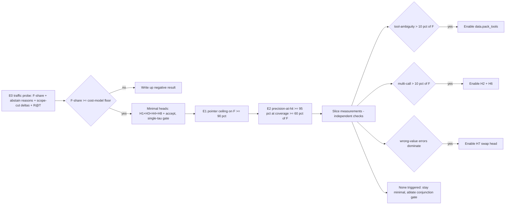

# SpanCall Remediation Plan — Simplify the Periphery, Measure the Premise

Status: **proposed** (design review outcome, 2026-10-27)
Owner: architect
Companion: [plans/spancall_remediation_plan.md](../plans/spancall_remediation_plan.md) (short form)

---

## 1. Why this document exists

A design review of the SpanCall proposal surfaced a systematic imbalance:

- **Over-built periphery:** 8 prediction heads (H1–H8), an 8-feature conjunction gate, multi-tool packing (T=4, J=3) and joint-assignment machinery were specified ahead of the E1/E2 experiments that would justify them. The docs' own ablation list ([heads.md §8](heads.md)) recommends a minimal v1 set (H3+H1+H4+H8) and gates H2/H5/H6/H7 behind measured slices (~10% of stratum F).
- **Under-built core:** the load-bearing premise — ~80% of calls are stratum F (fully groundable) — is unmeasured; the date-idiom window is narrow and self-contradictory; multi-word enums are rejected outright; timezone anchoring is deferred; schema selection (which decides whether the 10× cost claim survives) is explicitly out of scope.
- **Evidence ordering:** six design documents describe a system that is ~5% implemented (all of `spancall/` raises `NotImplementedError`), while the one number the economics hang on (`h`, hit rate) is assumed, not measured.

This document is the remediation: it converts the review's findings into concrete decisions, scoped changes, and decision gates that reorder the roadmap so **the premise is measured before the machinery is built**.

---

## 2. Problems and decisions (summary)

| # | Problem | Decision | Class |
| --- | --- | --- | --- |
| P1 | "tomorrow" is a flagship example in [proposal §1](proposal.md) and [mechanism §12](mechanism.md) but [pipeline_io §P3](pipeline_io.md) lists it as **not targetable** — an internal contradiction in the single-source-of-truth docs | **D1**: closed idiom table covers `tomorrow→+1d`, `day_after_tomorrow→+2d`, `tonight→today`; range-like idioms (`next week`, `this weekend`) stay off-window; "off-window" redefined as *no canonical entry covers it* | coverage / spec drift |
| P2 | Time window covers only `today`, `+1d/+3d/+7d`, `this_<dow>/next_<dow>` — common idioms abstain | **D1** (same table) | too simple |
| P3 | R5 rejects enum values with whitespace/`|` — `Premium Economy` crashes at ingestion | **D2**: quoted multi-word enums; `|` stays forbidden even when quoted | too simple |
| P4 | No timezone anchoring — `today` emits wrong dates with high confidence at day boundaries | **D3**: caller/tenant `clock.timezone` → user-local date; template API stays deterministic | correctness |
| P5 | H1–H8 + 8-feature conjunction gate before the E1/E2 experiments that justify them | **D4**: minimal-head v1 (H1+H3+H4+H8 + accept), single-τ gate; H2/H5/H6/H7 spec-only behind config | too complicated |
| P6 | Multi-tool packing (T=4, J=3) before its precondition slice is measured | **D5**: `data.pack_tools` defaults to 1; multi-tool form opt-in via measured slice (H-A6 gate) | too complicated |
| P7 | Schema selection out of scope, yet the cost claim's `c_s` ignores it | **D6**: explicit v1 contract — context-determined or embedding retriever with measured R@T in the cost model | economics |
| P8 | 80% stratum-F premise unmeasured; shadow mode is Phase-4 | **D7**: E0 traffic probe before training; decision floor on F-share | evidence |

---

## 3. Decisions in detail

### D1 — Expanded, still-closed date-idiom table (P1, P2)

The time window built by [`build_time_window`](../span_template/template.py) stays a **closed vocabulary** (that is what keeps R4's determinism and R8's snapping intact) but is widened from `{today, +1d, +3d, +7d, this_<dow>, next_<dow>}` to additionally include:

| Idiom entry | Value | Notes |
| --- | --- | --- |
| `tomorrow` | `+1d` | alias — the flagship example becomes targetable by construction |
| `+2d` (`day_after_tomorrow`) | base + 2 | add `2` to the default `window_days` set |
| `tonight` | `today` | canonical value = today's date; **date params only** — if a schema has a time param, `tonight` abstains for it |

**Deliberately excluded:** `next_week` and `this_weekend`. They denote a range or an anchor choice (Monday? Saturday?), not a single offset; mapping them to `+7d` or "nearest sat/sun" would emit confidently wrong values. They stay off-window → abstain, and can be added later only with an explicit, tested definition.

Changes:
- `build_time_window` and `_weekday` in [`template.py`](../span_template/template.py) gain the idiom map; `window_days` default becomes `(1, 2, 3, 7)` (`+3d` is a pre-existing offset kept for compatibility, not a natural idiom).
- [`pipeline_io.md §P3`](pipeline_io.md) rewording: *"Off-window phrases ("the 15th", "Q1 2027", "in 3 months") are not targetable"* — "tomorrow" is removed from the off-window list. The mechanism worked example ([mechanism.md §12](mechanism.md)) stays a **hit** by explicit entry, resolving P1.
- Tests in [`test_template.py`](../span_template/test_template.py): `tomorrow==base+1d`, `day_after_tomorrow==+2d`, `tonight==today`, `tonight` abstains on time params, `next week` is off-window.

Non-negotiable: entries that need *reasoning* (relative to an event, e.g. "the day after payday") remain off-window → `NEEDS_REASONING` → abstain → LLM. We are widening the closed table, not opening the vocabulary.

### D2 — Quoted multi-word enums (P3)

[`[CTX_ENUM]`](proposal.md) entries may carry R1-style quoting: `"Premium Economy" | BUSINESS | "First Class"`. Rules:

- **Whitespace allowed inside quotes**; leading/trailing whitespace of the whole value still rejected.
- **`|` remains forbidden, even inside quotes** (the separator is the one place the pool can still fragment — R5 stays strict there). This is a decision, revisitable only with measured need.
- **Escaping:** a literal `"` inside a quoted value is written `\"`, and a backslash `\\`. The parser unescapes; `validate_enums` round-trips (emit → parse → compare).
- Values without whitespace are emitted unquoted (backwards compatible with the existing fixture `test_enum_with_separator_rejected` which must still raise for `|`).

Changes:
- `validate_enums` in [`template.py`](../span_template/template.py): reject only raw `|`; whitespace is allowed if the emitted form is quoted (validated by re-parsing).
- [`template.jinja`](../span_template/template.jinja) / [`template_multi.jinja`](../span_template/template_multi.jinja): quote-on-demand (`quote` global already exists in [`template.py`](../span_template/template.py:48)).
- [`parser.py`](../span_template/parser.py) `ENUM_BODY_RE`: tokenize quoted entries; entry values are the **unescaped** canonical strings.
- Tests: `"Premium Economy"` parses as one entry with value `Premium Economy`; `"A | B"` raises `ValueError`; unquoted `BUSINESS` unchanged.

### D3 — Timezone anchoring contract (P4)

- The **caller** resolves `user_tz → user-local date` and passes `now` (existing `now: date` API — already deterministic, no wall-clock fallback). New helper `local_today(zone, utc_now)` lives in [`template.py`](../span_template/template.py) or a new `spancall/infer/clock.py`.
- Config [`configs/default.yaml`](configs/default.yaml) gains `clock.timezone` (IANA name, per-tenant default). Because `now` is caller-supplied, a **per-session override is allowed in v1 at no template cost** — the caller just passes a different `now`. `template.py` never reads config or the clock.
- Tests: day-boundary (UTC+14 vs UTC-12 around midnight), DST spring-forward/fall-back days reusing the existing `this_`/`next_` divergence fixtures.

The fast path never guesses a timezone: **unknown tz ⇒ abstain on date params** (no server-local fallback — that is the exact bug being fixed). This is a **correctness floor**, not an optimization.

### D4 — Minimal-head v1 and single-τ gate (P5)

Config `model.heads` (new) with defaults:

```yaml
model:
  heads: { tool: true, count: false, pointer: true, abstain_reason: true,
           source: false, list_size: false, swap: false, correctness: true }
```

- H3 (pointer) + H4 (abstain reason) + H1 (tool) + H8 (correctness) are v1. `CallAcceptHead` stays. H1 is a no-op when the schema holds exactly one tool (the D5 default); it stays on so tool-ambiguity is measured from day one when a retriever supplies top-N > 1.
- H2/H5/H6/H7 are **spec-only**, constructed only when `model.heads.<id>: true` — matching the docs' own priority note ([heads.md §8](heads.md)).
- Gate default `gate.mode: single_tau` replacing the 8-feature conjunction:

```
hit ⇔ min_k p_k ≥ τ   AND   accept ≥ τ_a   AND   validate()
```

`τ` calibrated on a paraphrase-disjoint set (Clopper–Pearson bound, unchanged from [mechanism §7.4](mechanism.md)). The conjunction gate (`gate.mode: conjunction`) remains an ablation behind config.
- [`spancall/infer/gate.py`](../spancall/infer/gate.py) is the single place the mode switch lives.

### D5 — Opt-in multi-tool packing (P6)

- Config `data.pack_tools` default `1`. [`build_input_multi`](../span_template/template.py:309), `[NONE]` anchor, T=4/J=3 slot machinery stay implemented and tested but are **not invoked by the default pipeline**.
- Enablement gate (H-A6): when the **tool-ambiguity** slice of measured traffic exceeds ~10% of stratum F (from E0/E7 telemetry), flip `data.pack_tools` on. The **multi-call** slice gates the list heads (H2 + H6) — a separate decision (§5). Until then the single-tool form is the shipped path.
- Reconciling with [heads.md §6](heads.md) ("the real cost lever"): packing reduces per-call schema cost once multiple tools are routinely in play; with a context-determined schema (D6 option 1) there is nothing to pack, so default-off costs nothing and defers the cross-tool-leakage question until it matters.

### D6 — Schema-selection contract (P7)

[mechanism §9](mechanism.md) becomes a v1 requirement instead of an open question:

1. **Context-determined** (search box, form, single-tool endpoint): `c_s` is just the encoder. Preferred v1.
2. **Embedding retriever** over tool descriptions → top-N: **R@T must be measured and reported** as a cost-model input (`c_s = c_retrieval + c_encoder`), because a retriever miss silently downgrades the system to LLM-only (`h ≈ 0` pointwise) while counting nothing in the FLOPs table. A minimum **R@T ≥ 0.95** (provisional) is required; otherwise the miss rate is folded into `h` in the cost model.

The 10× claim's cost table ([mechanism §1](mechanism.md)) is updated to show which schema-selection mode it assumes; any reported number states which mode it used.

### D7 — E0 traffic probe before training (P8)

New experiment **E0** (first item of the roadmap):

- Tooling: [`scripts/probe.py`](../scripts/probe.py) + `probe:` config section. It renders the **existing** template (nothing new trains first), logs abstain reasons via the sanitizer, and buckets calls. It depends only on `span_template/` and the sanitizer — **not** on `spancall/infer/gate.py` (still `NotImplementedError`).
- Ordering: E0 runs **after D1–D3** (cheap template fixes) so it measures the intended template. Each fix sits behind a flag so the probe can run the pre-fix baseline arm; the scope-cut deltas below are the with/without difference.
- Inputs: 2–3 representative workloads, ~1–2k hand-labeled calls each (workloads TBD — see §6).
- Outputs, all reported **per workload**, never aggregated across classes:
  - **F-share** (fraction of calls fully groundable by the current template).
  - **Abstain-reason mix** (H4 classes: ABSENT / AMBIGUOUS / NEEDS_REASONING / OFF_WINDOW) for the non-F share.
  - **Per-scope-cut deltas**: coverage lost by removing idioms (D1), multi-word enums (D2), recent-context rows, and anaphora-beyond-verbatim — so the plan knows *which* restriction consumed the F-share.
  - **Retriever R@T** for the schema-selection mode in play (D6).
- **Decision gate (kill floor below the success gate, per §9 protocol):** F-share is a **coverage upper bound** on the hit rate, not `h` itself: achievable `h ≲ F-share × coverage-of-F`, and E2 targets 60% coverage, so F=0.5 implies h≈0.3. The floor is therefore **derived from the cost model**: `F_floor = h_min / 0.6`, where `h_min` is the smallest hit rate still giving ≥ 5× (E6 target) under the stated schema-selection mode (D6). Default `F_floor = 0.5` is provisional until `h_min` is computed. Below floor ⇒ stop and write up the negative result; between floor and the 0.8 aspiration, proceed but report and manage coverage expectations.
- **Risk:** high F-share but poorly separable abstain reasons (H4 cannot learn them) would make the gate unreliable. E0 reports the abstain-reason mix so this is visible before training.

E0 deliberately reuses the [architecture §3](architecture.md) shadow-style instrumentation; it is a Phase-0 promotion of the mechanism's §11 shadow rollout.

---

## 4. Work breakdown (execution order)

| Step | Changes | Files (primary) |
| --- | --- | --- |
| 1. D1 | Idiom map + `+2d`; off-window wording fix; tests | [`span_template/template.py`](../span_template/template.py), [`span_template/test_template.py`](../span_template/test_template.py), [`docs/pipeline_io.md`](pipeline_io.md), [`docs/proposal.md`](proposal.md) |
| 2. D2 | Quoted multi-word enums; relaxed `validate_enums`; parser + templates; fixtures | [`span_template/template.py`](../span_template/template.py), [`span_template/parser.py`](../span_template/parser.py), [`span_template/template.jinja`](../span_template/template.jinja), [`span_template/template_multi.jinja`](../span_template/template_multi.jinja), [`span_template/test_template.py`](../span_template/test_template.py) |
| 3. D3 | `local_today(zone, utc_now)` + config `clock.timezone`; boundary/DST tests | [`span_template/template.py`](../span_template/template.py), [`spancall/infer/clock.py`](../spancall/infer/clock.py) (new), [`configs/default.yaml`](configs/default.yaml), tests |
| 4. D7 (after D1–D3; flag-gated baseline arm) | `scripts/probe.py` + `probe:` config + E0 ledger entry + decision gate | [`scripts/probe.py`](../scripts/probe.py) (new), [`configs/default.yaml`](configs/default.yaml), [`docs/experiments.md`](experiments.md) |
| 5. D4 | `model.heads` + `gate.mode`; single-τ gate; spec-only construction | [`spancall/train/config.py`](../spancall/train/config.py), [`spancall/infer/gate.py`](../spancall/infer/gate.py), [`spancall/model/heads.py`](../spancall/model/heads.py), [`configs/default.yaml`](configs/default.yaml) |
| 6. D5 | `data.pack_tools=1` default; multi-tool path behind config | [`spancall/train/config.py`](../spancall/train/config.py), [`spancall/data/mix.py`](../spancall/data/mix.py), [`configs/default.yaml`](configs/default.yaml) |
| 7. D6 | §9 schema-selection contract + cost-model inputs | [`docs/mechanism.md`](mechanism.md) |
| 8. Docs | Update proposal R4/R5, pipeline_io P3/P4/P6, heads §1/§2/§8, architecture §11 roadmap (Phase 0 = E0) | docs |

## 5. Revised roadmap (high level)



| Phase | Deliverable | Gate |
| --- | --- | --- |
| **Phase 0** | E0 probe on 2–3 workloads; F-share + abstain-reason mix + scope-cut deltas + R@T | F-share ≥ floor (default 0.5) |
| **Phase 1** | Minimal heads (H1/H3/H4/H8 + accept), single-τ gate, D1–D3 template fixes | E1 ≥ 90% exact payload on F dev |
| **Phase 2** | Calibrated gate + E2; ablation of conjunction when justified | E2 ≥ 95% precision-at-hit at ≥ 60% coverage of F |
| **Phase 3** | Conditionally: packing (D5), H7/H2/H6 (D4) as slice measurements require | H-A6 slice gates; E3/E4 ablations |
| **Phase 4** | Full agentic eval + cost table with schema-selection mode stated (D6) | E7/E9 non-inferiority; E6 ≥ 5× vs fair 0.5B baseline |

Kill/stall protocol unchanged from [architecture §9](architecture.md): floors below gates, a "stalled" band in between, negative results written up.

## 6. Open questions

1. Which 2–3 workloads does the E0 probe sample first (booking / CRM / IoT / search)? (Default: booking, CRM, search.)
2. `h_min` for the E0 floor: what hit rate gives ≥ 5× under the chosen schema-selection mode? (Provisional floor 0.5 until computed.)
3. Timezone: per-session override is allowed via caller-supplied `now` (resolved in D3); confirm the tenant-default source.
4. Decided: `|` stays forbidden everywhere (D2). Revisit only with measured need.

## 7. Relationship to existing docs

- [proposal.md](proposal.md): R4 (idiom table), R5 (quoted enums), §3.4 gate (single-τ default), §8 open items (timezone).
- [pipeline_io.md](pipeline_io.md): §P3 (off-window wording, timezone), §P4 candidate sets (quoted enum entries), §Q8 (gate modes), Part C/E status rows.
- [heads.md](heads.md): §1/§2/§8 — H2/H5/H6/H7 marked spec-only behind config; v1 head set per §4.
- [mechanism.md](mechanism.md): §1 cost table (schema-selection input), §7.3 gate modes, §9 contract, §12 worked example (tomorrow = hit).
- [experiments.md](experiments.md): add E0; keep kill/stall protocol.
- [architecture.md](architecture.md): §5.1 heads table (config-gated), §9 table (E0), §11 roadmap (Phase 0).
- [configs/default.yaml](configs/default.yaml): new `clock`, `probe`, `model.heads`, `gate.mode`, `data.pack_tools` sections.