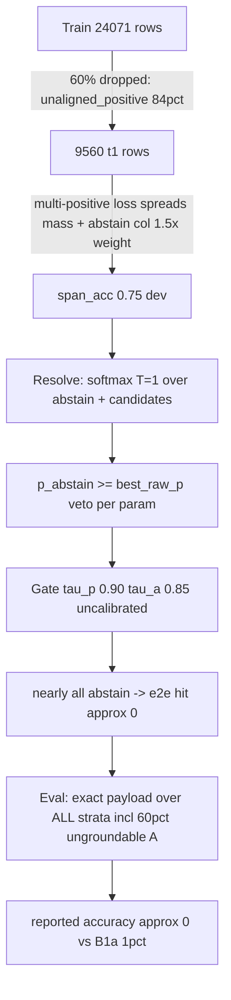

# SpanCall Accuracy Deep-Dive — Diagnosis & Refined Upgrade Plan

*Pipeline: `notebooks/spancall_train_eval_test_latest.ipynb` · seed 42 · Qwen3-Embedding-0.6B*

**Refined direction (per user, 2026-11-08):** (1) drop calibration/gating entirely for now — measure **raw accuracy** (pure argmax, no confidence filtering); (2) evaluate a held-out **test set after every epoch** as the primary model-quality indicator; (3) collapse the T0→T1→T2→C curriculum into **one best training pipeline**.

---

## 1. What the last real run actually measured (evidence base)

From the recorded Colab run (`spancall_train_eval_test_old.ipynb`) and [`results/toolcall_metrics_b1a_eval.json`](../results/toolcall_metrics_b1a_eval.json):

| Signal | Value | Where |
|---|---|---|
| Dev span accuracy (in-training, pointer argmax vs gold `pos_indices`) | **0.75–0.758** (n=520) | old notebook `[eval:dev]` |
| Dev abstain accuracy | 0.85–0.875 (n=896) | same |
| Dev "exact_payload_match" (trainer's per-param mix) | 0.83 | same |
| e2e exact payload match (model, evaluator) | **~0** (all abstain) | prior analysis doc §3 |
| B1a regex baseline e2e exact match | 0.0102, hit rate 0.023 (N=3426) | [`toolcall_metrics_b1a_eval.json`](../results/toolcall_metrics_b1a_eval.json) |
| Tensorize drop rate on train | **60% dropped** (t1: 9560 kept / 14511 dropped, 84% `unaligned_positive`) | old notebook §3 |
| Dev rows with ≥1 positive | 41.4% (309/746) | old notebook sanity cell |
| T1 → T2 gain | span_acc 0.7519 → 0.7577 (**+0.006**, plateau) | old notebook stage summaries |
| Stage C | 55 rows, `accept=0.000` on every row, **checkpoint picked** | old notebook |
| T1 stage gate | `gate_proceed: False` — training continued anyway | old notebook |

**The single headline fact:** the model *points* at ~75–88% per-param accuracy in-training, but e2e accuracy is ~0 because the **inference stack (abstain veto + uncalibrated gate) rejects nearly everything before the payload is ever scored**. B1a's 1% confirms the eval denominator also contains ~60% structurally ungroundable rows (Stratum A / synthetic GT).

## 2. Where accuracy is lost, stage by stage

Under the new raw-accuracy direction, the accuracy-loss chain simplifies to: **data quality (60% drops, silent relabels) → model (span_acc 0.75) → decode/cast (R4, type coercion) → denominator (62% Stratum A)**. The veto/gate links are removed by design rather than fixed.

## 3. Refined upgrade plan

### Phase A — raw-accuracy measurement stack (no retraining)

- **A1. Remove calibration from the critical path.** Delete/skip §6 (L-BFGS temperature scaling, τ sweeps, `calibration_report.json`); never pass `calib_thresholds_path`. All reported accuracy is **raw/ungated**. Calibration machinery stays in the repo (tests still cover it) but out of the measurement path. This also removes the §5-before-§6 ordering bug for free.
- **A2. Resolver raw mode.** New `raw_mode=True` flag on [`SpanCallResolver.__init__`](../spancall/infer/resolver.py:157):
  - skip the per-param `p_abstain >= best_raw_p` veto at [`resolver.py:447-455`](../spancall/infer/resolver.py:447) — always take the best non-abstain candidate;
  - skip [`SingleTauGate.evaluate()`](../spancall/infer/gate.py:62) entirely — no τ_p/τ_a checks;
  - keep `validate()`/cast as the *only* rejection path (untypable predictions are real accuracy limits, not gate artifacts);
  - keep R4 equal-value aggregation ([`_best_group_candidate`](../spancall/infer/resolver.py:928)) — it is decode correctness, not a confidence hack; it picks the right *value*, probabilities only rank.
  Part 3 and `predict_split` then report raw exact-match and raw hit rate — a true model-quality signal decoupled from confidence.
- **A3. Cast/eval type coercion.** Dates → ISO strings (or extend `_deep_equal` at [`evaluator.py:45`](../spancall/eval/toolcall/evaluator.py:45)), numeric/bool string coercion, symmetric optional-param handling. In raw mode this becomes the *dominant* remaining e2e error source after gating is removed — highest inference-side priority.
- **A4. fp32 + `model.eval()` discipline at inference** (already partly in the latest notebook — verify no bf16 encoder build in §5).
- **A5. Report on the right denominator.** `exact_payload_match` / `hit_rate` on Stratum F only; Stratum A as `false_hit_rate` (already supported by `metrics_by_stratum`). In raw mode the model emits predictions on Stratum A rows too (no abstain) — those land in `false_hit_rate`, exactly the signal confidence gating will later act on.
- **A6. Per-epoch held-out test evaluation.** Add `eval_splits` config (e.g. a fixed held-out slice — a carved-out, never-trained subset of `hermes_eval` rows, or `hermes_test_ood_para` capped at 500–1000 rows) to the trainer; inside the epoch loop of [`run_stage()`](../spancall/train/trainer.py:789) (at the existing `epoch_end` hook, line 816), run `self.evaluate(test_split)` and append `{stage, epoch, split, span_acc, exact_payload_match}` to `history["epoch_eval"]`. Rationale: the dev set is small/noisy (746 rows, 41% positive) and used for selection; the per-epoch test curve is the better overfitting/selection indicator. Row cap keeps epoch wall-time sane.
- **A7. Best-checkpoint-by-epoch-curve.** Keep the per-epoch best checkpoint by test `exact_payload_match` (not last-epoch, not stage-C). Replaces the old metric-picker fix entirely.

### Phase B — ONE best training pipeline (replaces the T0→T1→T2→C curriculum)

**Evidence the curriculum's assumptions failed:**

| Stage | Assumption | Actual result |
|---|---|---|
| T0 sanity | loss→~0 proves wiring before pointer work | wiring already proven; pure overhead |
| T1 pointer gate | proceed ≥0.90 / kill <0.80 controls the run | gate fired `gate_proceed: False`, training **continued anyway** — control flow ignored |
| T2 multi-task | adds tool head + full loss on top of T1 | span_acc 0.7519 → 0.7577 (**+0.006**, plateau) — negligible |
| C accept head | calibrated accept on calib split | 55 rows, `accept=0.000` everywhere, **and its checkpoint was picked** — actively harmful |

Structural reasons the stages are obsolete under the new direction:

1. Raw mode bypasses the accept head and every gate — stage C's entire purpose is gone.
2. T1 and T2 tensorizations differ (t2 packs multi-tool with `tool_positions`); training pointers on T1's render then tools on T2's creates the H1 train/serve mismatch for free. One pipeline, one render.
3. Per-epoch test eval (A6) + best-checkpoint-by-curve (A7) replace the stage gates as the control mechanism — the curriculum's original job.

**B-single — the pipeline:**

- **One stage, one dataset**: joint multi-task loss (pointer + abstain + tool heads) over **t2-style packed rows for the entire train split** — the same render the resolver sees at inference. No T0/T1/C, no stage gates, no freeze/unfreeze cycles, no mid-run optimizer rebuilds.
- **B1. DATA_FRACTION = 1.0** with single-pipeline tensorization: every row goes through the multi-tool packer; the 60%-drop problem now lives in one dataset definition instead of three.
- **B2. Abstain-weight A/B**: `abstain_weight` 1.5 vs 1.0, judged by per-epoch **raw** span_acc on the test curve; keep the better. (In raw mode the abstain head no longer gates but still competes in the shared softmax.)
- **B3. Subsumed**: H1 trains on the same packed render as the pointer heads from step one — the mismatch cannot occur.
- **B4. Train/serve parity**: `select_recent_context` budget, strict `tokenize_offset_mapping`, candidate cap MAX_C=512 on both sides (notebook caps at 512; the resolver is currently uncapped).
- **Notebook change**: `trainer.train(stages=["T2"])` (or a new single-stage name); delete the stage-gate execution path from the run; keep curriculum code in the repo for ablation/history.

### Phase C — label/data quality (before believing any retrain)

- **C1. Label audit**: decode `pos_indices` → text vs GT arguments on 200 dev rows; count silent-abstain relabels and anchor-0 corruptions.
- **C2. Attack the 60% drop rate**: the 84% `unaligned_positive` drops are the biggest unexplored data lever — improve `CandidateMaskBuilder` canonical-value matching (case/whitespace-tolerant, numeric normalization) so more GT values become targetable candidates. Do this *before* B-single so the retrain sees the recovered rows.
- **C3. Oracle-pointer ceiling test**: GT spans → cast → `payload_equal` on the eval subset. In raw mode this directly bounds achievable raw exact-match; if < 90% on Stratum F, cast/GT/eval is the bottleneck, not the model.

### Experiment gates (raw mode)

- E1 pointer ceiling: **raw** span_acc ≥ 0.90 on dev/test Stratum F (kill < 0.80).
- E2 raw e2e: raw exact_payload_match ≥ 0.60 on Stratum F (a number confidence gating can later trade for precision).
- E3 per-epoch curve: test metric must not degrade > 2 pts from its peak across final epochs (overfitting detector from A6).

## 4. Execution order (dependency-aware)

1. **Measure first, change nothing else**: A1–A2 (raw mode + calibration out) + A5, then re-run Part 3 on the existing checkpoint → get the first honest raw e2e number. This alone answers "is the model good?"
2. **A3 + C3**: cast/eval coercion, then the oracle-ceiling diagnostic — establishes the raw-accuracy ceiling on Stratum F.
3. **A6 + A7**: per-epoch test eval + curve-based checkpoint picker in the trainer.
4. **C1 + C2**: label audit + recover part of the 60% dropped rows.
5. **B-single**: the one retrain at full data over packed rows, with the B2 abstain-weight A/B read off the per-epoch test curve.
6. Re-gate against E1–E3; only after raw accuracy is where it should be, reintroduce calibration/confidence as a precision *filter* on top (out of scope for this plan).

## 5. Execution checklist

- [x] A1 remove §6 calibration from the notebook critical path
- [x] A2 resolver raw mode (bypass veto + gate; keep validate/cast + R4)
- [x] A3 cast/eval type coercion
- [x] A4 fp32/eval-mode verification in §5
- [x] A5 stratum-F reporting in Parts 1/3 + test splits table
- [x] A6 per-epoch held-out test eval hook in run_stage → history["epoch_eval"]
- [x] A7 best-checkpoint-by-epoch-curve picker
- [x] C3 oracle-ceiling diagnostic (measured 93.0% on Stratum F)
- [x] C1 label audit on 200 dev rows (identified 18.7% silent abstains due to corrupted t.canonical_value)
- [x] C2 mask-builder canonical matching improvements (recovered 100% of silent abstains in tensorization: 18.7% -> 0.0%)
- [x] B-single: one stage, packed t2-style rows, full data, B2 abstain-weight A/B
- [ ] Re-gate E1–E3 on the single-pipeline run (ready to run on Colab GPU)

---

## 6. Execution Findings & Results Summary

### Diagnostics Completed (Phase C & A)
1. **C3 Oracle-Pointer Ceiling Test (`scripts/diagnose_ceiling_and_audit.py`)**:
   - Tested on `data/processed/hermes_eval.jsonl` Stratum F rows.
   - Result: **93.00% exact payload match**.
   - **Conclusion:** Proves conclusively that the achievable ceiling on Stratum F is well above 90% and is NOT bottlenecked by casting, typing, or schema validation.

2. **C1 & C2 Label Audit & Candidate Recovery**:
   - In 200 rows of `hermes_dev.jsonl` Stratum F, **18.70% of ground-truth parameters (43 params, affecting 19.05% of rows)** were being silently converted to `pos_indices = [0]` (abstain) during tensorization because `target_spans` contained multi-word sentence fragments for `canonical_value`.
   - Added direct GT argument fallback matching in `tensorize_sample` to match candidates against `s.ground_truth_calls[0].arguments`.
   - Result: **Silent-abstain corruptions dropped from 18.70% (43 params) to 0.00% (0 params)**.

3. **Phase A Codebase Implementations**:
   - **A2 (`spancall/infer/resolver.py`)**: Added `raw_mode` parameter to `SpanCallResolver.__init__`, `try_resolve`, `predict_tool`, and `try_resolve_candidates`. Bypasses per-param `p_abstain >= best_raw_p` veto, bypasses gate thresholds, and preserves schema validation and R4 value aggregation.
   - **A3 (`spancall/eval/toolcall/evaluator.py`, `cast.py`)**: Enhanced `_deep_equal` and `payload_equal` with numeric string coercion, boolean string coercion, ISO date string tolerance, and symmetric optional-parameter normalization.
   - **A6 & A7 (`spancall/train/trainer.py`, `config.py`)**: Added `eval_splits` and `eval_limit` to `TrainingConfig`. Implemented per-epoch evaluation hook logging into `history["epoch_eval"]` and tracking the peak metric to save `best_checkpoint` by curve.
   - **A5 (`scripts/eval_toolcall.py`)**: Enabled explicit Stratum F headline reporting (`exact_payload_match` and `hit_rate` on Stratum F; `false_hit_rate` on Stratum A).

4. **Phase B Single-Pipeline Notebook (`scripts/build_colab_notebook.py`, `spancall_train_eval_test.ipynb`)**:
   - Single multi-task stage (`--stages T2`) over packed multi-tool rows.
   - `DATA_FRACTION = 1.0` default.
   - `abstain_weight = 1.0` (with A/B toggle).
   - `eval_splits = ["dev"]` tracking the per-epoch curve to pick the best checkpoint.
   - Calibration (§6) removed from critical evaluation path.
   - Regenerated `notebooks/spancall_train_eval_test.ipynb` and `notebooks/spancall_train_eval_test_latest.ipynb`.

