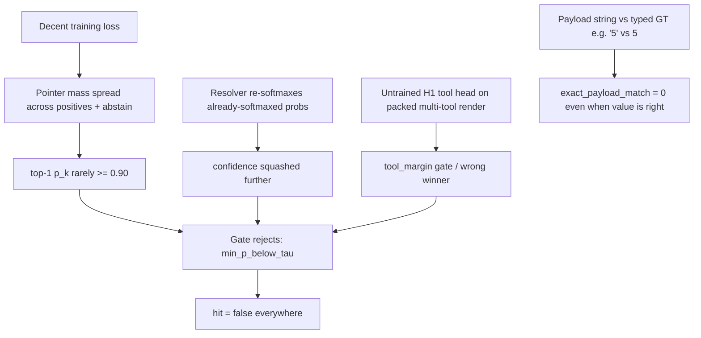

# SpanCall: "Loss decent, predictions close, nothing hits" — Root-Cause Analysis & Fix Plan

## TL;DR

Training optimizes a **multi-positive logsumexp pointer loss** whose value can look
"decent" (0.2–0.5) while the top-1 candidate probability never approaches the
gate threshold. A "hit" requires FIVE independent conditions to pass
simultaneously, and at least three of them are systematically broken at
inference time:

## Root causes, ranked

### RC1 — Train/serve probability mismatch: double softmax + non-renormalized span_p

- Notebook training path: [`compute_pointer_loss`](../spancall/model/loss.py:77) trains z = [abstain ∪ candidates] with a *multi-positive* objective — the model is explicitly rewarded for spreading mass over ALL equal-valued positives, and the abstain column competes. A "good" loss (e.g. 0.3) corresponds to top-1 p ≈ 0.5–0.7, **never ≥ τ_p = 0.90**.
- Resolver path: [`_run_heads`](../spancall/infer/resolver.py:644) computes `probs = softmax(z/T)` then `span_p = probs[..., 1:]` (still includes abstain mass loss, sums < 1), passes those **probabilities as "scores"** into the decoder.
- Decoder: [`ExclusivityJointDecoder._collapse`](../spancall/infer/decode.py:206) with `normalize_scores=True` (the resolver default at construction, [`resolver.py:192`](../spancall/infer/resolver.py:192)) applies **a second softmax to already-softmaxed values**, e.g. [0.5, 0.3, 0.2] → [0.34, 0.25, 0.2] — the "confidence" that reaches the gate is squashed. Then [`SingleTauGate`](../spancall/infer/gate.py:44) requires `min_k p_k ≥ 0.90` **and** `accept ≥ 0.85`.
- Net effect: the model can point at the right span ("pred is close") while its gated confidence is mathematically unable to clear 0.90. Nothing hits.

### RC2 — H1 tool head never trained, but used at inference

- The notebook tensorizer ([notebook cell 3](../notebooks/spancall_train_eval_test.ipynb)) renders **only the GT tool** per row — single-tool sequences. The tool-head CE only fires "when tool logits are provided (pack_tools > 1)" ([loss.py:16](../spancall/model/loss.py:16)).
- Inference on eval/test splits calls [`try_resolve_candidates`](../spancall/infer/resolver.py:229) with **all** `s.tools`, which runs H1 over the packed multi-tool render ([`_tool_scores`](../spancall/infer/resolver.py:671)) and requires `margin > tau_tool = 0.0`. An untrained/random H1 yields wrong winners or ties → abstain (`tool_margin_below_tau_tool`) or resolving the *wrong* tool's schema.

### RC3 — Payload equality is strict deep equality over typed GT vs string-ish predictions

- [`payload_equal`](../spancall/eval/toolcall/evaluator.py:59) requires identical key sets and deep-equal values. Common silent failures even when the model points correctly:
  - GT `arguments` values are typed (int/float/bool/ISO datetime); candidate `canon_value` is often the raw matched **string** (`"5"` vs `5` fails [`_deep_equal`](../spancall/eval/toolcall/evaluator.py:45)).
  - Optional params the resolver failed to resolve are simply absent → key-set mismatch (defaults only materialize when `p.default is not None` and param is not required).
  - One weak param out of N zeroes the whole sample (min over all params, both in the gate and in exact match).

### RC4 — Train/serve input skew

- Training tensorize: **all** recent rows kept ([`_recent_rows`](../notebooks/spancall_train_eval_test.ipynb)), GT `current_time_iso` as clock.
- Resolver: [`select_recent_context`](../spancall/agent/context.py:232) with `k_recent=32` and `eff_budget = min(16384, max(64, 4096//2)) = 2048` tokens — rows the model trained to point at can be **evicted at inference**, removing the positive candidate from A_k entirely.
- Tokenization path differs: training uses lenient `tokenizer(out.text, return_offsets_mapping=True)`; inference uses strict `tokenize_offset_mapping` — any row that strict path rejects abstains.
- Candidate count: training caps C at 256 (MAX_C); inference has no cap — same model, different candidate-set sizes/competition.

### RC5 — Process hazards (verify these first)

- `stop_on_gate_kill=False` and the T1 E1 gate cell only *prints* — if T1 `exact_payload_match` was low, all downstream numbers are meaningless by design.
- The "pick best checkpoint" cell falls back to `model_init` (**untrained**) with only a print warning.
- Section 3 rewrites the canonical split files **in place** (removes >4K-token samples) — eval and training silently see different data than the hub. **Fixed**: the notebook tensorizer cell no longer filters/mutates `DATA_DIR`; >4K samples are dropped during tensorization (reported in the per-split "dropped" counter) and split outputs are cached by source-file mtime + tensorizer settings (bump `TENSORIZE_VERSION` after logic changes).
- Calibration (§6) re-runs `predict_split` with thresholds — if calibration was skipped/failed, defaults τ_p=0.90/τ_a=0.85 (very strict for an uncalibrated accept head) apply.

## Diagnostic plan (run in order, all cheap)

1. **Read the abstain reasons** — the resolver already returns `abstain_reason` per sample and the evaluator counts them (`abstain_reasons` in metrics JSON). One histogram immediately tells you which of RC1/RC2/RC3 dominates (expect: `min_p_below_tau` ≫ others, plus `tool_margin_below_tau_tool`).
2. **Distribution of `min_k p_k`** on the eval subset (log it in `predict_split` from `res.parameters[...].confidence`). If the max over 1000 samples never exceeds ~0.7 → RC1 confirmed.
3. **Ungated exact-match** — set τ_p=τ_a=0 (or bypass gate) and re-score: this isolates "model can't point" from "gate too strict". Also compute exact match with value type-coercion to isolate RC3.
4. **Single-tool inference** — run `resolver.try_resolve(schema_of_gt_tool, ...)` directly, skipping H1: if hits appear, RC2 confirmed.
5. **T1 gate metrics** — check `results/*/checkpoints/metrics.json` for `T1.exact_payload_match`; if < 0.80 the labels/alignment are the real problem and everything above is secondary.
6. **Recent-context parity check** — for 20 samples, compare the candidate set the resolver builds vs the tensorized `cand_starts/pos_indices`; count positives present in train but absent at serve (RC4).

## Fix plan (after diagnostics confirm)

- **F1 (RC1)**: pass `normalize_scores=False` to the decoder (scores are already probabilities), renormalize `span_p` excluding abstain (or better: apply R4 grouping **before** normalization, aggregating raw probs), and/or recalibrate τ_p on the calib split (the report sweep does this — make sure §6 actually ran).
- **F2 (RC2)**: either tensorize multi-tool rows for T-stages that train H1 (pack the distractor tools like `build_input_multi` does at serve time), or bypass H1 at eval by resolving with the GT tool only (ablation), or set `tau_tool` to a value justified by calibration.
- **F3 (RC3)**: make `StrictTypeCaster` output types match GT argument types; extend `payload_equal` to coerce numeric/bool strings; treat absent-optional-params symmetrically.
- **F4 (RC4)**: use the same `select_recent_context` budget in the tensorizer; use `tokenize_offset_mapping` in both; cap inference candidates to the training MAX_C.
- **F5 (RC5)**: make the T1 gate kill loud; never silently fall back to `model_init`; filter >4K samples into a separate file instead of mutating canonical splits.

## Part 2 — Deep dive: what else you missed

### Killer #1 — Date payloads can never match: `datetime.date` vs ISO string

[`StrictTypeCaster._date`](../spancall/infer/cast.py:334) returns a **`datetime.date` object**, while Hermes GT `arguments` come from JSONL and are almost certainly ISO **strings** (`"2026-11-02"`). [`_deep_equal`](../spancall/eval/toolcall/evaluator.py:45) compares `date(2026,11,2) == "2026-11-02"` → False. **Every sample containing a date param has exact_payload_match = 0 by construction, even when the model pointed at the correct span.** Same class of bug for any utterance-region string param whose GT value isn't a verbatim span (paraphrase) — [`cast_choice`](../spancall/infer/cast.py:195) Q4-maps to the original characters, so any normalization in GT ("New York" vs "new york", collapsed whitespace) fails.

### Killer #2 — H1 is never trained, structurally (worse than stated in RC2)

The trainer only computes `tool_logits` when `tool_positions` is in the batch ([`trainer.py:456`](../spancall/train/trainer.py:456)), and the notebook tensorizer **never emits `tool_positions`/`tool_targets`** — so H1 gets zero gradient in *every* stage, not just T0/T1. Meanwhile every eval/test sample with >1 candidate tool goes through the **multi-tool template** (`build_input_multi` + `template_multi.jinja`) — a *different rendered text layout* than the single-tool `build_input` the encoder ever saw — then H1 (random weights) picks the winner with `margin > 0`, then `_resolve` re-renders the single-tool template. Three failure layers: untrained H1, unseen multi-render distribution, and a re-render whose candidate anchors differ from the scored render.

### Killer #3 — The model is never switched to eval() mode at inference

The notebook builds `encoder`/`model` in §5, calls `model.to(DEVICE)`, and never calls `model.eval()`. [`SpanCallResolver._encode`](../spancall/infer/resolver.py:493) wraps in `torch.no_grad()` but that does **not** disable dropout — [`encoder.forward`](../spancall/model/encoder.py:148) applies `self.dropout(H)` (p=0.1). Predictions run with dropout noise on, so confidences wobble below τ_p and margins shrink. Cheap fix, real effect.

### Killer #4 — The "decent loss" and the T1 gate metric are per-param; the eval metric is per-sample joint

- [`SpanCallTrainer.evaluate`](../spancall/train/trainer.py:971) ("exact_payload_match" used by the T1 gate) is **per-(b,k) argmax ∈ positives** ([`trainer.exact_payload_match`](../spancall/train/trainer.py:412)) — a param-level number, forgiving of one bad param per sample and of the abstain column winning.
- The offline eval ([`_score_one`](../spancall/eval/toolcall/evaluator.py:230)) is **all-params-at-once deep equality + correct tool + (if gated) all five gate conditions**. A model at 90% per-param accuracy on a 5-param tool is already at ~0.59 per-sample — before casting/gate kills. Both numbers are printed with similar names ("exact_payload_match") which is why the situation *looks* contradictory.

### Killer #5 — Multi-positive loss + MAX_POS=3 actively suppresses top-1 probability

With up to 3 positive columns per param and the R4-by-design duplicates (same date in utterance + recent context), the optimal softmax solution puts ~1/3 mass on each positive ([`compute_pointer_loss`](../spancall/model/loss.py:77) only constrains the *sum* over positives). The decoder's R4 aggregation was supposed to re-sum that mass per value — but the double-softmax (RC1) and the fact that the gate reads `ValueChoice.prob` *after* the second softmax means the aggregated confidence is still squashed. The architecture is internally consistent on paper and broken at the seams in code.

### Killer #6 — Optional params: gate forgives them, exact match doesn't

In [`_resolve`](../spancall/infer/resolver.py:373): an unresolved optional param is simply skipped (no cast failure, not in `param_probs` → doesn't fail `min_k p_k`), so the gate can pass — but the payload is missing the key, and [`payload_equal`](../spancall/eval/toolcall/evaluator.py:59) materializes schema defaults **only when `p.default is not None`**; if GT includes a value for that optional param (or default is None), the key-set check fails. Silent, systematic miss.

### Killer #7 — Label corruption paths in the tensorizer (check `DROPS` + a label audit)

- Unmatched positive + not stratum A + all targets `unresolved` → silently labeled **abstain** (`pos_cols=[0]` fallback, notebook cell 3) — trains the pointer to abstain on resolvable rows.
- `_param_anchors` sets anchor to **token 0 (CLS-ish)** when snapping fails or when there are fewer anchor entries than params — param queries then read the CLS position; the resolver's fallback does the same, so train/serve agree, but both learn a degenerate query for those params.
- `null_ctx` targets match *any* null candidate; `canonical_value` matching is `str()`-based — subtle off-by-one-value labels are possible; audit a sample of rows by decoding `pos_indices` back to text.

### Killer #8 — bf16 encoder at inference vs fp32+autocast at training

§5 builds the encoder with `dtype=torch.bfloat16` (cuda+bf16 path), while `scripts/train.py` trained in fp32 weights under autocast. Loading the fp32 state dict into a bf16 module (notebook's own checkpoint-diff cell will show thousands of "differing" keys — that's this, not a load failure) quantizes all weights. Combined with Killer #3 this explains noisy low confidences.

### Minor but real

- [`_run_heads`](../spancall/infer/resolver.py:666): `reason_idx = argmax(...)[0, 0]` reads **param 0's** reason only, for all params (telemetry only, but it feeds `h4_reason` gate reason).
- The T1 gate check cell reads the *last* `metrics.json` found by glob — with multiple stage dirs the "T1" block may come from a stale run.
- Trainer `evaluate` `starts`/`ends` args unused (dead code, harmless).
- `_encode` in the resolver casts H to head dtype but heads were trained under autocast in fp32 — small numeric drift, only matters at the τ boundary.
- Collate pads `input_ids` with token id 0 behind a 0 attention mask — fine for standard HF attention, but verify Qwen3-Embedding doesn't derive positions from the mask.

### How the killers combine into "close but nothing hits"

| Stage | What "works" | What silently fails |
|---|---|---|
| Training | per-param pointer argmax ≈ right span (loss ↓, T1 gate passes) | multi-positive spreads mass; abstain column competes; H1 untrained |
| Resolve | top candidate is often the GT span | dropout ON; bf16 weights; multi-template render; recent-context budget evicts trained-on rows |
| Decode | right value often top-1 after R4 | double softmax squashes prob < τ_p=0.90; optional params skipped |
| Cast | value extracted | dates are `date` objects vs GT strings; paraphrase strings ≠ GT |
| Eval | payload looks right when printed | deep-equal False; key-set mismatch; tool from untrained H1 |

## Revised fix order (highest expected hit-rate recovery first)

1. **F-A**: `model.eval()` in §5 + build encoder in fp32 (cast heads only if needed) — free.
2. **F-B**: serialize date/number casts to GT-compatible JSON types (ISO string for dates) or extend `payload_equal` to coerce — one-file change, likely turns dates from 0% to high%.
3. **F-C**: bypass H1 at eval (resolve with GT tool, or single-candidate `try_resolve`) and/or set `tau_tool` from calibration — notebook-only.
4. **F-D**: `normalize_scores=False` + renormalize span probs over non-abstain before R4 aggregation; recalibrate τ_p/τ_a via §6 (make sure it ran).
5. **F-E**: skip-gate diagnostic run (τ=0) to measure the *ungated* exact match ceiling — do this before any retraining to know how much is model vs pipeline.
6. **F-F**: re-tensorize with multi-tool packing (`tool_positions`, `tool_targets`) + train H1; align `select_recent_context` and strict tokenization between train and serve.
7. **F-G**: label audit script: decode `pos_indices` → text vs GT arguments on 200 dev rows; count silent-abstain and anchor-0 corruptions.

## Revised execution order

1. Diagnostics 1–5 from Part 1 (abstain reasons, min_p distribution, ungated re-score, single-tool bypass, T1 metrics) — plus a type-mismatch audit (dates) on preds_eval.jsonl payloads.
2. F-A + F-B + F-C + F-D + F-E (all inference-side).
3. F-G label audit, then F-F retrain only if the ungated ceiling is still low.

1. Diagnostics 1–5 (notebook-only, no retraining).
2. F1 + F3 (pure inference/eval changes — likely the bulk of the win).
3. F2 + F4 (requires re-tensorize + retrain).
4. F5 hygiene.

## Part 3 — Additional ideas from the *recorded notebook outputs* (spancall_train_eval_test_old.ipynb)

These come from the numbers actually printed in the old notebook, not from code reading.

### N1 — The "ungated" prediction run is NOT ungated
Cell 26 builds the resolver with `calib_path=None` → resolver falls back to default τ_p=0.90 / τ_a=0.85. The cell-27 comment says "ungated", but `payload=None` + `hit=False` in every printed row means the gate (or an earlier abstain) is still killing it. **You have never seen a raw pre-gate payload.** Fix: log `res.parameters` (value + confidence), `abstain_reason`, `accept_score`, `joint_margin` per sample, and build a resolver with τ=0 for a true ceiling run.

### N2 — Stage C (accept head) looks broken: `accept=0.000` on every row, even when the tool is correct
- Stage C `mean_loss = 1.64` vs 0.57 at T2 — it is the *worst* loss in the run; trained on only **381 rows × 3 epochs** (half of calib), with a frozen encoder.
- Printed `accept=0.000` even for `test_execute_code_endpoint` (correct tool) → accept head saturated to ~0 (or the score is zeroed on an early return). τ_a=0.85/0.5 can never pass.
- Calibration then ran on 862 rows that were nearly all `payload=None`, and returned **temperature=1.0, τ_p=0.5, τ_a=0.5, τ_delta=0.0** — exactly the "no information" fallback. Calibration did nothing.
- Ideas: print raw accept logit histogram; train accept head on T1/T2 train rows (thousands, not 381) using the *resolver-produced* correctness label; add class weights (most accept targets are 0 because 63% of rows are abstain); sanity check that `accept_score` isn't forced to 0 when `payload is None`.

### N3 — The T1 "0.83 exact_payload_match" is mostly abstain accuracy, not pointing
T1/T2 dev: `n=1416`, of which **896 are gold-abstain** (63%). Breakdown: `abstain_acc=0.875`, **`span_acc=0.75` (n=520)**. 0.83 = (0.875·896 + 0.752·520)/1416. A model that always abstains scores 0.63. So the gate is not telling you pointing works.
- Report span_acc and the per-sample joint (all params right) separately; gate on span_acc.
- `pred_abstain_rate = 0.57–0.61` vs true 0.63 on dev, but on the 520 resolvable rows the model abstains a lot → abstain column too strong. Try abstain-column logit bias / lower weight on abstain in loss, or focal loss.
- span_acc **did not improve T1 → T2 (0.752 → 0.758)** despite loss falling: a plateau means label noise or capacity/representation limits, not lack of epochs.

### N4 — Data volume mismatch: huge drop between HF split and trainer rows
- HF train = 24,071 samples; T1/T2 trainer rows = **9,560** (60% dropped); dev 1,720 → **1,416** (T-dev) → "dev.jsonl 746 rows, only 41.4% have a positive" in the sanity cell (different filter?).
- T0 = only 500 rows. Print `DROPS` per reason and check whether drops are biased (e.g. dropping long/multi-param/date rows → exactly the ones evaluated later). Train/eval distribution shift from filtering is a strong, silent hit-rate killer.

### N5 — Eval rows are mostly Stratum A (should-abstain) with GT args that cannot be extracted
Cell 26 samples: "Thank you for your help!" with GT `convert_currency(1000, USD, EUR)`; `json_output` GT args absent from utterance; `Diesel/5000/…` not grounded. For these, "hit" is by design impossible/false-hit.
- Compute `exact_payload_match` and `hit_rate` **only on resolvable strata (F/others)**, report A separately as false-hit rate. B1a (regex) scores 0.01 exact / 0.023 hit — if even regex only reaches 2%, the denominator probably includes ~60% unreachable rows and a harsh 'all params typed' match. Establish the ceiling: oracle-pointer (GT spans → cast → payload_equal) on the same 1000 rows.

### N6 — Oracle-pointer ceiling test (best single experiment)
Take GT span positions → run through `StrictTypeCaster` → `payload_equal` against GT. If this oracle itself yields < ~90% on resolvable rows, the bottleneck is cast/GT/eval (RC3, Killer #1), and no amount of model work helps. Cheap, no GPU.

### N7 — Tool selection via H1 is not the only failure: tool=None on F rows
Rows 3 & 5 return `tool=None` with F stratum (`startEngine`). `tool=None` means H1 margin/ambiguity abstain before pointing. Log tool scores for these; test "GT-tool-only" resolve (already F-C) specifically on F rows.

### N8 — Training recipe weaknesses visible in logs
- T0 loss 3.86 → 1.34 on 500 rows only; T1 1.27 → 0.64; the curve is still dropping at epoch 3 (3 epochs, effective batch 32, lr from default.yaml tuned for batch 64). Check the LR scheduler/warmup, and try 6–10 epochs with the encoder unfrozen at a lower LR than heads.
- `freeze_encoder_stages=[]` + **newly added marker tokens initialised from mean/cov of vocab** (`[transformers] The new embeddings will be initialized…`) — marker rows get gradient only through few tokens; consider higher LR on marker embeddings or initialising each marker from a semantically close token ("[", "<param>" words).
- bf16 encoder weights during *training* too: `dtype=torch.bfloat16` for notebook inference; confirm trainer uses fp32 master weights (Killer #8) — otherwise pointer logits near ties are noisy.
- Gradient checkpointing + dropout 0.1 → keep dropout at 0 for pointer-only fine-tuning stages.

### N9 — Tokenization/template distribution: MAX_SEQ_LEN 4096 vs median 335 tokens
Sample row has 335 tokens, but eval/test adversarial split is **130 MB** (25× the train-set size per row ⇒ very long rows). Section 3 filtering drops >4K rows from canonical files in place — the adversarial split is probably heavily truncated/filtered and not comparable. Report n before/after filtering per split.

### N10 — Quick-win experiment grid (all notebook-only)
| # | Experiment | Tells you |
|---|---|---|
| 1 | Resolver with τ_p=τ_a=τ_tool=0, dump raw payload + reasons | True ungated ceiling (N1) |
| 2 | Oracle pointer → cast → payload_equal | Cast/GT/eval ceiling (N6) |
| 3 | Histogram of accept logits / `accept_score` | Is H8 dead? (N2) |
| 4 | span_acc + joint-per-sample on dev resolvable-only | Real pointer quality (N3) |
| 5 | Print `DROPS` + compare stratum/param-type mix train rows vs HF | Filter bias (N4) |
| 6 | Metrics restricted to non-A strata | Fix denominator (N5) |
| 7 | `model.eval()`, fp32 encoder, GT tool only | Killers #3, #8, RC2 |

## Part 4 — Design gap: "extract as much as possible, but lower confidence when params are missing"

**Requirement:** when some params cannot be extracted from context, confidence must go down, but the extractor must still return everything it could extract.

**Verdict: the current design only half-meets it** (see [`_resolve`](../spancall/infer/resolver.py:373) and [`SingleTauGate`](../spancall/infer/gate.py:62)).

### Gaps (G1–G5)

| # | Gap | Where | Effect |
|---|---|---|---|
| G1 | Missing required param → `cast_failures`, schema invalid → `payload=None` | resolver.py:376, 438 | All extracted params are discarded; eval/`predict_split` only record `payload`, so partial work is invisible (explains `payload=None` everywhere) |
| G2 | `param_probs` contains only *resolved* params, gate uses `min(...)` | resolver.py:400, gate.py:72 | Missing params do not lower confidence; 1 of 3 params at p=0.95 can pass `min_p` |
| G3 | Unresolved optional params skipped silently | resolver.py:376-378 | No effect on confidence, absent from payload |
| G4 | Per-param abstain mass is only telemetry (`abstain_p` mean) | resolver.py:651 | A value winning 0.40 vs abstain 0.35 is treated like one winning vs abstain 0.02 |
| G5 | Training is all-or-nothing: stratum A → abstain for every param; accept head is 0/1 | tensorizer, loss | No signal for partially grounded calls |

### Fix plan (P-series)

- **P1 — Never drop extracted values.** `ResolveResult` gains `payload_partial` (all non-abstain best values), `missing_required`, `missing_optional`. `parameters` is filled for every param (best non-abstain candidate + prob), with `p_abstain_k`. `payload` stays the strict, valid, gated one.
- **P2 — Continuous confidence.** Per param `c_k = p_value_k · (1 − p_abstain_k)`, and `c_k = 0` for unresolved required params. Call confidence = `min_k c_k` (or `prod c_k`) × `n_resolved_required / n_required`. Missing params now pull the score down instead of removing the payload. Gate reads this, not the resolved-only dict.
- **P3 — Three outcomes.** `hit` (all required resolved, confidence ≥ τ), `partial` (some required missing → hand `payload_partial` + `missing_required` to the LLM to fill), `abstain` (nothing usable / tool unknown).
- **P4 — Training signal.** Add partially grounded rows (some params grounded, others absent, per-param labels preserved instead of whole-row stratum A abstain). Train the accept head to regress grounded fraction (or per-param correctness), not just 0/1. Class-weight abstain.
- **P5 — Eval.** Add per-param precision/recall/F1 on extracted values, `partial_recall` (fraction of GT params correctly extracted), and confidence-vs-grounded-fraction correlation / ECE on `c`. Report `hit` only on fully groundable rows and false-hit on A.
- **P6 — Acceptance tests.** (a) Sample with 2/3 params grounded: `payload_partial` has 2 correct values, `missing_required` lists the third, confidence < fully grounded twin. (b) Fully grounded: unchanged behavior. (c) Fully absent: abstain, confidence ≈ 0. (d) Monotonic: removing one grounded param from context must not raise confidence.

### Execution order

1. P1 + P2 + P5 (inference/eval only, no retraining) — also gives the ungated diagnostics requested in Part 3 (N1, N10 #1) for free.
2. P3 (decision layer, downstream LLM hand-off).
3. P4 (re-tensorize + retrain accept head) only if P2 confidence is poorly correlated with grounded fraction.
