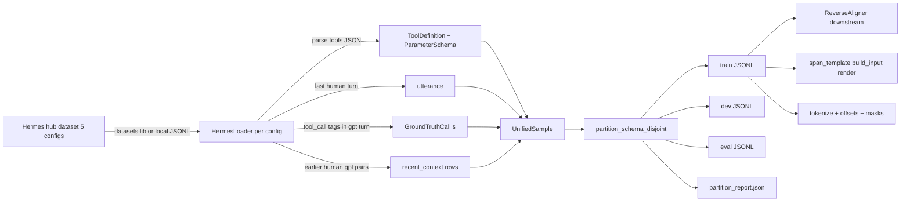

# Hermes Function-Calling V1: Data Ingestion & Training-Data Plan

Status: **draft for review** — no code implemented yet.

Scope: bring [`NousResearch/hermes-function-calling-v1`](https://huggingface.co/datasets/NousResearch/hermes-function-calling-v1)
into the SpanCall `UnifiedSample` pipeline, process **all 5 configs (setups)**, split
into train / dev / eval with **schema-disjoint** holdout, and describe exactly how the
processed records become SpanCall training data.

---

## 1. Goal

| Requirement | Deliverable |
| --- | --- |
| Work with more specific data | Replace/augment the generic stubs with a real loader for the Hermes dataset |
| 5 setups, each processed | One ingest path per dataset config (5 total), all convertible to `UnifiedSample` |
| Split train/val/test/eval | Schema-disjoint partition into `train` / `dev` / `eval` JSONL + a partition report |
| Understand how training data is created | Document the load → align → render → tensorize flow for the split output |

The existing loaders in [`spancall/data/sources/`](../spancall/data/sources/) (`xlam`,
`glaive`, `toolbench`, `bfcl`, `tau_bench`) are all `NotImplementedError` stubs. This plan
adds the first fully implemented source — `HermesLoader` — plus the partition utility that
will be reused by the other loaders later.

---

## 2. Dataset structure (verified against HF)

Repo: `NousResearch/hermes-function-calling-v1` — Apache-2.0, ~10K–100K rows.

### 2.1 The 5 configs ("setups")

| # | Config name | Data file | Format | Use |
| --- | --- | --- | --- | --- |
| 1 | `func_calling_singleturn` (default) | `func-calling-singleturn.json` | OpenAI-function format, single-turn | Function-calling core (F stratum, natural) |
| 2 | `func_calling` | `func-calling.json` | OpenAI-function format, multi-turn | Multi-turn recent-context training (E10-style) |
| 3 | `glaive_func_calling` | `glaive-function-calling-5k.json` | Glaive FC v2 format | Cross-format generalization, F stratum |
| 4 | `json_mode_agentic` | `json-mode-agentic.json` | JSON mode, multi-turn | JSON-mode rows → structured-output head |
| 5 | `json_mode_singleturn` | `json-mode-singleturn.json` | JSON mode, single-turn | Structured extraction → schema-less GT |

### 2.2 Row schema (shared shape)

```
{
  "id": "<uuid>",
  "conversations": [
    {"from": "system", "value": "You are a function calling AI model. ... <tools>[JSON]</tools> ... <tool_call>...</tool_call>"},
    {"from": "human",  "value": "<user utterance>"},
    {"from": "gpt",    "value": "<tool_call>{...}</tool_call>"}      # or plain JSON in json-mode configs
  ],
  "tools":  "<OpenAI-style JSON string>"          # present in function-calling configs; may be null/absent in json-mode
  "category": "...", "subcategory": "...", "task": "..."
}
```

Key observations that drive the loader design:

- **Tools** are a JSON *string* (OpenAI schema: `{"type":"function","function":{"name","description","parameters":{"properties","required"}}}`),
  embedded inside the system prompt `<tools> ... </tools>` block AND sometimes duplicated in the `tools` field.
  The loader must prefer the parsed `tools` field; fall back to extracting from the system prompt.
- **GT calls** appear as `<tool_call>{"name": ..., "arguments": {...}}</tool_call>` inside the `gpt` turn for the function-calling configs,
  and as bare `{...}` JSON in the json-mode configs.
- **Multi-turn** (`func_calling`, `json_mode_agentic`) have multiple `human/gpt` pairs — earlier pairs become `recent_context`;
  the final `human` turn is the `utterance`; the final `gpt` turn carries the ground truth.
- **json-mode configs** have no `<tool>` schemas in general — the target is a raw structured JSON object.
  These become `Stratum.A`-style rows tagged `metadata.mode="json"` so they are **still processed** (user requirement),
  never silently dropped.

---

## 3. Architecture



---

## 4. Processing each of the 5 subsets

All five go through the **same `HermesLoader.load()`**; only a small per-config branch differs
(how the GT is located and whether tools come from schemas or not).

### 4.1 `func_calling_singleturn` (core F)

1. `tools` field (JSON string) → parse → `ToolDefinition[]`.
2. Single `human` turn → `utterance`.
3. `gpt` turn → regex `<tool_call>\s*({.*?})\s*</tool_call>` → JSON → `GroundTruthCall` per call (multi-call rows → multiple GT calls).
4. `stratum = F` (arguments presumed present in utterance; the aligner confirms later).
5. `metadata = {config, category, subcategory, task, mode: "function"}`.

### 4.2 `func_calling` (multi-turn)

Same as 4.1, plus:
- All `human`/`gpt` pairs **before** the last pair → `recent_context` as
  `{"key": "<tool_name or turn_index>", "value": "<turn text>"}`.
- Last `human` → `utterance`; last `gpt` → GT calls.
- `metadata.turns = <count>` so E10-style multi-turn slices are measurable.

### 4.3 `glaive_func_calling` (Glaive format)

- Glaive rows use a different conversation shape (`conversations` with `possible_function_calls` /
  a single-tool system block). The loader detects the shape and maps:
  - tool → `ToolDefinition` from the system/`possible_functions` block;
  - `human` → `utterance`; `gpt` → the `{"function": "name", "arguments": {...}}` body → `GroundTruthCall`.
- `metadata.source_style = "glaive"`.

### 4.4 `json_mode_agentic` (structured JSON, multi-turn)

- No tool schema; GT is a JSON object in the last `gpt` turn.
- The loader wraps the JSON keys as a **synthetic schema-less GT**: `GroundTruthCall(tool_name="json_output", arguments=<object>)`.
- Earlier turns → `recent_context`.
- `metadata.mode = "json"`, `metadata.agentic = true`.

### 4.5 `json_mode_singleturn` (structured extraction)

- Same synthetic `json_output` GT; single turn; no recent context.
- `metadata.mode = "json"`, `metadata.agentic = false`.

### 4.6 Consistency rules applied to ALL 5

- `sample_id` = hug `id` (globally unique across configs); collision safety: `f"{config}::{id}"`.
- `source_dataset = "hermes-function-calling-v1"`, `metadata.config = <config_name>`.
- Rows with no `human` turn or no parseable GT are **counted** (metadata/telemetry), *not* silently
  dropped — the partition report lists `dropped_*` counters.
- `stratum` stays default `F` at load time; the aligner (downstream, existing stub) does real F/A tagging.

---

## 5. Train / dev / eval split (schema-disjoint)

The docs mandate **hold out schemas, not just utterances** (mechanism §8.4, architecture §4.3 step 5).
The `Split` enum in [`spancall/data/schema.py`](../spancall/data/schema.py) already defines
`TRAIN / DEV / CALIB / TEST_ID / TEST_OOD_SCHEMA / ...`; this plan implements the missing partitioner.

### 5.1 Algorithm — `partition_schema_disjoint`

1. Group all loaded samples by **schema key** = `frozenset(tool.name for tool in sample.tools)`
   (for json-mode rows, schema key = `("json_output",)`).
2. Sort groups deterministically (by key, then by first sample id) and assign each whole group
   to a split via seeded RNG with target ratios `train 0.80 / dev 0.10 / eval 0.10`.
   → **No schema appears in two splits**, guaranteeing zero-shot OOD-schema eval.
3. Failure fallback (only if distinct schemas < 3): fall back to utterance-level seeded shuffle and
   **warn loudly** in the partition report (`schema_disjoint: false`).
4. Emit `partition_report.json` with: per-config row counts, per-split counts, schema overlap check
   (`train ∩ dev ∩ eval == ∅`), F-stratum share per split, dropped counters.

### 5.2 CLI output (from `scripts/prepare_data.py`)

```
data/processed/
  hermes_train.jsonl
  hermes_dev.jsonl
  hermes_eval.jsonl
  partition_report.json
```

Each JSONL row = one `UnifiedSample` serialized as JSON (dataclass → dict via `asdict` +
a custom encoder for `Stratum`/`Split` enums).

### 5.3 Split semantics

| Split | Role | what feeds it |
| --- | --- | --- |
| `train` | model fitting | 80% of schema groups |
| `dev` | hyperparameter / early stopping | 10%, disjoint schemas |
| `eval` | held-out reporting (E1/E2 gates) | 10%, disjoint schemas (zero-shot OOD-schema) |

`calib` / adversarial / paraphrase splits remain downstream (post-aligner / post-augmenter) —
out of scope here, per the existing `Split` enum and the mix/augment stubs.

---

## 6. How training data is created (loader → template → tensors)

The split JSONL is the **canonical intermediate**. The actual training records are built on
top of it by the existing (stubbed) pipeline, following [`docs/mechanism.md`](../docs/mechanism.md) §8:

1. **Load** (`HermesLoader`) → `UnifiedSample` (this plan).
2. **Split** (`partition_schema_disjoint`) → `{train, dev, eval}.jsonl` (this plan).
3. **Reverse-align** (`ReverseAligner` stub, [`spancall/data/align.py`](../spancall/data/align.py)):
   for each GT argument, search verbatim in the utterance (→ `SpanTarget.utterance_span`),
   or in `recent_context` (→ `recent_ctx`), or match enum/boolean/date against the synthetic
   clock context (`enum_ctx / boolean_ctx / time_ctx`). Any required argument that cannot be
   grounded → `Stratum.A`. This is where real F/A statistics come from.
4. **Render** ([`span_template/template.py`](../span_template/template.py) `build_input`):
   the aligned `UnifiedSample` is rendered to the marker template —
   `[TOOL] / [PARAM] / [CTX_META] / [CTX_TIME] / [CTX_ENUM] / utterance / [CTX_RECENT] / [EOS]`
   (single-tool form, `data.pack_tools: 1` per D5). Parsing the rendered text back yields the
   **legend**: every selectable `Entry` (span + canonical value).
5. **Tensorize** (`build_input.tokenize` / `tokenize_offset_mapping` + `CandidateMaskBuilder`):
   token ids + per-token entry mapping + masks; per-param multi-positive softmax CE labels
   come from the legend (`P_k` = equal-valued entries, loss per [`spancall/model/loss.py`](../spancall/model/loss.py) §8.2).
6. **Augment then mix** (`DataAugmenter`, `DatasetMixer` stubs): shuffle/enum-swap/distractor
   variants + 55/20/10/15 stratum mix — downstream, out of scope here.

**Why this order matters:** splitting *before* alignment keeps schema-disjointness clean
(a schema group never straddles splits, regardless of how alignment tags F/A afterwards).

---

## 7. Files to implement / change

| File | Change |
| --- | --- |
| [`spancall/data/sources/hermes.py`](../spancall/data/sources/hermes.py) | **New** — `HermesLoader(BaseDatasetLoader)`; parses all 5 configs; lazy `datasets` import with stdlib-JSON fallback for local JSONL |
| [`spancall/data/partition.py`](../spancall/data/partition.py) | **New** — `partition_schema_disjoint()`, report builder, enum-aware `UnifiedSample` JSON encoder |
| [`spancall/data/sources/__init__.py`](../spancall/data/sources/__init__.py) | Register `HermesLoader` |
| [`spancall/data/__init__.py`](../spancall/data/__init__.py) | Re-export `partition_schema_disjoint` |
| [`scripts/prepare_data.py`](../scripts/prepare_data.py) | Real pipeline: read `data.sources` from YAML → instantiate one `HermesLoader` per config entry → ingest → split → write JSONL + report |
| [`configs/default.yaml`](../configs/default.yaml) | Add `hermes` source entry with all 5 config names; add `schema_split` ratios |
| [`pyproject.toml`](../pyproject.toml) | Add optional `data` extra: `datasets>=2.0.0` |
| [`tests/data/test_hermes.py`](../tests/data/test_hermes.py) | Per-config fixture rows + loader unit tests |
| [`tests/data/test_partition.py`](../tests/data/test_partition.py) | Schema-disjointness, determinism, fallback warning |
| [`docs/architecture.md`](../docs/architecture.md) | §4.2 sources table row + §4.3 pipeline step for Hermes & the split |

---

## 8. Tests

- `test_hermes.py`:
  - one representative fixture row per config (JSON inlined, HF-shape);
  - tool/param parsing (type, required, enum, default, items_type);
  - single- and multi-call GT extraction (2+ `<tool_call>` blocks);
  - multi-turn `recent_context` population and last-turn utterance selection;
  - json-mode fallback (synthetic `json_output` GT, `metadata.mode == "json"`);
  - no-schema / no-GT row → counted in dropped, not raised.
- `test_partition.py`:
  - schema-disjoint across the 3 splits (no tool-name frozenset in 2 splits);
  - determinism with a fixed seed;
  - fallback warning when distinct schemas < 3;
  - report JSON contains per-config counts + overlap=false flag.

---

## 8.5 Verification results (real hub run, 2026-10)

Full `prepare_data.py` run against `NousResearch/hermes-function-calling-v1` (all 5 configs,
seed 42, ratios 80/10/10):

| Config | rows seen | ingested | gt_calls parsed | dropped | drop reason |
| --- | --- | --- | --- | --- | --- |
| `func_calling_singleturn` | 1893 | 1883 | 2981 | 10 | assistant clarification turns with **no tool call** (asks user for a location/params) |
| `func_calling` | 1893 | 1883 | 2981 | 10 | same as above |
| `glaive_func_calling` | 5209 | 4344 | 4344 | 865 | natural-language QA rows (no `{"function":...}`) — an inherent ~16.6% QA mix in this config |
| `json_mode_agentic` | 1342 | 1342 | 1342 | 0 | — |
| `json_mode_singleturn` | 1241 | 1241 | 1241 | 0 | — |
| **Total** | **11578** | **10693** | **12889** | **885** | 92.4% ingestion; all drops are rows with genuinely no tool call |

Split (schema-disjoint): **train 8555 (80.0%) / dev 1069 (10.0%) / eval 1069 (10.0%)**,
`train ∩ dev ∩ eval == ∅` over all 4120 distinct schemas. The two largest schema groups —
`json_output` (1488) and `ExpertQAExtractor` (1464) — land in **train** because each exceeds a
single 10% share (~1069); placing them anywhere else would force a >10% schema into dev/eval.
This is the mathematically correct outcome of schema-disjoint partitioning, and it is a
documented property of this dataset: a ~14% schema cannot be held out as OOD unless we accept
a lopsided split.

Implementation notes discovered against real data (all covered by tests in
[`tests/data/test_hermes.py`](../tests/data/test_hermes.py)):

- `<tool_call>` payloads can contain **nested braces + literal `\n` escapes inside string
 values**; a non-greedy `\{.*?\}` regex truncates them → use brace-matching
 (`_extract_brace_object`) instead.
- Some configs emit **single-quoted (Python-literal) payloads** → `_safe_json_loads` falls back
 to `ast.literal_eval`.
- Multi-turn rows end with a natural-language **summary**, not a `<tool_call>` → scan *all*
 assistant turns, not just the last.
- json-mode GT can be a **JSON array** (`[{...}, ...]` flight/booking lists) → wrapped under
 `arguments["items"]` to fit the `GroundTruthCall.arguments` dict contract.
- Glaive rows are plain Q&A ~16.6% of the time (no function call) — these are counted in
 `dropped_no_gt` and are *not* a parsing bug.

---

## 9. Out of scope (existing stubs, remain separate)

- `ReverseAligner` ([`align.py`](../spancall/data/align.py)) — real F/A tagging.
- `DataAugmenter` / `DatasetMixer` — augment + 55/20/10/15 mix.
- `calib` / `test_adversarial` / paraphrase-disjoint splits (need augmenter).
- The other 5 loader stubs (xlam/glaive/toolbench/bfcl/tau_bench) — they will later reuse
  `partition_schema_disjoint` but are not implemented here.