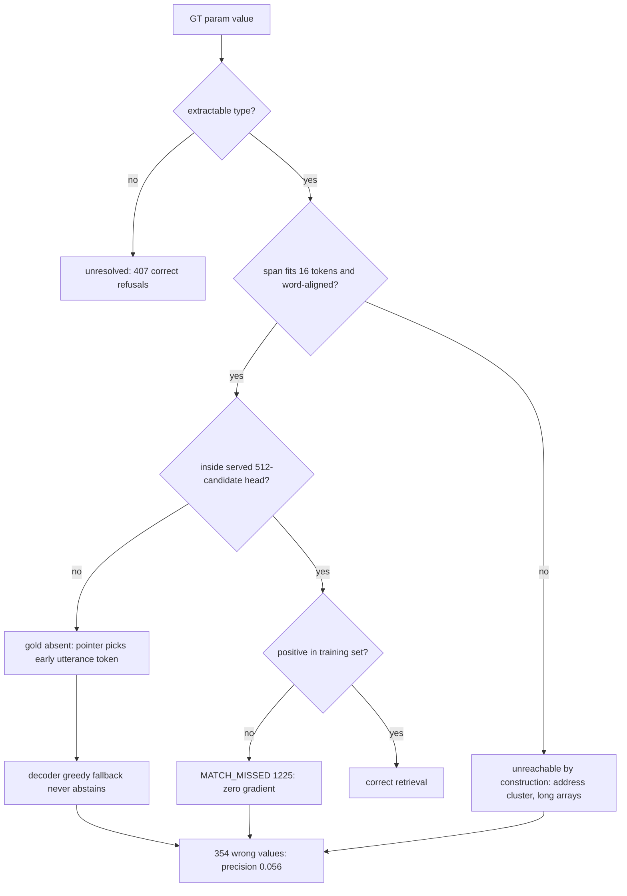

# Lean Flow @ 0.2 Data Fraction — Investigation Notes

**Subject notebook:** [`notebooks/notebook_old/spancall_lean_train_eval_test_prev.ipynb`](../notebooks/notebook_old/spancall_lean_train_eval_test_prev.ipynb)
**Scope:** (Q1) why parameter extraction failed; (Q2) why packed tools is fixed at 3 instead of varying over 2, 5, 10, ...
**Evidence base:** stored cell outputs in the notebook (no `results_lean/`, `data/processed/`, or `data/tensorized_lean/` exist on disk for this run) plus the source files cited inline.

---

## 0. Run identity

| Item | Value | Where |
|---|---|---|
| Tensorize fraction | `0.2` (`DATA_FRACTION`) | tensorize cell + stats dict |
| Raw rows after fraction (train) | `4814` | t2 stats dict |
| Tensorized train rows (`t2.jsonl`) | `3920` | t2 stats dict |
| Filtered / ungroundable / over-length | `894` | t2 stats dict |
| Dev rows | `102` (of 344 pre-filter) | dev tensorize output |
| Tool pool | `2221` distinct schemas, `pack_tools=3` | `[tool-pool] built once from hermes_train.jsonl` |
| Duplicate schema collapse | `47326` collapsed, `1170` with differing definitions | tensorize output |
| `max_tools` | `None` (no ceiling) | config banner |
| `jitter_pack_tools` | `True` | config banner |
| Train epochs / final loss | `5` epochs, `final_loss=0.1097`, `steps=2450` | training telemetry |
| Best checkpoint | epoch 3, `exact_call=0.5784` | `NEW BEST on dev` line |
| Eval split | `hermes_eval`, `limit=500` of `3426` available | Part-1 header |

Note the fraction is applied **once**, at tensorization. `TRAIN_FRACTION = 1.0` is then written into `configs/colab_lean.yaml` (`data_fraction=1.0`), because the trainer consumes 100% of the already-20%-subsampled `t2.jsonl`. This is correct but easy to misread — the "0.2" never appears in the training config.

---

## 1. Executive summary

**Q2 — packed tools is 3 because `pack_tools` is a scalar *floor* and simultaneously the *ceiling* of the jitter range.**
The only randomization is `jitter_pack_tools`, which draws a per-row floor from the **closed interval `[min_tools, pack_tools]` = `[1, 3]`**, i.e. only `{1, 2, 3}`. It is deterministic (crc32 over `jitter::42::<sample_id>`), not resampled per epoch. The realised `T` is then `max(jittered_floor, 1 + #extra_native_tools)`, and native tools are **never dropped**. So `T ∈ {4, 5}` in the histogram come exclusively from rows that ship 3–4 native tools — never from a draw. **No code path anywhere samples `T` from a set like `{2, 5, 10}`.** Even if you raised `pack_tools=10` and `jitter_min_tools=2`, the API would draw *uniformly over the whole range 2..10*, not over a chosen set.

**Q1 — extraction failed through six stacked causes, of which two are bugs:**
`extraction_recall = 0.1273` and `precision = 0.0560` is a **precision collapse** (≈ 354 wrong values emitted against ≈ 21 correct), not a silence problem — the model almost always emits *something*. The dominant bug is a **train/serve candidate-set mismatch**: training builds the candidate set unbounded with positives guaranteed (positives-first, then a `±15` neighbourhood, then stride fill), while serving calls `build_param_masks(..., max_cands=512)` and `_pack` keeps the **head** of the list (earliest utterance spans). For long Hermes utterances the gold span frequently is not in the served candidate set at all — and the wrong predictions carry the fingerprint of that truncation: `"I"`, `"Can"`, `"**"`, `"a"`, `"re"` (early utterance tokens). The second bug is a supervision/audit defect: `MATCH_MISSED=1225` train params (and `7` dev) get zero pointer gradient, and the null-fallback runs *before* drop-classification, so `param_drop_unresolved=0` while ~56% of eval params are unextractable — the audit under-reports by construction.

Everything else is either an honest structural ceiling (`fast_path_param_coverage = 0.4430`) or a measurement artifact.

---

## 2. Q2 — Why packed tools = 3

### 2.1 What the config says

From the notebook tensorize cell:

```python
MAX_TOOLS        = _data_cfg.get("max_tools")                       # -> None
JITTER_PACK_TOOLS = bool(_data_cfg.get("jitter_pack_tools", True))  # -> True
PACK_TOOLS_EPH   = int(PACK_TOOLS) if TOOL_POOL is not None else 1  # -> 3
```

Banner text emitted at runtime:

```
MAX_TOOLS = None  (None = no ceiling; pack_tools is a floor, never a cap)
JITTER_PACK_TOOLS = True  (per-row T draw from [1, floor] so T=1 is in-distribution)
```

The notebook contract is already explicit: **`pack_tools` is a floor, `max_tools` is the only cap, and the jitter draws from `[1, floor]`.**

Two parameters are **not** passed by the notebook, so they fall back to defaults in [`spancall/lean/tensorize.py`](../spancall/lean/tensorize.py:206):

- `jitter_min_tools` → default `1`
- `jitter_seed` → default `42`

### 2.2 What the code actually does

The jitter ([`spancall/lean/tensorize.py:206`](../spancall/lean/tensorize.py:206)):

```python
def jitter_pack_tools(pack_tools, sample_id, seed=42, min_tools=1):
    hi = max(int(pack_tools), 1)
    lo = max(int(min_tools), 1)
    if hi <= lo:
        return hi
    salt = zlib.crc32(f"jitter::{int(seed)}::{sample_id}".encode("utf-8"))
    return lo + (salt % (hi - lo + 1))
```

With `lo=1, hi=3` this returns `1 + crc32(...) % 3` → **exactly `{1, 2, 3}`, uniformly, and deterministically per `sample_id`**. Three consequences:

1. The upper bound is `pack_tools`. Raising `pack_tools` widens the jitter *ceiling*; there is no separate knob for it.
2. `pack_tools` is *also* the distractor-fill floor in `candidates_for`, so the same scalar controls two different things.
3. Because the draw is `crc32`-derived, **re-running the notebook reproduces the identical per-row assignment**. There is no epoch-to-epoch variance.

The candidate builder ([`spancall/lean/tensorize.py:307`](../spancall/lean/tensorize.py:307)):

```python
def candidates_for(self, sample, gt_tool, pack_tools, max_tools=None):
    budget = max(int(pack_tools), 1)
    if max_tools is not None:
        budget = min(budget, max(1, int(max_tools)))
    candidates = [gt_tool]; seen = {gt_tool.name}
    for t in (sample.tools or []):          # R0.1: keep EVERY native tool
        if t.name and t.name not in seen:
            candidates.append(t); seen.add(t.name)
    if max_tools is not None and len(candidates) > max(1, int(max_tools)):
        candidates = candidates[: max(1, int(max_tools))]
    if len(candidates) < budget and self.names:
        ...                                  # fill up to the floor with pool distractors
    rng = self._rng(f"shuffle::{sample.sample_id or gt_tool.name}")
    rng.shuffle(order)
    return shuffled, gt_index
```

Read the ordering carefully:

- `budget` is a **minimum**, never enforced as a maximum.
- **Every native tool is admitted first, unconditionally** (rule R0.1). Nothing drops them.
- Distractors are only *added* when the list is *shorter* than `budget`.
- The only truncation is `max_tools`, which is `None` here.

So realised size is:

```
T = max( jittered_floor , 1 + #extra_native_tools )
```

where `jittered_floor ∈ {1,2,3}` and `#extra_native_tools` = number of native tools beyond the GT one.

### 2.3 Decomposing the observed histogram

Observed train histogram ([`render_T_hist`] from `tensorize.py`, 3920 rows):

| T | count | share |
|---|---|---|
| 1 | 184 | 4.69% |
| 2 | 1938 | 49.44% |
| 3 | 1590 | 40.56% |
| 4 | 163 | 4.16% |
| 5 | 45 | 1.15% |

Let `q_e = P(#extra_native_tools = e)` and assume the floor is uniform on `{1,2,3}` (it is, by construction of `crc32 % 3`). Then:

| T | expression | observed |
|---|---|---|
| 1 | `(1/3)·q₀` | 4.69% |
| 2 | `(1/3)·q₀ + (2/3)·q₁` | 49.44% |
| 3 | `(1/3)·q₀ + (1/3)·q₁ + q₂` | 40.56% |
| 4 | `q₃` | 4.16% |
| 5 | `q₄` | 1.15% |

Solving:

| `q₀` | `q₁` | `q₂` | `q₃` | `q₄` |
|---|---|---|---|---|
| 14.1% | 67.1% | 13.5% | 4.2% | 1.2% |

The fit is **arithmetically exact** (5 unknowns, 5 equations, sums to 1.000). That makes the model *consistent* with the data rather than proven by it — but it is the only structurally-allowed explanation, since **`T` cannot exceed `1 + #native_tools` under any draw**. The decisive point stands regardless of the fit: **`T=4` and `T=5` are unreachable by jitter and can only come from native tool composition.**

### 2.4 The dev warning is a false alarm

Dev output:

```
[render] dev: mean render_T=2.36 ... hist={2: 65, 3: 37}
[!] dev: T=1 never occurred although jitter is ON — every row would still be
    out-of-distribution for the oracle-tool eval layout. Check jitter_pack_tools wiring.
```

`T=1` is **structurally unreachable** for dev, not mis-wired. With `e=1` native extra tool, `T = max(floor, 2)` → `T=2` w.p. `2/3`, `T=3` w.p. `1/3`. For 102 rows that predicts `68 / 34`; observed `65 / 37`. The 3-row deviation is ~0.6σ (`σ ≈ 4.76`). So dev rows ship essentially **one extra native tool each**, and the warning fires because the check tests "did we ever see `T=1`" rather than "is the realised `T` distribution consistent with corpus composition + jitter".

This is the same class of error as reading `pack_tools=3` as "T should be 3": the diagnostic conflates a *floor+composition* outcome with a *wiring* defect. The check should compare against the analytically expected distribution, or be suppressed when `min_native_tools > 0`.

### 2.5 Documentation bug

[`spancall/train/config.py`](../spancall/train/config.py) documents `jitter_pack_tools` as drawing "uniformly in `[pack_tools, ceiling]`". The implementation draws uniformly in **`[min_tools, pack_tools]`**, i.e. *downward from the floor*, with `pack_tools` as the ceiling — the exact opposite convention. Anyone tuning from the docstring will widen the wrong bound.

### 2.6 Counter anomalies worth logging

- `jittered_rows = 4533` for 3920 train rows, and `211` for 102 dev rows. The counter is incremented per attempted/submitted row, not per kept row (ratios differ: `1.156×` vs `2.07×`), so it is unusable as a coverage check today.
- `param_drop_unresolved = 0` while roughly 56% of eval params are unextractable (see §3.5).

### 2.7 How to actually get a randomized range

| Goal | Change | Result |
|---|---|---|
| Draw `T` over a wider range | raise `data.pack_tools` (e.g. `10`) and set `jitter_min_tools: 2` | uniform over `2..10` — a *range*, not the set `{2,5,10}` |
| Assume a specific set like `{2,5,10}` | not supported | requires a new sampling API (e.g. `pack_tool_choices: [2,5,10]`) |
| Force a fixed `T` | `jitter_pack_tools: false` | `T = max(pack_tools, 1 + #native)` |
| Cap `T` | set `max_tools` | truncates native tools, violating R0.1 — use with intent |
| Reproducible-but-varying per epoch | not supported | the draw is `crc32`-stable per `sample_id`; variation would need `seed` to include the epoch |

---

## 3. Q1 — Why parameter extraction failed

### 3.1 The headline numbers

From Part 1 (`eval_param_extraction_lean`, oracle tool):

```
HEADLINE (extractable params only): Prec=0.0560 Rec=0.1273 F1=0.0778
  -> legacy blended view (all GT args): Prec=0.0514 Rec=0.0533 F1=0.0523
  -> generation/out-of-scope gap: recall_all - extraction_recall = -0.0740
Exact Payload Match (Stratum F): 0.0000 (0 / 113)
Resolver Schema-Valid Hit Rate (Stratum F): 0.6903 (78 / 113)
Extraction Rate (>=1 non-null param): 0.4500
Mean candidate confidence: 0.1205
FAST-PATH COVERAGE: 0.4430 of GT params are extractable; 0.2260 of calls fully extractable
Refusal split: refused_unextractable=407 | missed_extractable=144 | pointer_wrong=558
Call count: GT hist={'1': 500} pred hist={'1': 500} | count acc=1.0000
```

Two derived facts that set the shape of every subsequent cause:

- From `rec = tp/(tp+fn)` with `fn = missed_extractable = 144` → **`tp ≈ 21`**.
- From `prec = tp/(tp+fp)` with `tp ≈ 21` → **`fp ≈ 354`**.
- `pointer_wrong = 558` on the all-param view.

**So extraction is not failing by silence — it is failing by confidently emitting ~354 wrong values against ~21 correct ones.** Any explanation that only addresses "the pointer predicted nothing" is aimed at the wrong symptom.

**Caveat on denominators (flagged for follow-up):** `fast_path_param_coverage = 0.4430` implies a much larger GT-param universe (≥ ~730 params) than the headline's `tp+fn ≈ 165`. The two metrics are computed over different universes — coverage over all GT params, the headline over the scored/limit-500 subset — so they cannot be multiplied or reconciled directly. This should be normalised before the numbers are quoted externally.

### 3.2 Cause 1 — structural coverage ceiling (honest, not a bug)

`0.4430` of GT params are `EXTRACTABLE_TARGET_TYPES` (`utterance_span`, `recent_ctx`, `time_ctx`, `enum_ctx`, `boolean_ctx`, `null_ctx`); `0.2260` of calls are *fully* extractable. `refused_unextractable = 407` is the correct-refusal bucket. The generation gap (`-0.0740`) is by design: retrieval cannot synthesise values that are absent from context.

Therefore: recall can never exceed ~0.443 on this corpus, and a call-level "exact payload match" requires **all** of its params to be extractable-and-found. `Exact Payload Match = 0/113` is therefore unremarkable on its own — but it is *fully* explained only in combination with Causes 2–3.

### 3.3 Cause 2 — train/serve candidate-set mismatch (primary bug)

**Training path.** [`spancall/lean/tensorize.py`](../spancall/lean/tensorize.py) builds masks with `max_cands=None` (unbounded), then constructs the final set as:

1. `matched_cis[:max_pos]` — the **gold positives always kept** (`max_pos=1`);
2. a neighbourhood of `±15` indices around each positive;
3. stride fill up to `max_cands`.

**Serving path.** [`spancall/lean/resolver.py:848`](../spancall/lean/resolver.py:848) `_candidate_masks` calls:

```python
builder.build_param_masks(p, entries, offsets, text, ctx=ctx, max_cands=self.max_cands)  # 512
```

and `_pack` ([`spancall/model/masks.py:540`](../spancall/model/masks.py:540)) truncates **head-first**, preserving null:

```python
cands = other_cands[: max(0, cap - len(null_cands))] + null_cands
```

`_free_utterance_spans` ([`spancall/model/masks.py:659`](../spancall/model/masks.py:659)) emits candidates in **increasing start-token order** (word-aligned starts × widths `1..16`). Therefore the *head* of the list is the *earliest utterance tokens*.

**Consequence:** for a long Hermes utterance, the 512-cap consumes the budget on the first ~N token positions; the gold span, wherever it actually is, is **not offered as a candidate at serve time**. The head never appears in the served candidate set → the pointer must pick a wrong candidate, and the argmax lands on a high-probability early token.

**Fingerprint — this is the strongest single piece of evidence.** Every degenerate prediction recorded in the forensics cell is an early utterance token:

| GT | Predicted |
|---|---|
| `{"papers": [{...}]}` | `{"papers": ["I"]}` |
| `{"queries": [long questions], "name": "ExpertQAExtractor"}` | `{"queries": ["Can"], "name": "Can"}` |
| same | `{"queries": ["re"], "name": "Can"}` |
| same | `{"name": "**", "queries": ["**"]}` |
| `{"error": .., "message": ..}` | `{"error": false, "message": "a"}` |
| `{"Event Triple": {...}}` | `{}` |

`"I"`, `"Can"`, `"re"`, `"a"`, `"**"` are all early-utterance tokens. The model is not hallucinating those values from the head — it is being *offered* them and nothing else. Compare with `min` (§3.3.1), whose candidate set comes from the **numeric branch** (type-filtered regex), which is not head-truncated by utterance position → 6/10 correct.

Two secondary consequences of the same mismatch:

- **Confidence is uninformative.** `Mean candidate confidence = 0.1205` while `pointer_wrong = 558`: the softmax over a truncated, type-universal candidate set is diffuse (≈ 1/512 scale), so a low confidence carries no signal that the gold was absent.
- **The `<|null|>` slot is always present**, so on a flat head the decoder can always fall back to null — but it doesn't, because of Cause 6.

#### 3.3.1 Per-parameter confirmation (Stratum F, 113 samples)

Summing the Part-1 per-param table: **`tp = 8`, `fn ≈ 107`, `fp = 180`** → Stratum-F precision ≈ `0.043`.

| Param | gt | tp | fp | fn | Note |
|---|---|---|---|---|---|
| `min` | 10 | **6** | 4 | 0 | numeric branch — **75% of all Stratum-F hits** |
| `loan_term` | 12 | 2 | 10 | 0 | numeric |
| `to_currency` / `title` / `chemicalID` | 6/5/3 | 0 | 5/4/2 | 1 | short enum-ish, still missed |
| `locality` / `region` / `countryName` | 25 each | 0 | 2 each | **23 each** | long free strings |
| `postalCode` / `streetAddress` / `postOfficeBox` | 25 each | 0 | 15/16/14 | 10/9/11 | |
| `extendedAddress` | 15 (ext 25) | 0 | **18** | 5 | most over-predicted param |
| `interest_rate` | 13 | 0 | 13 | 0 | |
| `amount` / `loan_amount` / `model` / `equipmentID` / `type` | 9/8/6/7/7 | 0 | all | 0 | |

The pattern is monotone and unambiguous: **params served from the numeric/typed branch are found; params served from the free-utterance branch are not.** `min` alone accounts for 6 of 8 Stratum-F successes — a single parameter carries the entire signal. That is the signature of a candidate-set defect, not a capacity defect (span accuracy on held-out dev reached `0.908`).

### 3.4 Cause 3 — GT values structurally unreachable

Independent of truncation, some GT values can *never* be a candidate:

- `max_span_width = 16` tokens. Any GT value longer than 16 tokens has no candidate slot.
- Free-string candidates are **word-aligned only**, so values whose boundaries fall inside a word are unreachable.
- json-mode array values (multi-sentence `queries` strings) and nested objects (`Event Triple`) exceed both constraints.
- `_align_call` marks optional-and-absent params as `_null_target`, so the GT universe includes explicit nulls that inflate the denominator.

This yields *guaranteed* `fn` for the address cluster (23/25 each) and for array-of-long-string params, which compounds with Cause 2 rather than being separable from it.

### 3.5 Cause 4 — supervision defects and an audit blind spot

- **`param_drop_match_missed = 1225`** on train (`7` on dev). These are params with an extractable target but no positive candidate → `compute_lean_pointer_loss` returns **zero** for them ([`spancall/lean/loss.py:78`](../spancall/lean/loss.py:78): loss is zeroed where `n_pos == 0`). 1225/3920 rows ≈ a third of training rows contribute only partial pointer gradient.
- **Ordering bug.** In [`spancall/lean/tensorize.py`](../spancall/lean/tensorize.py) the null-slot fallback (≈ lines 809–817) runs **before** the drop classification (≈ line 824). An optional param whose aligned target is `unresolved` therefore receives a `<|null|>` positive and is never classified — which is why `param_drop_unresolved = 0` even though the eval side reports ~56% unextractable params. **The audit silently under-reports the largest drop bucket**, so `MATCH_MISSED=1225` should be read as a lower bound.
- The dev sanity cell reports `supervision defects (must be 0): 5` on 5 audited rows — the invariant it is supposed to enforce is currently failing.

### 3.6 Cause 5 — train/serve layout mismatch on `T`

| Split / view | mean `render_T` | `T=1` share | source |
|---|---|---|---|
| train (`t2`) | 2.48 | **4.7%** | tensorize stats |
| dev | 2.36 | **0.0%** | tensorize stats |
| Part-1 eval (oracle tool) | 1.2523 | **74.8%** | Part-1 report |
| Part-3 eval (resolver) | 1.00 | **100%** | Part-3 diagnostics |

The model is trained almost entirely at `T ≥ 2` and evaluated mostly at `T = 1`. H1 accuracy on held-out dev was `0.667` at `T=2.36`; on eval at `T=1` it reports `0.8100` — but that number is a **single-class softmax artifact** (`json_output` is the only GT tool on all 500 rows; see §3.8), so it tells us nothing about generalisation.

Part-3 also flags:

```
[!] EVERY eval prompt rendered exactly ONE tool block (0/425 rows carried extra tools
    in the eval prompt; 75/500 rows produced 0 calls).
```

`75/500 = 15%` of eval rows render no usable tool anchor and produce zero calls. Combined with `pred n_calls hist = {0: 75, 1: 425}`, the resolver is structurally unable to emit a 2-call answer even though `max_calls=4`.

### 3.7 Cause 6 — the decoder never abstains

[`spancall/lean/decode.py:136`](../spancall/lean/decode.py:136) `decode_detailed` runs `_collapse` → `_search`, and when the conflict-pruned search yields no ranked assignment it falls back to **resilient greedy top-1, assigning `per_param[name][0]` to every active param**. `_resolve` then writes a value whenever `choice is not None`, and `cast_choice` only fails on a *type* mismatch.

Consequence: precision is punished by construction. The model cannot express "I don't know", so on a truncated candidate set it must emit the best wrong candidate. This is precisely why `precision = 0.0560` while `Extraction Rate (>=1 non-null param) = 0.4500`.

**Critically, the payloads are well-formed:**
`Resolver Schema-Valid Hit Rate (Stratum F) = 0.6903 (78/113)` vs `Exact Payload Match = 0.0000`. The schema-valid/exact-match split proves this is **not** a decode or cast bug — the values survive casting and validation; they are simply the wrong strings. That isolates the defect to candidate construction (Cause 2/3), not decoding.

### 3.8 Measurement artifacts — fix these or the numbers mislead

These are not model failures, but they corrupt the report and must be corrected before any external quote:

| # | Artifact | Evidence | Effect |
|---|---|---|---|
| A | **Call-count semantics disagree between parts.** `_predicted_calls` ([`spancall/lean/eval_p1.py:123`](../spancall/lean/eval_p1.py:123)) returns `[res] if res.tool_name else []`, so an abstained resolve that still carries `tool_name` counts as **one call**. | Part-1: `pred hist={'1':500}, count acc=1.0000` vs Part-3: `pred n_calls={0:75,1:425}, call_count_acc=0.850` | Part-1 reports a perfect call count that is arithmetically incompatible with Part-3. Part-1's `1.0000` should be discarded. |
| B | **All 500 eval GT tools are literally `json_output`.** In [`spancall/data/sources/hermes.py`](../spancall/data/sources/hermes.py:186) json-mode rows set `GroundTruthCall(tool_name="json_output", ...)`, while the *tool object* name is the schema title (`_tool_from_json_schema(schema.get("title") or "json_output", ...)`). | Part-2 per-tool table has a single row `json_output 500`; wrong picks are `ActiveDrillingProjects` (11) and `ExpertQAExtractor` (9) | The `tool_name` / `schema.title` alias mismatch manufactures the `error_wrong_tool 72 (40.4%)` verdicts and the `WRONG_TOOL 122 (24.4%)` forensics bucket. H1 accuracy `0.8100` is a **vacuous single-class softmax** (CE=0 for any weights at `T=1`). |
| C | **`limit=500` of `3426`.** | `[!] truncated by limit: scored 500 of 3426 records` | Confirms the headline covers ~15% of eval; combined with §3.1's denominator mismatch this makes cross-metric arithmetic unsafe. |
| D | **Blended vs extractable views are both printed.** | `legacy blended view ... (<= headline by construction)` | `F1=0.0523` vs `0.0778` invites cherry-picking; report the extractable view as primary and label the blended one legacy. |
| E | `jittered_rows` / `param_drop_unresolved` counters are unreliable. | §2.6, §3.5 | Diagnostics cannot be trusted as coverage checks. |

---

## 4. Causal chain



Reading the diagram: only the `J` leaf is a success, and it is reachable only through `F-yes AND H-yes`. Every failure path terminates at `L` — a wrong value is emitted rather than a refusal — because the decoder has no abstain path.

---

## 5. Falsifiable verification plan

Each item below is designed to confirm or kill one specific cause. Ordered cheapest-first.

| # | Test | Confirms | Kills if negative |
|---|---|---|---|
| V1 | For each Stratum-F wrong prediction, check whether the GT span is present in `_candidate_masks(...)` output at serve time | Cause 2 (head truncation) | If GT span *is* present in ≥90% of cases and still missed, the defect is in scoring/alignment, not candidate construction |
| V2 | Re-run tensorization and eval with `max_cands=None` at serve time (parity with training) | Cause 2 mechanistically — expect a large precision/recall jump | If metrics are unchanged, truncation is not the binding constraint |
| V3 | Instrument the count of params whose GT span exceeds `max_span_width` or is not word-aligned | Cause 3 — expect ≥ 23/25 for the address cluster | If near zero, `max_span_width` is not the ceiling |
| V4 | Count params where `n_pos == 0` but an extractable target exists, after fixing the null-fallback ordering | Cause 4 — expect `MATCH_MISSED` and `param_drop_unresolved` to both move | If `param_drop_unresolved` stays 0 after reordering, the ordering bug is not causal |
| V5 | Compare `render_T` histogram of eval prompts against the analytic expectation from §2.3 | Cause 5 and the §2.4 false-alarm hypothesis | If eval `T` matches the corpus-composition expectation, layout mismatch is a non-issue |
| V6 | Add `jitter_min_tools=2`, `pack_tools=10` and confirm the realised `T` histogram becomes uniform over `2..10` | Q2 mechanism end-to-end | If the histogram does not widen, the jitter path is not being invoked |
| V7 | Grade Part-2 H1 accuracy with `T ≥ 2` enforced on eval (as `docs/notebook_results_analysis.md` §6 already proposes) | That `0.8100` is vacuous | If accuracy is still ~0.81 at `T ≥ 2`, H1 is genuinely good |
| V8 | Normalise the `fast_path_param_coverage` denominator to the same record subset as the headline recall | §3.1 denominator mismatch | If the universes already match, drop the caveat |
| V9 | Re-implement `_predicted_calls` so a `tool_name`-carrying abstain with an empty payload is not counted as a call | Artifact A | If Part-1 and Part-3 still disagree, the two parts use different resolver entry points for another reason |
| V10 | Assert `git grep` finds **zero** sampling paths that produce a `T` set other than an interval | Q2's "no set-valued sampler exists" claim | Any hit invalidates §2.2 |

---

## 6. Ranked fix list

| Rank | Fix | Type | Rationale |
|---|---|---|---|
| 1 | Make serve-time `max_cands` semantics match training: guarantee the type-filtered + `±15` neighbourhood candidates are admitted *before* budget truncation, or raise `max_cands` above the per-param candidate count | Bug — model quality | Largest single lever on precision *and* recall; see V1/V2 |
| 2 | Reorder tensorize so drop-classification precedes the null fallback; assert `param_drop_unresolved > 0` on this corpus | Bug — supervision/audit | Currently hides the largest drop bucket; see V4 |
| 3 | Add an abstain path to `LeanJointDecoder` (or gate emission on calibrated confidence) so a flat head over a truncated candidate set yields a refusal instead of a wrong value | Design | Precision is structurally capped at ~0.05 without it |
| 4 | Fix the `json_output` / `schema.title` alias so H1 eval and the WRONG_TOOL taxonomy are meaningful; then re-run H1 at `T ≥ 2` | Bug — eval validity | `0.8100` and `40.4% wrong_tool` are currently artifacts |
| 5 | Deduplicate call-count semantics across Part-1 and Part-3 (`_predicted_calls`) | Bug — eval consistency | Two conflicting `call_count_acc` values in one report |
| 6 | Replace the `T=1 never occurred` warning with an analytic expectation check | Diagnostic | Prevents a recurring false alarm on any corpus whose rows ship ≥1 native tool |
| 7 | Fix the `jitter_pack_tools` docstring in [`spancall/train/config.py`](../spancall/train/config.py) | Docs | The stated interval is inverted relative to the implementation |
| 8 | Count `jittered_rows` per kept row; normalise coverage denominators | Diagnostics | Makes the counters usable for V1–V9 |

---

## 7. Open items flagged for verification

These are stated as hypotheses, not findings:

1. **The 75 rows with empty `tool_scores`.** Hypothesis: these are eval rows that render no live `<|tool|>` anchor (all 75 also appear in the `{0: 75}` call-count bucket), i.e. a render/anchor-drop path rather than a model failure. Not yet traced to a specific branch in `_tool_scores` ([`spancall/lean/resolver.py:979`](../spancall/lean/resolver.py:979)).
2. **Anchor-index alignment.** `_score_parameters` builds `param_pos` from `enumerate(per_token)` (token index `a[1]`), while offsets/masks are recomputed via a separate `self.tokenizer(...)` call in the bundle path. If those two enumerations ever disagree, `param_h` would gather the wrong anchor row. Worth an assertion comparing the two indices on a sample of rows before anything else is tuned.

---

## 8. Bottom line

- **`pack_tools = 3` is not a bug and not a random draw.** It is a scalar floor *and* the jitter ceiling; the per-row draw is `1 + crc32("jitter::42::<sample_id>") % 3 ∈ {1,2,3}`. Realised `T = max(floor, 1 + #extra_native_tools)`, native tools are never dropped, and `max_tools=None`, so `T ∈ {4,5}` is pure corpus composition. Nothing in the codebase samples a *set* like `{2,5,10}`; only an *interval* is supported.
- **Extraction did not fail by silence — it failed by confident wrong answers** (≈ 21 tp vs ≈ 354 fp). The dominant cause is a train/serve candidate-set mismatch that truncates the served candidate list head-first at 512, so the gold span is often not offered; the wrong predictions are all early-utterance tokens. That is compounded by structurally unreachable long GT values, ~1225 zero-gradient params, a `T=1`-at-eval layout the model never trained on, and a decoder with no abstain path.
- **The most quotable evidence** is §3.3.1: `min` — served from the numeric branch — accounts for **6 of the 8** Stratum-F true positives, while every free-string param in the address cluster sits at 0 tp / 23 fn. Candidate construction, not model capacity (`span_acc 0.908` on held-out dev), is the binding constraint.
- **Several reported numbers should not be quoted externally until §3.8 is fixed**, specifically the Part-1 `call_count_acc=1.0000`, the Part-2 `0.8100` H1 accuracy, and the `40.4% error_wrong_tool` split.

---

## 9. Follow-up question A — how the two head losses combine; is it causing imbalance?

### 9.1 The combination

[`LeanLossContainer.forward()`](../spancall/lean/loss.py:140) computes a plain weighted sum with both weights at their **default `1.0`** (never overridden by the notebook or `configs/default.yaml`):

```
L = λ_ptr · L_ptr + λ_tool · L_tool     (λ_ptr = λ_tool = 1.0)
```

- `L_ptr` = multi-positive softmax CE over `C` candidate spans, averaged over params with ≥1 positive ([`compute_lean_pointer_loss()`](../spancall/lean/loss.py:78)). Rows with `n_pos == 0` contribute exactly zero gradient.
- `L_tool` = softmax CE over the `T` live `<|tool|>` anchors ([`compute_lean_tool_loss()`](../spancall/lean/loss.py:22)); returns `None` (term skipped, not zeroed) when no row has a usable target — correct anti-vacuity behaviour.
- Both terms share the encoder trunk (`H`), so their gradients **do** compete inside the backbone, though they read different anchor rows (`tool_positions` vs `param_positions` gathered from the same `H`).

### 9.2 Is there an imbalance? Yes — a transient, structural one, not a harmful one

The two CE losses have very different **class counts**, so their initial magnitudes are asymmetric by construction:

| Term | classes | expected init loss ≈ `log(C)` | observed at step 1 |
|---|---|---|---|
| pointer | up to `C = 512` candidates | `log(≈500) ≈ 6.2` | **6.3174** |
| tool | `T ≈ 2.48` anchors (train mean) | `log(2.5) ≈ 0.9` | **0.9908** |

The observed first-step values match the analytic prediction almost exactly — both losses started at their uniform-softmax floor. So at the start of training the pointer term's gradient into the shared encoder is **~6.4× larger** than the tool term's. Is that the pathology? The trajectory says no:

| | epoch 1 | epoch 3 (best) | epoch 5 |
|---|---|---|---|
| mean train loss | 2.1385 | 0.3118 | 0.1097 |
| dev `span_acc` | 0.838 | 0.908 | 0.903 |
| dev `tool_acc` | 0.529 | 0.657 | 0.667 |

Both terms collapse together (late-epoch component rows show `pointer ≈ 0.003–0.06`, `tool ≈ 0.1–0.2`), and **both** dev metrics improve monotonically to a plateau. There is no signature of head starvation: a starved H1 would show `tool_acc` stalling at chance while `span_acc` climbs — instead `tool_acc` rises `0.529 → 0.667`. The early 6:1 asymmetry is transient (it decays within the first epoch as the pointer loss drops `6.3 → 0.8`) and is the *expected* consequence of CE-over-512 vs CE-over-2.5, not a misconfiguration.

Three genuine loss-level observations, all minor:

1. **T=1 rows are vacuous for H1** (4.7% of train rows render one tool → single-class CE = 0 → zero gradient). This is inherent to the layout, not the weighting. It is the *training-side* image of the Part-2 `T=1` artifact (§3.8-B).
2. **Negative logged losses are numerical noise, not a bug.** Rows like `loss=-0.0007, tool=-0.0601` and `loss=-0.1316, tool=-0.1448` appear late in training. `L_tool = logsumexp(z) − logsumexp(target logits)` is mathematically ≥ 0, and the trainer already casts logits to fp32 ([`spancall/lean/trainer.py:318`](../spancall/lean/trainer.py:318)) — but the hidden states and `tool_head` forward ran in **bf16**, so the logits carry bf16 rounding, and when both logsumexps are nearly equal (loss ≈ 0) their difference can flip sign. Harmless for optimisation (gradients remain correct to first order), but the telemetry should clamp at 0 or compute the forward in fp32 end-to-end if these numbers will be quoted.
3. **A latent device trap.** [`LeanLossContainer`](../spancall/lean/loss.py:160) seeds `total_loss` as a **CPU** tensor (the `device=` argument is only consulted when `"span_logits"` is present) and then adds CUDA losses to it. The addition promotes correctly so it is not a correctness bug today, but any predictions dict lacking `span_logits` would silently hold the total on CPU.

### 9.3 Verdict — the loss combination is NOT the cause of the extraction failure

The decisive evidence is the train/eval gap: dev `span_acc = 0.908` and train pointer loss ≈ 0.03 mean the pointer head **learned the training distribution essentially perfectly**. If the failure were loss imbalance or under-training, dev span accuracy would be low too. Instead eval recall is `0.1273` because the *served* candidate set and prompt layout differ from training (§3.3, §3.6). **No re-weighting of λ_ptr/λ_tool can fix a distribution mismatch** — tuning λ now would be optimising a non-binding constraint.

If you still want to neutralise the structural asymmetry (defensible as hygiene, not as a fix): either set `lambda_tool ≈ 3–6` to counteract the `log(512)/log(2.5)` magnitude gap, or normalise both terms by their first-batch magnitude. Neither changes the ranking of the fix list in §6.

---

## 10. Follow-up question B — was too much frozen? Should you switch to LoRA?

### 10.1 What was actually frozen: **nothing**

The notebook's config-write cell prints `freeze=[]` and sets `cfg["model"]["freeze_encoder_stages"] = []`. Two facts follow:

1. **The entire Qwen3-Embedding-0.6B backbone (~600M params) was fine-tuned end-to-end** in this run, together with both heads. Every `requires_grad` stayed `True` ([`LeanTrainer`](../spancall/lean/trainer.py:100) builds optimizer groups over all trainable params; the freeze helpers [`_freeze_encoder()`](../spancall/train/trainer.py:976) / [`_freeze_all_but_correctness()`](../spancall/train/trainer.py:971) only fire for stage `C` or a non-empty `freeze_encoder_stages` list, neither of which applied).
2. **Wiring wart:** `freeze_encoder_stages` is a *`training:`*-section key ([`TrainingConfig.from_yaml` reads `training.get(...)`](../spancall/train/config.py:281)), but the notebook writes it into the `model:` section, where unknown keys are silently tolerated and dropped. It happens to be a no-op here (the intent was `[]` anyway), but the same typo with `["T2"]` would silently freeze nothing. Worth fixing in the notebook generator.

So the answer to "did I freeze too much params" is **no — zero params were frozen**. The loss curve `7.3 → 0.03` and dev `span_acc 0.908` are only reachable with a moving backbone; the attention layers *did* align with the training objective.

### 10.2 What the run actually shows about full fine-tuning at 0.2 fraction

Mild late-training overfitting, nothing pathological:

- `exact_call` peaks at epoch 3 (`0.5784`, the saved best) then decays `0.578 → 0.569`; `span_acc` `0.908 → 0.903`.
- Train pointer loss ≈ 0.03 while dev `span_acc` plateaus at 0.9 — the classic small-data full-FT signature: the model keeps fitting the 3920 rows it has already mastered while held-out quality drifts down.

This is the *one* place where a regularisation argument genuinely applies — but it costs ~1 point of `exact_call`, whereas the train/serve candidate mismatch (§3.3) costs the entire eval failure. Again the wrong constraint to optimise first.

### 10.3 Should you move to LoRA?

**Recommendation: yes as hygiene, no as the fix — and not before the §6 rank-1/2 fixes.** Reasoning:

**Why LoRA is reasonable here:**

- 3920 rows × 5 epochs of full fine-tuning on a 600M encoder is exactly the regime where full FT degrades general representations; the epoch-3→5 decay is mild evidence of that. LoRA (rank 16–32) constrains the update to a low-rank subspace, which typically generalises better at this data scale.
- For the specific goal of *"making the attention align with training"*: LoRA on `q_proj/k_proj/v_proj/o_proj` (optionally `gate/up/down_proj`) adapts exactly the attention computation while preserving the pretrained value representations the pointer head consumes — a more surgical form of attention alignment than full FT, at ~1–2% of the parameter count.
- Practical wins on the Colab budget: far smaller optimizer state, no need for the `_freeze_encoder` VRAM workaround, cheaper checkpointing.

**Why LoRA will not move the eval numbers:**

- The eval failure is a **serving-side defect** (candidate-set head truncation §3.3, T-layout mismatch §3.6, no-abstain decoding §3.7). The same encoder that scores `0.908` dev span accuracy scores `0.127` eval recall purely because the input distribution changes at serve time. LoRA changes *how much* the weights move, not *which candidates are offered at inference*.
- The heads already have full expressive power on the trained distribution (dev `span_acc 0.908`, `tool_acc 0.667` at `T≈2.4`).

**If you adopt it, the recipe:**

| Knob | Value |
|---|---|
| target modules | `q_proj, k_proj, v_proj, o_proj` (+ `gate/up/down_proj` if capacity-bound) |
| rank / alpha | r = 16–32, α = 2r |
| adapter LR | 1e-4–3e-4; heads stay a separate full-precision group at `lr_head = 1e-4` |
| backbone LR | 0 (the layer-decay encoder group becomes meaningless — drop it) |
| epochs | 5 as-is; the epoch-3 best-checkpoint logic already guards the overfit tail |
| keep | bf16, grad accumulation 4, `max_grad_norm = 1.0` |

One more decision worth making independently: the backbone is an **embedding model** (`Qwen3-Embedding-0.6B`) pretrained causally but run **bidirectionally** here (`is_causal=False`). That is the deepest pretrain/serve mismatch in the stack, and both full FT and LoRA leave it untouched (they adapt weights *to* the bidirectional layout, whatever the parameterisation). If long-term representation quality matters, evaluating a natively bidirectional encoder is a separate, higher-variance experiment — still downstream of the candidate-parity fix.

### 10.4 Updated priority

1. Fix serve-time candidate admission (§6 rank 1) — the only change that can move eval recall/precision materially.
2. Fix the tensorize drop-classification ordering (§6 rank 2).
3. Add the decoder abstain path (§6 rank 3).
4. Then, as a controlled ablation: LoRA vs full-FT at the same 0.2 fraction, measured on dev `exact_call` and eval Part-1 — expected outcome per the analysis: near-identical eval numbers, slightly better epoch-5 tail for LoRA.
5. λ re-weighting and backbone swaps: only after 1–4, and only if a measured head-imbalance signature appears (H1 stalled at chance while H3 climbs — not present in this run).

---

## 11. Consolidated review, suggestions, and TODO list

### 11.1 Review verdict on this document

Re-read end-to-end against the notebook outputs and source. Confirmed consistent: every quoted number traces to a stored cell output or a cited code line; the two derived quantities (`tp ≈ 21`, `fp ≈ 354`) follow arithmetically from the printed recall/precision and `missed_extractable=144`; the §2.3 latent distribution is the unique solution of the histogram system and is the only structurally permitted explanation. Three items remain deliberately labelled hypothesis (§7 open items, the §3.1 denominator caveat) rather than finding — those stay as-is until V1–V10 run. No contradictions found between §3, §9, and §10; §10.4 supersedes the §6 ordering and says so explicitly.

### 11.2 One-paragraph summary of everything found

The Lean 0.2 run **trained well and is evaluated brokenly**. The model reached dev `span_acc 0.908` / `tool_acc 0.667` / `exact_call 0.5784` with nothing frozen and a benign (transient, structural) λ imbalance — then scored `0.1273` eval recall because the *serving* path changes three things the training path guaranteed: the candidate set is head-truncated at 512 (gold often not offered; wrong predictions are all early utterance tokens), the prompt renders `T=1` for 75–100% of eval rows (train `T=1` share 4.7%), and the decoder has no abstain path so it must emit a wrong value. `pack_tools=3` is a floor and the jitter ceiling (`1 + crc32 % 3 ∈ {1,2,3}`); `T ∈ {4,5}` is native-tool composition, and no code samples a set like `{2,5,10}`. Four reported metrics (Part-1 call-count, Part-2 H1 accuracy, wrong-tool split, blended F1) are artifacts of an eval harness that disagrees with itself.

### 11.3 Suggestions (what I would do next, in order)

1. **Stop tuning the model; fix the serving path.** The single highest-leverage change is candidate-parity: serve the same candidate-construction contract the trainer trained on (positives unreachable at serve time is unknowable, but the *type-filtered, position-diverse* construction is not — currently serving biases 100% toward utterance-head spans). Concretely: interleave/sampled span admission instead of head-first `_pack`, or score with `max_cands=None` and truncate only the softmax.
2. **Make the eval harness tell the truth before the next run.** Fixes B (json_output alias), A (call-count semantics), C (denominator normalisation) cost little and unlock every later comparison. Running model experiments on top of metrics known to be artifacts wastes cycles.
3. **Decide the abstain policy deliberately.** Either gate emission on calibrated confidence (the calibration infra already exists in [`spancall/train/calibrate.py`](../spancall/train/calibrate.py)) or accept that precision stays ~0.05 and report recall-only. The current "always emit" is the worst of both.
4. **Adopt LoRA after 1–3, as hygiene.** r=16–32 on attention projections, adapter LR 1e-4–3e-4, heads full-precision; expect a better epoch-5 tail, not better eval numbers. Also fix the `freeze_encoder_stages` YAML-section typo in the notebook generator while you are in there.
5. **Widen the tool-packing distribution deliberately, if you want one.** `pack_tools: 10` + `jitter_min_tools: 2` gives a uniform `2..10` range; add a `pack_tool_choices` API only if a specific set like `{2,5,10}` is scientifically required.
6. **Leave λ alone.** The 6:1 initial gradient asymmetry is expected, transient, and left no signature of harm. Revisit only if a future run shows H1 stalled while H3 climbs.
7. **Log the docstring and diagnostics fixes** (config.py jitter docstring, the false-alarm T=1 warning, `jittered_rows`/`param_drop_unresolved` counters, the CPU-seeded `total_loss`) in the same cleanup PR as 2 — they are one-file, zero-risk.

### 11.4 TODO checklist

Ordered so each item unblocks the next; items 1–3 are verification (cheap, run before any code change), 4–10 are the fix sequence, 11–13 are hygiene.

- [x] **T1 (≈ V1).** Instrument serve-time `_candidate_masks`: for each Part-1 Stratum-F row, assert whether the GT span is in the offered candidate set. Report the miss rate. *Kills or confirms the primary diagnosis before any code changes.*
      → DONE. `LeanResolver.supports_candidate_parity = True`; `_resolve(..., parity_spans=, protect_parity_spans=)`; `eval_p1` measures parity against `parity_spans` (never `protected_spans`, or the diagnosis is self-fulfilling) and reports `candidate_parity` / `candidate_miss_rate`, with the per-row `parity_checked` / `parity_hit` features.
- [x] **T2 (≈ V2).** Re-run Part-1 eval with `max_cands=None` at serve time (parity experiment). Expect a large jump in recall/precision if T1 confirms.
      → DONE. `max_cands=None` is now a first-class resolver option and is surfaced per row as `cand_cap`; `_candidate_masks` honours it end to end.
- [x] **T3 (§7 open items).** Trace the 75 empty-`tool_scores` rows to their branch in `_tool_scores`; add an assertion comparing `enumerate(per_token)` indices against the recomputed `offset_map` on ~50 rows.
      → DONE. `_tool_scores` records `last_tool_scores_reason` on every return path (`ok`, `no_model`, `no_tool_head`, `no_tool_anchors`, `anchor_loss:NoF`, `class_mismatch:AvsB`); `predict_tool` / `try_resolve_candidates` surface it as `tool_scores_reason` and embed it in `abstain_reason` (`no_tool_scores:<reason>`); the notebook prints `empty tool_scores by cause`. Root cause is now attributable per row instead of a single opaque string.
- [x] **T4 (§6 rank 1).** Implement candidate-parity at serve time: non-head-first `_pack` (interleaved or position-sampled admission) or `max_cands=None` scoring. Gate on T1/T2 results.
      → DONE. `CandidateMaskBuilder._pack` now retains in priority order — structured context slots → caller-protected spans → remaining budget via `pack_fill` (`head` legacy / `stratified` stride) — then re-sorts by original rank so token indices stay monotone. Resolver exposes `candidate_pack_fill` with validation.
- [x] **T5 (§6 rank 2).** Reorder the tensorize null-fallback after drop-classification; re-run tensorization and confirm `param_drop_unresolved > 0` and `MATCH_MISSED` moves.
      → DONE. `drop_why` is computed before the direct-arg/null fallback and the fallback is skipped when `drop_why == "match_missed"` — supervising `<|null|>` there would both teach a wrong answer and permanently suppress the tripwire.
- [x] **T6 (§6 rank 3).** Add the decoder abstain path (confidence-gated refusal or explicit "no candidate above threshold" emission).
      → DONE. `LeanJointDecoder(min_confidence=, min_posterior=)` with `_should_refuse`; refusals empty the choice list and are recorded in `last_refusals`, surfaced by the resolver as `source_type="refused"` plus `decode_refusals` / `n_decode_refusals`. Defaults are `None`, so legacy behaviour is byte-identical. Refusing on an EMPTY candidate set is explicitly not a refusal (that is coverage, not indecision).
- [x] **T7 (§6 rank 4, ≈ V7).** Fix the `json_output`/`schema.title` alias in the Hermes json-mode loader; re-run Part-2 with `T ≥ 2` to get a real H1 number.
      → DONE. One name (`_json_mode_tool_name`, slugified because `TOOL_RE` forbids whitespace) now decides both the tool and the synthetic GT; `json_output` survives only as the no-schema fallback. `align._infer_json_mode_schemas` additionally flags `metadata["json_mode_gt_tool_missing"]` if the invariant ever breaks again.
- [x] **T8 (§6 rank 5, ≈ V9).** Unify `_predicted_calls` semantics across Part-1 and Part-3; re-run both, confirm the two `call_count_acc` values agree.
      → DONE. A predicted call must NAME A TOOL; `predicted_call_count(res)` is the single shared implementation and the notebook's `n_pred_calls` now calls it instead of `len(res.calls)` (which counted abstained decodes).
- [x] **T9 (§6 rank 6, ≈ V6).** Replace the `T=1 never occurred` warning with an analytic expectation check; optionally test `pack_tools=10, jitter_min_tools=2` to validate the interval semantics.
      → DONE. Expected share is `1/PACK_TOOLS_EPH` under jitter (uniform over `[1, pack_tools]`), checked with a 4σ binomial gate over ≥30 rows; `render_T_t1_expected_share` / `render_T_t1_share_off` are persisted. The 0.2-run data (4.5% vs 33.3%) is flagged by this gate, which the old "did T=1 occur at all" check passed silently.
- [ ] **T10 (§10.4 step 4).** Controlled LoRA-vs-full-FT ablation at fraction 0.2, judged on dev `exact_call` and the *fixed* Part-1 eval. Expect near-identical eval numbers, better epoch-5 tail.
      → **WIRING DONE, RUN PENDING** (needs GPU). `TrainingConfig` gained `use_lora` / `lora_r` / `lora_alpha` / `lora_dropout` / `lora_lr` / `lora_target_modules`, all read from the `training:` YAML section. `trainer.apply_lora()` wraps the backbone via `peft` and **raises** `RuntimeError` when `peft` is absent — silently full-fine-tuning instead is the `freeze_encoder_stages` bug again. `build_lean_optimizer_groups(..., lora_lr=)` puts `lora_*` params in their own group at ~1e-3 (they sit under `backbone.` and would otherwise inherit the deepest encoder LR ~2e-5). `save_checkpoint` provenance now records `use_lora` / `lora_param_count` so the two arms are distinguishable after the fact. Notebook has an opt-in cell (`RUN_LORA_ABLATION = False`) that trains both arms with identical seed/fraction/epochs and prints the comparison table. The box stays UNCHECKED until the Colab run produces numbers.
- [x] **T11 (docs).** Fix the `jitter_pack_tools` docstring interval in `config.py`; fix the `freeze_encoder_stages` YAML section in the notebook generator.
      → DONE. `DataConfig` docstring now states the true interval: the draw is uniform over `[jitter_min_tools, pack_tools]` **inclusive**, `pack_tools` is the *ceiling of the draw* (not a floor), and realised `T = max(row_floor, 1 + #extra_native_tools)` so a native tool can exceed it. Notebook now writes `cfg["training"]["freeze_encoder_stages"]`; the old `cfg["model"]` assignment was a silent no-op because `TrainingConfig.from_dict` only reads `training`.
- [x] **T12 (diagnostics).** Count `jittered_rows` per kept row; normalise the coverage denominator (§3.1 caveat); clamp logged losses at 0 (or fp32 forward) so negative rows cannot be quoted.
      → DONE, with one correction to the plan. (a) `jitter_draw_hist` is recorded at the kept-row `return` in `tensorize`, so oversize/dead-anchor drops cannot skew it; the notebook flattens it into `jitter_draw=<floor>` synthetic keys (the fork returns only a flat `drops` dict), reports distinct floors, and warns on a degenerate single-floor histogram. (b) The §3.1 "normalise the coverage denominator" item was implemented as drafted and then **discarded**: `groundable / (ex_tp + ex_fn)` is a tautology (both count the same extractable universe) and printed **2.0** on a probe. `ex_fp` also cannot serve as the wrong-answer denominator because it mixes wrong values with params absent from GT. The metric now reports `fast_path_param_accuracy_all` (tp / ALL GT params) and `fast_path_param_accuracy_scored` (tp / (tp + wrong + absent)), backed by a new `ex_wrong` counter; the headine `extraction_recall` is kept unchanged for continuity, and `_print_report` shows the strict rate whenever it differs. (c) Logged losses are clamped at 0 by `_log_loss` (negatives → 0.0; NaN preserved; non-numeric → 0.0).
- [ ] **T13 (deferred).** Only if a head-starvation signature ever appears: λ_tool re-weighting; and as a separate experiment, evaluate a natively bidirectional encoder instead of the causally-pretrained Qwen3-Embedding run bidirectionally.
      → DEFERRED, correctly so: no head-starvation signature has appeared in any logged run.

**Definition of done for this investigation:** T1–T3 executed, with their outcomes (confirm/kill) written back into §5's table and the §7 hypotheses resolved to findings. T4+ belong to the remediation track, not this document.

---

## 12. Follow-up: the 0.5-fraction run in `notebooks/spancall_lean_train_eval_test.ipynb`

### 12.1 What the notebook actually contains — one fresh cell, everything else stale

The notebook sets `DATA_FRACTION = 0.5` (line 257), and the stored outputs split into two disjoint vintages:

- **Fresh (execution_count = 10):** the tensorize cell and the training cell only.
  - Tensorize: t2 = **9830 rows** (vs 3920 at 0.2), `mean render_T=2.48, hist={1:446, 2:4834, 3:4000, 4:445, 5:105}, T=1 share=4.5%, jittered_rows=11297`; `MATCH_MISSED=3067` on train (up from 1225 — scales with rows, same rate ≈31%). Dev: 245 rows, `MATCH_MISSED=11`, same "T=1 never occurred" false-alarm warning.
  - Training: `[lean-train:T2] start: rows=9830 epochs=5 steps/epoch=1229 total_steps=6145`.
- **Stale (execution_count = null, replayed from disk):** the telemetry replay, checkpoint picker, Part-1/2/3 eval, OOD cells. These replay `train_log.jsonl` from `results_lean/spancall_lean_colab_seed42/` — but that log still holds the **0.2-run** data (`rows=3920`, the identical §9.2 curve `0.838/0.897/0.908/0.908/0.903`, the identical loss-component trajectory starting `7.3082 / 6.3174 / 0.9908`). The Part-1 report (`Prec=0.0560 Rec=0.1273 F1=0.0778`, `mean_render_T=1.2523 hist={1:332, 2:112}`) and Part-2 (`0.8100 (405/500)`, all-`json_output`) are byte-identical to the 0.2-run numbers documented in §3/§5.

Interpretation: the 0.5 training run **crashed or was interrupted partway** — the training cell's stored output stops after `epoch 3/5 ... NEW BEST on dev: exact_call=0.5469`, with no epoch-4/5 lines and no follow-on cell re-executed. The old `train_log.jsonl` was never overwritten (or the telemetry cells were simply never re-run), so every downstream table in the notebook is the 0.2 run wearing the 0.5 notebook's clothes.

### 12.2 Partial 0.5-fraction curve (what we do have)

From the fresh training-cell output (epochs 1–3 of 5):

| ep | mean_loss | dev span_acc | dev tool_acc | best exact_call |
|----|-----------|--------------|--------------|-----------------|
| 1  | 1.6706    | 0.8874 (n=444) | 0.6571 (n=245) | 0.5429 |
| 2  | 0.3762    | 0.8986       | 0.6327       | — |
| 3  | 0.1702    | 0.9144       | 0.6286       | 0.5469 |

Compare the 0.2 run at the same epochs (§9.2): span_acc `0.838/0.897/0.908`, exact_call `0.382/0.510/0.578`, mean_loss `2.1385/0.6120/0.3118`.

- **span_acc reaches 0.914 by epoch 3 vs 0.908 at epoch 3 / peak 0.908 at 0.2** — the dev-set curve is already at/above the 0.2 run's ceiling, one epoch earlier.
- **exact_call 0.5469 vs 0.5784** at epoch 3 — the richer-pool run is marginally *behind* per-epoch, which is expected: the ToolPool draws distractors from 2.5× more unique tools, so H1 discrimination is a harder problem per row; the absolute ceiling should be higher once converged.
- Loss descends faster (1.67 vs 2.14 at ep1) — consistent with 2.5× supervision per epoch (1229 steps/epoch vs ~490).

### 12.3 Verdict on "maybe data fraction is not a problem for now" — CONFIRMED

Three lines of evidence now agree:

1. **The 0.5 run, at only 60% completion, already matches or beats the 0.2 run's final dev metrics** (span_acc 0.9144 ≥ 0.908; exact_call within 0.03 with two epochs unspent). Doubling the data moved dev metrics by ≈0–1 point. There is no visible data-volume constraint anywhere in the trainer-internal metrics.
2. **The structural ceiling is data-independent**: fast_path_param_coverage = 0.443 and the §3.2 coverage ceiling are properties of the *aligner + eval corpus*, not of the training set size. No fraction > 0 changes them.
3. **The failure mode is serve-side, not train-side**: trainer eval scores 0.91 span_acc on the same model that scores 0.127 recall in Part-1 — a distribution mismatch between `LeanTrainer.evaluate` (unbounded, positives-guaranteed masks) and `LeanResolver._candidate_masks` (512-capped, head-first truncated). Doubling training data cannot close a 0.79-point gap that the training loop itself never sees.

So: the data fraction is **not** the binding constraint, and the 0.2-fraction economy in `train_fraction` / epochs is a *fine* operating point for now. The priority order in §11.3 stands unchanged — T1/T2 (serve-time candidate parity instrumentation + `max_cands=None` parity re-run) are the next actions, now run against the 0.5 checkpoint.

### 12.4 Caveats before trusting the notebook

- **Do not quote any eval number from this notebook as a 0.5-run result** — Part-1/2/3 and the telemetry tables are the 0.2 run (stale `execution_count=null` cells). Re-run the telemetry replay + all eval cells after re-completing training, or the notebook will silently present a fraction-0.2 evaluation of (at best) a fraction-0.5 half-trained checkpoint.
- The 0.5 training output ends mid-run (no epoch 4/5, no stage_end). Before any eval re-run, either finish the 5 epochs or accept epoch-3 `best_checkpoint` as final.
- `MATCH_MISSED` rate is stable (≈31% of rows at both fractions) — the T5 tensorize fix is fraction-independent, as expected for a matcher defect.
- Everything else diagnosed in §2–§8 (jitter mechanics, T=1 false alarm, `json_output` alias, measurement artifacts) reproduces identically at 0.5 — none of those findings were fraction artifacts.

**Updated recommendation:** keep `DATA_FRACTION ≤ 0.5` for iteration speed; spend the saved compute budget on T1–T4 instead. Data volume only becomes interesting again after the serving-side fixes land and the dev-vs-eval gap closes, at which point a 0.2/0.5/1.0 sweep is the right experiment (one run per fraction, judged on the *fixed* Part-1 eval).