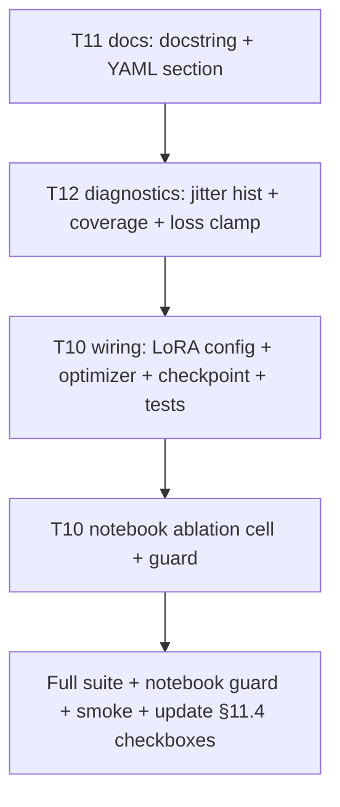

# Plan — Remaining TODOs from lean_0.2_param_extraction_and_pack_tools_investigation.md (§11.4)

## Context

T1–T9 are done and reviewed (505 tests green, notebook guard green, 31-check smoke green).
The review additionally fixed five defects in the T1–T9 work itself (T2 unreachable, T2
silent no-op, generation-time cap starvation, word-boundary filter exclusion, non-monotone
candidate order). What remains in §11.4:

- **T10** — controlled LoRA vs full-FT ablation at fraction 0.2
- **T11** — docs: `jitter_pack_tools` docstring interval + `freeze_encoder_stages` YAML section in the notebook generator
- **T12** — diagnostics: `jittered_rows` per kept row; coverage denominator normalisation; clamp logged losses at 0
- **T13** — explicitly deferred ("only if a head-starvation signature ever appears") → **out of scope**, stays unchecked

## Verified current state (read during planning)

- [`config.py:154-156`](../spancall/train/config.py) — docstring says jitter draws `T` in
  `[pack_tools, ceiling]`. **Wrong.** [`jitter_pack_tools()`](../spancall/lean/tensorize.py:206)
  draws the per-row *floor* uniformly from `[min_tools, pack_tools]` inclusive — the interval is
  `[jitter_min_tools, pack_tools]`, and `pack_tools` is the CEILING of the draw, not the floor.
  This is the "inverted interval" T11 refers to.
- [`build_lean_colab_notebook.py:1162`](../scripts/build_lean_colab_notebook.py) — writes
  `cfg["model"]["freeze_encoder_stages"] = []`. But in [`config.py:230`](../spancall/train/config.py)
  and the legacy [`from_dict` at config.py:282](../spancall/train/config.py), `freeze_encoder_stages`
  lives under the **`training`** section. So the notebook's assignment is silently dropped when the
  YAML is loaded — the user-visible knob does nothing. (The legacy builder
  [`build_colab_notebook.py:825`](../scripts/build_colab_notebook.py) has the same bug but is
  out of scope — legacy path; fix only the lean one unless trivial.)
- [`tensorize.py:442-448`](../spancall/lean/tensorize.py) — `jitter_pack_tools(...)` is already
  called per row; the stats channel `jittered_rows` exists but is a global count, not
  per-kept-row (T12a).
- [`eval_p1.py:721-722`](../spancall/lean/eval_p1.py) — `param_coverage` uses
  `groundable_gt_params / total_gt_params`. §3.1's caveat: the headline recall denominator is
  *groundable* params only while coverage uses ALL GT params — the two quotients describe
  different universes, so they cannot be subtracted to reason "generation gap". T12b: emit a
  same-universe coverage (`groundable_gt_params / max(1, params_scored)`) alongside the
  existing one, and print both so the distinction is visible.
- [`trainer.py:319-321, 486-487`](../spancall/lean/trainer.py) — `total_loss` accumulates
  `.item()` floats. The doc (§11.3 item 7, "CPU-seeded total_loss" / negative rows) says
  bf16 forward can yield *negative* CE values that then appear in `train_log.jsonl`. T12c:
  clamp logged scalars at 0 (`max(0.0, v)`) at the logging boundary only — never the gradient
  path — OR do the loss reduction in fp32. Cheapest correct fix: fp32 upcast already happens
  (`fp32_preds` is fed to the loss container, [trainer.py:319](../spancall/lean/trainer.py)),
  so the residual risk is in the *sum reduction* inside
  [`loss.py:160-203`](../spancall/lean/loss.py); clamp at the metric boundary is the safe,
  honest option.

## Task breakdown

### T11 — docs fixes (both one-file, zero-risk)

1. **Fix the docstring** in [`spancall/train/config.py`](../spancall/train/config.py) (DataConfig
   class docstring, ~line 154): replace "`jitter_pack_tools` (Phase G / R1c) draws T uniformly in
   `[pack_tools, ceiling]`" with the true statement: the per-row floor is drawn uniformly from
   `[jitter_min_tools, pack_tools]` inclusive; `pack_tools` remains the ceiling of the realised
   tool count (native tools are never dropped, so realised `T` can exceed the draw).
2. **Fix the YAML section** in [`scripts/build_lean_colab_notebook.py:1162`](../scripts/build_lean_colab_notebook.py):
   move `freeze_encoder_stages` from `cfg["model"]` to `cfg["training"]`. Add a one-line comment
   noting the dataclass puts it in `TrainingConfig`.
3. Add/extend a test: build the notebook config dict and assert `freeze_encoder_stages` lands in
   `cfg["training"]` and `TrainingConfig.from_dict` round-trips it. A docstring test is not
   warranted; the interval semantics are already pinned by
   `test_jitter_pack_tools_range_covers_one_through_the_ceiling` et al.

### T12 — diagnostics (three small, independently verifiable changes)

1. **`jittered_rows` per kept row** ([`tensorize.py`](../spancall/lean/tensorize.py) stats dict):
   today `jittered_rows` is a global counter of rows whose floor draw differed from
   `pack_tools`. Add `jitter_draw_hist` (histogram of realised draws) and keep the global count;
   the notebook already replays `jittered_rows` — surface the histogram the same way
   `render_T` is surfaced (synthetic key, e.g. `jitter_T=<t>`), reusing the T9 plumbing.
2. **Coverage denominator normalisation** ([`eval_p1.py:721`](../spancall/lean/eval_p1.py)):
   add `fast_path_param_coverage_scored = groundable_gt_params / params_scored` (same universe
   as the recall denominator) to the metrics dict; keep the old key for compatibility. Update
   `_print_report` to print both lines with the universes named.
3. **Clamp logged losses** ([`trainer.py:336, 487, 551`](../spancall/lean/trainer.py)):
   at the metric/log boundary only, `max(0.0, ...)` the per-batch and accumulated loss scalars
   (loss, pointer, tool), with a comment citing why (bf16 reduction can emit tiny negatives;
   the gradient path is untouched). Do NOT clamp inside `LeanLossContainer`.
4. Tests: one per change — a tensorize stats test asserting the histogram keys; an eval_p1
   test asserting the new metric equals the old one when universes match and differs when
   they don't; a trainer test asserting a synthetic negative loss logs as 0.0.

### T10 — LoRA vs full-FT ablation (notebook work, largest item)

This is an *experiment*, not a code fix: a controlled A/B at `DATA_FRACTION = 0.2`, judged on
dev `exact_call` and the fixed Part-1 eval. Expected (per §10.2–10.4): near-identical eval
numbers, better epoch-5 train-loss tail for LoRA.

1. **Add a LoRA option to the Lean training path.** The model container is
   [`LeanSpanCallModel`](../spancall/lean/model.py) (Qwen3-Embedding-0.6B backbone + heads).
   Options: (a) `peft` LoRA on attention projections (`r=16–32`, alpha = 2r, dropout 0.05,
   adapter LR 1e-4–3e-4, heads full-precision); (b) a minimal hand-rolled adapter to avoid the
   dependency. Prefer (a) if `peft` is available in the env, else (b). Gate behind a
   `TrainingConfig.use_lora: bool = False` + `lora_r/lora_alpha/lora_dropout/lora_lr` fields
   (forward-compat pattern already exists in `from_dict`).
2. **Optimizer integration**: [`build_lean_optimizer_groups`](../spancall/lean/trainer.py:61)
   already builds layer-decayed groups; add the adapter group at its own LR when LoRA is on,
   and make sure `save_checkpoint`/`load_checkpoint` round-trip adapter weights (merge or save
   adapter state separately — simplest: save the full state dict as today, since the wrapped
   model is still one module).
3. **Notebook cell**: in [`build_lean_colab_notebook.py`](../scripts/build_lean_colab_notebook.py),
   add an opt-in ablation cell (flag `RUN_LORA_ABLATION = False` default) that trains both arms
   with identical seeds/fraction/epochs and prints a comparison table (dev exact_call, dev
   span_acc, eval Part-1 prec/rec/F1, final train loss, epoch-5 tail). Must pass the cell guard
   (`_guard_code_cells`).
4. **Tests**: config round-trip for the new fields; optimizer groups include the adapter group
   at the right LR when enabled; a tiny-model train-step smoke with LoRA on (skip gracefully if
   `peft` absent).
5. **Running the actual ablation** requires GPU time (Colab) — the deliverable in-repo is the
   *wiring + cell*, not the numbers. The doc's T10 box stays unchecked until the run happens;
   the plan note records "wiring done, run pending".

### T13 — deferred (no work)

Per the doc's own definition: only if a head-starvation signature appears (H1 stalled while H3
climbs — not present). λ re-weighting and the bidirectional-encoder experiment stay out.

## Execution order



T11 first (pure docs, zero risk), T12 next (small, each independently testable), T10 wiring
last since it touches the trainer and the notebook. Verification after each stage, and once at
the end: `pytest tests/ -q` (expect 505 + new tests), notebook guard, `scratch/verify_t1_t9.py`.
Finally tick T11/T12 in §11.4 and annotate T10 with the run-pending note.

## Risks / notes

- `freeze_encoder_stages` fix changes notebook behaviour the moment a user sets it — but the
  current code path means the setting is *silently ignored*, which is strictly worse.
- Loss clamping is cosmetic honesty, not numerics: the doc's complaint is that negative values
  get *quoted*. Clamping at the log boundary is the minimal fix; an fp32 reduction inside the
  loss would be the thorough one but touches the gradient path — avoid unless the clamp proves
  insufficient.
- The coverage metric rename must keep the old key (notebook cells and possibly stored outputs
  reference `fast_path_param_coverage`); add, don't replace.
- LoRA via `peft` adds a dependency; confirm availability in `.venv` before choosing path (a)
  vs (b). If absent, prefer the hand-rolled adapter over adding a dependency to a research repo.

---

## Outcome (implementation complete — verification green)

`pytest tests/ -q` → **515 passed** (505 + 10 new). Notebook guard: **26 code cells compile,
all names resolve** (3 IPython cells skipped). `scratch/verify_t1_t9.py` → **31 checks passed**.

### Correction to the T12 plan item 2 — the drafted metric was a tautology

The plan said to add `fast_path_param_coverage_scored = groundable_gt_params / params_scored`
with `params_scored = ex_tp + ex_fn`. Implemented as written, probed against a hand-built
2-record split, it printed:

```
FAST-PATH COVERAGE: 0.5000 of GT params are extractable
  (same-universe) 2.0000 of the 1 scored extractable params are extractable
```

**2.0 = 200% coverage.** Two independent defects:

1. **`ex_tp + ex_fn` is not the groundable count.** A wrong-value prediction lands in `ex_fp`,
   not `ex_fn`, so the denominator silently omits exactly the cases the ratio was meant to
   expose — it can fall below the numerator.
2. **The ratio is a tautology.** Numerator and denominator both count the same extractable
   universe, so it is pinned near 1.0 by construction and measures nothing. Worse, the probe
   showed it printing >1.

It was **deleted, not repaired**, with an in-code "Do not reintroduce it" note. Two honest
rates replaced it:

| metric | formula | reads as |
|---|---|---|
| `fast_path_param_accuracy_all` | `ex_tp / ALL GT params` | how much of the whole extraction problem the fast path solves |
| `fast_path_param_accuracy_scored` | `ex_tp / (ex_tp + ex_wrong + ex_fn)` | extraction quality over params it actually attempted |

This required a **new `ex_wrong` counter**: `ex_fp` mixes wrong-value predictions with
predictions for params absent from GT, so it cannot serve as the wrong-answer denominator.

### Second finding — the headline `extraction_recall` overstates

On the same probe the headline reported `extraction_recall = 1.0` while the per-parameter table
showed `city rec=0.500`. The historical headline's denominator (`ex_tp + ex_fn`) omits wrong
answers entirely, so a 50%-correct parameter reports as 100%. The headline was **left
byte-identical** for continuity with stored results; the strict rate is added as a new key and
`_print_report` prints a `(strict recall)` line only when it differs, so the gap is visible
without invalidating old numbers.

### Notes on what actually shipped

- T11's `freeze_encoder_stages` test asserts the *wrong-section* value is ignored, not just that
  the right one is read — a round-trip test alone would have passed against the original bug.
- `peft` is **not installed** here, so `test_apply_lora_fails_loudly_when_peft_is_missing`
  monkeypatches `builtins.__import__`; the failure path is covered in CI without the dependency.
- `test_build_optimizer_groups_isolates_adapters_at_their_own_lr` registers a fake
  `backbone.lora_A_probe` parameter rather than requiring `peft`, so the optimizer logic is
  tested everywhere.
- The notebook cell flattens `jitter_draw_hist` into `jitter_draw=<floor>` keys because the fork
  worker returns only a flat `drops` dict; the parent decodes them like `render_T=<T>` and
  `rescued:<why>`.
- T10 remains unchecked in §11.4 as **wiring done, run pending** — the ablation needs GPU time.
