# Lean v2.3 Upgrade Plan — Single Training + Step-by-Step Isolated Evaluation

Supersedes the notebook training/evaluation flow in [`plans/lean_v2_2_two_step_plan.md`](lean_v2_2_two_step_plan.md) and [`scripts/build_lean_v2_2_colab_notebook.py`](../scripts/build_lean_v2_2_colab_notebook.py).

---

## 0. Root-Cause Diagnosis of the Current v2.2 Notebook

### A. Why "3 Trainings, 1 Eval" Fails
1. **Redundant duplicate training runs**:
   - **Run 1 (Cell 21)**: Trains `spancall_lean_colab` (Full-FT, Softmax CE H1 + Pointer H3, 5 epochs, seed 42).
   - **Run 2 (Cell 27, `arm="ce"`)**: Trains `binary_tool_ablation_ce` — **100% identical** configuration, seed, data, and objective as Run 1.
   - **Run 3 (Cell 27, `arm="binary"`)**: Trains `binary_tool_ablation_binary` from scratch, which already loses on `dev` (`tool_bin_acc = 0.5784` vs `ce = 0.6667`, `exact_call = 0.3235` vs `0.5392`).
   - **Cell 29 (`CHECKPOINT_DIR`)** then selects **only Run 1** for all of Sections 5 and 6.
2. **Train vs. Step-2 Serve layout mismatch (`T=1` starvation)**:
   - `ToolPool.candidates_for` ([`spancall/lean/tensorize.py:264`](../spancall/lean/tensorize.py#L264)) treats `pack_tools` as a floor (`T = max(row_pack_tools, len(sample.tools))`). Because most `hermes_train` / `hermes_dev` rows ship with `len(sample.tools) == 2`, drawing `row_pack_tools = 1` via `jitter_pack_tools` still renders `T = 2`.
   - Result: **`T=1` is only 4.6% of train (`t2`) and 0.0% of `dev`**, making the `T=1` single-tool layout used by Step 2 (both Oracle Part 1 and `two_step` inference) out-of-distribution.

### B. Why Part 5 & Part 6 Evaluation Fails
1. **Sequential `rows[:500]` slicing (`EVAL_LIMIT = 500`) hits a 100% `json_output` block**:
   - `data/processed_v2/hermes_eval.jsonl` (3,426 rows) is ordered by source dataset:
     - Rows `0..377` (378 rows): `gt_tool = "json_output"`, `s.tools = ["json_output"]` (`T=1`).
     - Rows `378..1021` (644 rows): Stratum-A rows where `gt_tool = "json_output"` **is not even in `s.tools = ["ExpertQAExtractor"]`** (`meta.json_mode_gt_tool_missing = ["json_output"]`, `T=1`).
     - Rows `1022..3425` (2,404 rows): Real multi-tool function calling (`convert_currency`, `calculate_loan_payment`, `get_movie_details`, etc., with `2,227` native `T = 2..6` rows and `1,243` Stratum-F rows).
   - Slicing the first 500 rows evaluates **0 real multi-tool function-calling rows** in `5b` and `predict_split`.
2. **`5a`, `5b`, and `predict_split` (`5c`/`5d`/Part 6) evaluate *different* 500-row subsets**:
   - **`5a` (`eval_param_extraction_lean`)** skips rows `378..1021` (`gt_tool not in s.tools`), scoring rows `0..377` (`json_output`) + `1022..1143` (122 real tool rows).
   - **`5b` (`eval_tool_prediction_lean`)** scores rows `0..499` (`0` native multi-tool rows), injects the alphabetically first tool (`ActiveDrillingProjects`) on every `0..377` row, injects row 0's unrelated `json_output` schema onto rows `378..499` (`ExpertQAExtractor`), and counts 75 `::r7` pre-encode `sanitize_error` vetoes as H1 model misses.
   - **`predict_split` (bottom of `5b`, used by `5c`, `5d`, Part 6)** scores raw rows `0..499` where `render_T = 1` on 100% of rows (Step 1 never runs!), and marks rows `378..499` as `WRONG_TOOL: 122` because `s.tools` only has `ExpertQAExtractor` while `gt_tool` is `json_output`.
3. **Part 5a conflates 4 distinct Step-2 sub-stages into a single number**:
   - Candidate generation truncation (`candidate_parity = 0.2903`, 71% of GT spans missing from `C=512`), neural pointer ranking (`H3`), type casting / schema validation (`P9`/`P10`), and post-decode gates (`min_joint_margin`, `collapse_guard`) are all blended together, alongside 387 Stratum-A rows.

---

## 1. Upgrade Architecture Overview

```mermaid
flowchart TD
    subgraph T["1. Single Training & Step-Aware Telemetry (Section 4)"]
        T1["Tensorizer: Fix jitter T=1 so floor=1 renders [gt_tool] (33% T=1 Step-2 layout, 67% T>=2 Step-1+2 layout)"]
        T2["Single Primary Training Run (Softmax CE H1 + Pointer H3)"]
        T3["Epoch Eval: Log Step-1 (tool_acc on T>=2) and Step-2 (span_acc, exact_call on T=1 vs T>=2) separately"]
        T1 --> T2 --> T3
    end

    subgraph S["2. Deterministic Stratified Benchmark Builder (Section 5.0)"]
        S1["Build shared subset_hermes_eval.jsonl (filtered for valid tool packets, stratified across cohorts)"]
        S2["Cohorts: F-Func (real tools, T>=2) | F-Json (json_output) | A-Clean (ungroundable) | A-Adv (::r7 marker injection)"]
        S3["Step 0 Gate Audit: Score pre-encode sanitize veto on A-Adv vs Clean cohorts; exclude vetoed rows from H1/H3 denominators"]
        S1 --> S2 --> S3
    end

    subgraph E["3. Step-by-Step Isolated Evaluation (Sections 5a – 5d)"]
        E1["5a. Step 1 (Tool Selection H1 in Isolation)\n• 1a: Native Multi-Tool (T=2..6)\n• 1b: Single + Random Pool Distractors\n• 1c: F vs A-Clean Score/Margin Separation\n• 1d: Per-Tool Confusion Matrix"]
        E2["5b. Step 2 (Param Extraction H3, Oracle Tool, Stratum F)\n• 2a: Candidate Mask Parity (C=512 survival, T=1 vs T=all, miss reasons)\n• 2b: Pure Pointer Scoring (protect_parity=True, gates OFF: conditional H3 acc & collapse)\n• 2c: Gate & Schema Waterfall (+unprotected mask -> +P9/P10 -> +collapse_guard -> +margin_gate)"]
        E3["5c. Step 3 (Composed E2E: Single-Pass vs Two-Step)\n• Same checkpoint & subset\n• Stage-by-Stage Funnel: Total F -> Step 0 -> Step 1 -> Step 2a -> Step 2b -> Step 2c\n• A-Clean false-hit / correct-abstain comparison"]
        E4["5d. Stage-Attributed Error Forensics\n• Concrete examples grouped by exact failure stage (Step 1, Step 2a, Step 2b, Step 2c)"]
        E1 --> E2 --> E3 --> E4
    end

    T3 --> S1
    S3 --> E1
```

---

## 2. Detailed Work Items

### Work Item 1 — Fix Training Process (1 Training Run + `T=1` Step-2 Layout Parity)
**Files**: [`spancall/lean/tensorize.py`](../spancall/lean/tensorize.py), [`spancall/lean/trainer.py`](../spancall/lean/trainer.py), [`scripts/build_lean_v2_2_colab_notebook.py`](../scripts/build_lean_v2_2_colab_notebook.py)

1. **Make `jitter_pack_tools` actually produce `T=1` on ~33% of rows**:
   - In [`tensorize_sample_lean`](../spancall/lean/tensorize.py#L390-L413), when `jitter=True` draws `row_pack_tools == 1`, set `tool_candidates = [gt_tool]` (`gt_idx = 0`) instead of letting `ToolPool.candidates_for` force `len(sample.tools) >= 2`.
   - Result: Training and `dev` both contain ~33% `T=1` rows (exact Step-2 serving layout) and ~67% `T >= 2` rows (Step-1 multi-tool discrimination layout).
2. **Eliminate duplicate training runs in the notebook**:
   - Keep **1 primary training run** in Section 4 (`spancall_lean_colab`).
   - Set `RUN_LORA_ABLATION = False` and `RUN_BINARY_TOOL_ABLATION = False` by default.
   - If `RUN_BINARY_TOOL_ABLATION` is enabled by the user, **reuse** the primary `spancall_lean_colab` run as the `ce` baseline instead of retraining `ce` a second time.
3. **Decouple Step-1 and Step-2 telemetry during training (`trainer.py` + Cell 23)**:
   - In `epoch_eval`, report:
     - **Step-1 (`H1`)**: `tool_acc_multi` (restricted to rows with `n_candidates >= 2` so `T=1` rows never inflate `tool_acc`).
     - **Step-2 (`H3`)**: `span_acc` (per-parameter pointer accuracy), `exact_params_only` (all supervised parameters of the row correct, independent of whether `H1` picked the right tool), and `exact_call` (both Step 1 and Step 2 correct).

---

### Work Item 2 — Build a Deterministic Stratified Eval Benchmark (Section 5.0)
**Files**: [`spancall/lean/eval_p1.py`](../spancall/lean/eval_p1.py), [`scripts/build_lean_v2_2_colab_notebook.py`](../scripts/build_lean_v2_2_colab_notebook.py)

1. **Add `build_stratified_eval_subset(split_name, data_dir, out_path, limit=500, seed=42)`**:
   - Never slice `rows[:500]` sequentially from `hermes_eval.jsonl`.
   - Partition `hermes_eval.jsonl` into explicit, non-overlapping cohorts:
     - **`F_func`**: `stratum == "F"`, `gt_tool != "json_output"`, `gt_tool in s.tools` (1,243 available; 80%+ have `len(s.tools) >= 2`).
     - **`F_json`**: `stratum == "F"`, `gt_tool == "json_output"`, `gt_tool in s.tools` (65 available).
     - **`A_clean`**: `stratum == "A"`, non-`::r7` adversarial, `gt_tool in s.tools` (~1,100 available).
     - **`A_adv`**: `stratum == "A"`, `::r7` marker injection (~375 available).
     - **`A_missing_gt_schema`**: rows `378..1021` where `gt_tool == "json_output"` is absent from `s.tools = ["ExpertQAExtractor"]` (644 rows — logged separately as a dataset audit count and excluded from `F_func`/`H1` accuracy so they cannot fabricate `WRONG_TOOL` errors).
   - Sample a deterministic stratified subset of size `EVAL_LIMIT` (e.g., for `EVAL_LIMIT=500`: `250 F_func`, `50 F_json`, `150 A_clean`, `50 A_adv`) and save it once to `RESULTS_DIR/subset_{EVAL_SPLIT}.jsonl`.
   - **Every cell in Part 5 (`5.0`, `5a`, `5b`, `5c`, `5d`) and Part 6 reads this exact same subset.**
2. **Section 5.0 Cell — Step 0: Pre-Encode Sanitize Gate Audit**:
   - Run pre-encode check across the subset before running neural evaluation:
     - Report block rate on `A_adv` (`::r7` marker injections — expected ~100%) vs false-block rate on `F_func` / `F_json` / `A_clean` (expected 0%).
     - Tag and exclude Step-0 vetoed rows from Step-1 and Step-2 denominators.

---

### Work Item 3 — Upgrade Section 5a: Step 1 (Tool Selection `H1`) in Isolation
**Files**: [`spancall/lean/eval_p1.py`](../spancall/lean/eval_p1.py), [`scripts/build_lean_v2_2_colab_notebook.py`](../scripts/build_lean_v2_2_colab_notebook.py)

Replace the current `eval_tool_prediction_lean` cell with a dedicated **Step-1 Diagnostic Suite** on non-sanitized rows:
1. **Step 1a — Native Multi-Tool Accuracy (`len(s.tools) >= 2`)**:
   - Evaluates `resolver.predict_tool(s.tools, ...)` on rows that natively ship 2–6 candidate tools (no artificial augmentation).
   - Reports Top-1 accuracy, mean winner probability, mean top1–top2 margin, and accuracy by candidate count `T ∈ {2, 3, 4, 5+}`.
2. **Step 1b — Single-Tool + Random Pool Distractors (`T_packed = 3`)**:
   - For rows with `len(s.tools) == 1`, samples 2 deterministic random distractors per row from `TOOL_POOL` (seeded by `sample_id`, never hardcoded to `ActiveDrillingProjects`).
3. **Step 1c — Stratum `F` vs `A_clean` Score & Margin Separation**:
   - Compares `tool_prob` and `tool_margin` percentiles (`p10, p25, p50, p75, p90`) on `F_func` vs `A_clean` to quantify whether H1 carries an abstention signal or if abstention must happen in Step 2.
4. **Step 1d — Per-Tool Accuracy & Confusion Matrix**:
   - Prints worst-performing tools and most frequent `(gt_tool → pred_tool)` confusions.

---

### Work Item 4 — Upgrade Section 5b: Step 2 (Parameter Extraction `H3`) Sub-Stage Breakdown
**Files**: [`spancall/lean/eval_p1.py`](../spancall/lean/eval_p1.py), [`spancall/lean/resolver.py`](../spancall/lean/resolver.py), [`scripts/build_lean_v2_2_colab_notebook.py`](../scripts/build_lean_v2_2_colab_notebook.py)

Evaluate Step 2 (`resolver.try_resolve(gt_tool, ...)`) on **Oracle Tool** across `F_func` (and separately `F_json`), explicitly isolating **three sub-steps**:

1. **Step 2a — Candidate Generation (`CandidateMaskBuilder`)**:
   - Measures `candidate_parity = parity_hit / parity_checked` (fraction of extractable GT spans present in the `C=512` candidate tensor).
   - Compares **Single-Tool layout (`T=1`, `context_schemas=[gt_tool]`)** vs **Multi-Tool layout (`T=all`, `context_schemas=s.tools`)** to test whether `T=1` reduces candidate truncation.
   - Reports exact miss-reason breakdown (`truncated` by `max_cands=512`, `never_generated_width > 16`, `region_filter`, `rel_unresolvable`).
2. **Step 2b — Pure Pointer Model Scoring (`LeanPointerHead` + `LeanJointDecoder`)**:
   - Runs with `protect_parity_spans=True` (guaranteeing every extractable GT span is in `C=512`) and post-decode gates OFF (`min_joint_margin=0.0`, `collapse_guard=False`).
   - Fixes the bug in `eval_p1.py` where `offered_miss_rate` was computed as `(parity_checked - parity_hit) / parity_checked`: adds true **Conditional Pointer Accuracy** (`tp_given_parity_hit / parity_hit` — when the GT span is in `C=512`, how often does H3 select it?).
   - Reports raw pointer accuracy by source type (`utterance_span`, `recent_ctx`, `time_ctx`, `enum_ctx`, `boolean_ctx`, `null_ctx`) and raw `pointer_collapsed` rate.
3. **Step 2c — Post-Processing, Schema Validation & Gates Ablation (`P9`, `P10`, `collapse_guard`, `min_joint_margin`)**:
   - Prints a 5-row **Step-2 Sub-Stage Waterfall Table** on `F_func` (and `A_clean` false-hit rate alongside it):

| Step-2 Configuration | `candidate_parity` | `Param Prec` | `Param Rec` | `Param F1` | `Collapse Rate` | `Exact Call (F)` | `False Hit (A_clean)` |
|---|---|---|---|---|---|---|---|
| **2b. Oracle Candidates** (`protect_parity=True`, gates OFF) | 1.000 | … | … | … | … | … | … |
| **2a+2b. Served Candidates** (`protect_parity=False`, gates OFF) | … | … | … | … | … | … | … |
| **2c-1. + Schema Check (`P9` cast + `P10` required)** | … | … | … | … | … | … | … |
| **2c-2. + Collapse Guard (`collapse_guard=True`)** | … | … | … | … | … | … | … |
| **2c-3. + Margin Gate (`min_joint_margin=0.02`)** | … | … | … | … | … | … | … |

---

### Work Item 5 — Upgrade Section 5c: Step 3 (End-to-End Composition & Waterfall Funnel)
**Files**: [`scripts/build_lean_v2_2_colab_notebook.py`](../scripts/build_lean_v2_2_colab_notebook.py)

1. Run `predict_split` on the shared stratified subset in two modes using the **same trained checkpoint**:
   - **Arm 1 (`single_pass`)**: `resolve_mode="single_pass"` (Step 1 and Step 2 share one multi-tool render `T=len(s.tools)`).
   - **Arm 2 (`two_step`)**: `resolve_mode="two_step"` (Step 1 picks winner tool on `T=len(s.tools)` → Step 2 re-renders `T=1` with `[winner_tool]` and decodes parameters).
2. Print the **End-to-End Waterfall Funnel Table** on `F_func` (and `F_json`) comparing `single_pass` vs `two_step` at every step:
   - **Total `F_func` rows**: $N$
   - **→ Pass Step 0 (Sanitize OK)**: $N_0$ ($\%$)
   - **→ Pass Step 1 (H1 Picked Correct Tool)**: $N_1$ ($\%$)
   - **→ Pass Step 2a (All GT Spans in `C=512` Candidates)**: $N_{2a}$ ($\%$)
   - **→ Pass Step 2b (Pointer H3 Matched All GT Params)**: $N_{2b}$ ($\%$)
   - **→ Pass Step 2c (Schema Valid + Collapse/Margin Gates Passed = E2E Exact Match)**: $N_{2c}$ ($\%$)
3. Print **Cohort `A_clean` & `A_adv` Abstention Breakdown**:
   - How many `A` rows are stopped at Step 0 (sanitize), Step 1 (tool threshold), Step 2b (`<|null|>` selection), or Step 2c (`missing_required` schema check, `collapse_guard`, `min_joint_margin`).

---

### Work Item 6 — Upgrade Section 5d: Stage-Attributed Error Forensics
**Files**: [`scripts/build_lean_v2_2_colab_notebook.py`](../scripts/build_lean_v2_2_colab_notebook.py)

Replace the generic `preds_eval.jsonl` dump (`5c`) and duplicate offset audit (`5d`) with a **Stage-Attributed Forensics Cell** that groups misses by the exact step where they failed and prints 3 examples per bucket:
1. **Step-1 Misses (`WRONG_TOOL`)**: Shows `utterance`, `candidate_tools`, `gt_tool`, `pred_tool`, and `H1 tool_scores`.
2. **Step-2a Misses (`PARITY_MISS` — GT span not in `C=512`)**: Shows `param_name`, `gt_span_text`, `miss_reason` (`truncated` vs `width > 16`), and `cands_per_param`.
3. **Step-2b Misses (`POINTER_RANK_MISS` — GT span was in `C=512`, H3 picked wrong span)**: Shows `param_name`, `gt_value`, `pred_value`, `pred_region` (`in_utterance` vs `before_utterance`), `confidence`, and `joint_margin`.
4. **Step-2c Misses (`GATE_OR_SCHEMA_REJECT`)**: Shows calls where pointer predictions were rejected by `P9` type cast, `P10` missing required, `collapse_guard`, or `min_joint_margin`.

---

## 3. Execution Order & Verification

1. **Step 1 (`spancall/lean/tensorize.py` + `spancall/lean/trainer.py`)**:
   - Wire `row_pack_tools == 1` → `T=1` single-tool render in `tensorize_sample_lean` when `jitter=True`.
   - Add decoupled Step-1 (`tool_acc_multi`) and Step-2 (`span_acc`, `exact_params_only`, `exact_call_t1`, `exact_call_multi`) eval metrics in `trainer.py`.
2. **Step 2 (`spancall/lean/eval_p1.py`)**:
   - Add `build_stratified_eval_subset` to construct the shared stratified subset (`F_func`, `F_json`, `A_clean`, `A_adv`).
   - Fix conditional pointer accuracy (`tp_given_parity_hit / parity_hit`) and add `context_schemas` toggle (`T=1` vs `T=all`) in `eval_param_extraction_lean`.
3. **Step 3 (`scripts/build_lean_v2_2_colab_notebook.py` → `notebooks/spancall_lean_v2_2_train_eval.ipynb`)**:
   - Remove redundant training runs (single training run by default).
   - Replace Sections 5 & 6 with the Step 0 → Step 1 → Step 2 (2a/2b/2c) → Step 3 (`single_pass` vs `two_step` waterfall) → Stage-Attributed Forensics flow.
4. **Step 4 (`pytest`)**:
   - Add unit tests covering the `T=1` jitter path, stratified subset builder, conditional pointer accuracy, and notebook cell compilation guard.

