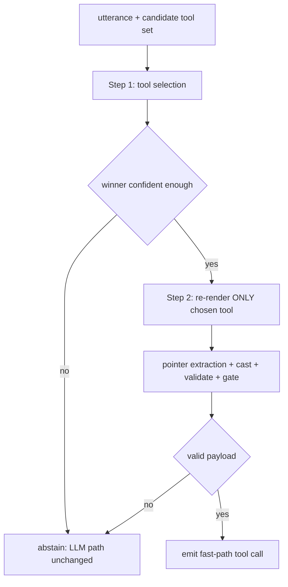

# Plan: Lean v2 2-Step Serving Flow — Tool Selection then Single-Tool Param Extraction

## Decision context

- User direction: split the fast path into **two smaller optimization problems**:
  1. **Step 1 — tool name extraction**: pick the called tool from the candidate set.
  2. **Step 2 — param extraction for the chosen tool only**: re-render the input
     with ONLY the chosen tool's schema, then run the pointer.
- Latency is explicitly not a constraint (2 encoder passes ≈ ~130ms is fine).
- Training changes are allowed; the two steps may be trained/optimized
  independently.

## Evidence that shapes the design

1. **Step 2's ceiling is capped by candidate parity, even in the T=1 oracle
   render**: Part 1 (oracle tool) scored `candidate_parity=0.29`,
   `extraction_precision=0.09`, `exact_payload_match_F=0.0265`. The single-tool
   render does NOT fix the 71% never-offerable spans — the loss is
   generation-side (width cap, P4 type filter, entry snapping, fallback
   addressing). Any 2-step plan must carry the parity fix, or step 2 optimizes
   against a broken candidate set.
2. **Step 1 today: dev `tool_acc=0.667`** (v1 hit 1.0 — a regression worth
   understanding). The binary tool head is already implemented and green
   ([binary_tool_selection_plan.md](binary_tool_selection_plan.md), steps 1–3
   done; calibration + ablation pending) — it is the natural step-1 head.
3. **Train/serve layout shift is the biggest training risk**: the pointer is
   supervised on packed multi-tool renders (`jitter_pack_tools`, T≥2). Serving
   a fresh T=1 render puts H3 in a layout it never trained on — the exact
   class of skew (stale offsets, +30 drift) this project has been bitten by
   twice. "Training might be the same" is the assumption to kill deliberately:
   either train on T=1 renders or prove the shift is harmless.

## Architecture

- **Step 1** — `predict_tool` over the packed render (binary head arm:
  absolute sigmoid prob, calibrated τ threshold; T=1 short-circuit unchanged).
- **Step 2** — new resolver path: `build_input_multi([chosen_tool], ...)`,
  fresh encode, `_candidate_masks` on the T=1 render, pointer decode, cast,
  validate, margin gate. All existing machinery reused — this is the same code
  path as Part 1's oracle call, just fed the *predicted* tool instead of GT.

## Workstreams

### W0. Baseline measurement (the old probe, kept as step 0)
`eval_p1` gains `tool_source="oracle"|"predicted"` (see
[lean_v2_two_step_probe.md](lean_v2_two_step_probe.md) §1 for the exact
design). Run both arms on the current checkpoint BEFORE any training change:
- fixes the step-1 penalty number (`step1_tool_acc`, conditional step-2 metrics)
- oracle arm = step 2's ceiling today; predicted arm = end-to-end today.
Everything below is measured against these baselines.

### W1. Step 1 — raise tool-name extraction accuracy
1. **Diagnose the 0.667 regression first** (cheap, before any new training):
   diff lean v2's H1 setup vs v1's (which hit 1.0) — candidate-set
   construction, anchor layout, `mean_n_candidates`, `jitter_pack_tools`
   presence in the lean trainer. Fix whatever differs.
2. **Train the binary arm** (`tool_objective="binary"`, code already green):
   BCE per anchor, absolute P(called), no softmax competition.
3. **Calibrate step 1** (pending item of the binary plan): dev-split τ sweep
   on `tool_binary_logits` → PR curve, F1-optimal τ; persisted with the
   checkpoint. Below-τ → whole-call abstain (fits the all-or-nothing R4
   contract: a step-1 miss is a *call-level* miss, param extraction never
   runs — exactly the decomposition the user wants).
4. Success gate: `step1_tool_acc` (call-level, on eval) ≥ 0.95 at the
   calibrated τ with a reported abstain rate; kill/revert rule stays the
   binary plan's kill criterion.

### W2. Step 2 — param extraction on the single-tool render
1. **Train the pointer on the T=1 layout** (the layout shift fix). Two arms:
   - **2a (curriculum)**: stage T-packed (current, keeps packed-render
     generality) then a short T=1 fine-tune stage — the tensorizer emits T=1
     rows (no distractor injection, `pack_tools=1`) for the final stage.
   - **2b (pure T=1)**: pointer trained only on T=1 renders from scratch.
   Prefer 2a (cheaper, reuses the checkpoint); decide by dev metrics on both
   layouts — report both so the shift is quantified, not assumed away.
2. **Candidate parity fix is a hard prerequisite** — carry
   [lean_v2_candidate_parity_fix.md](lean_v2_candidate_parity_fix.md) W2/W3
   (miss-reason instrumentation + the dominant-class fix). Parity must reach
   ≥ 0.95 on the T=1 render WITHOUT `protect_parity_spans` before step-2
   metrics mean anything.
3. **Step-2 eval protocol**: Part 1 already IS the protocol (oracle-tool T=1
   render + parity instrumentation + refusal split). The predicted-tool arm
   from W0 becomes the standing e2e metric; per-step metrics reported
   separately (`step1_*`, `step2_*`) so each optimization problem gets its own
   scoreboard.

### W3. Resolver: the 2-step serving path
1. New resolver method (or a flag on `try_resolve_candidates`): after the
   winner is chosen and passes the step-1 gate, re-render `[winner]` only,
   re-encode, decode. Reuse `_resolve`'s existing single-schema branch
   (the same code Part 1 exercises) — the new code is mostly plumbing: pass
   `context_schemas=[winner]` instead of the full set, plus a second encode.
2. Telemetry: `step` fields in `LeanResolveResult.features`
   (`step1_tool`, `step1_prob`, `step1_gate`, `step2_render_T=1`); stage
   clocks already exist — the second encode shows as a second `enc_ms`.
3. Keep the **decode-restricted single-pass path** (current behavior) as a
   fallback mode — comparison between one-pass and two-pass on the same rows
   is the ablation that says whether the re-render itself helps the pointer
   beyond the layout-matched training (W2.1) effect.

### W4. Notebook + tests
1. v2 notebook: cells for W0 probe (both arms), the 2a/2b training stages,
   the 2-step serving path, and a per-step scoreboard table
   (step1 acc/abstain | step2 P/R/F1, parity, exact | e2e exact/hit).
2. Tests: resolver 2-step path (winner → re-render T=1 → decode); step-1
   gate abstains before any encode of step 2; parity instrumentation works
   on the T=1 render; regression — existing single-pass path byte-identical
   when the flag is off.

## Execution order

1. **W0** probe (measures both steps today; zero training).
2. **W1.1** diagnose the tool_acc regression (code inspection + dev metrics).
3. **W2.2 parity fix** (from the parity plan — prerequisite for any step-2
   claim) — in parallel with W1.2/W1.3 (binary arm + τ calibration).
4. **W2.1** T=1 pointer training stage (2a curriculum arm first).
5. **W3** resolver 2-step path + tests.
6. **W4** notebook scoreboard; final read: per-step numbers, one-pass vs
   two-pass ablation, and the decision on 2b (pure T=1) from the dev
   comparison.

## Success criteria (per sub-problem, per the user's decomposition)

- **Step 1**: `step1_tool_acc ≥ 0.95` at calibrated τ (with abstain rate
  reported — abstain routes to the LLM, it is not an error).
- **Step 2** (conditioned on step-1-correct rows): `candidate_parity ≥ 0.95`,
  `extraction_precision ≥ 0.90` (raw pointer, pre-gate) — the calibrated
  whole-call gate then targets the standing ≥ 0.95 precision-at-hit claim.
- **End-to-end**: `call_exact_set_match` and `exact_payload_match_F` on the
  predicted-tool arm improve over the W0 baseline by at least the step-1
  penalty recovered.

## Files touched (expected)

- `spancall/lean/eval_p1.py` — `tool_source` + per-step metrics.
- `spancall/lean/tensorize.py` / `trainer.py` — T=1 fine-tune stage (2a),
  binary arm already wired.
- `spancall/lean/resolver.py` — 2-step serving path + telemetry.
- `scripts/build_lean_v2_colab_notebook.py` + the v2 notebook.
- Parity-plan files (see [lean_v2_candidate_parity_fix.md](lean_v2_candidate_parity_fix.md)).
- Tests: resolver 2-step, eval_p1 predicted arm, T=1 tensorize stage.

## Non-goals

- No head redesign beyond the already-implemented binary tool head.
- No agent-loop/router changes — the resolver's contract (hit / abstain) is
  unchanged; the router consumes it exactly as today.
