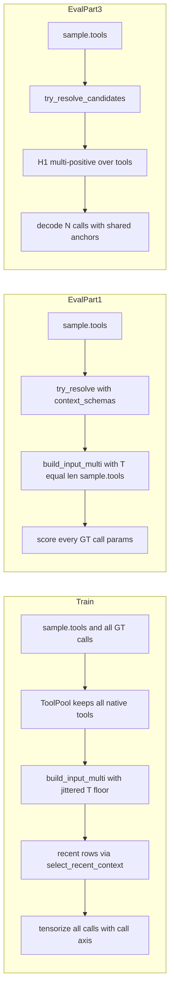

# Lean Workflow Upgrade Plan

Step-by-step upgrade plan derived from
[`plans/lean_workflow_remaining_issues.md`](plans/lean_workflow_remaining_issues.md).
Every issue (R0–R10) was re-verified against the current source before being
scheduled; findings that differed from the doc are called out inline.

**Scope decision: fix all of R0–R10, including full multi-call supervision
(R0.4).** No issue is deferred. Phase J is the largest phase and is scheduled
last because it depends on the single-grammar, tool-coverage, mask-keying and
telemetry work in Phases A–G.

---

## 1. Verified state of the code

| Issue | Verified location | Status |
|---|---|---|
| **R0.1** native tools truncated at `pack_tools` | [`ToolPool.candidates_for()`](spancall/lean/tensorize.py:242) breaks out of the native loop at `len(candidates) >= budget` | confirmed |
| **R0.2** Eval Part 1 renders only `[gt_tool]` | [`eval_param_extraction_lean()`](spancall/lean/eval_p1.py:269) calls `try_resolve(gt_tool, ...)`; [`_resolve()`](spancall/lean/resolver.py:404) renders one tool | confirmed |
| **R0.3** Eval Part 3 un-augmented at `len(s.tools) == 1` | [`try_resolve_candidates()`](spancall/lean/resolver.py:287) short-circuits to `try_resolve` | confirmed |
| **R0.4** multi-call rows: only `ground_truth_calls[0]` used | [`tensorize_sample_lean()`](spancall/lean/tensorize.py:309), [`LeanJointDecoder`](spancall/lean/decode.py:89) is single-call | confirmed |
| **R1** Train `T=3`, Eval Part 1 `T=1` | render at [`tensorize.py:338`](spancall/lean/tensorize.py:338) vs [`resolver.py:404`](spancall/lean/resolver.py:404) | confirmed |
| **R2** budget silently halved | clamp duplicated at [`predict_tool`](spancall/lean/resolver.py:214), [`try_resolve_candidates`](spancall/lean/resolver.py:299), [`_resolve`](spancall/lean/resolver.py:394) | confirmed |
| **R3** masks keyed by bare `p.name` | [`_candidate_masks()`](spancall/lean/resolver.py:627) | confirmed |
| **R4** re-tokenize + rebuild `_RowCtx` per param | [`_candidate_masks()`](spancall/lean/resolver.py:618) | confirmed |
| **R5** inverted `t_mask` / `t_enc`, clobbered features | [`_resolve` bundle branch](spancall/lean/resolver.py:389), [`res.features.update`](spancall/lean/resolver.py:355) | confirmed |
| **R6** `pack_multi_tools=False` renders `template.jinja` | [`tensorize.py:344`](spancall/lean/tensorize.py:344) | confirmed |
| **R7** `max_pos: 1` reduces the multi-positive loss to single-positive CE | [`configs/default.yaml:88`](configs/default.yaml:88), consumed at [`build_lean_colab_notebook.py:126`](scripts/build_lean_colab_notebook.py:126) | confirmed |
| **R8** training skips recent-context sanitization | [`_recent_rows()`](spancall/lean/tensorize.py:134) has no `sanitize_key` / budget | confirmed |
| **R9** no `render_T` telemetry | [`_resolve` features](spancall/lean/resolver.py:558), [`try_resolve_candidates` features](spancall/lean/resolver.py:330) | confirmed |
| **R10** `build_input` is dead in the Lean path | imported at [`resolver.py:34`](spancall/lean/resolver.py:34), never called | confirmed |

### Corrections and discoveries that change the plan

1. **`tokenize_offset_mapping` does not return offsets.** The R4 fix cannot
   reuse them without a new API. Plan adds
   `span_template.template.tokenize_legend(...) -> (ids, per_token, offsets)`
   and has `tokenize_offset_mapping` delegate to it, so the resolver gets both
   the boundary check and the offsets from **one** tokenizer pass.
2. **R0.1 alone does not close R1.** Keeping native tools still leaves
   `T = max(pack_tools, 1 + len(native))`, which is `3` for the ~90% of rows
   with one native tool, while Eval Part 1 renders `1`. R1 needs the jittered
   floor (Phase G), not just the truncation fix.
3. **`_score_parameters` already filters anchors by tool name**
   ([`resolver.py:643`](spancall/lean/resolver.py:643)), so scoring the oracle
   tool inside a multi-tool prompt works with no head change — R0.2 is a
   rendering change only.
4. **`target_spans` is keyed by bare `param_name`, not per call.**
   [`_emit()`](spancall/data/align.py:730) does
   `sample.target_spans.setdefault(pname, []).extend(targets)` while
   [`align()`](spancall/data/align.py:407) loops over every GT call. Two calls
   that both declare `query` merge into one `"query"` list with no call
   attribution. **This is a data-contract bug, and it is the real blocker for
   R0.4** — not the tensorizer. Phase J1 fixes it.
5. **`LeanJointDecoder` is structurally single-call.** It takes
   `per_param_scores: Dict[str, List[Tuple[cand, score]]]` at
   [`decode.py:89`](spancall/lean/decode.py:89), keyed by parameter name with no
   call axis, and applies exclusivity conflicts across that flat map. Multi-call
   requires a `(call, param)` key space and per-call exclusivity scoping.
6. **Stub resolvers in tests** ([`_StubResolver`](tests/test_lean_flow.py:519))
   do not accept `context_schemas`. Plan uses an explicit capability flag
   (`LeanResolver.supports_context_schemas = True`) plus a
   `getattr(resolver, "supports_context_schemas", False)` guard in `eval_p1`,
   rather than a `TypeError` fallback.
7. **Hermes already counts multi-call rows upstream**
   ([`hermes.py:418`](spancall/data/sources/hermes.py:418)), so the phenomenon
   is known at ingestion and simply lost downstream.

---

## 2. Target invariants

After this upgrade the following must hold, each with one assertion:

1. **Tool coverage contract.** For every function-calling sample,
   `render_T >= len(sample.tools)` and every `sample.tools[*]` name appears
   exactly once as a `<|tool|>` block in the rendered prompt.
2. **Grammar uniformity.** Exactly one template (`template_multi.jinja`) is
   used by the Lean workflow at every `T >= 1`; `build_input` is not reachable
   from `spancall/lean/`.
3. **Train/serve T parity.** The set of `T` values used in training is a
   superset of the `T` values produced by all three eval parts.
4. **Mask identity.** `cand_masks` keys are `f"{tool}::{param}"`; same-named
   parameters of different tools never alias.
5. **Timing additivity.**
   `pre_ms + mask_ms + enc_ms + heads_ms + decode_ms + post_ms <= latency_ms`
   for every result object, including the H1 path.
6. **Recent-context parity.** Train and serve apply the same
   `sanitize_key` / `_normalize_recent_value` / dedupe / `k_recent` / token
   budget pipeline, and the effective budget is reported in `features`.
7. **Multi-call completeness.** A sample with `n` GT calls produces `n`
   predicted calls, every GT call is supervised, and eval scores the sample as
   a set of calls rather than `ground_truth_calls[0]`.



---

## 3. Phases

Each phase is independently mergeable and must leave the suite green.

### Phase A — One canonical grammar (R6, R10)

**Files:** [`spancall/lean/tensorize.py`](spancall/lean/tensorize.py:22),
[`spancall/lean/resolver.py`](spancall/lean/resolver.py:34),
[`span_template/template.py`](span_template/template.py:298)

1. `tensorize_sample_lean`: default `pack_multi_tools: bool = True`; delete the
   `build_input` branch and always call
   [`build_input_multi()`](span_template/template.py:382) with
   `[tooldef_to_template_tool(t) for t in tool_candidates]`. Keep the parameter
   in the signature (the notebook passes it per split group) and document it as
   a no-op kept for call-site compatibility.
2. Because `template_multi.jinja` always emits `<|none|>`
   ([line 31](span_template/template_multi.jinja:31)), the `else` branches for
   `tool_positions` ([`tensorize.py:372`](spancall/lean/tensorize.py:372)) and
   param anchors ([`tensorize.py:439`](spancall/lean/tensorize.py:439)) collapse
   into one path. Emit `tool_positions` / `tool_targets` whenever anchors exist,
   including `T=1` (single-class CE is 0 — honest, not wrong).
3. Remove the unused `build_input` import from `tensorize.py` and
   `resolver.py`; add a docstring note on
   [`build_input()`](span_template/template.py:298) that the Lean workflow uses
   `build_input_multi` exclusively.

**Exit:** existing tensorize tests pass; new test asserts
`pack_multi_tools=False` and `True` produce identical `input_ids` at
`pack_tools=1`, both containing `<|none|>`.

---

### Phase B — Never drop native tools (R0.1)

**File:** [`ToolPool.candidates_for()`](spancall/lean/tensorize.py:223)

```python
budget_floor = max(int(pack_tools), 1)
native = [t for t in (sample.tools or []) if t.name != gt_tool.name]
candidates: List[ToolDefinition] = [gt_tool]
seen = {gt_tool.name}

for t in native:                     # unconditional: the row shipped these
    if t.name not in seen:
        candidates.append(t)
        seen.add(t.name)

budget = max(budget_floor, len(candidates))   # floor, never a cap
```

Distractor fill continues to use `budget`. Add counters to the `stats` dict
threaded from the notebook worker: `stats["render_T_hist"]`,
`stats["dropped_over_length"]`, `stats["dropped_no_gt_anchor"]` — today
[`tensorize.py:357`](spancall/lean/tensorize.py:357) drops over-length rows
silently, which matters more once prompts grow.

**Exit:** new test — 5 native tools with `pack_tools=3` returns 6 candidates,
GT exactly once. Existing `test_tool_pool_packs_gt_plus_distractors` still
passes.

---

### Phase C — Resolver mask correctness and speed (R3, R4)

**File:** [`spancall/lean/resolver.py`](spancall/lean/resolver.py:610)

1. **R4a — token offsets from one pass.** Add
   `tokenize_legend(output, tokenizer, max_len) -> (ids, per_token, offsets)`;
   make [`tokenize_offset_mapping()`](span_template/template.py:445) a thin
   wrapper returning the first two. Change `_candidate_masks` to accept
   `token_offsets=None` and pass offsets from every call site
   ([`resolver.py:229`](spancall/lean/resolver.py:229),
   [`resolver.py:315`](spancall/lean/resolver.py:315),
   [`resolver.py:411`](spancall/lean/resolver.py:411)).
2. **R4b — share `_RowCtx`.** Build
   `row_ctx = _RowCtx.for_row(output.entries, token_offsets, max_seq_len)` once
   per call and pass `ctx=row_ctx` into
   [`build_param_masks()`](spancall/model/masks.py:348), mirroring
   [`tensorize.py:486`](spancall/lean/tensorize.py:486).
3. **R3 — qualified keys.** Store `masks[f"{schema.name}::{p.name}"]`; also
   store bare `p.name` **only** when `len(schemas) == 1`. Carry
   `(tool_name, param_name, tok_idx)` on each anchor in `_score_parameters` and
   look up `cand_masks.get(f"{tool}::{name}") or cand_masks.get(name)`.

**Exit:** distinct masks for `tool_a::query` and `tool_b::query`; a monkeypatch
asserts `_RowCtx.for_row` and the tokenizer are each called once per resolve.

---

### Phase D — Full tool coverage in Eval Part 1 (R0.2, R1b)

**Files:** [`spancall/lean/resolver.py`](spancall/lean/resolver.py:359),
[`spancall/lean/eval_p1.py`](spancall/lean/eval_p1.py:269)

1. Add `context_schemas: Optional[Sequence[ToolDefinition]] = None` to
   `try_resolve` and `_resolve`; render
   `list(context_schemas) if context_schemas else [schema]`, but keep
   `_candidate_masks(..., [schema])` and `_score_parameters(..., schema=schema)`
   so only oracle parameters are decoded. Pass `context_schemas` (not `[schema]`)
   to `select_recent_context` so relevance filtering sees the real inventory.
2. Set `LeanResolver.supports_context_schemas = True`; in `eval_p1` call
   `resolver.try_resolve(..., context_schemas=s.tools)` only when
   `getattr(resolver, "supports_context_schemas", False)`, keeping test stubs
   unchanged.
3. Document that Part 1 measures *param extraction under the sample's real tool
   inventory*, and that H1 still cannot contaminate it because the oracle tool
   is decoded unconditionally.

**Exit:** `try_resolve(gt, ..., context_schemas=sample.tools)` yields
`features["render_T"] == len(sample.tools)` and a matching `<|tool|>` count,
while `parameters` keys equal `gt_tool`'s parameter names only.

---

### Phase E — Recent-context parity and budget visibility (R8, R2)

**Files:** [`spancall/lean/tensorize.py`](spancall/lean/tensorize.py:134),
[`spancall/agent/context.py`](spancall/agent/context.py:232),
[`configs/default.yaml`](configs/default.yaml:26)

1. **R8.** Rewrite `_recent_rows` to route through
   [`select_recent_context()`](spancall/agent/context.py:232) with `tools`,
   `tokenizer`, `k_recent`, and
   `context_budget_tokens=min(cb, max(64, max_seq_len // 2))`. Thread
   `tokenizer` / `max_seq_len` / `k_recent` / `context_budget_tokens` into
   `tensorize_sample_lean` as new keyword args with backward-compatible
   defaults. Add `stats["recent_rows_dropped"]` and `stats["recent_truncated"]`.
2. **R2.** Add `"recent_budget_tokens"` and `"recent_budget_clamped"` to the
   `features` dict on both returns of `select_recent_context`
   ([`context.py:274`](spancall/agent/context.py:274),
   [`context.py:297`](spancall/agent/context.py:297)); they propagate into every
   `LeanResolveResult.features` via `**ctx_features`.
3. **Config.** `data.recent.context_budget_tokens: 2048`, with a comment stating
   the `max_seq_len // 2` ceiling so the config cannot advertise a budget the
   resolver silently halves.
4. Refactor the triple-duplicated clamp into one helper
   `LeanResolver._effective_recent_budget()` used by all three call sites.

**Exit:** a `"user city"` row survives tensorization as `user_city`;
`features["recent_budget_tokens"] == 2048` at the shipped config; an
under-budget render reports `truncated=False`.

---

### Phase F — Resolver timing and telemetry (R5, R9)

**File:** [`spancall/lean/resolver.py`](spancall/lean/resolver.py:270)

1. Restructure `try_resolve_candidates` timestamps: `t_pre` after
   render+tokenize, `t_enc` after `_encode`, `t_h1` after `_tool_scores`.
   Record `h1_pre_ms`, `h1_enc_ms`, `h1_heads_ms`.
2. Fix the bundle branch of `_resolve`
   ([`resolver.py:387`](spancall/lean/resolver.py:387)): compute `cand_masks`
   **before** `t_mask`, then `t_enc = t_mask` (encode already happened in the
   caller). Merge rather than clobber:
   `pre_ms = h1_pre_ms`, `enc_ms = h1_enc_ms`,
   `heads_ms = h1_heads_ms + pointer_heads_ms`.
3. Accept `t_total_start: Optional[float] = None` in `_resolve` and set
   `latency_ms = (perf_counter() - t_total_start) * 1000` when supplied, so H1
   time is inside the reported latency.
4. **R9.** Emit `render_T = len(output.tools)` and `n_tool_candidates` in both
   paths; keep `n_candidates` for compatibility. Add `n_gt_calls` to eval and
   tensorize telemetry.

**Exit:** on `try_resolve_candidates` with `>= 2` tools, `mask_ms > 0`,
`enc_ms > 0`, and `pre+mask+enc+heads+decode+post <= latency_ms`. Both resolve
paths expose `render_T`.

---

### Phase G — Make `T=1` in-distribution (R1c)

**Files:** [`spancall/lean/tensorize.py`](spancall/lean/tensorize.py:320),
[`configs/default.yaml`](configs/default.yaml:18)

Add `pack_tools_min: 1` and `pack_tools_jitter: true`. In
`tensorize_sample_lean`, draw the floor deterministically per sample, reusing
the `zlib.crc32(seed::sample_id)` pattern from
[`ToolPool._rng()`](spancall/lean/tensorize.py:218):

```python
floor = pack_tools
if pack_tools_jitter and pack_tools > pack_tools_min:
    floor = _rng(sample.sample_id).randint(pack_tools_min, pack_tools)
tool_candidates, gt_idx = tool_pool.candidates_for(sample, gt_tool, floor)
```

Native tools are still never truncated (Phase B makes `budget` a floor), so the
training distribution becomes
`T ∈ {1..max(pack_tools, 1 + len(native))}` — a superset of every eval `T`.
Bonus: an empty `tool_pool` no longer silently degrades to `sample.tools`
because the floor is still applied.

**Risk:** `T=1` rows carry zero H1 gradient (single-class CE). That is intended
— their purpose is encoder exposure to the `T=1` layout. The `render_T`
histogram from Phase F is the guard that non-vacuous rows stay in the majority.

**Exit:** unit test forces the jitter rng and asserts a histogram over
`{1, 2, 3}`; the notebook reports the per-split `render_T` histogram.

---

### Phase H — Remaining regression tests and docs (R7)

1. **R7.** `tensorize_sample_lean(..., max_pos=3)` on an utterance with a
   repeated entity → two positive slots populated, and
   [`compute_lean_pointer_loss()`](spancall/lean/loss.py:22) yields finite,
   non-zero gradient. Config `max_pos` stays `1`.
2. Add the §4 test matrix to [`tests/test_lean_flow.py`](tests/test_lean_flow.py:1).
3. Regenerate the notebook via `python scripts/build_lean_colab_notebook.py`
   and re-run [`tests/test_notebook_cell_guard.py`](tests/test_notebook_cell_guard.py:1)
   and [`tests/test_tensorize_pool.py`](tests/test_tensorize_pool.py:1) — the
   tensorize cell is string data, so repo-only changes do not reach it.
4. Surface `render_T` beside `mean_n_candidates` in the tensorize stats table
   and in the Part 1 / Part 3 tables.
5. Update [`docs/mechanism.md`](docs/mechanism.md) and
   [`docs/pipeline_io.md`](docs/pipeline_io.md) with invariants 1–2 and 7. Tick
   resolved entries in
   [`plans/lean_workflow_remaining_issues.md`](plans/lean_workflow_remaining_issues.md:1).

---

### Phase J — Full multi-call supervision and decoding (R0.4)

This is the only phase that changes the data contract. It is split into six
steps, each independently testable.

#### J1 — Call-aware `target_spans` (data contract)

**File:** [`spancall/data/align.py`](spancall/data/align.py:730)

`_emit()` currently appends into a flat `{param_name: [...]}` map, so two calls
sharing a parameter name collide. Fix:

1. Change the key space to `f"{call_index}::{param_name}"`.
2. Keep the legacy bare `param_name` key populated **only when
   `len(ground_truth_calls) == 1`**, so all existing single-call readers
   (`tensorize.py` today, `augment.py:184`, `align.py:400`) are untouched.
3. Add `UnifiedSample.n_calls` and have
   [`align()`](spancall/data/align.py:407) attach the `call_index` it already
   iterates over.
4. Add a `targets_for_call(sample, call_index)` accessor that transparently
   falls back to the legacy flat key, so readers migrate one at a time.

**Exit:** a two-call sample where both calls declare `query` yields two
disjoint target lists; single-call samples produce byte-identical
`target_spans` to today (existing align tests must not change).

#### J2 — Tensorizer emits a call axis

**File:** [`spancall/lean/tensorize.py`](spancall/lean/tensorize.py:309)

1. Replace `gt_call = sample.ground_truth_calls[0]` with a loop over all calls
   whose tool is present in `sample.tools`, tracking
   `(call_index, tool, gt_index_in_sample_tools)`.
2. Emit `call_param_index` `(K,)`: the call that owns each param anchor, and
   `n_calls` per row.
3. Supervision shapes become `pos_indices (K, P)` where `K` is now the **union**
   of anchors across all calls' tools (deduplicated by `(tool, param)`), and the
   same anchor can be a positive for multiple calls. `tool_targets` becomes
   `(n_calls,)` (one tool index per call) instead of a scalar.
4. When two calls share a tool and a parameter but demand *different* values,
   both values become positives on the same anchor and the row is tagged
   `metadata["ambiguous_anchor"]`, counted in
   `stats["multi_call_ambiguous_anchors"]`. This is honest: the Lean fast path
   cannot distinguish them from span features alone, and the count makes that
   visible instead of silently keeping only `call[0]`.
5. Keep `pos_indices` 2-D so [`LeanBatchCollate`](spancall/lean/tensorize.py:683)
   needs no change.

**Exit:** existing single-call tensorize tests unchanged; a synthetic 2-call
sample yields `n_calls=2`, `tool_targets.shape == (2,)`, and per-call
`pos_indices` matching each call's GT values.

#### J3 — Multi-positive tool loss

**File:** [`spancall/lean/loss.py`](spancall/lean/loss.py:124)

`F.cross_entropy(tool_logits, tool_targets)` assumes one class per row. For
multiple calls the correct objective is set-valued (any of the GT tools is
correct at that slot):

```python
# tool_targets: (B, P) with PAD_INDEX padding
valid = (tool_targets >= 0) & (tool_targets < tool_logits.size(-1))
tgt_logits = tool_logits.gather(-1, tool_targets.clamp(min=0))
tgt_logits = tgt_logits.masked_fill(~valid, float("-inf"))
n_pos = valid.sum(-1)
has = n_pos > 0
num = torch.logsumexp(tgt_logits.masked_fill(~has[:, None], 0.0), dim=-1)
den = torch.logsumexp(tool_logits, dim=-1)
t_loss = ((den - num) * has).sum() / has.sum().clamp(min=1)
```

Accept both shapes: a `(B,)` scalar target behaves exactly like today (one
positive → plain CE), so this is backward compatible.

**Exit:** loss identical to `cross_entropy` for `P=1` (numerical equality test);
finite and lower when more GT tools are provided.

#### J4 — Multi-call decoder

**File:** [`spancall/lean/decode.py`](spancall/lean/decode.py:174) — ⚠️ **library
API only; NOT on the serving path**

1. ✅ `decode_calls(per_param_scores_by_call, n_calls, entity_classes, top_k)`
   exists and operates on a `{call_index: {param: [(cand, score)]}}` structure.
2. ✅ Exclusivity is scoped per call: two calls may legitimately reuse the same
   span, so conflict pruning never runs across call boundaries. The greedy
   fallback is kept per call.
3. ✅ `decode_detailed` remains the `n_calls == 1` fast path.

**Exit:** ✅ met — a 2-call case reusing one span resolves both;
`test_lean_decoder_greedy_fallback` is unchanged.

**Honest status — read this before citing J4 as shipped.** `decode_calls` has
**no production caller**: only the four unit tests in `tests/test_lean_flow.py`
exercise it. Serving multi-call goes through the H1 admission loop in
`LeanResolver.try_resolve_candidates` (J5), which resolves one tool per call and
builds `res.calls` from the per-tool results. `decode_calls` is therefore the
tested, ready decoder for a future joint multi-call head — not the code that
produces today's predictions.

#### J5 — Resolver returns multiple calls

**File:** [`spancall/lean/resolver.py`](spancall/lean/resolver.py:270)

1. ✅ `try_resolve_candidates` picks the top-`n` tools from H1 — how many calls
   the model predicts is itself a decision (`n_calls = argmax` over a count head
   is out of scope), so it admits an extra tool only when its H1 probability
   clears `call_min_prob` **and** `call_min_prob_ratio` of the top tool, bounded
   by `max_calls`. Implementation note: it then resolves each admitted tool with
   the ordinary single-call path and appends the parts into `res.calls`; it does
   **not** call `decode_calls` (see the J4 status note). `max_calls` defaults to
   `1` in `LeanResolver.__init__`, so callers must opt in — the notebook now
   reads it from `data.max_calls` and `configs/default.yaml` sets it to `4`.
2. Add `LeanResolveResult.calls: List[LeanCallResult]` while keeping `payload`,
   `tool_name` and `parameters` populated from `calls[0]` for backward
   compatibility with the notebook and router.
3. `try_resolve` (oracle path) accepts `context_schemas` **and** a
   `call_schemas: Optional[Sequence[ToolDefinition]]` for the multi-call oracle
   case, decoding one call per entry.

**Exit:** `len(res.calls) == n_calls`; `res.payload` equals `calls[0]`'s payload;
single-call behaviour bit-identical to today.

#### J6 — Multi-call eval metrics — ✅ done

**Files:** [`spancall/lean/eval_p1.py`](spancall/lean/eval_p1.py:269),
[`scripts/build_lean_colab_notebook.py`](scripts/build_lean_colab_notebook.py:1459)

1. Part 1 loops over **every** GT call (not just `[0]`), scoring each call's
   parameters separately and reporting `call_index`-tagged per-param rows.
2. Part 3 compares predicted calls to GT calls as a **set**: introduce
   `call_exact_set_match` (all GT calls matched exactly, no extras) alongside
   the existing single-call `exact_payload_match`, so the headline number stops
   silently penalising-only-call-0 on the 13.9% multi-call rows.
3. Report `n_calls` distribution and `call_count_acc` (predicted vs GT call
   count) in both parts.
4. `predict_split` records `calls` in each prediction record.

**Exit:** a 2-call eval sample is scored on both calls; `n_calls_hist` appears
in Part 1 and Part 3 metrics.

**Status: complete (493 tests passing).** Landed in
[`spancall/lean/eval_p1.py`](spancall/lean/eval_p1.py:566),
[`spancall/eval/toolcall/evaluator.py`](spancall/eval/toolcall/evaluator.py:324),
[`scripts/eval_toolcall.py`](scripts/eval_toolcall.py:184) and
[`scripts/build_lean_colab_notebook.py`](scripts/build_lean_colab_notebook.py:1459):

- Part 1 iterates **every** GT call (`_predicted_calls` unions all per-call
  resolutions, deduped by tool name) and tags each per-param row with
  `call_index`. New keys: `call_exact_set_match`, `call_exact_set_match_F`,
  `call_exact_set_match_n`, `call_count_acc`, `call_count_correct_n`,
  `n_calls_hist`, `pred_n_calls_hist`, `n_multi_call_samples`.
- `exact_payload_match` deliberately **stays call-0-only** so its historical
  series remains continuous; `call_exact_set_match` is the new set-level number.
  `set < call-0` is the expected signature of dropped/extra calls.
- Part 3 `predict_split` records `gt_calls`, `n_gt_calls`, `calls`
  (`LeanCallResult.as_dict()`) and `n_pred_calls`; `_metrics_to_dict`
  serialises the four set metrics; Part 3 comparison and forensics cells print
  `set_exact_F`, `count_acc`, `set_exact_all` and both `n_calls` histograms.
- `_predicted_call_list` treats a flattened `tool_name`/`payload` as exactly one
  call, so pre-J6 prediction files remain scorable.
- Guarded by 7 new tests in
  [`tests/eval/toolcall/test_evaluator.py`](tests/eval/toolcall/test_evaluator.py:330)
  and 4 in [`tests/test_lean_flow.py`](tests/test_lean_flow.py:2479)
  (both calls scored, order insensitivity, dropped call, extra call, wrong
  second payload, per-stratum propagation, legacy back-compat).

---

### Phase I — Metrics delta report — ✅ done

Because Phases B, D, G and J change what the model sees, previously reported
numbers are not comparable. Record per split:

- `render_T` histogram (train vs Part 1 vs Part 3),
- Part 1 exact-match / param F1, now across all calls,
- Part 2 `tool_acc` with `mean_n_candidates`,
- Part 3 hit rate, `call_exact_set_match`, `call_count_acc`, and the latency
  breakdown (now additive),
- tensorize drop counters (`dropped_over_length`, `tool_snap_miss`,
  `recent_rows_dropped`, `param_drop_reasons`,
  `multi_call_ambiguous_anchors`).

Write the comparison into [`docs/experiments.md`](docs/experiments.md).

**Status: complete.** The reporting contract is now written as
**“Metrics Delta — Lean Workflow Upgrade (Phases A–J)”** in
[`docs/experiments.md`](docs/experiments.md:28), with four subsections:

- **I.1 Where each number now lives** — artifact/key table for train layout,
  train H1 job size, supervision losses, recent budget, Part 1 extraction,
  Part 1 call axis, Part 2 H1, Part 3 end-to-end, Part 3 call axis, latency.
- **I.2 What each change does to the number** — per-issue deltas, including the
  explicit statement that `exact_payload_match` stays call-0-only while
  `call_exact_set_match` is set-level.
- **I.3 Expected direction** — a falsifiable gate table (predictions, not
  measurements).
- **I.4 Post-upgrade run log** — intentionally empty until a real end-to-end
  notebook run is recorded.

All six drop counters named in this phase are now first-class channels rather
than being folded into `param_drop_other`:
`dropped_over_length`, `tool_snap_misses`, `param_snap_misses`,
`multi_call_ambiguous_anchors`, `recent_truncated_rows`, `n_recent_rows`.

---

## 4. Test matrix

| Issue | Test | Phase |
|---|---|---|
| R0.1 | `candidates_for(sample_with_5_tools, pack_tools=3)` returns 6 candidates, GT once | B |
| R0.2 / R1b | `try_resolve(..., context_schemas=s.tools)` → `render_T == len(s.tools)`, `<|tool|>` count matches, decoded params are oracle-only | D |
| R0.3 | `try_resolve_candidates(single_tool_sample)` still renders `T=1` but routes through the candidate path (no silent H1 bypass) | D |
| R0.4 J1 | Two calls sharing `query` produce two disjoint target lists; single-call output unchanged | J1 |
| R0.4 J2 | 2-call sample → `n_calls=2`, `tool_targets.shape == (2,)`, per-call positives correct | J2 |
| R0.4 J3 | `P=1` loss numerically equals `cross_entropy`; `P=2` is finite and lower | J3 |
| R0.4 J4 | 2-call case reusing one span resolves both calls | J4 |
| R0.4 J5 | `len(res.calls) == n_calls`, `res.payload == calls[0].payload` | J5 |
| R0.4 J6 | 2-call eval sample scored on both calls; `n_calls_hist` present | J6 |
| R1c | forced jitter → `render_T` histogram spans `{1,2,3}` | G |
| R2 | `features["recent_budget_tokens"] == 2048`; under-budget render `truncated=False` | E |
| R3 | `_candidate_masks` keeps `tool_a::query` and `tool_b::query` distinct | C |
| R4 | `_RowCtx.for_row` once per call; tokenizer once per resolve | C |
| R5 | `mask_ms > 0` and stage-sum `<= latency_ms` on the multi-tool path | F |
| R6 | `pack_multi_tools=False` and `True` at `pack_tools=1` give identical `input_ids`, both with `<|none|>` | A |
| R7 | `max_pos=3` multi-mention → 2 positives, finite non-zero gradient | H |
| R8 | `"user city"` key survives as `user_city` | E |
| R9 | `render_T` and `n_tool_candidates` on both resolve paths | F |

---

## 5. Execution order and gates

| # | Phase | Depends on | Gate |
|---|---|---|---|
| 1 | A — R6 + R10 | — | suite green; grammar-equality test |
| 2 | B — R0.1 | A | candidates-for test; `render_T` histogram recorded |
| 3 | C — R3 + R4 | — | mask + call-count tests; no resolver latency regression |
| 4 | D — R0.2 + R1b + R0.3 | C, A, B | Part 1 `render_T` test; Part 3 single-tool routing test |
| 5 | E — R8 + R2 | A | recent-row parity tests |
| 6 | F — R5 + R9 | C, D | timing additivity test |
| 7 | G — R1c | B, F | histogram test |
| 8 | H — R7 + docs + notebook | all of A–G | `pytest tests/` green, notebook regenerated |
| 9 | J1 — call-aware targets — ✅ done | — | align tests byte-identical for single-call |
| 10 | J2 — tensorize call axis — ✅ done | J1, A, B | 2-call tensorize test (469 tests) |
| 11 | J3 — multi-positive tool loss — ✅ done | J2 | `P=1` equality test (474 tests) |
| 12 | J4 — multi-call decoder — ✅ done | J2 | span-reuse test |
| 13 | J5 — resolver `calls` — ✅ done | J3, J4, C, D | `calls` contract test (482 tests) |
| 14 | J6 — multi-call metrics — ✅ done | J5 | both-calls-scored test (493 tests) |
| 15 | I — metrics delta — ✅ done | all | delta table written to `docs/experiments.md` |

**Current state.** Every phase A–J and Phase I is landed. `pytest tests/` is
green at **493 passed**; [`scripts/build_lean_colab_notebook.py`](scripts/build_lean_colab_notebook.py)
regenerates a 49-cell notebook that passes the cell guard. The only work left in
this plan is the *measurement* itself: the post-upgrade run log in
[`docs/experiments.md`](docs/experiments.md:99) fills in from a real end-to-end
notebook run.

Rationale: A/B are mechanical and unblock everything. C must precede D and J5
because both reuse the offsets plumbing and qualified mask keys. F must follow C
because it measures the work C changes. G must follow F so the `render_T`
histogram guard exists before training `T` is randomized. J1 must precede J2
because the tensorizer cannot supervise per call until targets are keyed per
call.

**Rollback:** A–F are individually revertible. G is behind `pack_tools_jitter`.
J1 keeps the legacy flat `target_spans` key for single-call rows, so J2–J6 can
be reverted without touching data on disk.

---

## 6. Residual limits after the fix

1. **Call-count prediction.** Phase J emits `n_calls` (a 0-dim tensor in the
   row) and `call_param_index` as **telemetry only**: no loss, no trainer, and no
   resolver code reads `n_calls`, and the resolver never predicts a count from a
   head. At serve time the call count falls out of the H1 admission loop in
   `try_resolve_candidates` (`max_calls` + `call_min_prob` /
   `call_min_prob_ratio`) — a threshold rule, not a learned count. A dedicated
   count head is the follow-up if Phase I's `call_count_acc` is poor.
2. **Ambiguous shared anchors.** Two calls with different values for the same
   `(tool, param)` cannot be separated by span features; they are counted, not
   hidden.
3. **`max_pos: 1`.** Stays `1` by design (R7 becomes a test, not a default
   change); multi-call rows that need >1 positive on one anchor are therefore
   capped at one positive per param at train time. Raise `max_pos` only if
   Phase I shows the cap is binding.