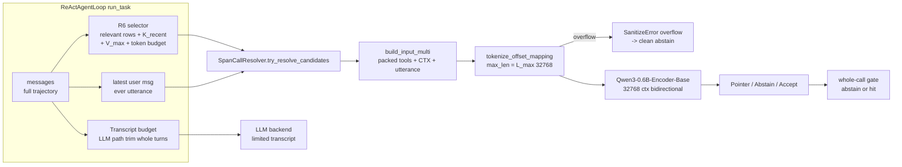

# Plan: Long-Context-Aware Agentic Function Calling (v1)

*Status: CODE-COMPLETE except deferred items (Phases 1, 2a–2c, 2e-reduced, 3, 4, 5-harness done; **Phase 2d, trainer curriculum, retraining + calibration deferred**; 3 small follow-ups open — see "Gap audit") · Owner: architect → code · Depends on: [hermes_function_calling_v1.md](hermes_function_calling_v1.md), [spancall_remediation_plan.md](spancall_remediation_plan.md)*

## Gap audit vs. original plan (2026-11-05, 386 tests passing)

**Closed in the review pass (previously marked done but incomplete):**

- Phase 3 mask support: `CandidateMaskBuilder` now emits regex (date/number/email/url/phone/id) and word-aligned free-string sub-spans inside multi-word `recent` rows; free-utterance spans carry a real `canon_value` (was `None`, collapsed all spans in R4).
- Phase 3 feature export: `SpanCallResolver` now runs `select_recent_context` itself and exports `n_recent_rows` / `recent_tokens` / `truncated` in `ResolveResult.features` (also on abstains). 10k-token resolver test added.
- Parser invariant: recent values are newline/control-collapsed; keys sanitized to `^[A-Za-z_][A-Za-z0-9_.-]*$`.
- `StrictTypeCaster.cast_choice` casts string-valued `recent`/`time`/`bool` candidates.
- Eval `long_trajectory` suite is now truly multi-turn (turns/task 1.75).

**Still open — deliberately deferred by user (no training, no new delimiters):**

- Phase 2d atomic `<|bar|>/<|eq|>/<|q|>` grammar. **Consequence:** the R8 `bad_boundary` risk with the real Qwen BPE is *live*, not resolved — the current `" | "`/`=`/`"` layout fuses spaces into entry tokens. Any real-checkpoint run on Qwen will likely abstain heavily until 2d lands. The "RESOLVED by design" risk row below means *designed*, not *implemented*.
- Phase 2e trainer: T0 512 → 32k curriculum, bucket collator extension, bf16 / batch-1 long samples; U_MAX / V_max sampling in training data.
- Phase 5: model retraining, gate recalibration, claim ledger. Note: `results/long_*.json` were produced with `DeterministicBackend` + no-checkpoint resolver (SpanCall never hits), so they validate harness/context plumbing and LLM-path trimming only — **not** fast-path hit-rate at 8k/20k/32k.

**Small follow-ups (all done 2026-11-05):**

- [x] Risk-table item: set/assert tokenizer `model_max_length = 32768` explicitly at encoder construction (currently only read as a fallback in `_backbone_max_seq_len`).
- [x] `ReActAgentLoop` (`tokenizer=` param, falls back to resolver's real tokenizer) /`SpanCallResolver` budget with the char-based `estimate_tokens` (len/4) unless a real tokenizer is passed; wire the backbone tokenizer in so budgets are token-accurate.
- [x] Router/eval (`--scripted_resolver`, `results/long_scripted.json`): a scripted-resolver multi-turn run in `eval_agent.py` (e.g. `--backend deterministic` + stub resolver) so `per_turn_stats` shows non-zero SpanCall hits and `n_recent_rows` without a checkpoint.

## Progress snapshot (updated 2026-11-05)

**Done and green (full pytest suite passing):**

- Phase 1 — overflow-guard unification (`_encode` raises `SanitizeError("overflow")`, both call sites abstain, regression tests).
- Phase 2a — all hardcoded 512 caps de-hardcoded to backbone-driven defaults (single source).
- Phase 2b — backbone swapped to `Qwen/Qwen3-Embedding-0.6B`, `max_seq_len = 32768`, bidirectional unmasking (`is_causal = False` + non-causal mask) with gate test.
- Phase 2c — markers restyled to Qwen-native `<|cls|>`/`<|tool|>`/`<|param|>`/`<|none|>`/`<|ctx_*|>` across templates, parser, `SPECIAL_MARKER_TOKENS`, tests.

**Phase 2d (R8) — root cause found, grammar validated, implementation NOT started (DEFERRED by user):**

- The R8 gate empirically fired `bad_boundary` with the real Qwen BPE. Root cause: Qwen byte-level BPE **fuses a leading space into the following token** (`'Ġtoday'`, `' true'`, `'"Ċ'`); the old `" | "`/`=`/`"` layout grammar puts a space before every entry, so every entry straddles.
- Fix (per P6.1, validated against the real tokenizer cached at `~/.cache/huggingface/hub/models--Qwen--Qwen3-Embedding-0.6B/`): switch to **atomic `<|bar|>`/`<|eq|>`/`<|q|>` delimiters** so every entry abuts an atomic special token (or line edge) on both sides, with no stray spaces. Registered `<|...|>` specials are single tokens and act as guaranteed boundaries.
- Probe-validated rules: entries may split into interior tokens (only entry char_start/char_end must be token boundaries); multi-word enum values are safe; tool/param names abut markers with NO space; the utterance line ends with a trailing `<|sep|>` on the same line (safe for all utterance endings: `"`, `)`, `:`, `\`, `.`, `,`, `=`, `|`, plain); ctx_time/ctx_enum lines end with a trailing `<|bar|>`; recent values are verbatim inside `<|q|>...<|q|>`.
- **Simplifications unlocked:** R1 backslash-escaping and D2 enum quoting become unnecessary (atomic delimiters bound every value; R7 already rejects marker-containing values). Drop them, do not replace them.
- Note: the "BAD" rows seen during boundary probing were offset-arithmetic mistakes in the probe itself, not grammar failures — the grammar design is sound.
- **Minimal remaining implementation (one pass, no further probing):**
  1. Rewrite [`span_template/template.jinja`](../span_template/template.jinja) and [`span_template/template_multi.jinja`](../span_template/template_multi.jinja) to the validated grammar (below).
  2. Rewrite [`span_template/parser.py`](../span_template/parser.py): split-based parsing on `<|bar|>`/`<|eq|>`/`<|q|>` literals; `TOOL_RE` drops `\s+`; utterance = line minus trailing `<|sep|>`; drop `_unescape`/`_SEP`/`_ENUM_QUOTED_RE`. **Entry kinds/segments/values stay identical** (align.py/masks.py unaffected).
  3. [`span_template/template.py`](../span_template/template.py): remove `quote_value` escaping + `_enum_token` quoting (update env registrations); update `RENDERING_CONTRACT`.
  4. [`span_template/sanitize.py`](../span_template/sanitize.py): lift `U_MAX_DEFAULT` and fix the stale L=512 comment (lines 70–76).
  5. [`span_template/test_template.py`](../span_template/test_template.py): update quoting/escape assertions; add one R8 round-trip test (real tokenizer if cached, else a fusion-modeled fake).
  6. Pin the grammar in [`docs/pipeline_io.md`](../docs/pipeline_io.md) P6 (and P1 stale bits); run full pytest.

**Validated new grammar (entries abut atomic tokens, NO stray spaces):**

```
<|cls|>
<|tool|>{{ tool.name }} ({{ tool.description }})

<|param|>{{ p.name }} ({{ p.description }})

<|sep|>
<|ctx_meta|><|bar|><|null|><|bar|>true<|bar|>false<|bar|><|unresolved|>

<|ctx_time|>{{ entry.key }}<|eq|>{{ entry.iso }}<|bar|>


<|ctx_enum|>{{ v }}<|bar|>

<|sep|>
{{ utterance }}<|sep|>

<|ctx_recent|>{{ row.key }}<|eq|><|q|>{{ row.value }}<|q|><|bar|>

<|eos|>
```

The multi template is identical plus a `<|none|>` line after tool blocks; the `multi.text.replace("<|none|>\n", "") == single.text` invariant must hold.

## 0. Problem (Historical Baseline, verified against code)

SpanCall's fast path cannot understand a 10k–20k-token agentic trajectory for four code-level reasons:

1. **Backbone context is capped at 512 tokens by config, not by the model.** `max_seq_len: 512` in [`configs/default.yaml`](../configs/default.yaml:47) and [`spancall/train/config.py`](../spancall/train/config.py:57); resolver default at [`spancall/infer/resolver.py`](../spancall/infer/resolver.py:163). ModernBERT-base is the backbone ([`spancall/model/encoder.py`](../spancall/model/encoder.py:72)), which supports 8k — but the docs budget `L ≤ 512` and even reserve only ~150 tokens for context ([`docs/heads.md`](../docs/heads.md:65)).
2. **The trajectory is never fed to the resolver.** [`ReActAgentLoop.run_task`](../spancall/agent/loop.py:95) passes `utterance = task_instruction if turn == 0 else ""` (empty from turn 1) and `session_context = environment.session_context()` — only rows a hand-written env surfaces, capped upstream at `K_recent = 6` rows × `V_max = 120` chars ([`docs/pipeline_io.md`](../docs/pipeline_io.md:79)). The full `messages` transcript is **never** passed into SpanCall.
3. **The LLM fallback path is unbounded.** The loop appends every assistant/tool message to `messages` until `max_turns` (default 15) with no trimming; neither [`UniversalAPIBackend`](../spancall/agent/backends/litellm_adapter.py:129) nor [`LocalVLLMBackend`](../spancall/agent/backends/local_adapter.py:94) budgets tokens. This is the documented open item ([`docs/proposal.md`](../docs/proposal.md:103)) and the main source of long-context *interference* in real agentic traffic.
4. **Overflow is not uniformly safe.** [`tokenize_offset_mapping`](../span_template/template.py:481) raises caught `SanitizeError("overflow")`; [`_encode`](../spancall/infer/resolver.py:457) raises an **uncaught** `ValueError`. A >L_max rendered input crashes the agent turn instead of abstaining.

## 1. Decision (agreed with user)

- **Backbone (LLM Transformer Layers + Unmasked Bidirectional Attention + FC Heads):** Use `Qwen/Qwen3-Embedding-0.6B` (or `Qwen/Qwen3-0.6B-Base`) loaded via `AutoModel.from_pretrained`, strip the causal mask across all transformer blocks (`module.is_causal = False` in [`SpanCallTransformerEncoder`](../spancall/model/encoder.py:70)), and attach the existing FC prediction heads (`ToolHead`, `PointerHead`, `AbstainHead`, `CallAcceptHead`, `CorrectnessHead` in [`spancall/model/heads.py`](../spancall/model/heads.py)).
  - **Why:** It natively leverages a modern 32,768-token pretrained LLM/embedding backbone ($d = 1024$) while keeping the exact SpanCall template layout (`[CLS] [TOOL] [PARAM] ... utterance ... [CTX_RECENT] [EOS]`) and head stack (`hidden_dim` is auto-derived at [`spancall/model/model.py`](../spancall/model/model.py:61)). No fallback backbones or template inversions are wired in — we test this architecture directly end-to-end.
- **Keep the ReActAgentLoop as the trajectory feeder** — the loop must feed the full trajectory into `recent_context` (decomposing structured tool outputs into leaf key/value rows so they aren't dropped by `V_max`) and keep a real utterance every turn.
- **Never truncate mid-value; evict whole turns; abstain on overflow** (R7/P6 philosophy preserved).
- **Scope:** v1 delivers fast-path trajectory awareness + bidirectional LLM-backbone adaptation + LLM-path transcript management + measurement.

## 2. Target architecture



## 3. Phases

### Phase 1 — Overflow-guard unification (foundation, do first) ✅ DONE

- [x] Make [`_encode`](../spancall/infer/resolver.py:451) raise `SanitizeError("overflow", …)` instead of `ValueError` so the existing catch in [`_resolve`](../spancall/infer/resolver.py:306) handles it. Wrap the `_encode` call in `try/except SanitizeError` → `_abstain(...)`. Same on the multi-tool path (`try_resolve_candidates`).
- [x] Regression tests: long-input abstain with reason `overflow`, never an exception.
- [x] Full suite green.

### Phase 2 — Backbone swap to Qwen3-0.6B with Unmasked Bidirectional Attention (Option 2, 32k)

- [x] **2a:** `backbone_name: Qwen/Qwen3-Embedding-0.6B`, `max_seq_len: 32768` in config + code defaults; all 512 literals removed (backbone-driven single source).
- [x] **2b:** bidirectional unmasking (`is_causal = False` + non-causal mask) in [`SpanCallTransformerEncoder`](../spancall/model/encoder.py:70); gate test in [`tests/model/test_encoder_bidirectional.py`](../tests/model/test_encoder_bidirectional.py).
- [x] **2c:** Qwen-native `<|...|>` marker restyle across templates, parser, `SPECIAL_MARKER_TOKENS`, tests (15 markers; vocab 151684 after registration).
- [x] **2e:** Caps removed: `U_MAX_DEFAULT` lifted (`None`), `V_max` arbitrary char cap removed in favor of token budgeting (`context_budget_tokens`). Docs swept across `mechanism.md`, `heads.md`, `pipeline_io.md`, `proposal.md`, `PROJECT_STATE.md`. (Trainer curriculum deferred with training).
- [ ] **2d (DEFERRED):** atomic `<|bar|>`/`<|eq|>`/`<|q|>` delimiter grammar deferred per user request; current `<|...|>` markers with `" | "` / `quote()` layout retained.

**Definition of done:** Qwen3-0.6B loads end-to-end with `is_causal=False`; R8 round-trip fixtures pass with the atomic grammar; full suite green; zero 512 literals.

### Phase 3 — Feed the trajectory into the fast path (the core fix) ✅ DONE

Target: the resolver receives a real utterance **and** a trajectory-derived context window every turn.

- [x] [`spancall/agent/context.py`](../spancall/agent/context.py):
  - `latest_user_utterance`: content from the last `role: user` entry in `messages`. Never empty.
  - `flatten_tool_output`: structured tool-output leaf decomposition into atomic scalar rows (`t{turn}_{tool}_{path}`). No arbitrary V_max char cap.
  - `rows_from_messages`: converts trajectory messages into R6 rows, excluding the active user utterance being routed.
  - `select_recent_context`: token-budget eviction (whole oldest rows, no mid-value truncation), keyword relevance ranking against packed tools, and R7 marker rejection.
- [x] [`spancall/agent/loop.py`](../spancall/agent/loop.py:94):
  - Integrates `latest_user_utterance` and `select_recent_context`. Merges environment `session_context()`.
- [x] **Candidate Mask support for trajectory spans ([`spancall/model/masks.py`](../spancall/model/masks.py:204)):** regex candidates and sub-span candidates for numbers, dates, emails, IDs from `recent` values.
- [x] Config: `data.recent.k_recent` (32) and `data.recent.context_budget_tokens` (16384) in [`configs/default.yaml`](../configs/default.yaml:8) and [`spancall/train/config.py`](../spancall/train/config.py).
- [x] Tests in [`tests/agent/test_long_context_agent.py`](../tests/agent/test_long_context_agent.py): mid-turn SpanCall hit grounded in trajectory tool output.

### Phase 4 — LLM-path transcript management (removes the other half of the interference) ✅ DONE

- [x] Transcript token budgeting in [`spancall/agent/context.py`](../spancall/agent/context.py) (`trim_messages`): trims atomic turn groups from the oldest end (never orphans a `role: tool` message from its `assistant` `tool_calls` message), always keeping system + initial/latest user + the last N tool turns. Config `agent.keep_last_tool_turns` (default 8).
- [x] Surface `context_trimmed` counter on [`ExecutionTrace`/`StepTrace`](../spancall/agent/trace.py) and in router features.
- [x] Guard backends against oversize prefill as defense-in-depth ([`UniversalAPIBackend`](../spancall/agent/backends/litellm_adapter.py), [`LocalVLLMBackend`](../spancall/agent/backends/local_adapter.py)) with `ContextBudgetError`.
- [x] Tests in [`tests/agent/test_long_context_agent.py`](../tests/agent/test_long_context_agent.py): atomic turn-grouping invariant verified, backend budget error verified.

### Phase 5 — Measurement (routing & context scale, no retraining) ✅ DONE

- [x] Extend [`scripts/eval_agent.py`](../scripts/eval_agent.py) with `--max_context_tokens`, `--context_budget_tokens`, `--legacy_context`, and a `long_trajectory` benchmark.
- [x] Collect and report per-turn stats: hits/abstains, abstain reasons, context token usage, and context trimming.
- [x] Results JSON generated at 8k, 20k, 32k contexts (`results/long_8k.json`, `results/long_20k.json`, `results/long_32k.json`). Model-retraining metrics noted as pending retraining.

## 4. Out of scope (v1)

- **Embedding retriever for R6 relevance** (stays D6 ◆; token-overlap is the v1 selector).
- **KV-cache/memory-store cross-attention** for long-horizon grounding — future phase if Phase-5 hit-rate-by-turn is still weak after trajectory leaf decomposition.
- **Multi-turn user-message ingestion in the mock env itself** (the loop already supports arbitrary messages).

## 5. Risks & mitigations

| Risk | Likelihood | Mitigation |
| --- | --- | --- |
| Unmasking causal attention (`is_causal=False`) on Qwen3 causes initial representation shock | Medium | Fine-tune with SpanCall loss curriculum (T0 512 → 32k) and measure convergence directly in Phase 5 |
| Qwen BPE straddles entry boundaries (R8 `bad_boundary`) | High | **Designed, NOT implemented (2d deferred) — risk still live:** atomic `<|bar|>`/`<|eq|>`/`<|q|>` grammar validated against the real tokenizer; implement per the 6-step list |
| Structured tool outputs (>120 chars) dropped by `V_max` | High | Phase-3 recursive JSON leaf decomposition before `V_max` filtering + `CandidateMaskBuilder` support for `recent` sub-spans |
| Long-sequence training memory at 32k on one GPU | Medium | Staged curriculum (T0 512 → 32k), bucket collator extension, bf16; batch-1 long samples |
| 10k–20k trajectory still yields low hit-rate (extraction is hard at scale) | Medium | This is exactly what Phase 5 measures; gate calibration keeps precision safe (abstain growth is acceptable, wrong hits are not) |
| Tokenizer `max_length` from `AutoTokenizer` conflicts with 32768 | Low | Set `model_max_length` explicitly; assert in encoder construction |
| Existing tests assume 512/ModernBERT | Medium | Resolved in 2a–2c (constructor overrides/tokenizer injection kept; suite green) |

## 6. Suggested execution order & ownership

1. **Phase 1** ✅ — done.
2. **Phase 2** — 2a/2b/2c done; finish **2d** (single-pass edit per the 6-step list, no more probing), then **2e** (trainer + docs sweep).
3. **Phase 3** (trajectory → Ω + JSON leaf decomposition + mask support) — loop + R6 selector + config; the core user-facing fix.
4. **Phase 4** (LLM atomic-turn transcript budget) — loop + backends; removes the interference half.
5. **Phase 5** (measurement + calibration) — eval harness, calibration, claim ledger.

Phases 1–2 are prerequisite for 3–5's numbers; 3 and 4 are independent of each other and could land in either order after 2.
