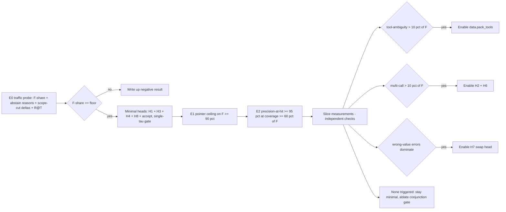

# SpanCall Remediation Plan — Simplify the Periphery, Measure the Premise

Source: design review debate (docs read: proposal, architecture, mechanism, pipeline_io, heads, experiments, plus `span_template/` reference implementation).

## Problems being solved

| # | Problem | Class |
| --- | --- | --- |
| P1 | "tomorrow" is a flagship example in proposal/mechanism but pipeline_io §P3 marks it **not targetable** — an internal contradiction in the single-source-of-truth docs | coverage / spec drift |
| P2 | Time window covers only `today`, `+1d/+3d/+7d`, `this_<dow>/next_<dow>` — common idioms (`day after tomorrow`, `tonight`) abstain | too simple |
| P3 | R5 rejects any enum value with whitespace/`|` — multi-word enums (`Premium Economy`, `Business Class`) crash at ingestion | too simple |
| P4 | No timezone anchoring — `today` can emit the wrong date with high confidence at day boundaries | correctness |
| P5 | H1–H8 heads + 8-feature conjunction gate ship before the E1/E2 experiment that would justify them | too complicated |
| P6 | Multi-tool packing (T=4, J=3) ships before its precondition slice (multi-call > ~10% of F) is measured | too complicated |
| P7 | Schema selection out of scope, yet the 10× cost claim's `c_s` ignores it | economics |
| P8 | The 80% stratum-F premise is unmeasured; no Phase-0 traffic probe before 6 weeks of machinery | evidence |

## Decisions

1. **Expanded but still closed date-idiom table** — the window builder gains a deterministic idiom map: `tomorrow→+1d`, `day_after_tomorrow→+2d` (adds `+2d`), `tonight→today` (date params only). `next_week` and `this_weekend` are **excluded** (range/anchor ambiguity → would emit confidently wrong values; they stay off-window until explicitly defined and tested). "Off-window" is redefined to mean *"no canonical entry covers it"* (`the 15th`, `Q1 2027`, `in 3 months`); paraphrase matching to existing entries remains a learned behavior (mechanism §3). Docs fixed to match.
2. **Quoted multi-word enums** — `[CTX_ENUM]` entries may carry R1-style quoting: `"Premium Economy" | BUSINESS`. `|` remains forbidden (even quoted — decided); whitespace is allowed inside quotes; `\"` and `\\` are the escapes. `validate_enums` round-trips emit→parse; parser and template updated; R5 doc updated.
3. **Timezone as input contract** — `build_time_window` and the router take the **user-local date** (caller computes it from the tenant `clock.timezone`); template API's existing `now: date` parameter stays deterministic. Config gains `clock.timezone`. Per-session override is free (caller passes a different `now`). Unknown tz ⇒ **abstain on date params** (no server-local fallback). Tests for day-boundary and DST.
4. **Minimal-head v1** — config `model.heads` defaults to `{tool: true, count: false, pointer: true, abstain_reason: true, source: false, list_size: false, swap: false, correctness: true}` (H1+H3+H4+H8 + accept; H1 is a no-op with a single tool). Baseline gate = **single calibrated τ over `min_k p_k` and the accept head** + schema validation. Conjunction gate and H2/H5/H6/H7 stay `spec-only` behind the config, enabled only when their slice measurement or ablation (H-A2…H-A8) justifies them.
5. **Opt-in packing** — `data.pack_tools` default `1` (single-tool form). `build_input_multi` remains, used only when the **tool-ambiguity** slice of traffic > ~10% of F (H-A6 gate); the multi-call slice instead gates H2 + H6. T=4/J=3 machinery deferred.
6. **Schema-selection contract** — §9 made explicit: v1 deployments are context-determined (single fixed tool) **or** an embedding retriever with **measured R@T reported** (provisional min 0.95, else folded into `h`) as part of the cost model (`c_s` includes retrieval). The 10× claim's cost table must show the schema-selection input.
7. **E0 traffic probe before machinery** — `scripts/probe.py` + config `probe:` section + experiment **E0** replaces "six weeks then shadow mode". Outputs: F-share, abstain-reason mix, per-scope-cut coverage loss (drop idioms / multi-word enums / anaphora / recent context) and retriever R@T on 2–3 representative workloads. Decision gate: F-share is only an upper bound on `h`, so the floor is derived from the cost model, `F_floor = h_min / 0.6` (`h_min` = hit rate giving ≥ 5×); default 0.5 is provisional until computed. Below floor — stop and write up. E0 runs after steps 1–3 (flag-gated baseline arm for scope-cut deltas) and needs only `span_template/` + sanitizer, not `gate.py`.

## Work breakdown (execution order)

1. **[P4, P1, P2] Time window**: extend [`build_time_window`](span_template/template.py:169) + `_weekday` with the idiom map and `+2d`; add `clock.timezone` to [`configs/default.yaml`](configs/default.yaml:1) and a `local_today(tz)` helper; add boundary/DST/tomorrow tests in [`test_template.py`](span_template/test_template.py:197); fix the "off-window" wording in [`pipeline_io.md`](docs/pipeline_io.md:75) and the mechanism worked example ([`mechanism.md`](docs/mechanism.md:307)) stays a *hit* by explicit entry.
2. **[P3] Quoted enums**: relax [`validate_enums`](span_template/template.py:207) (reject only `|` and unquoted whitespace); emit quoted values in `template.jinja`/`template_multi.jinja`; extend [`parser.py`](span_template/parser.py:38) `ENUM_BODY_RE` to parse quoted tokens; add fixtures (`Premium Economy`, `"A | B"` rejected).
3. **[P8] Probe tooling**: add `scripts/probe.py` + `probe:` config section; render existing template over a sample (hand-labeled 1–2k calls per workload); emit F/A split, abstain-reason histogram, per-scope-cut delta, retriever R@T; add E0 to [`experiments.md`](docs/experiments.md:1).
4. **[P5, P6] Scope-lock config**: add `model.heads`, `gate.mode: single_tau | conjunction`, `data.pack_tools` to [`configs/default.yaml`](configs/default.yaml:23) and [`spancall/train/config.py`](spancall/train/config.py:1); gate `build_input_multi` and H2/H5/H6/H7 behind config; baseline gate in [`spancall/infer/gate.py`](spancall/infer/gate.py:1) = single-τ + accept + validate.
5. **[P7] Schema-selection contract**: document v1 options and R@T-as-metric in [`mechanism.md`](docs/mechanism.md:260) §9; wire R@T output into the probe and E8.
6. **[all] Docs + roadmap**: update proposal §3.1.1 (R4/R5 wording), pipeline_io P3/P4/P6, heads §1/§2/§8 (spec-only status), architecture §11 roadmap (Phase 0 = E0 probe; Phase 1 = minimal heads + E1/E2; head expansions gated behind slice measurements).

## Open questions for the user

- Q1: Which 2–3 workloads should the E0 probe sample (booking / CRM / IoT / search)?
- Q2: `h_min` for the E0 floor — what hit rate gives ≥ 5× under the chosen schema-selection mode? (Provisional floor 0.5.)
- Q3: Tenant-default `clock.timezone` source (per-session override already allowed via caller-supplied `now`).