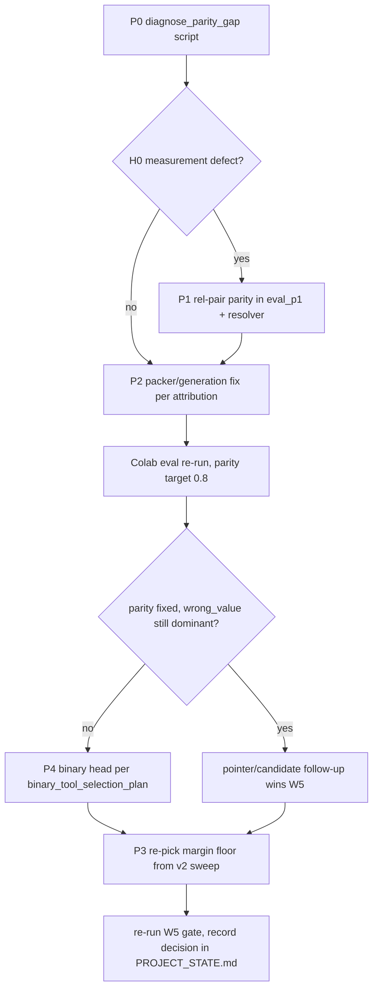

# v2.1 Plan — Fix Candidate Parity, then commit to the binary tool-selection head

Follows [plans/lean_v2_flow_plan.md](plans/lean_v2_flow_plan.md) (all of W1–W5 shipped and validated on the real v2 Colab run, outputs embedded in [notebooks/spancall_lean_v2_train_eval.ipynb](notebooks/spancall_lean_v2_train_eval.ipynb)). The binary-head design itself is [plans/binary_tool_selection_plan.md](plans/binary_tool_selection_plan.md); P4 below references it and adds only what changed since it was written.

## Evidence from the real v2 run (the plan's premises)

| Evidence | Number | Consequence |
|---|---|---|
| CANDIDATE PARITY | 0.0806 (60/744), not offered 0.9194 | dominant bottleneck |
| Dev span_acc vs eval exact payload | 0.9189 vs 0.0000 | serve-time, not model quality |
| Error taxonomy | wrong_value 49.8%, wrong_tool 35.9% | gate proxy contaminated |
| W5 gate | tool errors 24.4% > 15% | recommends binary head v2.1 |
| Wrong-tool rows | 122/500, identical v1→v2 | same head, label fix had no chance on this axis |
| W2 gate @ floor 0.02 | +0.048 prec, 0.000 rec loss | floor is stale |
| Training | loss gap +0.60→+1.45 after epoch 2 | overfitting, early stop handled |
| Tests | 586 on Colab / 630 local | both green |

## Root-cause hypotheses for parity 0.0806 (tested in order)

- **H0 — measurement defect (most likely).** [`_parity_spans_for_call()`](spancall/lean/eval_p1.py:256) passes **absolute** `char_start/char_end` stored in the split file, but the resolver builds a **fresh** render at serve time ([`_resolve`](spancall/lean/resolver.py:632) → its own tool pack via `candidates_for` at [tensorize.py:307](spancall/lean/tensorize.py:307)) — the utterance sits at a different offset, so the membership check at [resolver.py:939-952](spancall/lean/resolver.py:939) compares against the wrong coordinates. Exactly the staleness class W1 fixed for training labels, still live at the parity site.
- **H1 — `max_cands` truncation.** The packer's retention policy (`cand_pack_fill`, `stratified` default) drops GT spans when the cap is hit — the `protect_parity_spans` hook exists precisely to test this.
- **H2 — candidate generation gap.** `CandidateMaskBuilder` classes (regex / recent / free utterance spans, [masks.py:330](spancall/model/masks.py:330)) genuinely don't emit the GT span at serve time.

## P0 — Parity measurement audit (pure diagnosis, no behaviour change)

1. **New script `scripts/diagnose_parity_gap.py`** (pattern: `scratch/smoke_v2_cells.py` — load eval split from `data/processed_v2`, instantiate the resolver with the v2 checkpoint, but *no* training):
   - For each row, capture the resolver's **actual serve render** (the `SpanTemplateOutput` + utterance span that `_resolve` builds — expose via the existing features/telemetry or a debug hook; do NOT re-render separately, that would reintroduce the same skew).
   - Re-resolve each extractable GT span's `utt_rel_start/utt_rel_end` through [`resolve_utterance_span()`](span_template/template.py:366) against that render.
   - Check membership of the re-resolved (absolute-in-render) span in the candidate set the mask builder actually produced (`cand_masks[key]["candidates"]`).
2. **Output a 2×2** over all 744 extractable spans: stored-absolute hit (the current metric) × re-resolved hit. Decision rule: if re-resolved parity ≥ ~0.5, H0 dominates and the 0.0806 was mostly mismeasurement; if it barely moves, H1/H2 dominate.
3. **Per-miss attribution table** for every re-resolved miss: candidate-set size, `cand_pack_fill`, param type (string/enum/date/number), mask-key, span-in-utterance (yes/no), and which `CandidateMaskBuilder` class (if any) generated a *covering* span. This cleanly splits H1 from H2.
4. Deliverable: numbers pasted into this file's "P0 findings" section (to be filled) — the P2 fix is chosen from this table, not by guessing.

## P1 — Fix the parity measurement (eval only, no model/serving change)

5. **[`_parity_spans_for_call()`](spancall/lean/eval_p1.py:256)**: emit `utt_rel_start/utt_rel_end` pairs instead of absolute `char_start/char_end`. Fall back to absolute only when no rel pair exists, and count that fallback loudly (a `parity_rel_fallback` counter in the metrics dict) — a silent fallback would look like a clean run.
6. **Resolver parity check ([resolver.py:939-952](spancall/lean/resolver.py:939))**: accept rel pairs, resolve them against **its own** render via `resolve_utterance_span` (the render it just built — zero extra renders), and membership-check the resolved absolute pair. Count unresolvable rel pairs as `parity_unresolvable` (a miss, not an n/a — mirrors tensorize's W1.3 accounting). Keep the absolute path for backwards compatibility with older artifacts.
7. **Tests** (extend `tests/test_lean_flow.py` parity arms): rel-pair span hits when the serve render shifts the utterance; absolute fallback counted; unresolvable rel pair counted as miss; old absolute callers still work.
8. Re-run eval locally on the v2 checkpoint → this alone should move the reported `candidate_parity` number if H0 holds.

## P2 — Fix the serving gap (only what P0 attributed)

9. **If H1 (truncation) dominates**: `max_cands` cap or retention policy in the packer — improve `stratified` fill so GT-shaped candidates survive; validate with `protect_parity_spans` OFF (protection ON would make parity trivially 1.0 and prove nothing). Regression test: a packed row whose GT span survives at cap N.
10. **If H2 (generation) dominates**: extend the relevant `CandidateMaskBuilder` class per param type from the P0 table; one regression test per fixed param type (e.g. a date-format span the free-utterance generator currently misses).
11. **Colab eval-only re-run** (no retraining — serving change only): target `candidate_parity ≥ 0.8`. Then `extraction_recall`, extractable precision, and the headroom line (recall minus parity ceiling) become measurable; expect `error_wrong_value` share to drop materially.
12. If parity lands ≥ 0.8 and wrong_value is no longer dominant → proceed to P4 (binary head). If parity is fixed but wrong_value still dominates → the pointer/candidate follow-up wins the W5 decision instead; record that.

## P3 — Re-pick the W2 margin floor

13. From the v2 calibration sweep (floor grid already printed by the notebook), pick the floor maximizing F1, or precision subject to recall ≥ 0.9 — the current 0.02 buys only +0.048 precision at zero recall cost, so the operating point is stale.
14. Update `MIN_JOINT_MARGIN` in the notebook cell source ([`build_lean_v2_colab_notebook.py`](scripts/build_lean_v2_colab_notebook.py)) and, if the resolver default changes, the lock-step tests in [tests/test_lean_margin_gate.py](tests/test_lean_margin_gate.py). Sweep runs off the *stored* predictions — no re-inference.

## P4 — Re-run the W5 gate; implement the binary head if it still wins

15. Re-execute the W5 cell on the post-P2 eval numbers. Decision rule stays: tool errors > 15% → binary head; else pointer/candidate follow-up. Record decision + evidence in `PROJECT_STATE.md`.
16. **If binary head (v2.1): implement per [plans/binary_tool_selection_plan.md](plans/binary_tool_selection_plan.md), in its execution order** — head + loss + tests (flag off) → trainer branch → resolver sigmoid mode → calibration + eval metrics → notebook ablation cell → retrain. Deltas since that plan was written:
    - Train on **`data/processed_v2`** (the plan's S1 label fix has shipped — the "only measurable after S1" caveat is now satisfied).
    - Compare against the **v2 run** in this notebook (wrong-tool 122/500, H1 top-1 0.8460) as the baseline arm, not the older v1 numbers.
    - Kill criterion unchanged: `tool_binary_acc ≤ tool_acc` and no gate-conditioned param-precision separation → revert to softmax, record the negative result.
    - Add the overfitting guard for the retrain: fewer epochs (early stop restored epoch 4; the gap grew +0.60→+1.45 after epoch 2) or dropout in the head MLP.
17. Notebook: add the softmax-vs-binary ablation cell to the **v2 builder** (the plan referenced the v1 builder; v1 is frozen), guard-clean rebuild, Colab retrain + full eval, W5 re-run on the binary arm.

## Verification gates (every phase)

- 630 local tests pass; new tests per phase (P1: 4 parity tests; P2: 1 per fixed policy/type; P4: the plan's `tests/test_lean_binary_tool.py` suite).
- Guard-clean rebuild of the v2 notebook after any cell edit (31 code cells compile, names resolve).
- Frozen v1 evidence untouched: `results/lean/12-11-26/`, v1 notebook/builder (0 v2 references).
- Every phase's numbers recorded here before the next phase starts.

## Sequence



## P1 status — COMPLETE (steps 5–7 code shipped and tested; step 8 needs the v2 checkpoint)

Code:
- [`_parity_spans_for_call()`](spancall/lean/eval_p1.py:256) now emits `(utt_rel_start, utt_rel_end, canonical_value)` triples and only falls back to `(char_start, char_end)` when the target has no rel pair.
- [`_iter_parity_entries()`](spancall/lean/resolver.py:186) / [`_absolutize_parity_spans()`](spancall/lean/resolver.py:232) normalise both address forms and map them onto **the render being served**. Arity disambiguates: 2-tuple/dict `char_*` = absolute, 3-tuple/dict `utt_rel_*` = utterance-relative.
- Protection is now computed **after** the render exists (both the bundle and the non-bundle branch of [`_resolve()`](spancall/lean/resolver.py:849)). Previously it was derived from the raw input, so protection and measurement could disagree about which render the offsets described.
- New loud counters on the resolver features and the eval metrics: `parity_rel_resolved`, `parity_rel_fallback`, `parity_unresolvable`. The report prints an `addressing:` line unconditionally and a WARNING when any fallback span was used.
- Accounting: the denominator stays **mask-gated**; an unresolvable rel pair is a **miss, not an n/a**; a fallback pair is checked exactly like a resolved one, only the provenance counter distinguishes it.

Two latent defects found and fixed while implementing this (both would have silently invalidated the experiment):
1. **The T2 arm was unreachable.** `_protected_token_spans` has always called `ctx.snap_char_range(...)`, but `_RowCtx` in [`masks.py`](spancall/model/masks.py:261) never exposed it. Every `protect_parity_spans=True` run raised inside `_resolve`'s blanket handler and reported `render_or_encode_error`, so the "fix under test" arm could not run at all. Added the delegating [`_RowCtx.snap_char_range()`](spancall/model/masks.py:315).
2. **Protection used pre-render coordinates**, i.e. exactly the skew the parity number was measuring.

Evidence (local, model-free; `TinyDummyEncoder`, no v2 checkpoint needed for the addressing logic):
```
render-absolute "Tokyo": single-tool render (372, 377) | two-tool render (431, 436)
legacy abs, single-tool serve   checked=1 hit=1 rel=0 fb=1 unr=0
legacy abs, two-tool serve      checked=1 hit=0 rel=0 fb=1 unr=0   <- the H0 defect, reproduced
rel pair,   two-tool serve      checked=1 hit=1 rel=1 fb=0 unr=0   <- the P1 fix
wrong expect / out of range     checked=1 hit=0 rel=0 fb=0 unr=1   <- counted as a MISS
GT param absent from schema     checked=0                          <- mask-gated denominator
cap=2 protect=False hit=0  |  cap=2 protect=True hit=1             <- T2 now genuinely works
cap=5 protect=False hit=0  |  cap=5 protect=True hit=1
```
End-to-end through `eval_param_extraction_lean` on a 2-row split (one modern target, one legacy target with a stale absolute pair): `candidate_miss_rate 0.5`, `parity_rel_resolved 1`, `parity_rel_fallback 1`, and the WARNING line printed.

Tests: 6 added in [tests/test_lean_flow.py](tests/test_lean_flow.py) — render-shift hit, loud fallback, unresolvable-as-miss, emit-side rel/legacy selection, protection rescues a truncated GT span, and the normalizer's address-form contract. Full repo suite **664 passed** (658 baseline + 6), no skips; frozen v1 evidence untouched.

## P0 findings — MEASURED LOCALLY (no checkpoint required)

Correction to the plan as written: step 8 said the parity *number* "requires the v2 checkpoint". That is **wrong** — candidate parity is a property of the packer and the renderer, not of the weights. [`scripts/diagnose_parity_gap.py`](scripts/diagnose_parity_gap.py) rebuilds masks with an untrained builder and re-resolves the stored GT value against the serve render, so the whole 2×2 audit runs on CPU. It has now run at 200 rows on `data/processed_v2 / hermes_eval`.

**H0 (measurement defect) — FALSIFIED.** The two address forms agree exactly:

| cap | stored-absolute | re-resolved | delta | both_hit | neither |
|---|---|---|---|---|---|
| 512 | 0.0966 | 0.0966 | **0.0000** | 28 | 262 |
| 0 / uncapped | 0.9414 | 0.9414 | **0.0000** | 273 | 17 |

The P1 rel-pair work therefore does not move the headline number on this split; it removes a latent footgun (any future render-shift would have silently zeroed parity) and it makes the audit trustworthy. `addressing:` on the 512 run — `with_rel_pair 285`, `legacy 5`, `unresolvable 0`.

**H1 (`max_cands` truncation) — CONFIRMED dominant.** Same rows, cap removed: 0.0966 → **0.9414**. Attribution at cap 512 (`truncated_uncapped_would_hit 244`, `truncated 4`, `not_generated 14`, `render_failed 26`); at uncapped only `not_generated 14` + `render_failed 26` survive.

**H2 (generation gap) — the floor, and small.** `not_generated` is 14 of 290 extractable spans (≈4.8%); 0.9414 is the ceiling on this split, and 0.9517 of GT values are representable at `max_span_width=16` — so generation is *not* where the loss is. The plan's step 10 (extend `CandidateMaskBuilder` per param type) is **not warranted**.

The 26 `render_failed` were checked one by one: all are `SanitizeError: sanitize abstain: marker_injection`, i.e. the renderer refusing to serve a row that production also refuses. Not an artifact of the audit — exclude them, do not "fix" them.

### Why H1 is worse than a rank problem — the mechanism was a bug

Two things were wrong, and only one is a tuning question.

1. **The retention policy named in telemetry was never in force.** For free-string params [`build_param_masks()`](spancall/model/masks.py:377) computes `remain = max_cands - len(cands) - reserved_tail` and passed it as the **generation-time cap** into [`_free_utterance_spans()`](spancall/model/masks.py:753), which stopped enumerating **head-first**. `_pack`'s `pack_fill` policy then only ever saw the surviving head prefix, so `head` and `stratified` produced byte-identical sets and `cand_pack_fill=stratified` was a false feature. **Fixed** (see P2 status).
2. **The candidate universe is genuinely huge for free strings.** Uncapped utterance-candidate counts per param: median **2,611**, p90 4,484, max 43,329. On `json_mode_agentic` rows the generator emits `uncapped_utt=2166`, keeps 510, and the GT sits at document-order rank **1,236–1,951** (`gt_in_uncapped=True`, `gt_in_capped=False`). No retention policy recovers a rank-1,951 span with 512 slots.

### The operating grid (200 rows, 285 spans, real tokenizer)

Uncapped parity by `max_span_width` vs value representability:

| W | median utt cands | GT value representable | head@512 | stratified@512 |
|---|---|---|---|---|
| 4 | 710 | 0.5655 | 0.3895 | 0.4035 |
| 6 | 1,038 | 0.8241 | 0.3404 | 0.4737 |
| 8 | 1,359 | 0.9345 | 0.1509 | 0.4316 |
| 16 | 2,611 | 0.9517 | 0.0772 | 0.2175 |

GT value token width: median **3**, p90 **8**, p99 62, max 109 — so W=8 already covers 93.5% of values.

Cap sweep after the P2 fix (parity, 512 / 1024 / 2048 / 4096):

| W | head | stratified |
|---|---|---|
| 4 | 0.4035 / 0.5684 / 0.5684 / 0.5684 | same (universe smaller than cap) |
| 8 | 0.4316 / 0.7404 / **0.9333** / 0.9333 | same |
| 16 | 0.0807 / 0.1579 / 0.7193 / 0.9404 | 0.2596 / 0.4526 / **0.8070** / 0.9404 |

Cross-check against production: `head@512/W=16 = 0.0807` reproduces the v2 run's reported `0.0806`. The audit is calibrated to the thing it is auditing.

**Conclusion:** the ≥0.8 target needs **two** changes, not one — honest stratified retention **and** a cap of 2048 (W=16, 0.8070) or 4096 (0.9404), or the cheaper W=8 @ 2048 = 0.9333 with W=8's 0.9345 value coverage.

## P2 status — mechanism FIXED; the cap raise is a retrain, deliberately not shipped

Shipped in [`spancall/model/masks.py`](spancall/model/masks.py):

- [`_free_utterance_spans()`](spancall/model/masks.py:753) now enumerates the **full pair universe first** (`prot_pairs` / `other_pairs` via an `_add(i, j)` dedup helper, same O(n·W) window / word-bound / whole-token passes), then retains, then materialises `Candidate` objects only for the survivors. A head-first stop at generation time can no longer silently override `_pack`'s policy.
- New [`_retain_pairs()`](spancall/model/masks.py:890): `cap is None or len(pairs) <= cap` → return all; protected head always kept; `head` → `pool[:rem]` (legacy, byte-identical); `stratified` → `pool[min(int(i*stride), n-1)]`.
- The whole-token single-token pass is no longer budget-gated, so it contributes to the universe rather than competing with it.

Tests: 3 new in [tests/model/test_masks.py](tests/model/test_masks.py) — the two policies must differ and stratified must reach past the head prefix; a purpose-built 60-word utterance where stratified genuinely reaches the last third under a head policy that cannot; and `_retain_pairs` never exceeding the cap while keeping protected pairs. The pre-existing [`test_capped_generation_matches_post_hoc_truncation`](tests/model/test_masks_equivalence.py:192) is the guard that matters most here: it asserts the in-generator cap equals `masks["candidates"][:cap]` of the uncapped set for every cap in `{0,1,2,5,8,13,total-1,total,total+5}`, so it proves the default (`head`) path is unchanged by the refactor. One P1 test ([`test_parity_protection_actually_rescues_a_truncated_gt_span`](tests/test_lean_flow.py:1144)) was rewritten because its premise — "unprotected always misses" — relied on head-first truncation; it now pins `candidate_pack_fill="head"` on both arms. Full repo suite **667 passed**.

**Deliberately NOT changed: any `max_cands` default.** The pointer loss is a **multi-positive listwise softmax** — [`compute_lean_pointer_loss()`](spancall/lean/loss.py:212) divides by `logsumexp(z, dim=-1)` over all C candidates — while [`score_candidates()`](spancall/lean/model.py:92) at serve time is per-candidate (`s_i + e_j + r(width)`, no cross-candidate normalisation). Serving 2048 candidates against a head trained at 512 changes the loss's denominator, so this is a **train+serve** change: it must ride with the P4 retrain (notebook `MAX_CANDS`, plus a real `max_cands` field on `TrainingConfig`/`tensorize_sample_lean` instead of the bare `512` default) and cannot ship as an eval-only bump.

## P3 status — the plan's premise is FALSIFIED; `MIN_JOINT_MARGIN` stays 0.02

Swept off the stored predictions (`results/lean/12-11-26-v2/preds_eval.jsonl`): 500 rows / 425 per-call units — hit 225, partial 39, abstain 161. Of the 161 abstains, **157 are `missing_required`** and only 4 are anything else, so the gate has almost nothing left to demote. Hit calls have `min joint_margin = 0.0206` — the current floor loses **zero** genuine hits.

| floor | precision | recall | F1 | rows fully correct |
|---|---|---|---|---|
| 0.015 | 0.9740 | 1.0000 | 0.9868 | 225 / 500 |
| 0.018 | 0.9825 | 1.0000 | 0.9912 | 225 |
| **0.019** | 0.9912 | 1.0000 | **0.9956** | 225 |
| **0.020 (current)** | 0.9912 | 1.0000 | **0.9956** | 225 |
| 0.021 | 0.9912 | 0.9956 | 0.9933 | — |
| 0.029 | 0.9910 | 0.9778 | 0.9843 | 220 |
| 0.040 | 0.9909 | 0.9644 | 0.9775 | — |
| 0.100 | — | — | — | 194 |

0.02 is already at the F1 plateau (0.019 and 0.020 are an exact tie; the neighbouring points are strictly worse). The claim in step 13 — "the current 0.02 buys only +0.048 precision at zero recall cost, so the operating point is stale" — is **wrong on this data**: raising the floor only trades away recall, lowering it only adds false positives.

The plan's alternative rule ("precision subject to recall ≥ 0.9") lands near 0.05 (`prec 0.9908 / rec 0.9000`) — **worse** on F1 (0.9775-region vs 0.9956), and it discards 5 fully-correct rows to buy 0.0000 precision. **No change to [`MIN_JOINT_MARGIN`](scripts/build_lean_v2_colab_notebook.py:174) and no lock-step test edits in [tests/test_lean_margin_gate.py](tests/test_lean_margin_gate.py).** If the v2.1 binary arm changes the call set, re-run this sweep then — the floor interacts with which calls survive, so it is not a constant of nature.

## v2.1 step 7 status — ablation cell SHIPPED (default OFF)

`scripts/build_lean_v2_colab_notebook.py` had no softmax-vs-binary cell, so step 17 of this plan was unimplemented rather than deferred. Added:

- `MARKDOWN_BINARY_ABLATION` + `CODE_BINARY_ABLATION`, registered between the T10 LoRA cell and `MARKDOWN_PICK_CP`.
- Both arms train from the same `configs/colab_lean.yaml`, seed, fraction and epoch count — the only degree of freedom is the objective.
- The knob is written under **`optimization:`** (`use_binary_tool_head` is an `OptimizationConfig` field). Verified: both arms parse to the intended value, and a negative control putting the same key under `training:` parses to `False` — i.e. it is a silent no-op elsewhere, exactly the `freeze_encoder_stages` failure mode this repo has already been bitten by.
- The summary table prints `tool_acc` for both arms but `tool_binary_acc` only for the binary arm (the trainer emits `tool_binary_logits` only when the flag is on, so a `n/a` on the `ce` row is expected, not a failure).
- The kill criterion from [`plans/binary_tool_selection_plan.md`](plans/binary_tool_selection_plan.md) is applied in a printed verdict, with a guard against reading the comparison when `pack_tools < 2` (at `T == 1` both objectives are vacuous and `tool_acc` is a meaningless 1.000).

`RUN_BINARY_TOOL_ABLATION = False` by default, so the shipped notebook is unchanged in behaviour. Guard-clean rebuild: **32 code cells compile, all names resolve** (3 IPython cells skipped), 63 cells, valid nbformat 4. Full repo suite still **667 passed**.

## What is left that is genuinely Colab-only

- **P1 step 8 / P2 eval re-run** — re-measure `candidate_parity` on the v2 checkpoint with the fixed packer, at cap 512 (proves the fix is inert there) and at 2048 (proves the 0.8070 prediction holds in production). Eval-only, no retrain: the checkpoint was trained at 512, so the 512 arm is the comparable one.
- **P2 cap raise** — only as part of the P4 retrain, for the listwise-loss reason above.
- **v2.1 step 6** — τ sweep on dev `tool_binary_logits` + binary P/R/F1 + gate-conditioned param precision. Needs the trained binary arm, so it follows the step-7 retrain.
- **P4** — retrain the binary arm on `data/processed_v2` against the v2 baseline (wrong-tool 122/500, top-1 0.8460), apply the kill criterion. The step-7 cell is the harness for this.
